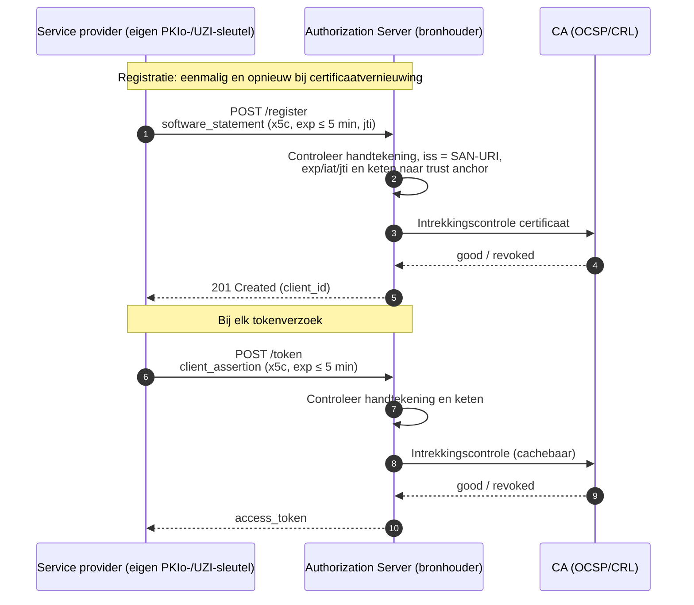

### Inleiding

Deze pagina werkt bouwsteen **B1 — Dynamic Client Registration** uit [Service provider en mandatering](authenticatie-service-provider-mandatering.html) verder uit. Een service provider (SP) moet zich bij veel authorization servers (AS) van bronhouders als *confidential client* kunnen registreren, zonder per koppeling handmatig te onboarden. De pagina beantwoordt twee vragen:

1. Bestaan er breed gebruikte standaarden of profielen voor (dynamische) clientregistratie in de zorg, in Europa of in meerdere Europese landen?
2. Wanneer wordt de handtekening van het *software statement* gewoonlijk gecontroleerd, en wordt daarbij en daarna gecontroleerd of het certificaat is ingetrokken?

Daarna worden de varianten met elkaar vergeleken. Net als de mandateringspagina is dit een technische verkenning en nog geen keuze.

> Peildatum van het bronnenonderzoek: 12 oktober 2026. Statussen zoals draft, STU en productie kunnen snel veranderen; zie de [bronnen](#bronnen).

### Samenvatting

- **Er is geen breed gebruikt Europees DCR-profiel voor de zorg.** Het enige volwassen zorgprofiel dat [RFC 7591](https://www.rfc-editor.org/rfc/rfc7591) met X.509-certificaten combineert, is het HL7 **UDAP Security IG**. Dat profiel wordt op schaal alleen in de Verenigde Staten gebruikt. Europese zorgspecificaties, zoals de EU Health Data API, IHE IUA en SMART Backend Services, gaan uit van **vooraf (out-of-band) geregistreerde clients**. Het Duitse gematik **ZETA** combineert RFC 7591 met client-attestatie, maar is nog niet geschikt voor productie.
- **In meerdere Europese landen worden vooral alternatieven voor DCR gebruikt.** PSD2/Berlin Group en iSHARE authenticeren de client **bij elk verzoek met een certificaat**, zonder aparte registratie. OpenID Federation 1.0 is sinds 2026 final, draait in Italië in productie en wordt in Duitsland ingevoerd voor de sectorale identity providers. UK Open Banking gebruikt RFC 7591 met een **software statement van een centrale directory**. Dat model is volwassen, maar beperkt tot één land.
- **Normaal wordt de handtekening van het software statement alleen bij registratie gecontroleerd**, en opnieuw bij herregistratie of wijziging. Bij latere tokenverzoeken wordt het software statement niet opnieuw meegestuurd. RFC 7591 laat het vertrouwensoordeel en de intrekking over aan het profiel.
- **De controle op certificaatintrekking verschilt sterk per profiel.** UDAP verplicht controle van de keten *en* de intrekkingsstatus bij registratie en bij elke clientauthenticatie op het tokenendpoint. RFC 8705 (mTLS) laat de intrekkingscontrole aan de AS over en FAPI 2.0 regelt haar niet. OpenID Federation kent geen CRL/OCSP, maar beperkt de geldigheid van de registratie tot de looptijd van de trust chain.
- **Het belangrijkste risico** ontstaat als de AS het certificaat alleen bij registratie controleert en daarna alleen de geregistreerde JWKS gebruikt. Een client met een ingetrokken certificaat kan dan tokens blijven krijgen. Dit vraagt een expliciete keuze in het profiel; zie de [aandachtspunten voor profilering](#aandachtspunten-voor-profilering).

### Begrippen

| Begrip | Betekenis op deze pagina |
|---|---|
| **Registratie** | Het bekendmaken van een client bij een AS, met metadata zoals `client_id`, grant types, authenticatiemethode en sleutels. Bij DCR gebeurt dit via een registration endpoint ([RFC 7591](https://www.rfc-editor.org/rfc/rfc7591)). |
| **Software statement** | Een ondertekend JWT met clientmetadata dat bij registratie wordt meegestuurd. De uitgever (`iss`) is de client zelf (UDAP) of een vertrouwde derde, zoals een directory. UK Open Banking noemt dit een *Software Statement Assertion* (SSA). |
| **Clientauthenticatie** | Het bewijs bij elk tokenverzoek dat de client de geregistreerde client is, bijvoorbeeld met `private_key_jwt` ([RFC 7523](https://www.rfc-editor.org/rfc/rfc7523)) of mTLS ([RFC 8705](https://www.rfc-editor.org/rfc/rfc8705)). |
| **Intrekkingscontrole** | Controle of een certificaat in de keten is ingetrokken, via OCSP ([RFC 6960](https://www.rfc-editor.org/rfc/rfc6960)) of een CRL ([RFC 5280](https://www.rfc-editor.org/rfc/rfc5280)). |
| **Trust anchor** | Het vertrouwde beginpunt. Dit kan een root-CA zijn (bijvoorbeeld PKIoverheid/UZI), een directory die software statements uitgeeft of een trust anchor van een federatie. |

DCR legt alleen de **technische identiteit** van de client vast. Het "namens"-verband tussen SP en zorgaanbieder valt daarbuiten en vereist een mandaat; zie O2, O3 of O4 op [Service provider en mandatering](authenticatie-service-provider-mandatering.html).

### Standaarden en profielen

#### Zorg

| Standaard of profiel | Registratiemodel | Status (oktober 2026) | Gebruik |
|---|---|---|---|
| [HL7 UDAP Security IG](https://hl7.org/fhir/us/udap-security/STU2/) v2.0.0, gebaseerd op [UDAP.org](https://www.udap.org/) | RFC 7591/7592 met een **door de client zelf ondertekend software statement** (`x5c`). Vertrouwen ontstaat via de certificaatketen naar een trust anchor van de *trust community*. | STU2, gepubliceerd in december 2025. In april 2026 is een *universal realm*-ballot verschenen onder de naam [FAST Security IG](https://hl7.org/fhir/uv/fast-security/) (3.0.0-ballot). | VS: onder meer TEFCA (Facilitated FHIR), Carequality, CARIN en Da Vinci. **Geen Europese adoptie gevonden.** |
| [SMART App Launch / Backend Services](https://hl7.org/fhir/smart-app-launch/backend-services.html) | **Geen** gestandaardiseerde registratie. De client geeft zijn publieke sleutel of JWKS-URL vooraf (out-of-band) door. | STU 2.2 | Wereldwijd het dominante patroon voor systeem-tot-systeemkoppelingen met FHIR. In Nederland gebruikt onder meer Koppeltaal 2.0 dit patroon. |
| [IHE IUA](https://profiles.ihe.net/ITI/IUA/) | Clientregistratie valt expliciet buiten scope; een beheerder registreert de client. | Trial Implementation | Veelgebruikt actormodel voor autorisatie; het regelt geen registratie. |
| [EU Health Data API](https://github.com/euridice-org/eu-health-data-api) (HL7 Europe/IHE Europe, voor de EHDS) | Neemt SMART Backend Services over, inclusief **out-of-band** clientregistratie. De motivatie is aansluiting bij wereldwijde specificaties en minder implementatielast. | Ballot/concept | Europees, nog niet in productie. |
| [gematik ZETA](https://github.com/gematik/zeta) (Duitsland, TI 2.0) | RFC 7591 DCR **plus client-attestatie** (onder meer TPM) en een client statement dat is ondertekend met de instellingskaart (SMC-B). | Specificatie voor fase 1. Volgens gematik **nog niet geschikt voor productie**, omdat de beveiligingstoets nog loopt. | Duitsland. Het duidelijkste Europese zorgvoorbeeld van RFC 7591. |
| [HelseID](https://selvbetjening.nhn.no/docs) (Noorwegen) | **Centrale AS** als vertrouwde derde, met selfservice voor clients. Een *multi-tenant*-client van een leverancier mag namens meerdere organisaties optreden nadat die via helsenettet.no een **fullmakt** (machtiging) hebben gegeven. | Productie | Noorwegen. Relevant voor het mandaatvraagstuk, maar geen DCR per AS. |
| Nederland: [MedMij](https://afsprakenstelsel.medmij.nl/), [Nuts](https://nuts-node.readthedocs.io/en/latest/pages/deployment/discovery.html) en Koppeltaal 2.0 | MedMij gebruikt een centraal gepubliceerde *OAuth Client List*. Nuts gebruikt DID's en verifiable credentials met een Discovery Service. Koppeltaal 2.0 gebruikt SMART Backend Services met vooraf geregistreerde sleutels. | MedMij en Nuts zijn in productie. | Geen van deze stelsels gebruikt RFC 7591. |

#### Europa, ook buiten de zorg

| Standaard of stelsel | Registratiemodel | Status | Landen of sector |
|---|---|---|---|
| [Berlin Group NextGenPSD2](https://www.berlin-group.org/standards/open-banking-nextgenpsd2/) onder PSD2 | **Geen registratie.** Bij elk verzoek worden eIDAS-certificaten gebruikt: een QWAC voor mTLS en een QSealC voor ondertekening. De identiteit komt uit het certificaat. | Productie | Bankensector in de hele EU. |
| [iSHARE](https://dev.ishare.eu/) | **Geen voorafgaande registratie** ("Clients MUST NOT be pre-registered"). Bij elk tokenverzoek wordt een `client_assertion` met `x5c` en een eIDAS-certificaat gestuurd. Daarnaast controleert de AS de status in het Participant Registry. | Productie | Datadeelstelsels voor onder meer logistiek, mobiliteit en agri. Nederlands geïnitieerd en in meerdere landen gebruikt; geen productiegebruik in de zorg gevonden. |
| [OpenID Federation 1.0](https://openid.net/specs/openid-federation-1_0.html) | **Automatische registratie**, waarbij de `client_id` de entity identifier is en de AS de trust chain oplost, of **expliciete registratie** via een registratie-endpoint van de federatie. | Final Specification (2026) | Productie in Italië ([SPID/CIE](https://github.com/italia/spid-cie-oidc-docs)). In Duitsland in invoering voor de sectorale identity providers (GesundheitsID). |
| [UK Open Banking DCR](https://openbankinguk.github.io/dcr-docs-pub/) | RFC 7591/7592 met een **SSA die de centrale Open Banking Directory uitgeeft**. | Productie | Verenigd Koninkrijk. Buiten Europa gebruiken Brazilië (Open Finance) en Australië (CDR) hetzelfde patroon. |
| [EUDI Wallet ARF](https://github.com/eu-digital-identity-wallet/eudi-doc-architecture-and-reference-framework) en [OpenID4VP](https://openid.net/specs/openid-4-verifiable-presentations-1_0.html) | Geen OAuth-DCR. Een nationale *registrar* registreert relying parties, die *access certificates* en *registration certificates* krijgen. In OpenID4VP gebeurt dit via `client_id`-prefixen zoals `x509_san_dns`, `verifier_attestation` en `openid_federation`. | ARF in ontwikkeling; OpenID4VP final | Alle EU-lidstaten (eIDAS 2.0). De uitrol verschilt per lidstaat. |
| [FAPI 2.0 Security Profile](https://openid.net/specs/fapi-security-profile-2_0.html) | Vereist `private_key_jwt` of mTLS, maar **definieert geen eigen registratieprofiel**. | Final | Basis onder Open Banking-stelsels. |
| [OAuth Attestation-Based Client Authentication](https://datatracker.ietf.org/doc/draft-ietf-oauth-attestation-based-client-auth/) | Een attester verklaart de client-instantie. Bij elk verzoek bewijst de client het bezit van de bijbehorende sleutel. | IETF-draft | Bedoeld voor onder meer wallet-architecturen; nog geen RFC. |

#### Conclusie

- In de zorg is **UDAP** het enige gestandaardiseerde DCR-profiel op basis van X.509 dat op schaal wordt gebruikt, maar alleen in de VS. Wie technisch wil aansluiten bij een bestaand zorgprofiel, komt bij UDAP uit. Er is nog geen Europese adoptie, maar met de universal-realm-ballot is het profiel niet langer alleen Amerikaans gepositioneerd.
- De Europese zorgspecificaties, de EU Health Data API en IHE IUA, kiezen **bewust voor SMART Backend Services met out-of-band registratie**. Het Duitse ZETA wijkt daarvan af: het gebruikt wel RFC 7591, maar met eigen attestatie-eisen.
- In meerdere Europese landen zijn twee patronen het meest gangbaar: **een certificaat bij elk verzoek zonder registratie** (PSD2/Berlin Group en iSHARE) en **federatieve registratie** (OpenID Federation). Klassieke DCR volgens RFC 7591 komt vooral voor met een **centrale uitgever van software statements** (UK Open Banking).

### Varianten

V1 tot en met V5 beschrijven manieren waarop een SP zich automatisch bij een AS registreert. V0, handmatige registratie, dient als referentie. In alle varianten gebruikt de SP een **eigen** sleutel en een eigen certificaat. Voor het "namens"-verband blijft een mandaat nodig: O2, O3 of O4.

#### V0 — Handmatige registratie (referentie)

De SP levert zijn metadata, zoals `jwks_uri`, certificaatkenmerken en grant type, buiten het protocol om aan. De beheerder van de AS legt de client vast. Dit is het model van SMART Backend Services, IHE IUA en de EU Health Data API.

- **Controle van het software statement:** niet van toepassing. Het vertrouwen ontstaat bij de handmatige beoordeling.
- **Intrekkingscontrole:** alleen als de AS bij clientauthenticatie het certificaat controleert, bijvoorbeeld via `x5c` of mTLS. Anders werkt een intrekking pas door wanneer de beheerder de client verwijdert.
- **Beoordeling:** dit model is eenvoudig en breed ondersteund, maar schaalt niet naar een netwerk met veel partijen. Registraties lopen bovendien uit de pas met certificaatvernieuwing en -intrekking.

#### V1 — Zelfondertekend software statement met X.509 (UDAP-profiel)

Deze variant is het uitgangspunt in [Authentication](authentication.html#dynamic-client-registration). De SP ondertekent het software statement met de sleutel van zijn eigen certificaat en neemt dat certificaat op in `x5c`. De AS bouwt de keten naar een vertrouwde trust anchor (UZI/PKIoverheid), controleert de intrekkingsstatus en registreert de client. UDAP koppelt de identiteit aan de URI in de *Subject Alternative Name* van het certificaat (`iss` is de SAN-URI). Het software statement is maximaal vijf minuten geldig en bevat een `jti`.

Bij elk volgend tokenverzoek authenticeert de client zich met een ondertekend JWT, waarin hij **opnieuw** `x5c` meestuurt (UDAP JWT-Based Client Authentication). De AS valideert dan opnieuw de keten, **inclusief de intrekkingsstatus**. Bij certificaatvernieuwing registreert de client opnieuw met dezelfde SAN-URI. De AS hoort dan dezelfde `client_id` terug te geven (SHOULD). Een registratie annuleert de client door opnieuw te registreren met een lege `grant_types`.

- **Beoordeling:** dit is een volwassen zorgprofiel met expliciete afspraken over controlemomenten en certificaatvernieuwing. Er is geen centrale partij nodig. Nadelen zijn de beperkte productondersteuning in Europa en de ketenvalidatie plus intrekkingscontrole die elke AS bij elk tokenverzoek moet uitvoeren.
- **Verschil met de huidige uitwerking:** [Authentication](authentication.html#dynamic-client-registration) registreert een `jwks_uri` en valideert latere tokenverzoeken via die JWKS. Het voorbeeld toont wel een intrekkingscontrole bij het tokenverzoek, maar specificeert niet hoe de AS bij een JWKS-sleutel het bijbehorende certificaat vindt. Als het stelsel het UDAP-gedrag wil, moet `x5c` in elke `client_assertion` worden opgenomen. Een alternatief is om het certificaat bij de registratie vast te leggen en zelf periodiek te controleren. Zie de [aandachtspunten voor profilering](#aandachtspunten-voor-profilering).

#### V2 — Software statement van een centrale stelselpartij (SSA-model)

Een centrale stelselpartij, bijvoorbeeld de beheerder van het afsprakenstelsel of een directory, beoordeelt de SP één keer bij toetreding. Daarna geeft die partij een ondertekend software statement (SSA) uit met de clientmetadata, zoals organisatie-identiteit, `jwks_uri`, toegestane grant types en rollen. De SP biedt de SSA aan bij het registration endpoint van elke AS. De AS controleert de handtekening van de SSA met de gepubliceerde sleutels van de stelselpartij; het SP-certificaat hoeft dan niet in de SSA te staan. Daarna authenticeert de client zich met mTLS of `private_key_jwt`. Dit model wordt gebruikt door UK Open Banking en, buiten Europa, door Brazilië en Australië.

- **Controle van het software statement:** bij registratie, met de JWKS van de uitgever en inclusief `exp`.
- **Intrekkingscontrole:** RFC 7591 en de Britse specificatie leggen geen controlemoment na registratie vast. De Open Banking Directory biedt OCSP, een CRL en een JWKS met actieve sleutels. Elke AS bepaalt zelf hoe vaak hij die raadpleegt en hoe lang hij resultaten cachet. Een SP die uit het stelsel wordt verwijderd, wordt bij een AS pas geweigerd als die AS de status opnieuw controleert.
- **Beoordeling:** de deelnemerstoets vindt op één plek plaats en een AS hoeft maar één uitgeverssleutel te vertrouwen. De SSA kan rollen of stelselattributen bevatten die niet in een certificaat staan. Daar staat tegenover dat het stelsel een centrale uitgever nodig heeft (alleen bij registratie, niet per transactie) en een statusmechanisme om intrekking te laten doorwerken. Buiten het Verenigd Koninkrijk wordt dit model in Europa weinig gebruikt.
- **Raakvlak met mandatering:** een SSA kan ook de zorgaanbieders noemen namens wie de SP optreedt. Mandaten veranderen echter vaker dan clientmetadata. Dan moet de SSA steeds opnieuw worden uitgegeven en moet de registratie bij elke AS worden bijgewerkt. Een apart mandaat (O2 of O3) ligt daarom meer voor de hand.

#### V3 — OpenID Federation (automatische of expliciete registratie)

De SP is een *leaf entity* in een federatie; zie O4 op [Service provider en mandatering](authenticatie-service-provider-mandatering.html). Bij **automatische registratie** is de `client_id` de entity identifier van de SP. De AS lost de trust chain naar de trust anchor op en past metadata policies toe; een aparte registratiestap ontbreekt. Bij **expliciete registratie** stuurt de SP zijn entity configuration of trust chain naar een registratie-endpoint en krijgt hij een `client_id`. De specificatie noemt toepassing in pure OAuth- en FAPI-omgevingen expliciet. Voor de `client_credentials`-grant, waarbij geen authorization request plaatsvindt, moet het stelselprofiel vastleggen dat de AS de trust chain oplost bij een tokenverzoek van een onbekende client of een client met een verlopen trust chain.

- **Controle van handtekeningen:** alle entity statements in de trust chain worden gecontroleerd bij registratie of resolutie. De resultaten mogen tot `exp` worden gecachet. Daarna moet het vertrouwen opnieuw worden vastgesteld.
- **Intrekkingscontrole:** OpenID Federation "does not define a revocation process". Een superior trekt vertrouwen in door geen nieuw subordinate statement meer uit te geven; daarnaast beperken korte looptijden de duur van het vertrouwen. De geldigheid van een registratie mag de looptijd van de trust chain niet overschrijden. Voor gecompromitteerde sleutels is er een *historical keys*-endpoint en voor trust marks een status-endpoint.
- **Beoordeling:** dit model is generiek, wordt in Europa gebruikt (Italië en Duitsland) en is ontworpen voor stelsels met meerdere lagen. Het stelsel moet wel een trust anchor, intermediates en beleid inrichten. De vertraging bij intrekking hangt af van de gekozen looptijd van de statements, bijvoorbeeld enkele uren, en niet van een OCSP-antwoord. Een koppeling met UZI/PKIoverheid is optioneel, bijvoorbeeld als toelatingseis voor een subordinate statement.

#### V4 — Geen registratie: certificaat bij elk verzoek (iSHARE/PSD2-patroon)

De AS registreert de client niet vooraf. De client stuurt bij elk tokenverzoek een `client_assertion` met `x5c` of authenticeert zich met `tls_client_auth`. De AS leidt de clientidentiteit af uit het certificaat, bijvoorbeeld het OIN of URA-nummer. Daarna valideert de AS de keten en de intrekkingsstatus en maakt hij zo nodig zelf een clientrecord aan. In iSHARE controleert de AS daarnaast in het Participant Registry of de deelnemer actief is. Een client assertion is daar maximaal 30 seconden geldig.

- **Controle van het software statement:** niet van toepassing, want er is geen software statement. De AS controleert elke `client_assertion` afzonderlijk.
- **Intrekkingscontrole:** dit kan bij elk verzoek. iSHARE verwijst voor certificaatcontrole naar "best practices ... (such as a check on revocation lists)", maar schrijft de statuscontrole van de deelnemer bij elk verzoek expliciet voor. Bij mTLS laat RFC 8705 de intrekkingscontrole aan de AS over.
- **Beoordeling:** dit is het eenvoudigste model en wordt in meerdere Europese landen gebruikt. Een intrekking werkt direct door, omdat er geen registratie is die geldig kan blijven. Er is wel geen gestandaardiseerde plek voor clientmetadata, zoals toegestane `authorization_details_types` en scopes; die moeten uit het certificaat, een register of stelselafspraken komen. Veel standaard AS-producten verwachten bovendien vooraf geregistreerde clients, terwijl reviewers van de memo juist om een bekende *confidential client* vroegen. Dat is op te vangen als de AS bij het eerste geldige verzoek automatisch een client aanmaakt (*registratie bij eerste gebruik*).

#### V5 — DCR met client-attestatie (ZETA-patroon, in opkomst)

Bij deze variant registreert de client zich volgens RFC 7591 met een verklaring die is ondertekend met het organisatiecertificaat. Daarnaast levert hij een **attestatie van de client-instantie**, bijvoorbeeld van een sleutel in een TPM of HSM. Bij elk tokenverzoek controleert de AS de client assertion en het DPoP-bewijs. In ZETA controleert de AS daarbij ook de intrekkingsstatus van het organisatiecertificaat via OCSP. De IETF-draft *Attestation-Based Client Authentication* standaardiseert een vergelijkbaar mechanisme, maar laat vertrouwen in de attester en intrekking buiten scope.

- **Beoordeling:** deze variant geeft naast zekerheid over de organisatie ook zekerheid over het concrete systeem of de client-instantie. Dat versterkt de herleidbaarheid (NEN 7513). De standaarden zijn echter nog jong: de IETF-specificatie is een draft en ZETA is nog niet in productie. Attestatie past vooral bij centraal beheerde clients. Voor server-naar-serverkoppelingen tussen SP en bronhouder is de meerwaarde ten opzichte van V1 of V4 met een HSM-sleutel beperkter.

### Wanneer worden handtekening en intrekkingsstatus gecontroleerd?

#### Gangbare praktijk

1. **De handtekening van het software statement wordt bij registratie gecontroleerd.** RFC 7591 behandelt het software statement als onderdeel van het registratieverzoek; de AS beoordeelt het op dat moment. Als de AS de uitgever vertrouwt, hebben de waarden in het statement voorrang op losse metadata. Op welke criteria de AS vertrouwt, laat RFC 7591 aan het profiel over: "The criteria by which authorization servers determine whether to trust and utilize the information in a software statement are outside the scope of this specification." Bij tokenverzoeken wordt het software statement niet opnieuw meegestuurd en dus ook niet opnieuw gecontroleerd. Een nieuwe controle volgt pas bij herregistratie of wijziging, bijvoorbeeld via [RFC 7592](https://www.rfc-editor.org/rfc/rfc7592) of via een UDAP-herregistratie na certificaatvernieuwing.
2. **De keten en intrekkingsstatus worden normaal ook bij registratie gecontroleerd** als het vertrouwen op X.509 berust. UDAP schrijft dit expliciet voor: "including certificate validity and revocation status checking". Pathvalidatie volgens RFC 5280 omvat de controle dat het certificaat "at the current time" niet is ingetrokken.
3. **Na registratie hangt het van de methode voor clientauthenticatie af** of het certificaat opnieuw wordt gecontroleerd:
   - **`private_key_jwt` met `x5c` (UDAP, iSHARE):** de keten wordt bij **elk** tokenverzoek opnieuw gecontroleerd. UDAP schrijft daarbij ook een controle van de intrekkingsstatus voor.
   - **`private_key_jwt` met een geregistreerde JWKS:** alleen de handtekening wordt gecontroleerd. Het certificaat speelt dan geen rol meer, tenzij het profiel dat expliciet regelt.
   - **mTLS (`tls_client_auth`):** de keten wordt bij de TLS-handshake gevalideerd, maar "if and how to check a certificate's revocation status is a deployment decision at the discretion of the authorization server" ([RFC 8705](https://www.rfc-editor.org/rfc/rfc8705)).
   - **OpenID Federation:** het vertrouwen wordt opnieuw vastgesteld zodra de trust chain verloopt; CRL of OCSP wordt niet gebruikt.

| Variant of standaard | Controle handtekening software statement | Keten en intrekking bij registratie | Intrekking bij tokenverzoek | Effect van intrekking op een bestaande registratie |
|---|---|---|---|---|
| RFC 7591/7592 zonder profiel | Bij registratie of wijziging | Niet gespecificeerd; dit regelt het profiel | Niet gespecificeerd | Geen automatisch effect; alleen een expliciete `DELETE` (RFC 7592) |
| **V1** UDAP | Bij registratie (`exp` ≤ 5 min, `jti`) | **Verplicht** | **Verplicht** bij elke clientauthenticatie met `x5c` | Het volgende tokenverzoek wordt geweigerd |
| **V2** SSA (UK Open Banking) | Bij registratie, met de JWKS van de directory | Bepaald door profiel of directory | Niet voorgeschreven; de directory biedt OCSP, een CRL en een JWKS en de AS kiest frequentie en caching | Werkt pas door na een statuscontrole door de AS |
| **V3** OpenID Federation | Bij resolutie van de trust chain; cache tot `exp` | Controle van de trust chain; geen X.509-intrekking | Opnieuw zodra de trust chain is verlopen | Uiterlijk wanneer de trust chain verloopt |
| **V4** iSHARE / certificaat bij elk verzoek | Niet van toepassing; assertion bij elk verzoek, maximaal 30 seconden geldig | Niet van toepassing | De keten bij elk verzoek; intrekking als "best practice"; de deelnemersstatus bij elk verzoek | Het volgende verzoek wordt geweigerd na de statuscontrole |
| **V5** ZETA (draft) | Bij registratie (attestatie en client statement) | De attestatieketen bij registratie | **OCSP-controle van het organisatiecertificaat bij elk tokenverzoek** | Het volgende tokenverzoek wordt geweigerd |
| FAPI 2.0 | Geen eigen eis | Geen eigen eis | Geen eigen eis; verwijst naar RFC 8705 of `private_key_jwt` | Niet geregeld |

#### Risico van controle alleen bij registratie

Als de AS het certificaat alleen bij registratie controleert en daarna uitsluitend een geregistreerde JWKS gebruikt, ontstaan de volgende risico's:

- Een SP met een **ingetrokken** certificaat, bijvoorbeeld na een gecompromitteerde sleutel of beëindigde deelname, kan tokens blijven krijgen zolang de sleutel in de JWKS staat.
- Elke AS moet een intrekking afzonderlijk verwerken. RFC 7592 kent alleen een `DELETE` die de client zelf initieert.
- Registraties lopen uit de pas met certificaatvernieuwing.

Dit risico speelt bij V0 en V2, en bij de huidige uitwerking in [Authentication](authentication.html#dynamic-client-registration), tenzij het profiel aanvullende eisen stelt.

#### Aandachtspunten voor profilering

Ongeacht de gekozen variant zijn de volgende afspraken nodig om controlemomenten en intrekking eenduidig te regelen:

1. **Koppel de registratie aan het certificaat** en niet alleen aan een JWKS. Leg bij registratie de identiteit (bijvoorbeeld SAN-URI, OIN of URA-nummer) en de certificaatketen vast, en laat de registratie uiterlijk op de `notAfter` van het certificaat verlopen.
2. **Controleer het certificaat bij clientauthenticatie.** Eis bijvoorbeeld `x5c` in elke `client_assertion` en valideer de keten en de intrekkingsstatus (UDAP-gedrag). Bij mTLS kan de AS de intrekkingsstatus van het clientcertificaat controleren.
3. **Leg cachetermijnen en het gedrag bij storingen vast.** Bepaal hoe lang een OCSP-antwoord of CRL mag worden gecachet en wat de AS doet als de OCSP-responder of CRL niet beschikbaar is: de toegang weigeren (*fail-closed*) of beperkt doorlaten (*fail-open*). Zo blijft een intrekkingscontrole bij elk verzoek haalbaar en voorspelbaar. In TLS 1.3 kan de server de client vragen een OCSP-antwoord mee te sturen ([RFC 8446](https://www.rfc-editor.org/rfc/rfc8446), §4.4.2.1). Of gateways en TLS-stacks dit ondersteunen, moet per product worden vastgesteld.
4. **Gebruik kortlevende software statements en assertions** met `exp` (in UDAP maximaal vijf minuten) en een replaycontrole op `jti`.
5. **Regel vernieuwing en beëindiging.** Na certificaatvernieuwing registreert de client opnieuw met behoud van de `client_id` (UDAP). Beëindiging gebeurt via `DELETE` volgens RFC 7592 of via UDAP-annulering met een lege `grant_types`. Daarnaast moet de AS zelf registraties kunnen opschonen waarvan het certificaat is ingetrokken.
6. **Stel publicatietermijnen voor intrekkingen vast.** Er is geen openbaar document gevonden dat vastlegt hoe snel een intrekking van een UZI-servercertificaat in de CRL of via OCSP zichtbaar is. Dit moet worden nagevraagd bij het UZI-register/CIBG en PKIoverheid, omdat dit bepaalt hoe snel een intrekking in elke variant op zijn vroegst kan doorwerken.
7. **Houd het mandaat los van de registratie.** De registratie legt vast *wie* de client is; het mandaat (O2, O3 of O4) legt vast *namens wie* hij optreedt. Zo kan een mandaat worden ingetrokken zonder dat de registratie of het certificaat verandert, en omgekeerd.

### Vergelijking

De vergelijking gebruikt de criteria van [Service provider en mandatering](authenticatie-service-provider-mandatering.html). Voor **beveiliging**, **duurzaamheid** en **performance** betekent Hoog een gunstige score. **Implementatie-inspanning** wordt uitgedrukt als Beperkt, Gemiddeld of Groot; minder inspanning is gunstiger. **Gebruik in Europa** geeft aan in welke mate het patroon in Europa wordt toegepast.

| Variant | Beveiliging | Implementatie-inspanning | Duurzaamheid | Performance | Gebruik in Europa |
|---|---|---|---|---|---|
| **V0** Handmatig | Midden | Beperkt per koppeling; Groot bij opschaling | Midden | Hoog | Hoog (SMART, IUA, EU Health Data API) |
| **V1** UDAP (zelfondertekend, X.509) | Hoog | Gemiddeld | Midden/Hoog | Midden | Laag (alleen in de VS in productie) |
| **V2** Centrale SSA | Midden/Hoog | Gemiddeld; vereist een centrale uitgever | Midden | Hoog | Midden (VK; buiten Europa ook Brazilië en Australië) |
| **V3** OpenID Federation | Hoog | Groot voor het stelsel; Beperkt tot Gemiddeld per deelnemer | Hoog | Midden/Hoog | Midden (productie in Italië, invoering in Duitsland) |
| **V4** Certificaat bij elk verzoek | Midden/Hoog | Beperkt voor het protocol; Gemiddeld voor AS-producten | Hoog | Midden | Hoog (PSD2 in de hele EU, iSHARE) |
| **V5** DCR met attestatie | Hoog | Groot | Midden | Midden | Laag (Duitsland, nog niet in productie) |

- **Beveiliging:** de scores voor V1 en V4 gaan ervan uit dat de AS bij elk verzoek de intrekkingsstatus controleert. Zonder die controle wordt de score Midden. Bij V2 hangt de score af van de statuscontrole door de AS.
- **Performance:** V1, V4 en V5 scoren Midden, omdat de AS bij elk tokenverzoek de keten valideert en OCSP raadpleegt. Door OCSP-antwoorden te cachen en access tokens tot hun `exp` te hergebruiken, blijft de extra belasting beperkt.

### Observaties

- V1 en V4 liggen technisch dicht bij elkaar. In beide varianten authenticeert de client zich bij elk verzoek met `x5c`; V1 voegt een expliciete registratie met metadata toe. Een **combinatie** is denkbaar: UDAP-registratie voor metadata en een bekende `client_id`, aangevuld met een certificaatcontrole zoals in UDAP bij elk tokenverzoek. Zo krijgen reviewers de gevraagde bekende *confidential client* en werkt een intrekking direct door.
- V2 en V3 leggen het vertrouwen niet meer primair bij de certificaatketen, maar bij een **stelselpartij**: een directory of trust anchor. Intrekking verloopt dan via de status bij die partij of via korte looptijden, in plaats van via OCSP of een CRL. Dit sluit aan bij O3 en O4 op [Service provider en mandatering](authenticatie-service-provider-mandatering.html).
- Voor **Europese aansluiting** wegen het iSHARE/PSD2-patroon (V4) en OpenID Federation (V3) het zwaarst. UDAP (V1) is het enige uitgewerkte *zorg*profiel, maar wordt in Europa nog niet gebruikt.

### Open vragen

- Welk certificaat vormt de trust anchor voor de SP: een UZI-servercertificaat, een PKIoverheid-organisatiecertificaat (OIN/KvK) of beide?
- Welke publicatietermijnen en beschikbaarheidsgaranties gelden voor de CRL en OCSP van UZI-servercertificaten?
- Welke gangbare AS-producten en gateways ondersteunen UDAP-registratie, clients zonder voorafgaande registratie (V4) of OpenID Federation?
- Gebeurt registratie bilateraal per AS (V1 of V4) of via een centrale stelselpartij (V2 of V3)?

### Bronnen

Geraadpleegd op 12 oktober 2026.

- IETF: [RFC 7591](https://www.rfc-editor.org/rfc/rfc7591) (Dynamic Client Registration), [RFC 7592](https://www.rfc-editor.org/rfc/rfc7592) (beheer van registraties), [RFC 7523](https://www.rfc-editor.org/rfc/rfc7523) (JWT-clientauthenticatie), [RFC 8705](https://www.rfc-editor.org/rfc/rfc8705) (mTLS-clientauthenticatie), [RFC 5280](https://www.rfc-editor.org/rfc/rfc5280) (X.509 en CRL), [RFC 6960](https://www.rfc-editor.org/rfc/rfc6960) (OCSP), [RFC 8446](https://www.rfc-editor.org/rfc/rfc8446) (TLS 1.3) en de draft [OAuth Attestation-Based Client Authentication](https://datatracker.ietf.org/doc/draft-ietf-oauth-attestation-based-client-auth/).
- HL7/UDAP: [UDAP Security IG STU2](https://hl7.org/fhir/us/udap-security/STU2/) (v2.0.0, december 2025), [FAST Security IG](https://hl7.org/fhir/uv/fast-security/) (3.0.0-ballot, april 2026), [UDAP Dynamic Client Registration](https://www.udap.org/udap-dynamic-client-registration-stu1.html) en [UDAP JWT-Based Client Authentication](https://www.udap.org/udap-jwt-client-auth-stu1.html).
- HL7/IHE: [SMART Backend Services](https://hl7.org/fhir/smart-app-launch/backend-services.html), [IHE IUA](https://profiles.ihe.net/ITI/IUA/) en [EU Health Data API](https://github.com/euridice-org/eu-health-data-api).
- OpenID Foundation: [OpenID Federation 1.0](https://openid.net/specs/openid-federation-1_0.html), [FAPI 2.0 Security Profile](https://openid.net/specs/fapi-security-profile-2_0.html) en [OpenID for Verifiable Presentations 1.0](https://openid.net/specs/openid-4-verifiable-presentations-1_0.html).
- Europa en andere landen: [gematik ZETA](https://github.com/gematik/zeta) en [gemSpec_ZETA](https://gemspec.gematik.de/docs/gemSpec/gemSpec_ZETA/latest/), [HelseID](https://selvbetjening.nhn.no/docs), [SPID/CIE OIDC Federation](https://github.com/italia/spid-cie-oidc-docs), [UK Open Banking DCR](https://openbankinguk.github.io/dcr-docs-pub/), [Berlin Group NextGenPSD2](https://www.berlin-group.org/standards/open-banking-nextgenpsd2/), [iSHARE](https://dev.ishare.eu/) en [EUDI Wallet ARF](https://github.com/eu-digital-identity-wallet/eudi-doc-architecture-and-reference-framework).
- Nederland: [MedMij-afsprakenstelsel](https://afsprakenstelsel.medmij.nl/) en [Nuts Discovery](https://nuts-node.readthedocs.io/en/latest/pages/deployment/discovery.html).
