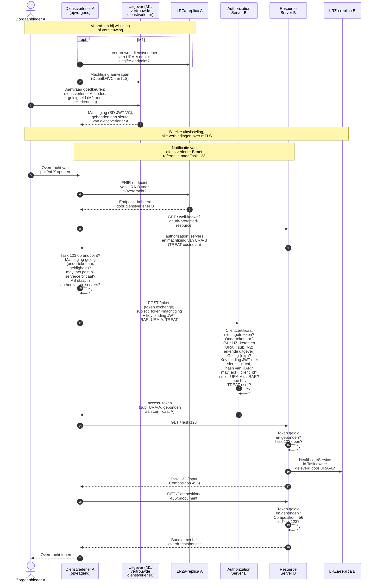

**Concept** · 27 oktober 2026

Deze notitie is een vervolg op de notitie [*Harmonisatie van authenticatie en autorisatie voor de gegevensuitwisselingen BgZ en eOverdracht*](https://build.fhir.org/ig/minvws/generiekefuncties-docs/branches/authn-for-push/en/authenticatie-en-autorisatie-eOverdracht-BgZ-vMT-DICIO-20260818.html) (versie 0.95, hierna: de notitie). Op het concept van de notitie zijn reacties ontvangen van onder meer Silizo, ChipSoft, Twiin, UMCG, Nedap, de Nuts Kring Techniek, VZVZ (AORTA/LSP) en RSO Nederland. Twee punten komen in vrijwel alle inhoudelijke reacties terug en deze zijn de focus voor dit document:


- **Sleutelbeheer en machtiging.** De notitie laat de zorgaanbieder het tokenrequest én het access token ondertekenen met de sleutel van zijn UZI-servercertificaat. In de praktijk beheert vaak een dienstverlener die sleutel: een leverancier, SaaS-platform of knooppunt. Reviewers vinden dat onwenselijk en stellen voor dat de dienstverlener met een eigen identiteit handelt, op basis van een machtiging van de zorgaanbieder.
- **Clientregistratie.** De notitie beschrijft niet hoe een authorization server een OAuth-client herkent. FAPI 2.0 gaat uit van een bekende *confidential client*, en handmatige, bilaterale registratie schaalt niet in een netwerk met veel partijen.

Deze notitie geeft een voorstel ter aanscherping van hoofdstuk 6 (*Technische keuzes en onderbouwing*) van de notitie. Het juridisch kader (hoofdstuk 4) en de eisen en GISA-uitgangspunten (hoofdstuk 5) blijven ongewijzigd. Voor deze uitwerking zijn diverse verkenningen gedaan naar vormen van serviceprovider-machtiging, (dynamic) client registration, en zelfs verkenning van andere frameworks (o.a. iSHARE, PSD2 en OpenID Federation).


Bij de keuze voor machtiging zijn er in [§2.2](#22-machtiging-in-plaats-van-ondertekening-door-de-zorgaanbieder) een vijftal alternatieven opgesteld, waar een afweging gemaakt kan worden op een aantal aspecten, bijvoorbeeld:
- wat moet een zorgaanbieder(en dienstverlener) doen voor een machtiging? (eenmalig en/of periodiek)
- welke operationele afhankelijkheden worden er geintroduceerd door een machtiging?
- welke beveiligingsmaatregelen kunnen/moeten er gerealiseerd worden? (b.v. het effect van een gecompromitteerde actor)
- moet de machtiging een afbakening/scope hebben? Zo ja; welke? ([zie §2.3](#23-voorstel-voor-machtigingscodes))

Deze lijst met alternatieven is niet uitputtend; er zijn ongetwijfeld meerdere varianten te verzinnen. Bij de keuze voor client registratie, in [§2.4](#24-registratie-van-oauth-clients), is er vooral de keuze tussen:
- dynamische/automatische registratie waarbij metadata van de client vastgelegd kan worden OF 
- geen registratie, maar identificatie van de client d.m.v. het client-certificaat (mTLS).

Paragraaf 2.5 t/m 2.7 geven de mogelijke wijzigingen aan de kant van de client, server en in de transactie (b.v. welke 'OAuth grant'). Dit lijken geen fundamentele keuzes, maar wel technische keuzes en aanpassingen n.a.v. keuzes in 2.2 t/m 2.4.


{: .ig-lead}

# Documenthistorie

| Versie | Status | Datum | Auteur | Wijziging |
|--------|--------|-------|--------|-----------|
| 0.1.0 | Concept | 16 oktober 2026 | VWS | eerste versie voor review expertgroep|
| 0.2.0 | Concept | 27 oktober 2026 | VWS | aanpassing variant M1 en M2 n.a.v. expertgroep op 23 oktober |

# Inhoudsopgave

- [Rollen: zorgaanbieder en dienstverlener](#1-rollen-zorgaanbieder-en-dienstverlener)
- [Gewijzigde technische keuzes](#2-gewijzigde-technische-keuzes)
  - [2.1 Ongewijzigde keuzes](#21-ongewijzigde-keuzes)
  - [2.2 Machtiging in plaats van ondertekening door de zorgaanbieder](#22-machtiging-in-plaats-van-ondertekening-door-de-zorgaanbieder)
  - [2.3 Voorstel voor machtigingscodes](#23-voorstel-voor-machtigingscodes)
  - [2.4 Registratie van OAuth-clients](#24-registratie-van-oauth-clients)
  - [2.5 Clientauthenticatie van de dienstverlener: mTLS](#25-clientauthenticatie-van-de-dienstverlener-mtls)
  - [2.6 Access token: uitgifte door de authorization server van de bron](#26-access-token-uitgifte-door-de-authorization-server-van-de-bron)
  - [2.7 Grant en RAR-object](#27-grant-en-rar-object)

- [Verantwoordelijkheid van de bron en NEN 7512](#3-verantwoordelijkheid-van-de-bron-en-nen-7512)
- [Bijlage A: technische uitwerking](#bijlage-a-technische-uitwerking)
  - [A.1 Machtiging als attestatie (M1 en M2)](#a1-machtiging-als-attestatie-m1-en-m2)
  - [A.2 Clientidentificatie uit het certificaat (R2)](#a2-clientidentificatie-uit-het-certificaat-r2)
  - [A.3 mTLS en access token](#a3-mtls-en-access-token)
  - [A.4 RAR-object](#a4-rar-object)
  - [A.5 Voorbeeld: ophalen van een verpleegkundige overdracht](#a5-voorbeeld-ophalen-van-een-verpleegkundige-overdracht)
- [Bijlage B: attestaties in de European Business Wallet](#bijlage-b-attestaties-in-de-european-business-wallet)


# 1. Rollen: zorgaanbieder en dienstverlener
De oorspronkelijke notitie maakt geen onderscheid tussen de zorgaanbieder en de partij die de techniek levert. Dit voorstel onderscheidt twee rollen:

- **Zorgaanbieder:** de verwerkingsverantwoordelijke, geïdentificeerd met het URA. De zorgaanbieder bepaalt welke dienstverlener namens hem mag handelen en voor welke doelen (paragraaf 2.3).
- **Dienstverlener:** de partij die de technische voorziening levert en beheert, zoals een EPD-leverancier, SaaS-platform, knooppunt, of de zorgaanbieder zelf bij eigen beheer. Aan de opvragende kant beheert de dienstverlener de OAuth-client, aan de bronkant de authorization server en de resource server. De dienstverlener heeft een eigen certificaat, bijvoorbeeld een PKIoverheid-servercertificaat met zijn KvK-nummer of OIN.

Eén dienstverlener handelt doorgaans namens veel zorgaanbieders, en één zorgaanbieder kan meerdere dienstverleners hebben. De machtiging legt per combinatie vast wat de dienstverlener mag.

Dit past bij GISA-keuze A44: het vertrouwen op de transportlaag ligt bij de verantwoordelijken voor de verbinding (de dienstverleners), het vertrouwen tussen verzender en ontvanger van gezondheidsgegevens op de applicatielaag (de machtiging). Het uitvoerende systeem wordt daarmee een herkenbare technische actor in de transactie en kan daardoor ook meegenomen worden in de logging.

# 2. Gewijzigde technische keuzes

## 2.1 Ongewijzigde keuzes
De volgende keuzes uit de notitie blijven van kracht: **OAuth 2.0** als basis; de beveiligingsmaatregelen uit **FAPI 2.0** (asymmetrische clientauthenticatie, *sender-constrained* access tokens, verplichte transportbeveiliging en strikte validatie); **Rich Authorization Requests** (RAR, [RFC 9396](https://www.rfc-editor.org/rfc/rfc9396)) voor zorgspecifieke attributen; en **mTLS op de transportlaag**, voorlopig met UZI-servercertificaten of PKIoverheid-certificaten.

## 2.2 Machtiging in plaats van ondertekening door de zorgaanbieder
Omdat niet elke dienstverlener het UZI-servercertificaat en de sleutel van de zorgaanbieder heeft, en dat ook niet wenselijk is, gaat het machtigingsprincipe uit van ondertekening van het tokenrequest door de dienstverlener zelf. De machtiging zorgt voor het vertrouwen tussen verzender en ontvanger van gezondheidsgegevens: die legt vast dat de zorgaanbieder de dienstverlener heeft aangewezen om namens hem te handelen.

Een machtiging bevat in alle varianten dezelfde gegevens. Die sluiten aan op de [`OrganizationAffiliation`](https://build.fhir.org/ig/minvws/generiekefuncties-docs/branches/authn-for-push/en/StructureDefinition-nl-gf-organizationaffiliation.html) uit de [Care Service Directory](https://build.fhir.org/ig/minvws/generiekefuncties-docs/branches/authn-for-push/en/csd.html), die in de LRZa al wordt gebruikt om dienstverleners te machtigen voor het beheer van adresgegevens.

| Gegeven | Machtiging als attestatie (M1 en M2) | `OrganizationAffiliation` (M3 tot en met M5) |
|---|---|---|
| Zorgaanbieder (machtiginggever) | `sub` (URA) | `organization` |
| Dienstverlener (gemachtigde) | `may_act.sub` (de `client_id`, bijvoorbeeld KvK-nummer; paragraaf 2.4) | `participatingOrganization` |
| Reikwijdte | `scope` (machtigingscodes, paragraaf 2.3) | `code` |
| Geldigheid | `nbf` en `exp` (ten hoogste 3 maanden) | `period` en `active` |
| Unieke referentie | `jti` | `identifier` |
| Ondertekenaar | `iss` en `x5c`: bij M1 de vertrouwde dienstverlener, met het UZI-certificaat van de zorgaanbieder; bij M2 een erkende uitgever | Zorgaanbieder via het LRZa-portaal; geauthenticeerd door eHerkenning. Bij M4 en M5 daarnaast een ondertekende `Provenance` |


### M0 — Dienstverlener ondertekent met het UZI-certificaat van de zorgaanbieder
De zorgaanbieder vraagt een UZI-servercertificaat aan en laat de sleutel beheren door de dienstverlener, die daarmee optreedt *als* de zorgaanbieder. Dit is de opzet zoals die in de originele notitie staat en dient hier als referentie/baseline.

- *Voordelen:* geen nieuwe techniek; het URA zit in het certificaat en de intrekking verloopt via het UZI-register.
- *Nadelen:* de dienstverlener beheert de private sleutel van de zorgaanbieder en is cryptografisch niet van hem te onderscheiden; meerdere dienstverleners betekent meerdere certificaten of een gedeelde sleutel; compromittering van een dienstverlener raakt al zijn zorgaanbieders. Hiertegen maken de meeste reacties bezwaar.

### M1 — Vertrouwde dienstverlener geeft machtigingen uit met de UZI-sleutel van de zorgaanbieder
De zorgaanbieder wijst één vertrouwde dienstverlener aan, bijvoorbeeld zijn EPD-leverancier, of voert deze rol zelf uit. Die heeft de beschikking over het UZI-servercertificaat van de zorgaanbieder en de sleutel daarvan, en geeft daarmee namens de zorgaanbieder machtigingen uit: aan zichzelf en aan de andere dienstverleners van de zorgaanbieder. Andere dienstverleners hebben dus geen UZI-certificaat of sleutel van de zorgaanbieder nodig; zij halen hun machtiging op bij de vertrouwde dienstverlener. De machtiging heeft de vorm van een attestatie zoals een European Business Wallet (EBW) die straks kan uitgeven ([bijlage B](#bijlage-b-attestaties-in-de-european-business-wallet)). De technische uitwerking, met een voorbeeld, staat in [bijlage A.1](#a1-machtiging-als-attestatie-m1-en-m2).

- **Uitgifte.** Een andere dienstverlener vraagt de machtiging aan bij de vertrouwde dienstverlener en authenticeert zich met zijn certificaat. De zorgaanbieder keurt de aanvraag goed, met de machtigingscodes en de geldigheid, bijvoorbeeld in de applicatie van de vertrouwde dienstverlener. De vertrouwde dienstverlener legt elke goedkeuring vast en biedt de zorgaanbieder een overzicht van zijn machtigingen.
- **Attestatie.** De machtiging is een attestatie (SD-JWT VC) met de gegevens uit de tabel hierboven. De vertrouwde dienstverlener ondertekent haar met de sleutel van het UZI-servercertificaat van de zorgaanbieder.
- **Aanwijzing in de LRZa.** De zorgaanbieder legt in het LRZa-portaal vast met welk `Endpoint` machtigingen kunnen worden aangevraagd. Andere dienstverleners vinden dit `Endpoint` in hun LRZa-replica. De LRZa dient alleen om die te vinden; de controle van een machtiging steunt op de ondertekening.
- **Binding aan de dienstverlener.** De machtiging is gebonden aan een sleutel van de gemachtigde dienstverlener. Bij elk tokenrequest stuurt hij haar mee en ondertekent hij het verzoek, inclusief het RAR-object, met die sleutel. Zo is het verzoek achteraf aantoonbaar (paragraaf 2.5).
- **Controle.** De authorization server controleert de handtekening met het UZI-certificaat van de zorgaanbieder, de geldigheid van de machtiging, en of de machtiging past bij de geauthenticeerde dienstverlener en het doel van het verzoek. De opvragende dienstverlener controleert de machtiging van de bron op dezelfde manier (paragraaf 2.6).
- **Geldigheid en intrekking.** Een machtiging is ten hoogste 3 maanden geldig. Zolang de goedkeuring van de zorgaanbieder geldt, vernieuwt de vertrouwde dienstverlener de machtiging automatisch, zonder nieuwe goedkeuring. Trekt de zorgaanbieder zijn goedkeuring in, bijvoorbeeld omdat hij de samenwerking met een dienstverlener beëindigt, dan wordt de machtiging niet meer vernieuwd en vervalt zij uiterlijk na 3 maanden. Een statuslijst voor tussentijdse intrekking wordt voorlopig niet gebruikt, omdat de specificatie daarvan nog een draft is. Moet een dienstverlener direct worden afgesloten, dan kan dat alleen door zijn certificaat in te trekken; dat sluit hem af voor alle zorgaanbieders. Intrekking van het UZI-certificaat van de zorgaanbieder maakt al diens machtigingen ongeldig.
- **Invoering op korte termijn.** M1 bouwt voort op wat er al is, en vraagt geen nieuwe partij of nieuw vertrouwensstelsel:
  - Veel zorgaanbieders laten hun UZI-servercertificaat nu al beheren door één leverancier (M0). Die leverancier kan de rol van vertrouwde dienstverlener op zich nemen.
  - Het vertrouwen steunt op het UZI-register, dat wettelijk is verankerd (Wabvpz) en waarvan dienstverleners de certificaten nu al controleren. Er hoeven geen nieuwe of andere uitgevers vertrouwd te worden.
  - Elke vertrouwde dienstverlener bouwt de uitgifte in zijn eigen software, zonder te wachten op een centrale voorziening. Daarvoor zijn bibliotheken beschikbaar (bijlage A.1). Een zorgaanbieder kan beginnen zodra zijn vertrouwde dienstverlener machtigingen uitgeeft.

  Voorwaarden zijn dat het UZI-register (CIBG) instemt met het gebruik van het UZI-servercertificaat voor het ondertekenen van machtigingen, en dat het stelsel de technische afspraken vastlegt (bijlage A.1).
- **Groeipad naar de EBW.** Zodra de EBW operationeel is, kan de zorgaanbieder hetzelfde type attestatie zelf uitgeven vanuit zijn wallet ([bijlage B](#bijlage-b-attestaties-in-de-european-business-wallet)). Schema, formaat, presentatie en controle blijven gelijk; alleen de ondertekenaar verandert, en er komt een statuslijst voor intrekking bij ([bijlage B](#bijlage-b-attestaties-in-de-european-business-wallet)). Authorization servers controleren de ondertekening dan tegen de Europese vertrouwenslijsten, en de koppeling aan het URA, bijvoorbeeld met een attestatie van het UZI-register als dat die uitgeeft. De vertrouwde dienstverlener is dan niet meer nodig, en geen dienstverlener beheert nog de UZI-sleutel van de zorgaanbieder. Machtigingen van de vertrouwde dienstverlener, of bij M2 van de uitgevers, worden daarna op een vaste datum niet meer geaccepteerd.

- *Voordelen:*
  - **Op korte termijn haalbaar.** Er is geen nieuwe partij, erkenning of centrale voorziening nodig (zie *Invoering op korte termijn*).
  - **Geen register in de controle.** De machtiging reist mee met de dienstverlener die haar gebruikt; een authorization server heeft voor de controle geen LRZa-replica, FHIR of andere machtigingsvoorziening nodig. Omdat er geen statuslijst is, hoeft hij ook geen voorziening van de vertrouwde dienstverlener te raadplegen; alleen de intrekkingsstatus van de certificaten (OCSP of CRL). Een compromittering van de LRZa kan hooguit naar een verkeerde uitgifte-endpoint verwijzen, maar geen geldige machtigingen maken.
  - **Eén sleutelhouder.** Alleen de vertrouwde dienstverlener heeft de UZI-sleutel; andere dienstverleners handelen met een eigen identiteit.
  - **Ondertekend verzoek.** De dienstverlener ondertekent elk verzoek, inclusief het RAR-object.
  - **In lijn met de EBW.** Formaat, binding en uitgifteprotocol zijn die van attestaties uit een wallet; bij de overstap naar de EBW veranderen alleen de ondertekenaar en de intrekking.
- *Nadelen:*
  - **Vertrouwen in de sleutelhouder.** De vertrouwde dienstverlener kan zichzelf en anderen voor alle machtigingscodes machtigen; voor hem is het vertrouwen even groot als bij variant hiervoor (M0). De goedkeuring door de zorgaanbieder verloopt via zijn applicatie.
  - **UZI-servercertificaat.** De zorgaanbieder heeft een UZI-servercertificaat nodig, en het gebruik daarvan voor het ondertekenen van machtigingen moet met het UZI-register (CIBG) worden afgestemd.
  - **Geen tussentijdse intrekking.** Een ingetrokken goedkeuring werkt pas door als de machtiging verloopt, uiterlijk na 3 maanden. Direct afsluiten kan alleen door een certificaat in te trekken, en dat raakt meer dan die ene machtiging.
  - **Standaarden en implementatie.** SD-JWT VC is nog een draft, en het meetekenen van het RAR-object is een eigen afspraak. Dienstverleners moeten machtigingen kunnen aanvragen en presenteren, vertrouwde dienstverleners moeten ze kunnen uitgeven, en authorization servers moeten ze kunnen controleren.

### M2 — Variant van M1: tijdelijke uitgifte door vertrouwde uitgevers
Zoals M1, maar vertrouwde uitgevers ondertekenen de machtiging met hun eigen certificaat, in plaats van een dienstverlener met de UZI-sleutel van de zorgaanbieder. Het vertrouwen steunt daarmee op de uitgevers en niet op het UZI-certificaat van de zorgaanbieder. Deze variant vervangt de eerdere M2. Aanleiding was de expertgroep van 23 oktober 2026, waarin is voorgesteld om machtigingen op korte termijn te laten uitgeven door bestaande vertrouwensstelsels, zoals Twiin, VZVZ en Nuts, totdat de EBW beschikbaar is. Meerdere deelnemers gaven de voorkeur aan een beperkt aantal uitgevers, bij voorkeur met een gemeenschappelijke certificaathiërarchie. M2 gaat daarom uit van enkele uitgevers die het stelsel erkent.

Ten opzichte van M1 verandert het volgende:
- **Uitgifte.** De dienstverlener vraagt de machtiging met OpenID4VCI aan bij een van de erkende uitgevers, bijvoorbeeld die van het stelsel waarbij hij is aangesloten, en niet bij een vertrouwde dienstverlener; een aanwijzing in de LRZa is niet nodig. Een medewerker van de zorgaanbieder logt bij die uitgever in met eHerkenning, ziet welke dienstverlener de machtiging aanvraagt en keurt de machtigingscodes en de geldigheid goed. Het URA haalt de uitgever uit het UZI-register.
- **Ondertekening en controle.** De uitgever ondertekent met zijn eigen certificaat in `x5c`, en `iss` identificeert de uitgever. De authorization server controleert niet of het URA in het certificaat gelijk is aan `sub`, maar of de ondertekenaar op de vertrouwenslijst van erkende uitgevers staat; voor de koppeling tussen zorgaanbieder en dienstverlener vertrouwt hij op die uitgever.
- **Erkenning van uitgevers.** Het stelsel erkent de uitgevers en legt voor allemaal dezelfde eisen vast: het vaststellen van de zorgaanbieder en zijn goedkeuring, functiescheiding (een uitgever geeft geen machtigingen uit aan zichzelf of aan een dienstverlener die bij hem hoort), beschikbaarheid van de uitgifte, logging en audits (hoofdstuk 3). Elke uitgever wordt op dezelfde manier beoordeeld en gecontroleerd, en biedt de zorgaanbieder een overzicht van de machtigingen die hij heeft uitgegeven.
- **Vertrouwenslijst.** Een gemeenschappelijke certificaathiërarchie ('basiscertificaat') beperkt het aantal vertrouwensankers, maar een CA bevestigt alleen de identiteit van een uitgever, niet dat hij erkend is. Daarom publiceert het stelsel daarnaast een vertrouwenslijst van erkende uitgevers, of geeft een stelsel-CA alleen erkende uitgevers een certificaat.

Het groeipad naar de EBW is gelijk aan dat van M1.

- *Voordelen ten opzichte van M1:*
  - **Weinig nodig bij de zorgaanbieder.** Alleen eHerkenning; geen UZI-servercertificaat, en geen dienstverlener beheert zijn UZI-sleutel.
  - **Geen zelfmachtiging.** De zorgaanbieder keurt elke machtiging goed bij een uitgever die geen dienstverlener van hem is.
  - **Aansluiting bij bestaande stelsels.** Zorgaanbieders en leveranciers vragen machtigingen aan bij het stelsel waarbij ze al zijn aangesloten.
- *Nadelen ten opzichte van M1:*
  - **De zwakste uitgever bepaalt het geheel.** De machtiging is niet ondertekend met een sleutel van de zorgaanbieder. Een controleur accepteert machtigingen van elke erkende uitgever voor elke zorgaanbieder, dus een fout of compromittering bij één uitgever raakt alle zorgaanbieders, vergelijkbaar met een gecompromitteerde LRZa bij M3. Dat beperken tot een vaste uitgever per zorgaanbieder vraagt een register dat per zorgaanbieder de uitgever vastlegt, en brengt dat register in de controle.
  - **Niet op korte termijn haalbaar:**
    - *Erkenning en borging.* Welke partijen uitgever worden, is nog niet vastgesteld. De kaderstellende partijen moeten elke uitgever onderzoeken en erkennen (NEN 7512, 6.1.3), voor allemaal dezelfde eisen en hetzelfde toezicht vastleggen en de aansprakelijkheid per uitgever regelen (hoofdstuk 3). De bestaande stelsels hebben daarvoor geen gelijke vertrouwensdefinitie, en een juridische toets, onder meer van de aansprakelijkheid, ontbreekt nog. Bij M1 steunt het vertrouwen op het UZI-register, dat wettelijk is verankerd.
    - *Nieuwe voorzieningen.* Elke uitgever moet een voorziening inrichten die er nu niet is: uitgifte met OpenID4VCI, goedkeuring met eHerkenning, vernieuwing, logging en meldingen. Een zorgaanbieder of dienstverlener kan pas beginnen als zijn uitgever erkend is en die voorziening werkt. Bij M1 bouwt elke vertrouwde dienstverlener de uitgifte in zijn eigen software, zonder op erkenning of een centrale partij te wachten.
    - *Vertrouwenslijst.* Authorization servers en dienstverleners moeten een vertrouwenslijst van erkende uitgevers gebruiken, die iemand moet beheren; bij M1 volstaat de controle van UZI-certificaten.
    - *Dekking.* Elke zorgaanbieder moet bij ten minste één uitgever terechtkunnen, ook als hij bij geen van de stelsels is aangesloten.
    - *Tijdelijke investering.* De voorzieningen zijn alleen nodig tot de EBW operationeel is, en vervallen daarna.


### M3 — `OrganizationAffiliation` in de LRZa
De zorgaanbieder registreert de machtiging in het LRZa-portaal, na inloggen met eHerkenning, als `OrganizationAffiliation` met de dienstverlener als `participatingOrganization` en een machtigingscode als `code`. Een dienstverlener mag zichzelf niet kunnen machtigen. De machtiging wordt gerepliceerd naar de lokale LRZa-replica's van dienstverleners (ITI-91-NL).

Bij het tokenrequest reist **geen machtiging** mee. De dienstverlener vermeldt in het RAR-object (paragraaf 2.7) namens welke zorgaanbieder (`subject_organization_id`) en met welk doel (`purpose_of_use`) hij handelt. De controle gebeurt aan beide kanten in de lokale LRZa-replica:

- De **opvragende dienstverlener** controleert vóór het verzoek dat het endpoint bij de bronhoudende zorgaanbieder hoort en dat de dienstverlener van de bron, herkenbaar aan zijn servercertificaat, door die zorgaanbieder is gemachtigd met de bijbehorende `custodian`-code, bijvoorbeeld `TREAT-custodian`.
- De **authorization server van de bron** controleert of er een actieve `OrganizationAffiliation` is van de opvragende zorgaanbieder aan de geauthenticeerde dienstverlener, met de machtigingscode die bij het doel hoort, bijvoorbeeld `TREAT-user`.

De uitwisseling, met de verschillen ten opzichte van M1 en M2, staat in de [bijlage](#a5-voorbeeld-ophalen-van-een-verpleegkundige-overdracht).

- *Voordelen:* de zorgaanbieder heeft alleen eHerkenning nodig, geen sleutel of ondertekendienst en, met het certificaat van de dienstverlener, ook geen UZI-servercertificaat; geen centrale bevraging tijdens de uitwisseling; centraal overzicht voor de zorgaanbieder van bestaande machtigingen; het bouwt voort op de LRZa-registratie en replicatie; machtigingen aan de opvragende en de bronkant worden op dezelfde manier vastgelegd en gecontroleerd.
- *Nadelen:*
  - Wijziging en intrekking werken door na de volgende synchronisatie; een interval van ongeveer 15 minuten wordt geadviseerd.
  - Machtigingen worden opgeslagen in een centrale dienst; zodra het LRZa gecompromitteerd wordt, kunnen kwaadwillenden machtigingen aanmaken en wijzigen zonder dat deze door anderen te verifieren zijn.  

### M4 — Combinatie van M1 en M3: één dienstverlener ondertekent machtigingen met het UZI-certificaat van de zorgaanbieder
Zoals M3, maar elke machtiging is ondertekend met het UZI-servercertificaat van de zorgaanbieder. De zorgaanbieder geeft daarvoor, net als bij M1, één vertrouwde dienstverlener, die ook zijn adresgegevens beheert, de beschikking over zijn UZI-servercertificaat, en machtigt die eenmalig in het LRZa-portaal voor het beheer van zijn LRZa-gegevens (`HSYSADMIN-custodian`). Deze vertrouwde dienstverlener registreert daarna de machtigingen voor zichzelf en andere dienstverleners via de LRZa-API (ITI-130-NL), elk met een ondertekende `Provenance` volgens [Resource signing](https://build.fhir.org/ig/minvws/generiekefuncties-docs/branches/authn-for-push/en/signing.html); de Care Service Directory kent die ondertekening al als optie ([Mutation signing](https://build.fhir.org/ig/minvws/generiekefuncties-docs/branches/authn-for-push/en/csd.html#mutation-signing-optional)). Controleurs controleren naast de `OrganizationAffiliation` ook de `Provenance`: de handtekening, de UZI-keten, de intrekkingsstatus en of het URA in het certificaat gelijk is aan `organization`. Zonder geldige `Provenance` geldt een `OrganizationAffiliation` niet als machtiging.

- *Voordelen ten opzichte van M3:* een compromittering van de LRZa, het portaal of een replica kan geen geldige machtigingen toevoegen, en de zorgaanbieder gebruikt het portaal alleen voor de vertrouwde dienstverlener.
- *Nadelen ten opzichte van M3:* de vertrouwde dienstverlener heeft de UZI-sleutel en kan zichzelf en anderen voor alle machtigingscodes machtigen; voor hem is het vertrouwen even groot als bij M0. De zorgaanbieder heeft een UZI-servercertificaat nodig, waarvan het gebruik voor ondertekening met CIBG moet worden afgestemd. De controle hangt ook af van de intrekkingsstatus van het UZI-certificaat.

### M5 — Variant van M3 met de European Business Wallet
Zoals M3, maar de zorgaanbieder verzegelt de `OrganizationAffiliation` in het LRZa-portaal met zijn European Business Wallet, in een `Provenance` volgens [Resource signing](https://build.fhir.org/ig/minvws/generiekefuncties-docs/branches/authn-for-push/en/signing.html). Inloggen gebeurt dan waarschijnlijk ook met de wallet. Controleurs controleren daarnaast het zegel tegen de Europese vertrouwenslijsten, inclusief de intrekkingsstatus, en of het KvK-nummer of de EUID in het zegel bij het URA hoort. Zonder geldig zegel geldt een `OrganizationAffiliation` niet als machtiging.

- *Voordelen ten opzichte van M3:* een compromittering van de LRZa, het portaal of een replica kan geen geldige machtigingen toevoegen, en het gekwalificeerde zegel levert bewijs in een geschil. De zorgaanbieder heeft geen UZI-servercertificaat of ondertekendienst nodig.
- *Nadelen ten opzichte van M3:* nog niet operationeel ([bijlage B](#bijlage-b-attestaties-in-de-european-business-wallet)); het LRZa-portaal moet de wallet ondersteunen; en de controle hangt ook af van de intrekkingsstatus van het zegelcertificaat.

### Vergelijking

| Variant | Zorgaanbieder heeft nodig | Vindplaats van de machtiging | Externe afhankelijkheid voor de machtiging (cachebaar) | Intrekking |
|---|---|---|---|---|
| **M0** Dienstverlener ondertekent met UZI-sleutel van de zorgaanbieder | UZI-servercertificaat, sleutel bij de dienstverlener | Niet van toepassing | OCSP of CRL van het UZI-register | Intrekken UZI-certificaat |
| **M1** Vertrouwde dienstverlener geeft uit met de UZI-sleutel | UZI-servercertificaat (sleutel bij de vertrouwde dienstverlener) en eHerkenning (aanwijzing in de LRZa) | Bij de dienstverlener, als attestatie gebonden aan zijn sleutel; als `subject_token` met een *key binding*-JWT, en de machtiging van de bron in de *Protected Resource Metadata* | OCSP of CRL van het UZI-register | Verloop na ten hoogste 3 maanden; direct alleen door intrekken van een certificaat |
| **M2** Variant van M1: vertrouwde uitgevers (tijdelijk) | eHerkenning (goedkeuring bij een uitgever) | Zoals M1 | Vertrouwenslijst van erkende uitgevers; OCSP of CRL van het certificaat van de uitgever | Zoals M1 |
| **M3** `OrganizationAffiliation` in de LRZa | eHerkenning | LRZa en lokale replica; niet in het tokenrequest | Synchronisatie met de LRZa (maximale ouderdom) | Deactiveren in het portaal |
| **M4** Combinatie van M1 en M3 | UZI-servercertificaat (sleutel bij één dienstverlener) en eHerkenning | LRZa en lokale replica, met `Provenance`; niet in het tokenrequest | Synchronisatie met de LRZa; OCSP of CRL van het UZI-register | Deactiveren in het portaal of door de vertrouwde dienstverlener; intrekken UZI-certificaat |
| **M5** Variant van M3 met de EBW | Business wallet | LRZa en lokale replica, met `Provenance`; niet in het tokenrequest | Synchronisatie met de LRZa; OCSP of CRL van de vertrouwensdienstverlener; EU-vertrouwenslijsten | Deactiveren in het portaal |

Geen van de varianten is dus volledig zonder centrale afhankelijkheid. Bij M1 en M2 is voor de controle geen register nodig, maar wel de intrekkingsdienst van de certificaatuitgever van de ondertekenaar; een statuslijst is er voorlopig niet, zodat een machtiging pas vervalt als zij verloopt; de dienstverleners bewaren en publiceren de machtigingen zelf. Bij M1 wordt de LRZa alleen gebruikt om de vertrouwde dienstverlener te vinden; bij M2 is de uitgifte belegd bij een beperkt aantal erkende uitgevers. M3 heeft geen intrekkingscontrole voor de machtiging nodig, maar is afhankelijk van de synchronisatie van de replica met de LRZa. M4 en M5 voegen aan M3 een handtekening of zegel van de zorgaanbieder toe, en worden daarmee ook afhankelijk van de intrekkingsdienst van de certificaatuitgever.

Een overzicht van de beveiligingsrisico's per variant staat in de [beveiligingsreview](https://build.fhir.org/ig/minvws/generiekefuncties-docs/branches/authn-for-push/en/authenticatie-en-autorisatie-security-review.html). In alle varianten controleren de authorization server en de resource server daarnaast de intrekkingsstatus van het certificaat van de dienstverlener (paragraaf 2.5).


## 2.3 Voorstel voor machtigingscodes
Een dienstverlener kan met een machtiging handelen namens een zorgaanbieder, maar hoe wordt er bepaald wat de reikwijdte van de machtiging is? 

Uitgangspunt is dat een code of rol alleen wordt toegevoegd als die daadwerkelijk bijdraagt aan de gegevensbescherming, doordat ze een dienstverlener beperkt tot wat hij voor zijn taak nodig heeft. Een code die dat niet doet, levert alleen administratie en foutkans op.

**Binnen eOverdracht en de BgZ-MSZ** is behandeling het enige doel. Eén code, of geen code, lijkt dan voldoende, maar dan hebben alle dienstverleners van een zorgaanbieder dezelfde rechten.

**Buiten eOverdracht en de BgZ-MSZ** lopen de taken van dienstverleners verder uiteen:
- Een viewer waarmee zorgverleners gegevens bij andere zorgaanbieders inzien, heeft alleen `TREAT-user` nodig. De toestemming van de patiënt controleert de bron bij de OTV (`TREAT-custodian`); de viewer hoeft dus geen toestemmingen van patiënten op te kunnen vragen.
- Een dienstverlener die gegevens uitgeeft aan onderzoekers, heeft `HRESCH-custodian` nodig, maar hoeft geen BgZ van een patiënt op te kunnen halen. Zonder onderscheid naar doel zou hij gegevens bij andere zorgaanbieders kunnen verzamelen onder de noemer behandeling, in strijd met de doelbinding ([AVG](https://eur-lex.europa.eu/eli/reg/2016/679/oj), art. 5 lid 1 onder b).

**Onderscheid tussen `TREAT-user` en `TREAT-custodian`.** Volgens hetzelfde uitgangspunt is de vraag of dit onderscheid nodig is. Een EPD-leverancier die voor een zorgaanbieder gegevens zowel opvraagt als beschikbaar stelt, krijgt beide codes; voor hem draagt het onderscheid niet bij. Er zijn echter dienstverleners met één rol: een viewer, of een portaal waarmee een zorgaanbieder overdrachten alleen ontvangt, heeft alleen `TREAT-user` nodig; een archief of een platform dat alleen gegevens beschikbaar stelt, alleen `TREAT-custodian`. Voor hen beperkt het onderscheid de gevolgen van een fout of inbraak. Een machtiging kan meerdere codes bevatten (`scope` bij M1 en M2, `OrganizationAffiliation.code` bij M3 tot en met M5), zodat de zorgaanbieder beide codes in één handeling vastlegt; het onderscheid vraagt dan geen extra administratie. Blijkt in de praktijk dat vrijwel alle dienstverleners beide codes krijgen, dan kunnen ze worden samengevoegd tot één code.

De machtigingscodes zijn gebaseerd op de HL7-codelijst *PurposeOfUse* ([v3-ActReason](https://terminology.hl7.org/CodeSystem-v3-ActReason.html)), dezelfde codelijst als voor `purpose_of_use` in het RAR-object. Een machtigingscode bestaat uit een doel en een rol: `<doel>-<rol>`.

- **Doel:** een code uit PurposeOfUse. Voorgesteld worden de algemene codes van het hoogste niveau van de codelijst. Een machtiging voor een doel geldt ook voor de specialisaties ervan: `TREAT` omvat bijvoorbeeld spoed (`ETREAT`) en zorgcoördinatie (`COC`). Voor beheer wordt `HSYSADMIN` (*health system administration*) gebruikt, een code onder `HOPERAT` (*healthcare operations*).
- **Rol:** :
  - `user`: gegevens opvragen en ontvangen namens de zorgaanbieder, doorgaans als OAuth-client;
  - `custodian`: als bronhouder gegevens beschikbaar stellen of registreren namens de zorgaanbieder, doorgaans als authorization server en resource server; bij registratie in de LRZa of de NVI als client van die voorziening.

| Doel (PurposeOfUse) | `<doel>-user`: de dienstverlener mag namens de zorgaanbieder… | `<doel>-custodian`: de dienstverlener mag namens de zorgaanbieder… |
|---|---|---|
| `TREAT` — behandeling | gegevens opvragen voor de behandeling van patiënten, zoals BgZ, European Patient Summary, eOverdracht, Medicatieoverdracht, geboortezorg en spoed, en daarvoor de NVI doorzoeken. | gegevens beschikbaar stellen voor de behandeling van patiënten, daarvoor toestemmingen raadplegen bij de OTV, en patiënten registreren bij de NVI (lokalisatie). |
| `PATRQT` — op verzoek van de patiënt | gegevens opvragen op verzoek van de patiënt. | gegevens beschikbaar stellen aan de patiënt of diens persoonlijke gezondheidsomgeving (PGO). |
| `HRESCH` — onderzoek | gegevens opvragen voor (medisch-wetenschappelijk) onderzoek. | gegevens uitgeven voor onderzoek, en datasetbeschrijvingen bijwerken in de catalogus van de Health Data Access Body (HDAB, EHDS). |
| `PUBHLTH` — publieke gezondheid | gegevens opvragen voor publieke gezondheid. | gegevens verstrekken voor publieke gezondheid, zoals meldingen van infectieziekten. |
| `HSYSADMIN` — beheer | gegevens van de zorgaanbieder opvragen uit de LRZa (adressering) en bijwerken van 'eigen' resources (b.v. Endpoints) in het LRZa  | gegevens van de zorgaanbieder registreren en bijwerken in de LRZa (adressering). |

Dit levert tien codes op: `TREAT-user`, `TREAT-custodian`, `PATRQT-user`, `PATRQT-custodian`, `HRESCH-user`, `HRESCH-custodian`, `PUBHLTH-user`, `PUBHLTH-custodian`, `HSYSADMIN-user` en `HSYSADMIN-custodian`.

- **Doel en machtiging hangen samen.** De authorization server van de bron leidt de vereiste machtigingscode af uit `purpose_of_use` in het RAR-object: een verzoek met doel `TREAT` vraagt een machtiging `TREAT-user` van de opvragende zorgaanbieder aan zijn dienstverlener. Omgekeerd controleert de opvragende dienstverlener dat de dienstverlener van de bron de machtiging `TREAT-custodian` heeft.
- **Bewust algemeen.** Eén code dekt alle zorgtoepassingen met hetzelfde doel. Zorgaanbieders begrijpen de machtiging daardoor makkelijk en hoeven die niet bij elke nieuwe zorgtoepassing aan te passen. Waar fijnere machtiging nodig blijkt, bijvoorbeeld alleen voor spoed, kan een specialisatie als eigen code worden toegevoegd (`ETREAT-user`). Andere doelen uit de codelijst, zoals betaling (`HPAYMT`), kunnen worden toegevoegd zodra een zorgtoepassing erom vraagt.

## 2.4 Registratie van OAuth-clients
Een authorization server moet bij elk tokenrequest vaststellen welke client het verzoek doet en met welk sleutelmateriaal. FAPI 2.0 schrijft niet voor hoe clients worden geregistreerd. Twee oplossingen zijn beschouwd.

### Optie R1: Dynamic Client Registration naar voorbeeld van UDAP
De dienstverlener registreert zich bij elke authorization server via [Dynamic Client Registration](https://www.rfc-editor.org/rfc/rfc7591) (RFC 7591), geprofileerd volgens het HL7 [UDAP Security IG](https://hl7.org/fhir/us/udap-security/STU2/). Hij ondertekent een *software statement* met de sleutel van zijn certificaat, dat in `x5c` meereist. De authorization server valideert handtekening, certificaatketen en intrekkingsstatus en geeft een `client_id` uit. De Europese concept-specificatie [EU Health Data API](https://github.com/euridice-org/eu-health-data-api) gaat voor systeemkoppelingen uit van registratie buiten het protocol om. UDAP noemt zij alleen als mogelijkheid voor toegang op gebruikersniveau, die buiten haar scope valt.

- *Voordelen:* gestandaardiseerd protocol met een uitgewerkt zorgprofiel (UDAP STU2, december 2025), gebruikt in de Verenigde Staten, onder meer in TEFCA; de client is daarna bekend bij de server, zoals autorisatiesoftware verwacht; een software statement kan productnaam, versie of certificeringen vastleggen.
- *Nadelen:* een extra stap en extra 'state' aan client en server-zijde, want per authorization server een registratie en een `client_id`, met herregistratie bij certificaatvernieuwing.

### Optie R2: client-id afgeleid uit het clientcertificaat
De registratiestap vervalt. De authorization server leidt de `client_id` af uit een persistente identificatie in het certificaat van de dienstverlener, zoals het KvK-nummer, de OIN of het URA, en controleert dat de `client_id` in het verzoek daarmee overeenkomt ([bijlage A.2](#a2-clientidentificatie-uit-het-certificaat-r2)).

Deze werkwijze wordt ook gebruikt in het Europese betalingsverkeer. Onder PSD2 identificeert een bank een betaaldienstverlener (TPP) uitsluitend met diens eIDAS-certificaat; de Berlin Group-specificatie gebruikt het `organizationIdentifier` uit dat certificaat als `client_id` ([Berlin Group V2.4.1, §8.8](https://berlin-group.org/wp-content/uploads/2026/09/11c.-Berlin-Group-openFinance-API-Framework-Core-PSD2-Compliance-V2-Suite-Protocol-Functions-and-Security-Measures-V2.4.1-20260731.pdf)).

De belangrijkste 'feature' van R1 is dat een software statement of certificering van de client kan worden vastgelegd. Echter, daar is geen noodzaak voor:

- NEN 7513 vraagt dat uit de logging kan worden vastgesteld welke externe systemen gegevens hebben ontvangen, maar schrijft niet voor dat softwareproduct, versie of kwalificatie worden vastgelegd. Het certificaat van de dienstverlener identificeert het externe systeem voldoende. Welke onderdelen uit het certificaat daarvoor worden gebruikt, is nog nader te bepalen (bijlage A.2).
- De EHDS legt de verantwoordelijkheid voor conformiteit bij de fabrikant zelf, via een verplichte zelfbeoordeling: met de EU-conformiteitsverklaring "the manufacturer shall assume responsibility for the compliance" ([Verordening (EU) 2025/327](https://eur-lex.europa.eu/eli/reg/2025/327/oj), art. 39 lid 5). Een software statement van de dienstverlener zelf voegt daar voor de ontvanger weinig aan toe. Certificeringen door derden zijn in UDAP wel mogelijk, maar de EHDS vereist die niet.

Voordelen:
- **Geen 'state'.** Clients en servers hoeven geen `client_id` uit te wisselen of bij te houden; er is geen registratie die kan verouderen. Maakt de autorisatiesoftware toch een clientrecord aan (zie de nadelen), dan is dat volledig af te leiden uit het certificaat.
- **Geen herregistratie.** De identificatie blijft gelijk bij certificaatvernieuwing.
- **Geen registratie-endpoint en geen software statements** om te beheren en te valideren.

Nadelen:
- Gangbare autorisatiesoftware verwacht vooraf geregistreerde clients. De server moet een client bij het eerste geldige verzoek automatisch kunnen aanmaken (*registratie bij eerste gebruik*); dat kan configuratie of een uitbreiding vragen.
- Het afleiden van de `client_id` uit het certificaat is een profielregel die het stelsel moet vastleggen (bijlage A.2).


### Voorstel
Optie R2: geen verplichte clientregistratie; de authorization server leidt de `client_id` af uit het certificaat van de dienstverlener. Naar analogie van het Europese betalingsverkeer/PSD2 mag een authorization server geen aanvullende registratie verplicht stellen. Een authorization server mag een dienstverlener wel lokaal blokkeren (paragraaf 2.5).

Om te voorkomen dat een `client_id` uit een verkeerd certificaat wordt afgeleid, stelt het stelsel eisen aan de certificaten, zoals een vaste lijst van uitgevende CA's en het weigeren van persoonsgebonden certificaten ([bijlage A.2](#a2-clientidentificatie-uit-het-certificaat-r2)).

## 2.5 Clientauthenticatie van de dienstverlener: mTLS
De dienstverlener authenticeert zich met zijn **eigen** certificaat, niet met de UZI-sleutel van de zorgaanbieder. Het voorstel is om voor clientauthenticatie én voor *sender-constrained* access tokens uitsluitend **mTLS** te gebruiken ([RFC 8705](https://www.rfc-editor.org/rfc/rfc8705)), in plaats van `private_key_jwt` en DPoP uit de notitie. De dienstverlener authenticeert zich met zijn certificaat in de TLS-verbinding die er volgens de GISA al is, en de authorization server bindt het access token aan dat certificaat. FAPI 2.0 staat deze methode toe.

Deze keuze is mogelijk doordat de verbinding tussen dienstverleners en het vertrouwen tussen verzender en ontvanger (de machtiging, paragraaf 2.2) uit elkaar zijn gehaald. De notitie koos `private_key_jwt` onder meer omdat het transportcertificaat de zorgaanbieder niet altijd identificeert. Nu de dienstverlener zelf de client is, vervalt dat argument: het transportcertificaat identificeert juist de dienstverlener, die verantwoordelijk is voor de verbinding, en de identiteit van de zorgaanbieder wordt op de applicatielaag geborgd met de machtiging. Dit blijft binnen het juridisch kader en de GISA.

Voordelen:
- **Eén mechanisme** voor transport, clientauthenticatie en tokenbinding. Een JWKS-endpoint per zorgaanbieder, client assertions en DPoP-proofs zijn niet meer nodig.
- **Integriteit van het tokenrequest tijdens transport.** TLS beschermt het tokenrequest, inclusief het RAR-object, onderweg tegen wijziging, en de authorization server weet dat het verzoek van de geauthenticeerde dienstverlener komt. Dit is geen ondertekening: achteraf kan de authorization server niet aan derden aantonen wat de dienstverlener precies heeft verzocht, en bij `private_key_jwt` evenmin. Bij M1 en M2 ondertekent de dienstverlener het verzoek wel (paragraaf 2.2).

Aandachtspunten:
- **Intrekkingscontrole.** De authorization server en de resource server controleren de intrekkingsstatus van het certificaat van de dienstverlener, en de opvragende dienstverlener die van het servercertificaat van de bron. Is de status onbekend, dan wordt het verzoek geweigerd (*fail-closed*).
- **TLS-terminatie.** mTLS moet doorlopen tot de authorization server en de resource server; een tussenpartij mag de verbinding niet beëindigen.

De technische eisen staan in [bijlage A.3](#a3-mtls-en-access-token).

## 2.6 Access token: uitgifte door de authorization server van de bron
In de notitie ondertekent de bronhoudende zorgaanbieder het access token met zijn UZI-sleutel, en valideert de client die handtekening. Reviewers wijzen erop dat dit afwijkt van gangbare standaarden; IHE IUA stelt "The token is opaque to the Authorization Client". Een authorization server voor veel zorgaanbieders zou bovendien per zorgaanbieder een UZI-sleutel moeten beheren. 

Het voorstel:
- De authorization server van de dienstverlener van de bron ondertekent het access token met **zijn eigen sleutel** en bindt het aan het certificaat van de client; de resource server controleert die binding bij elk verzoek.
- Het access token is ***opaque* voor de client**. Hoe het wordt uitgegeven en gevalideerd, bepalen authorization server en resource server onderling.
- Het token legt vast namens welke zorgaanbieder toegang is verleend en welke dienstverlener handelt.
- De opvragende dienstverlener stelt de identiteit van de **bronhoudende zorgaanbieder** vóór het verzoek vast, en het servercertificaat van de dienstverlener van de bron bevestigt dat de verbinding met de gemachtigde partij is opgezet:
  - Bij M1 en M2 publiceert de resource server de machtiging van de bronhoudende zorgaanbieder in zijn *Protected Resource Metadata* ([RFC 9728](https://www.rfc-editor.org/rfc/rfc9728)), samen met de authorization servers die bij het endpoint horen.
  - Bij M3, M4 en M5 via de lokale LRZa-replica: het endpoint hoort bij de bronhoudende zorgaanbieder, en die heeft de dienstverlener van de bron gemachtigd. Bij M4 en M5 moet die machtiging een geldige `Provenance` van die zorgaanbieder hebben.

De technische uitwerking staat in [bijlage A.3](#a3-mtls-en-access-token).

Zo blijft eis 1 uit de notitie, het wederzijds vaststellen van de identiteit van de zorgaanbieder, vervuld. Er blijft één restrisico: de opvragende dienstverlener geeft zelf op namens welke zorgaanbieder hij handelt (paragraaf 2.7).

## 2.7 Grant en RAR-object
**Grant.** De notitie motiveerde de *client-credentials flow* met de stelling dat FAPI 2.0 die voorschrijft. Dat is onjuist: FAPI 2.0 sluit andere grants niet uit. De juiste motivatie is dat er geen interactieve gebruiker in de uitwisseling is: de zorgverlener is in het eigen domein geauthenticeerd en de uitwisseling verloopt van systeem tot systeem. Bij M0, M3, M4 en M5 blijft client credentials de grant; bij M1 en M2 reist de machtiging mee in een token exchange (RFC 8693), eveneens zonder interactieve gebruiker.

**RAR-object.** Het RAR-object van type `nl-gis-v1` blijft, met één aanvulling: `subject_organization_id`, het URA van de zorgaanbieder namens wie de dienstverlener handelt. De vereiste machtigingscode volgt uit `purpose_of_use` (paragraaf 2.3), zodat een apart veld voor het machtigingstype niet nodig is. Een voorbeeld staat in [bijlage A.4](#a4-rar-object).

De authorization server controleert dat de zorgaanbieder in `subject_organization_id` de geauthenticeerde dienstverlener heeft gemachtigd met de machtigingscode die bij `purpose_of_use` hoort. Authenticeert de client zich met het UZI-servercertificaat van de zorgaanbieder zelf (M0), dan moet `subject_organization_id` gelijk zijn aan het URA in dat certificaat en is geen machtiging nodig.


# 3. Verantwoordelijkheid van de bron en NEN 7512
In de expertgroep van 23 oktober 2026 is gevraagd naar de verantwoordelijkheid van de bron, het bronsysteem en de bronleverancier in relatie tot NEN 7512, in het bijzonder als de bron vertrouwt op een machtiging die een andere partij heeft uitgegeven, zoals bij M2. Dit hoofdstuk geeft een normatieve analyse op basis van de [normenanalyse](https://build.fhir.org/ig/minvws/generiekefuncties-docs/branches/authn-for-push/en/authenitcatie-en-autorisatie-Normenanlyse-eOverdracht-BgZ-vMT-DICIO.html) en de verkorte versie daarvan. Een juridische toets, bijvoorbeeld van de aansprakelijkheid, valt daarbuiten.

**Het oordeel over de uitgever ligt bij de kaderstellende partijen.** NEN 7512 noemt de overeenkomst die de communicatiepartijen bindt het *kader*, en de partijen die dat opstellen de *kaderstellende partijen* (3.10 en 3.11). Wie vertrouwt op een bestaand identificatiestelsel, zoals de uitgever van machtigingen uit een ander vertrouwensstelsel, moet dat stelsel volgens de norm laten onderzoeken door de kaderstellende partijen, die moeten concluderen dat het voldoende zekerheden biedt (6.1.3, beheersmaatregel 1). De bron hoeft dat oordeel dus niet zelf te vellen, en hoeft niet per machtiging na te gaan hoe de uitgever de zorgaanbieder heeft vastgesteld. Voorwaarde is dat het kader de uitgever aanwijst en de eisen vastlegt, dat elke deelnemende organisatie het kader ondertekent (6.1.1 en 6.1.2), en dat op de naleving wordt toegezien (6.2.1). Deelname aan een landelijk afsprakenstelsel volstaat daarbij als vooraf gemaakte afspraak met elke partij (NEN 7510-2, 9.1.1; NEN 7545, 8.8 b). Bij M2 moet elke uitgever op dezelfde manier worden beoordeeld.

**De risicobeoordeling hoort bij het kader.** NEN 7512 hoofdstuk 5 vraagt de kaderstellende partijen de bedreigingen te inventariseren, de risicoklasse vast te stellen en de restrisico's te documenteren. Voor M2 horen daarbij een fout of compromittering bij een uitgever, en het risico dat de zwakste uitgever het geheel bepaalt. De risicoklasse bepaalt ook of de ondertekeningseis van 6.2.7 geldt.

**Wat de bron zelf doet.** De bron:
- identificeert de tegenpartij eenduidig en herleidbaar: de zorgaanbieder met het URA (6.1.8, beheersmaatregel 2) en het systeem van de dienstverlener met zijn certificaat (beheersmaatregel 3). Voor zo'n niet-menselijke entiteit eist de norm ook een aangewezen eigenaar en verantwoordelijke: het certificaat wijst de dienstverlener aan, de machtiging de zorgaanbieder namens wie hij handelt;
- voert de controles uit die het kader voorschrijft (paragraaf 2.2, 2.5 en 2.7);
- legt de uitwisseling vast volgens NEN 7513, op het niveau van de opvragende organisatie (5.2 onder 3), aangevuld met de dienstverlener en de certificaatgegevens.

**Wat de bron niet hoeft te doen.** Elke partij staat in voor de bevoegdheid van de eigen medewerkers (NEN 7512, 6.1.9) en heeft een eigen grondslag (6.1.10). Dat is een garantie jegens de wederpartij, geen plicht om die bevoegdheid bij de ander te verifiëren. De bron is dus niet verantwoordelijk voor de interne autorisatie bij de opvragende zorgaanbieder, en evenmin voor de uitgifte door de uitgever, zolang die in het kader is geborgd.

**Bronsysteem en bronleverancier.** De dienstverlener van de bron voert de controles uit namens de bronhoudende zorgaanbieder, die verwerkingsverantwoordelijke blijft. Hij is via het kader en de verwerkersovereenkomst gebonden aan de voorgeschreven controles, en moet zich vergewissen van de stand van de techniek en zich daarover verantwoorden (NEN 7545, 7.2 c).

**Wat open blijft.** Of bij de uitwisseling ook de individuele zorgverlener moet worden geauthenticeerd (NEN 7512, 6.1.8, beheersmaatregel 4 en 5; NEN 7545, 8.3 g), verandert niet door de machtiging. Volgens de normenanalyse is dat een stelselkeuze die in het kader moet worden vastgelegd. Ook de aansprakelijkheid tussen uitgever, bron en dienstverlener moet in het kader worden geregeld.

# Bijlage A: technische uitwerking
Deze bijlage werkt de technische details uit van de machtiging als attestatie (M1 en M2, paragraaf 2.2), de clientidentificatie uit het certificaat (R2, paragraaf 2.4), mTLS en het access token (paragraaf 2.5 en 2.6) en het RAR-object (paragraaf 2.7), en geeft een voorbeeld van de technische flow.

## A.1 Machtiging als attestatie (M1 en M2)
- **Formaat.** De machtiging is een SD-JWT VC ([draft-ietf-oauth-sd-jwt-vc](https://datatracker.ietf.org/doc/draft-ietf-oauth-sd-jwt-vc/)) met zorgaanbieder (`sub`), dienstverlener (`may_act`), machtigingscodes (`scope`), geldigheid (`nbf` en `exp`) en een uniek kenmerk (`jti`). Bij M1 ondertekent de vertrouwde dienstverlener haar met de sleutel van het UZI-servercertificaat van de zorgaanbieder, met dat certificaat en de keten in `x5c`; alleen een UZI-servercertificaat (pastype `S`) mag een machtiging ondertekenen. Bij M2 ondertekent de uitgever met zijn eigen certificaat. Het stelsel legt type (`vct`), attributen en geldigheidsduur vast in een attestatieschema.
- **Uitgifte.** De dienstverlener vraagt de machtiging aan met OpenID4VCI en authenticeert zich met zijn certificaat (mTLS).
- **Binding en presentatie.** De machtiging is gebonden aan een sleutel van de gemachtigde dienstverlener (`cnf`). Bij elk tokenrequest stuurt hij haar als `subject_token` mee in een token exchange ([RFC 8693](https://www.rfc-editor.org/rfc/rfc8693)), met een *key binding*-JWT ([RFC 9901](https://www.rfc-editor.org/rfc/rfc9901), paragraaf 4.3) die `aud`, `nonce`, `iat`, `sd_hash` en een hash van het RAR-object bevat. Een aparte sleutel is praktischer dan die van het TLS-certificaat, die vaak in een proxy of HSM zit; bij een nieuwe sleutel wordt de machtiging opnieuw uitgegeven, zonder nieuwe goedkeuring. Het stelsel legt het `subject_token_type` en de detectie van hergebruik vast.
- **Controle.** De authorization server controleert de punten hieronder. De opvragende dienstverlener controleert de `custodian`-machtiging van de bron op dezelfde manier, met `may_act.sub` tegen het servercertificaat.
  - bij M1 de handtekening, de UZI-keten, de intrekkingsstatus van het UZI-certificaat, het pastype en of het URA in het certificaat gelijk is aan `sub`; bij M2 of de ondertekenaar op de vertrouwenslijst van erkende uitgevers staat;
  - de geldigheid van de machtiging: `nbf` en `exp`, met ten hoogste 3 maanden daartussen;
  - de *key binding*-JWT: de handtekening met de sleutel uit `cnf`, `aud`, de versheid en de hash van het RAR-object;
  - of `may_act.sub` gelijk is aan de `client_id` uit het mTLS-certificaat;
  - of de machtigingscode past bij `purpose_of_use`.
- **Geldigheid en vernieuwing.** Een machtiging is ten hoogste 3 maanden geldig. Zolang de goedkeuring geldt, geeft de uitgevende partij tijdig een nieuwe machtiging uit, bijvoorbeeld een maand voor het verlopen; de dienstverlener haalt die op met OpenID4VCI, zonder nieuwe goedkeuring. Er is geen statuslijst, zodat de authorization server bij de controle geen voorziening van de uitgevende partij hoeft te raadplegen. Intrekking van het certificaat van een dienstverlener sluit hem voor alle zorgaanbieders af; bij M1 maakt intrekking van het UZI-certificaat alle machtigingen van die zorgaanbieder ongeldig. Een statuslijst ([Token Status List](https://datatracker.ietf.org/doc/draft-ietf-oauth-status-list/)) kan worden toegevoegd zodra de specificatie definitief is.
- **Bibliotheken.** Voor SD-JWT VC en OpenID4VCI zijn bibliotheken beschikbaar, onder meer uit de EUDI-referentie-implementatie ([eudi-lib-jvm-sdjwt-kt](https://github.com/eu-digital-identity-wallet/eudi-lib-jvm-sdjwt-kt), [eudi-srv-issuer-oidc-py](https://github.com/eu-digital-identity-wallet/eudi-srv-issuer-oidc-py)).

Voorbeeld van een machtiging bij M1 (payload):

```json
{
  "vct": "https://stelsel.example.nl/vct/zorgaanbiederdienstverlenermachtiging",
  "iss": "https://machtigingen.epd-leverancier.example.nl",
  "sub": "urn:oid:2.16.528.1.1007.3.3.11111111",
  "may_act": { "sub": "NTRNL-90000001" },
  "scope": "TREAT-user TREAT-custodian",
  "jti": "5f0c2a8e-3b7d-4c1e-9a6f-2d8b7e4c1a90",
  "iat": 1792108800,
  "nbf": 1792108800,
  "exp": 1807833600,
  "cnf": { "jwk": { "kty": "EC", "crv": "P-256", "x": "<x-coördinaat>", "y": "<y-coördinaat>" } }
}
```

De *key binding*-JWT (header `typ: kb+jwt`) bevat bijvoorbeeld:

```json
{
  "iat": 1792108800,
  "aud": "https://as.dienstverlener-b.nl",
  "nonce": "n-0S6_WzA2Mj",
  "sd_hash": "<hash van de machtiging>",
  "authorization_details_hash": "<hash van het RAR-object>"
}
```

## A.2 Clientidentificatie uit het certificaat (R2)
De authorization server leidt de `client_id` af uit een persistente identificatie in het certificaat van de dienstverlener: bij een PKIoverheid-certificaat het attribuut `organizationIdentifier` met KvK-nummer of OIN ([PKIoverheid PvE v5.4](https://cp.pkioverheid.nl/pkioverheid-por-v5.4.html), §7.1.4.2.2.10), bij een UZI-servercertificaat het URA in de `subjectAltName`. Eventueel kunnen extra, nog te bepalen onderdelen uit het certificaat worden overgenomen om het systeem te identificeren in plaats van alleen de organisatie. De client stuurt deze waarde als `client_id` mee, zoals [RFC 8705](https://www.rfc-editor.org/rfc/rfc8705) vraagt, en de server controleert of die overeenkomt met het certificaat. RFC 8705 vergelijkt het certificaat met één verwachte subject-waarde per client; het afleiden van de `client_id` uit één attribuut is een profielregel die het stelsel moet vastleggen.

Om te voorkomen dat een `client_id` uit een verkeerd certificaat wordt afgeleid, gelden de volgende eisen:
- De authorization server accepteert alleen servercertificaten van een in het stelsel vastgelegde lijst van uitgevende CA's en certificaatbeleid: PKIoverheid-servercertificaten en UZI-servercertificaten (pastype `S`). Standaard-truststores van het besturingssysteem of de gateway worden niet gebruikt.
- Het certificaat bevat de *extended key usage* `clientAuth`.
- Persoonsgebonden certificaten worden geweigerd, ook als ze een `organizationIdentifier` of URA bevatten. Dat geldt voor PKIoverheid-persoonscertificaten en voor UZI-passen (pastypes `Z`, `N` en `M`).
- Of de client de zorgaanbieder zelf is (M0), volgt uit het certificaattype (een UZI-servercertificaat), niet uit een vergelijking van nummers.

## A.3 mTLS en access token
- **Clientauthenticatie en tokenbinding (paragraaf 2.5).** De dienstverlener authenticeert zich met `tls_client_auth` ([RFC 8705](https://www.rfc-editor.org/rfc/rfc8705)). De authorization server bindt het access token aan de hash van het clientcertificaat (`cnf.x5t#S256`), en de resource server controleert bij elk verzoek dat het clientcertificaat van de mTLS-verbinding daarmee overeenkomt.
- **Intrekkingscontrole (paragraaf 2.5).** De authorization server en de resource server controleren de intrekkingsstatus van het certificaat van de dienstverlener via OCSP of de CRL van de vertrouwensdienstverlener. Het stelsel legt een maximale ouderdom van het OCSP-antwoord of de CRL vast, los van `nextUpdate`. Is de intrekkingsstatus onbekend of niet op te halen, dan weigert de server het verzoek (*fail-closed*). RFC 8705 laat het aan de server over of en hoe hij de intrekking controleert; het stelsel moet die controle daarom voorschrijven. Dit geldt voor alle machtigingsvarianten. Omgekeerd controleert de opvragende dienstverlener op dezelfde manier de intrekkingsstatus van het servercertificaat van de dienstverlener van de bron, en of die dienstverlener is geschorst.
- **TLS-terminatie.** Een doorgegeven clientcertificaat, bijvoorbeeld in een header volgens het informatieve [RFC 9440](https://www.rfc-editor.org/rfc/rfc9440), bevat alleen het publieke certificaat: wie die header kan zetten, kan zich voordoen als elke dienstverlener. Daarom mag een knooppunt of intermediair van een andere partij de TLS-verbinding niet beëindigen, maar geeft hij die ongewijzigd door, of treedt hij zelf als OAuth-client op met een eigen machtiging.
- **Inhoud van het access token (paragraaf 2.6).** Het token legt vast namens welke zorgaanbieder toegang is verleend (`sub`, het URA) en welke dienstverlener handelt (`client_id`, en bij token exchange de claim `act`).
- **Protected Resource Metadata (M1 en M2).** De resource server publiceert op `/.well-known/oauth-protected-resource` ([RFC 9728](https://www.rfc-editor.org/rfc/rfc9728)) onder meer welke authorization servers bij het endpoint horen. De resource server publiceert hier ook de machtiging die de bronhoudende zorgaanbieder aan zijn dienstverlener heeft gegeven. RFC 9728 staat extra metadataparameters toe; hoe de machtiging daarin wordt opgenomen, moet worden uitgewerkt. Bedient één endpoint meerdere zorgaanbieders, dan bevat de metadata meerdere machtigingen. Met een eigen pad per zorgaanbieder, bijvoorbeeld `https://fhir.dienstverlener-b.nl/zorgaanbieder-b/fhir`, heeft elk endpoint eigen metadata, omdat RFC 9728 het pad van het endpoint in de metadata-URL opneemt. De opvragende dienstverlener cachet deze metadata ten hoogste een vastgestelde maximale tijd en controleert ook de status van de gepubliceerde machtiging.

## A.4 RAR-object
Het RAR-object (paragraaf 2.7) met `subject_organization_id`:

```json
{
  "authorization_details": [
    {
      "type": "nl-gis-v1",
      "subject_organization_id": "urn:oid:2.16.528.1.1007.3.3.11111111",
      "purpose_of_use": "http://terminology.hl7.org/CodeSystem/v3-ActReason|TREAT",
      "locations_organization_id": "urn:oid:2.16.528.1.1007.3.3.12345678",
      "locations": ["https://fhir.zorgaanbieder-b.nl/fhir"]
    }
  ]
}
```

## A.5 Voorbeeld: ophalen van een verpleegkundige overdracht
Het voorbeeld toont het ophalen van een verpleegkundige overdracht (eOverdracht). Zorgaanbieder B, bijvoorbeeld een ziekenhuis, draagt de zorg voor patiënt X over aan een wijkverpleegkundig team van zorgaanbieder A. Dienstverlener B legt de overdracht vast in Task 123, met als `owner` de `HealthcareService` van dat team en in `Task.input` het overdrachtsbericht (Composition 456). Hij stuurt dienstverlener A een notificatie met de referentie naar de Task. Dienstverlener A haalt daarna de Task op (`GET [base]/Task/123`) en het overdrachtsbericht (`GET [base]/Composition/456/$document`).

De resource server controleert bij elk verzoek, naast het token en de binding aan het clientcertificaat, dat de `HealthcareService` in `Task.owner` hoort bij de zorgaanbieder in `authorization_details` (`subject_organization_id`). Dat is zo als `HealthcareService.providedBy` in de LRZa-replica verwijst naar de `Organization` met dat URA, of naar een onderdeel daarvan (`partOf`) ([Care Service Directory](https://build.fhir.org/ig/minvws/generiekefuncties-docs/branches/authn-for-push/en/csd.html)). Bij een verzoek om een resource uit `Task.input` past de resource server die controle toe op de Task waar de resource bij hoort. De resource server kent `authorization_details` uit het access token zelf of via token introspection (RFC 9396).

M1 en M2 verschillen alleen in de uitgifte (stap 1 tot en met 4) en in de controle van de ondertekenaar (stap 10 en 12). Bij M1 geeft de vertrouwde dienstverlener van zorgaanbieder A de machtiging uit, bij M2 een erkende uitgever. Dienstverlener A haalt het FHIR-endpoint van zorgaanbieder B op uit zijn LRZa-replica (stap 6 en 7), en stelt met *Protected Resource Metadata* vast dat het endpoint bij zorgaanbieder B hoort (paragraaf 2.6; stap 8 tot en met 10). Het tokenrequest (stap 11):

```
POST /token HTTP/1.1
Host: as.dienstverlener-b.nl
Content-Type: application/x-www-form-urlencoded

grant_type=urn:ietf:params:oauth:grant-type:token-exchange
&client_id=NTRNL-90000001
&subject_token=<machtiging>~<key binding JWT>
&subject_token_type=<door het stelsel vast te leggen>
&authorization_details=%5B%7B%22type%22%3A%22nl-gis-v1%22...%7D%5D
```



**Uitgifte (stap 1 tot en met 4).**
- *M1:* dienstverlener A zoekt in zijn LRZa-replica de `OrganizationAffiliation` waarmee zorgaanbieder A zijn vertrouwde dienstverlener heeft aangewezen, met het uitgifte-endpoint (stap 1). Hij vraagt de machtiging daar met OpenID4VCI aan en authenticeert zich met zijn certificaat. Zorgaanbieder A keurt de aanvraag goed, bijvoorbeeld in de applicatie van de vertrouwde dienstverlener, die de machtiging ondertekent met de UZI-sleutel van zorgaanbieder A. Is dienstverlener A zelf de vertrouwde dienstverlener, dan geeft hij de machtiging aan zichzelf uit.
- *M2:* stap 1 vervalt. Dienstverlener A vraagt de machtiging aan bij een erkende uitgever. Een medewerker van zorgaanbieder A logt daar in met eHerkenning en keurt de aanvraag goed; de uitgever ondertekent de machtiging met zijn eigen certificaat.

In beide gevallen is de machtiging een SD-JWT VC, gebonden aan een sleutel van dienstverlener A (`cnf`).

**Tokenrequest (stap 11 en 12).** Dienstverlener A voegt aan de machtiging een *key binding*-JWT toe, ondertekend met de sleutel uit `cnf` en met een hash van het RAR-object. De authorization server controleert die *key binding*-JWT en de geldigheid van de machtiging (`nbf` en `exp`). Bij M1 controleert hij de UZI-keten, het pastype, de intrekkingsstatus van het UZI-certificaat en of het URA in het certificaat gelijk is aan `sub`; bij M2 of de ondertekenaar op de vertrouwenslijst van erkende uitgevers staat. Dienstverlener A controleert de machtiging van zorgaanbieder B op dezelfde manier in stap 10. Een voorbeeld van de *key binding*-JWT staat in A.1.

**Bij M3, M4 en M5** reist geen machtiging mee. De machtigingen worden vooraf in de LRZa geregistreerd, door de zorgaanbieder in het portaal (M3 en M5) of door de vertrouwde dienstverlener (M4), in plaats van stap 1 tot en met 4. In stap 8 tot en met 10 gebruikt dienstverlener A geen *Protected Resource Metadata*, maar controleert hij in zijn LRZa-replica of zorgaanbieder B dienstverlener B heeft gemachtigd met `TREAT-custodian`, en of het servercertificaat bij dienstverlener B past. In stap 11 vraagt hij een token aan met client credentials, met `subject_organization_id` en `purpose_of_use` in het RAR-object. In stap 12 controleert de authorization server in zijn replica, die actueel moet zijn, of zorgaanbieder A dienstverlener A heeft gemachtigd met `TREAT-user`. Bij M4 en M5 controleren beide daarnaast de handtekening of het zegel in de `Provenance`.

# Bijlage B: attestaties in de European Business Wallet
Volgens het voorstel ([COM(2025) 838](https://www.eerstekamer.nl/bijlage/20251121/com_2025_838_proposal_for_a/document3/f=/vmsoctgrbbeb.pdf)) kan een EBW elektronische attestaties van attributen uitgeven aan andere EBW's en aan EUDI-wallets (art. 5 lid 1 onder f), ook vanuit de wallet van de eigenaar, gekoppeld aan andere attestaties in een keten (onder g). Daarnaast kan hij attestaties bewaren en presenteren (onder a). Het begrip 'mandate' uit het voorstel (art. 2, punt 19) is iets anders: dat machtigt een vertegenwoordiger om de wallet zelf te bedienen. Een machtiging voor gegevensuitwisseling past daarom als attestatie die de zorgaanbieder uitgeeft aan de dienstverlener. Welke standaarden een EBW gebruikt, wordt in uitvoeringshandelingen vastgelegd (art. 5 lid 5). Omdat een EBW attestaties moet kunnen uitwisselen met EUDI-wallets (art. 5 lid 1 onder c), ligt het voor de hand dat dezelfde standaarden gelden als in het [Architecture and Reference Framework](https://eu-digital-identity-wallet.github.io/eudi-doc-architecture-and-reference-framework/) (ARF) van de EUDI-wallet:
- SD-JWT VC of ISO mdoc als formaat, met het HAIP-profiel;
- OpenID4VCI voor uitgifte en OpenID4VP voor presentatie;
- een statuslijst voor intrekking, als een attestatie langer dan 24 uur geldig is;
- attestatieschema's, die in de catalogus van de Europese Commissie kunnen worden opgenomen ([Uitvoeringsverordening (EU) 2025/1569](http://data.europa.eu/eli/reg_impl/2025/1569/oj), art. 8).

**Status.** Het voorstel voor de verordening dateert van 19 november 2025. Het Europees Parlement heeft op 7 oktober 2026 besloten de onderhandelingen met de Raad over de definitieve tekst te starten (de triloog, met de Europese Commissie als bemiddelaar; [procedure 2025/0358(COD)](https://oeil.europarl.europa.eu/oeil/en/procedure-file?reference=2025/0358(COD))). De verordening is dus nog niet aangenomen. Volgens het voorstel geldt ze één jaar na inwerkingtreding.

M1 en M2 nemen deze keuzes grotendeels over: SD-JWT VC als formaat, OpenID4VCI voor uitgifte en een attestatieschema voor de machtiging. Voor intrekking wijken ze voorlopig af: in plaats van een statuslijst is een machtiging ten hoogste 3 maanden geldig. Uiterlijk bij de overstap naar de EBW is een statuslijst nodig, omdat het ARF die vraagt voor attestaties die langer dan 24 uur geldig zijn.
