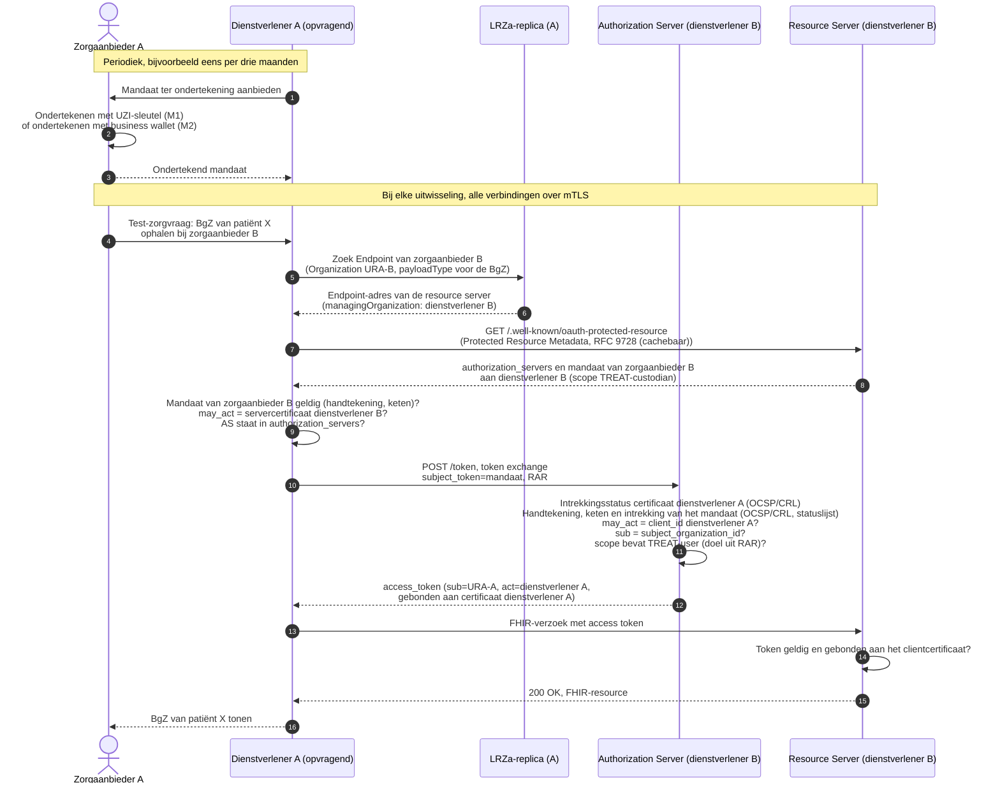
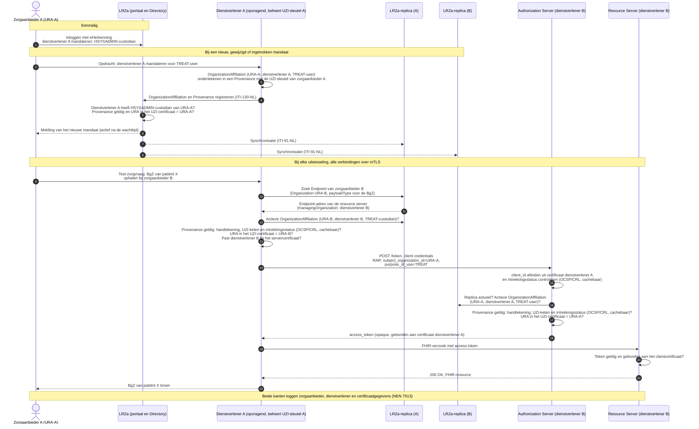

**Concept** · 16 oktober 2026

Deze notitie is een vervolg op de notitie [*Harmonisatie van authenticatie en autorisatie voor de gegevensuitwisselingen BgZ en eOverdracht*](https://build.fhir.org/ig/minvws/generiekefuncties-docs/branches/authn-for-push/en/authenticatie-en-autorisatie-eOverdracht-BgZ-vMT-DICIO-20260818.html) (versie 0.95, hierna: de notitie). Op het concept van de notitie zijn reacties ontvangen van onder meer Silizo, ChipSoft, Twiin, UMCG, Nedap, de Nuts Kring Techniek, VZVZ (AORTA/LSP) en RSO Nederland. Twee punten komen in vrijwel alle inhoudelijke reacties terug en deze zijn de focus voor dit document:

- **Clientregistratie.** De notitie beschrijft niet hoe een authorization server een OAuth-client herkent. FAPI 2.0 gaat uit van een bekende *confidential client*, en handmatige, bilaterale registratie schaalt niet in een netwerk met veel partijen.
- **Sleutelbeheer en mandatering.** De notitie laat de zorgaanbieder het tokenrequest én het access token ondertekenen met de sleutel van zijn UZI-servercertificaat. In de praktijk beheert vaak een dienstverlener die sleutel: een leverancier, SaaS-platform of knooppunt. Reviewers vinden dat onwenselijk en stellen voor dat de dienstverlener met een eigen identiteit handelt, op basis van een mandaat van de zorgaanbieder.

Deze notitie geeft een voorstel ter aanscherping van hoofdstuk 6 (*Technische keuzes en onderbouwing*) van de notitie. Het juridisch kader (hoofdstuk 4) en de eisen en GISA-uitgangspunten (hoofdstuk 5) blijven ongewijzigd. Voor deze uitwerking zijn diverse verkenningen gedaan naar vormen van serviceprovider-mandatering, (dynamic) client registration, en zelfs verkenning van andere frameworks (o.a. iSHARE, PSD2 en OpenID Federation).
{: .ig-lead}

# Inhoudsopgave

- [Rollen: zorgaanbieder en dienstverlener](#1-rollen-zorgaanbieder-en-dienstverlener)
- [Gewijzigde technische keuzes](#2-gewijzigde-technische-keuzes)
  - [2.1 Ongewijzigde keuzes](#21-ongewijzigde-keuzes)
  - [2.2 Registratie van OAuth-clients](#22-registratie-van-oauth-clients)
  - [2.3 Clientauthenticatie van de dienstverlener: mTLS](#23-clientauthenticatie-van-de-dienstverlener-mtls)
  - [2.4 Mandaat in plaats van ondertekening door de zorgaanbieder](#24-mandaat-in-plaats-van-ondertekening-door-de-zorgaanbieder)
  - [2.5 Access token: uitgifte door de authorization server van de bron](#25-access-token-uitgifte-door-de-authorization-server-van-de-bron)
  - [2.6 Grant en RAR-object](#26-grant-en-rar-object)
  - [2.7 Voorstel voor mandaatcodes](#27-voorstel-voor-mandaatcodes)
- [Toetsing aan eisen en uitgangspunten](#3-toetsing-aan-eisen-en-uitgangspunten)
- [Verwerking van de reacties](#4-verwerking-van-de-reacties)
- [Conclusie en openstaande besluiten](#5-conclusie-en-openstaande-besluiten)
- [Bijlage: voorbeelden van de technische flow](#bijlage-voorbeelden-van-de-technische-flow)
  - [A. M1 en M2: mandaat als `subject_token`](#a-m1-en-m2-mandaat-als-subject_token)
  - [B. M4: ondertekend mandaat in de lokale LRZa-replica](#b-m4-ondertekend-mandaat-in-de-lokale-lrza-replica)
- [Beveiligingsreview (aparte pagina, door AI gegenereerd)](https://build.fhir.org/ig/minvws/generiekefuncties-docs/branches/authn-for-push/en/authenticatie-en-autorisatie-security-review.html)

# 1. Rollen: zorgaanbieder en dienstverlener
De oorspronkelijke notitie maakt geen onderscheid tussen de zorgaanbieder en de partij die de techniek levert. Dit voorstel onderscheidt twee rollen:

- **Zorgaanbieder:** de verwerkingsverantwoordelijke, geïdentificeerd met het URA. De zorgaanbieder bepaalt welke dienstverlener namens hem mag handelen en voor welke doelen (paragraaf 2.7).
- **Dienstverlener:** de partij die de technische voorziening levert en beheert, zoals een EPD-leverancier, SaaS-platform, knooppunt, of de zorgaanbieder zelf bij eigen beheer. Aan de opvragende kant beheert de dienstverlener de OAuth-client, aan de bronkant de authorization server en de resource server. De dienstverlener heeft een eigen certificaat, bijvoorbeeld een PKIoverheid-servercertificaat met zijn KvK-nummer of OIN.

Eén dienstverlener handelt doorgaans namens veel zorgaanbieders, en één zorgaanbieder kan meerdere dienstverleners hebben. Het mandaat legt per combinatie vast wat de dienstverlener mag.

Dit past bij GISA-keuze A44: het vertrouwen op de transportlaag ligt bij de verantwoordelijken voor de verbinding (de dienstverleners), het vertrouwen tussen verzender en ontvanger van gezondheidsgegevens op de applicatielaag (het mandaat). Het uitvoerende systeem wordt daarmee een herkenbare technische actor in de transactie en kan daardoor ook meegenomen worden in de logging.

# 2. Gewijzigde technische keuzes

## 2.1 Ongewijzigde keuzes
De volgende keuzes uit de notitie blijven van kracht: **OAuth 2.0** als basis; de beveiligingsmaatregelen uit **FAPI 2.0** (asymmetrische clientauthenticatie, *sender-constrained* access tokens, verplichte transportbeveiliging en strikte validatie); **Rich Authorization Requests** (RAR, [RFC 9396](https://www.rfc-editor.org/rfc/rfc9396)) voor zorgspecifieke attributen; en **mTLS op de transportlaag**, voorlopig met UZI-servercertificaten of PKIoverheid-certificaten.

## 2.2 Registratie van OAuth-clients
Een authorization server moet bij elk tokenrequest vaststellen welke client het verzoek doet en met welk sleutelmateriaal. FAPI 2.0 schrijft niet voor hoe clients worden geregistreerd. Twee oplossingen zijn beschouwd.

### Optie R1: Dynamic Client Registration naar voorbeeld van UDAP
De dienstverlener registreert zich bij elke authorization server via [Dynamic Client Registration](https://www.rfc-editor.org/rfc/rfc7591) (RFC 7591), geprofileerd volgens het HL7 [UDAP Security IG](https://hl7.org/fhir/us/udap-security/STU2/). Hij ondertekent een *software statement* met de sleutel van zijn certificaat, dat in `x5c` meereist. De authorization server valideert handtekening, certificaatketen en intrekkingsstatus en geeft een `client_id` uit. Bij elk volgend tokenrequest valideert de server de keten opnieuw. De Europese concept-specificatie [EU Health Data API](https://github.com/euridice-org/eu-health-data-api) gaat voor systeemkoppelingen uit van registratie buiten het protocol om. UDAP noemt zij alleen als mogelijkheid voor toegang op gebruikersniveau, die buiten haar scope valt.

- *Voordelen:* gestandaardiseerd protocol met een uitgewerkt zorgprofiel (UDAP STU2, december 2025), gebruikt in de Verenigde Staten, onder meer in TEFCA; de client is daarna bekend bij de server, zoals autorisatiesoftware verwacht; een software statement kan productnaam, versie of certificeringen vastleggen.
- *Nadelen:* een extra stap en extra 'state' aan client en server-zijde, want per authorization server een registratie en een `client_id`, met herregistratie bij certificaatvernieuwing.

### Optie R2: client-id afgeleid uit het clientcertificaat
De registratiestap vervalt. De authorization server leidt de `client_id` af uit een persistente identificatie in het certificaat van de dienstverlener: bij een PKIoverheid-certificaat het attribuut `organizationIdentifier` met KvK-nummer of OIN ([PKIoverheid PvE v5.4](https://cp.pkioverheid.nl/pkioverheid-por-v5.4.html), §7.1.4.2.2.10), bij een UZI-servercertificaat het URA in de `subjectAltName`. De client stuurt deze waarde als `client_id` mee, zoals [RFC 8705](https://www.rfc-editor.org/rfc/rfc8705) vraagt, en de server controleert of die overeenkomt met het certificaat.

Dit is de praktijk in het Europese betalingsverkeer. Onder PSD2 identificeert een bank een betaaldienstverlener (TPP) uitsluitend met diens eIDAS-certificaat; de Berlin Group-specificatie gebruikt het `organizationIdentifier` uit dat certificaat als `client_id` ([Berlin Group V2.4.1, §8.8](https://berlin-group.org/wp-content/uploads/2026/09/11c.-Berlin-Group-openFinance-API-Framework-Core-PSD2-Compliance-V2-Suite-Protocol-Functions-and-Security-Measures-V2.4.1-20260731.pdf)).

Voordelen:
- **Geen 'state'.** Clients en servers hoeven geen `client_id` uit te wisselen of bij te houden; er is geen registratie die kan verouderen. Maakt de autorisatiesoftware toch een clientrecord aan (zie de nadelen), dan is dat volledig af te leiden uit het certificaat.
- **Geen herregistratie.** De identificatie blijft gelijk bij certificaatvernieuwing.
- **Geen registratie-endpoint en geen software statements** om te beheren en te valideren.
- **Europese praktijk in bancaire sector** in een verplicht, grensoverschrijdend stelsel, en verenigbaar met FAPI 2.0.

Nadelen:
- Gangbare autorisatiesoftware verwacht vooraf geregistreerde clients. De server moet een client bij het eerste geldige verzoek automatisch kunnen aanmaken (*registratie bij eerste gebruik*); dat kan configuratie of een uitbreiding vragen.
- RFC 8705 vergelijkt het certificaat met één verwachte subject-waarde per client. Het afleiden van de `client_id` uit één attribuut is een profielregel die het stelsel moet vastleggen.
- Er is geen plek voor clientmetadata. Wat een dienstverlener mag, volgt uit het mandaat en de stelselafspraken.
- De `client_id` identificeert de dienstverlener als organisatie. Voor herleidbaarheid naar het systeem logt de ontvanger ook serienummer en domeinnaam (FQDN) van het certificaat.

### Software statements en certificering zijn niet nodig
Het belangrijkste voordeel van R1 is dat een software statement of certificering van de client kan worden vastgelegd. Echter, daar is geen noodzaak voor:

- NEN 7513 vraagt dat uit de logging kan worden vastgesteld welke externe systemen gegevens hebben ontvangen, maar schrijft niet voor dat softwareproduct, versie of kwalificatie worden vastgelegd. Het certificaat van de dienstverlener identificeert het externe systeem voldoende.
- De EHDS legt de verantwoordelijkheid voor conformiteit bij de fabrikant zelf, via een verplichte zelfbeoordeling: met de EU-conformiteitsverklaring "the manufacturer shall assume responsibility for the compliance" ([Verordening (EU) 2025/327](https://eur-lex.europa.eu/eli/reg/2025/327/oj), art. 39 lid 5). Een software statement van de dienstverlener zelf voegt daar voor de ontvanger weinig aan toe. Certificeringen door derden zijn in UDAP wel mogelijk, maar de EHDS vereist die niet.

### Voorstel
Optie R2: geen verplichte clientregistratie; de authorization server leidt de `client_id` af uit het certificaat van de dienstverlener. Naar analogie van het Europese betalingsverkeer/PSD2 mag een authorization server geen aanvullende registratie verplicht stellen. Een authorization server mag een dienstverlener wel lokaal blokkeren (paragraaf 2.3).

Om te voorkomen dat een `client_id` uit een verkeerd certificaat wordt afgeleid, gelden de volgende eisen:
- De authorization server accepteert alleen servercertificaten van een in het stelsel vastgelegde lijst van uitgevende CA's en certificaatbeleid: PKIoverheid-servercertificaten en UZI-servercertificaten (pastype `S`). Standaard-truststores van het besturingssysteem of de gateway worden niet gebruikt.
- Het certificaat bevat de *extended key usage* `clientAuth`.
- Persoonsgebonden certificaten worden geweigerd, ook als ze een `organizationIdentifier` of URA bevatten. Dat geldt voor PKIoverheid-persoonscertificaten en voor UZI-passen (pastypes `Z`, `N` en `M`).
- Of de client de zorgaanbieder zelf is (M0), volgt uit het certificaattype (een UZI-servercertificaat), niet uit een vergelijking van nummers.

## 2.3 Clientauthenticatie van de dienstverlener: mTLS
De dienstverlener authenticeert zich met zijn **eigen** certificaat, niet met de UZI-sleutel van de zorgaanbieder. Het voorstel is om voor clientauthenticatie én voor *sender-constrained* access tokens uitsluitend **mTLS** te gebruiken ([RFC 8705](https://www.rfc-editor.org/rfc/rfc8705)), in plaats van `private_key_jwt` en DPoP uit de notitie. De dienstverlener authenticeert zich met zijn certificaat in de TLS-verbinding die er volgens de GISA al is (`tls_client_auth`), en de authorization server bindt het access token aan dat certificaat (`cnf.x5t#S256`). FAPI 2.0 staat deze methode toe.

Deze keuze is mogelijk doordat de verbinding tussen dienstverleners en het vertrouwen tussen verzender en ontvanger (het mandaat) uit elkaar zijn gehaald. De notitie koos `private_key_jwt` onder meer omdat het transportcertificaat de zorgaanbieder niet altijd identificeert. Nu de dienstverlener zelf de client is, vervalt dat argument: het transportcertificaat identificeert juist de dienstverlener, die verantwoordelijk is voor de verbinding, en de identiteit van de zorgaanbieder wordt op de applicatielaag geborgd met het mandaat. Dit blijft binnen het juridisch kader en de GISA.

Voordelen:
- **Eén mechanisme** voor transport, clientauthenticatie en tokenbinding. Een JWKS-endpoint per zorgaanbieder, client assertions en DPoP-proofs zijn niet meer nodig.
- **Integriteit van het tokenrequest tijdens transport.** TLS beschermt alles wat over de verbinding gaat tegen wijziging, en bij mTLS heeft de dienstverlener zich in dezelfde verbinding met zijn certificaat geauthenticeerd. Zolang de verbinding niet onderweg wordt beëindigd, kan geen tussenpartij het tokenrequest, inclusief het RAR-object, ongemerkt wijzigen, en weet de authorization server dat het verzoek van de geauthenticeerde dienstverlener komt. Dit is geen ondertekening: achteraf kan de authorization server niet aan derden aantonen wat de dienstverlener precies heeft verzocht. Bij `private_key_jwt` is dat evenmin het geval, omdat de client assertion het RAR-object niet ondertekent.

Aandachtspunten:
- **Intrekkingscontrole van het clientcertificaat.** De authorization server en de resource server controleren de intrekkingsstatus van het certificaat van de dienstverlener via OCSP of de CRL van de vertrouwensdienstverlener. Het stelsel legt een maximale ouderdom van het OCSP-antwoord of de CRL vast, los van `nextUpdate`. Is de intrekkingsstatus onbekend of niet op te halen, dan weigert de server het verzoek (*fail-closed*). RFC 8705 laat het aan de server over of en hoe hij de intrekking controleert; het stelsel moet die controle daarom voorschrijven. Dit geldt voor alle mandaatvarianten. Omgekeerd controleert de opvragende dienstverlener op dezelfde manier de intrekkingsstatus van het servercertificaat van de dienstverlener van de bron, en of die dienstverlener is geschorst.
- **Schorsen van een dienstverlener.** Intrekken van zijn certificaat is de snelste manier om een gecompromitteerde dienstverlener af te sluiten, maar werkt pas als de vertrouwensdienstverlener de intrekking publiceert. Daarnaast komt er een stelselvoorziening om een dienstverlener te schorsen, bijvoorbeeld een status van de dienstverlener in de LRZa of het in één keer deactiveren van al zijn mandaten; authorization servers controleren die. Een authorization server mag een dienstverlener ook lokaal blokkeren.
- **Kortlevende access tokens.** Access tokens zijn kort geldig, in de orde van minuten, zodat een intrekking of schorsing snel doorwerkt.
- **TLS-terminatie.** mTLS moet doorlopen tot de authorization server en de resource server. Een doorgegeven clientcertificaat, bijvoorbeeld in een header volgens het informatieve [RFC 9440](https://www.rfc-editor.org/rfc/rfc9440), bevat alleen het publieke certificaat: wie die header kan zetten, kan zich voordoen als elke dienstverlener. Daarom:
  - TLS wordt alleen beëindigd binnen het eigen beheerdomein van de beheerder van de authorization server en de resource server.
  - Een knooppunt of intermediair van een andere partij beëindigt de TLS-verbinding niet, maar geeft die ongewijzigd door, of treedt zelf als OAuth-client op met een eigen mandaat.
  - Een interne gateway verwijdert of overschrijft binnenkomende certificaatheaders, valideert zelf keten, certificaatbeleid en intrekkingsstatus, en geeft het certificaat alleen via een geauthenticeerd kanaal door aan de achterliggende server.
  - De naleving wordt getoetst, onder meer met tests op het injecteren van certificaatheaders.
- Als GIS Veilig Netwerk in de toekomst certificaten voorschrijft die niet de dienstverlener zelf identificeren, moet deze keuze opnieuw worden bekeken.

## 2.4 Mandaat in plaats van ondertekening door de zorgaanbieder
Omdat niet elke dienstverlener het UZI-servercertificaat en de sleutel van de zorgaanbieder heeft, en dat ook niet wenselijk is, gaat het mandaatprincipe uit van ondertekening van het tokenrequest door de dienstverlener zelf. Het mandaat zorgt voor het vertrouwen tussen verzender en ontvanger van gezondheidsgegevens: het legt vast dat de zorgaanbieder de dienstverlener heeft aangewezen om namens hem te handelen.

Een mandaat bevat in alle varianten dezelfde gegevens. Die sluiten aan op de [`OrganizationAffiliation`](https://build.fhir.org/ig/minvws/generiekefuncties-docs/branches/authn-for-push/en/StructureDefinition-nl-gf-organizationaffiliation.html) uit de [Care Service Directory](https://build.fhir.org/ig/minvws/generiekefuncties-docs/branches/authn-for-push/en/csd.html), die in de LRZa al wordt gebruikt om dienstverleners te machtigen voor het beheer van adresgegevens.

| Gegeven | Ondertekend mandaat (JWT) | `OrganizationAffiliation` |
|---|---|---|
| Zorgaanbieder (mandaatgever) | `sub` (URA) | `organization` |
| Dienstverlener (gemandateerde) | `may_act.sub` (de `client_id`, bijvoorbeeld KvK-nummer) | `participatingOrganization` |
| Reikwijdte | `scope` (mandaatcodes, paragraaf 2.7) | `code` |
| Geldigheid | `nbf` en `exp` | `period` en `active` |
| Unieke referentie | `jti` | `identifier` |
| Ondertekenaar | `iss` en `x5c` | Zorgaanbieder via het LRZa-portaal; geauthenticeerd door eHerkenning. Bij M4 en M5 daarnaast een ondertekende `Provenance` |


### M0 — Dienstverlener ondertekent met het UZI-certificaat van de zorgaanbieder
De zorgaanbieder vraagt een UZI-servercertificaat aan en laat de sleutel beheren door de dienstverlener, die daarmee optreedt *als* de zorgaanbieder. Dit is de opzet zoals die in de originele notitie staat en dient hier als referentie/baseline.

- *Voordelen:* geen nieuwe techniek; het URA zit in het certificaat en de intrekking verloopt via het UZI-register.
- *Nadelen:* de dienstverlener beheert de private sleutel van de zorgaanbieder en is cryptografisch niet van hem te onderscheiden; meerdere dienstverleners betekent meerdere certificaten of een gedeelde sleutel; compromittering van een dienstverlener raakt al zijn zorgaanbieders. Hiertegen maken de meeste reacties bezwaar.

### M1 — Zorgaanbieder ondertekent het mandaat met zijn UZI-sleutel
De zorgaanbieder houdt de sleutel van zijn UZI-servercertificaat zelf in beheer (of bij een vertrouwde dienstverlener) en ondertekent daarmee periodiek, bijvoorbeeld eens per 3 maanden, een mandaat. Het mandaat is een JWT met het UZI-certificaat en de keten in de header:

```json
{
  "typ": "nl-gf-mandate+jwt",
  "alg": "RS256",
  "x5c": ["<UZI-servercertificaat van zorgaanbieder A>", "<UZI-register Server CA>"]
}
```

```json
{
  "iss": "urn:oid:2.16.528.1.1007.3.3.11111111",
  "sub": "urn:oid:2.16.528.1.1007.3.3.11111111",
  "may_act": { "sub": "NTRNL-90000001" },
  "scope": "TREAT-user TREAT-custodian",
  "iat": 1792108800,
  "nbf": 1792108800,
  "exp": 1799884800,
  "jti": "5f0c2a8e-3b7d-4c1e-9a6f-2d8b7e4c1a90",
  "status": {
    "status_list": { "idx": 412, "uri": "https://mandaten.zorgaanbieder-a.nl/statuslists/1" }
  }
}
```

Het mandaat gaat mee als parameter `subject_token` in een tokenrequest volgens OAuth 2.0 Token Exchange ([RFC 8693](https://www.rfc-editor.org/rfc/rfc8693)). De authorization server valideert de handtekening, de UZI-keten en de intrekkingsstatus, en controleert dat het URA in het certificaat gelijk is aan `sub` en dat `may_act.sub` gelijk is aan de geauthenticeerde `client_id`. Alleen een UZI-servercertificaat (pastype `S`) mag een mandaat ondertekenen. Een statusmechanisme voor tussentijdse intrekking is verplicht, bijvoorbeeld een statuslijst volgens [draft-ietf-oauth-status-list](https://datatracker.ietf.org/doc/draft-ietf-oauth-status-list/) (claim `status`). De statuslijst wordt ondertekend door de ondertekenaar van het mandaat (hetzelfde URA) of door een statusuitgever die het stelsel aanwijst, en niet door de gemandateerde dienstverlener. De authorization server controleert de status en de ondertekenaar daarvan bij elk tokenrequest, met een vastgestelde maximale cachetijd. Is de status onbekend of niet op te halen, dan weigert hij het verzoek (*fail-closed*). Zie de [bijlage](#a-m1-en-m2-mandaat-als-subject_token).

- *Voordelen:* federatief verifieerbaar, zonder bevraging van de LRZa of een andere mandaatvoorziening. De intrekkingsstatus van het UZI-certificaat vraagt wel een (cachebare) OCSP- of CRL-controle bij het UZI-register, een centrale voorziening. De dienstverlener heeft een eigen identiteit en de zorgaanbieder houdt de UZI-sleutel in eigen beheer.
- *Nadelen:* de zorgaanbieder heeft een UZI-servercertificaat en een **ondertekendienst** nodig. Die vraagt investering en doorlopend beheer: veilige sleutelopslag (HSM of cloud-KMS) met toegangsbeheer en back-up; software en procedures om mandaten op te stellen en te ondertekenen; het opnieuw ondertekenen van alle mandaten bij verloop en certificaatvernieuwing; een beschikbaar intrekkingsmechanisme; en opname in de NEN 7510-scope met audits en logging. Voor kleine zorgaanbieders, zoals in de VVT of de huisartsenzorg, is dit onevenredig, en niet alle zorgaanbieders hebben een UZI-servercertificaat. Beheert de dienstverlener in een SaaS-situatie toch de UZI-sleutel, dan kan hij zijn eigen mandaat ondertekenen en biedt M1 weinig meer dan M0. Het verplichte statusmechanisme moet de zorgaanbieder beschikbaar houden; de IETF-specificatie voor statuslijsten is nog een draft. Of het UZI-servercertificaat voor het ondertekenen van mandaten mag worden gebruikt, moet met het UZI-register (CIBG) worden afgestemd: het certificaatbeleid beschrijft dit certificaat voor de authenticatie van systemen en de beveiliging van communicatie.

### M2 — European Business Wallet
De dienstverlener stelt periodiek, bijvoorbeeld eens per drie maanden, een mandaat op en biedt dat de zorgaanbieder ter ondertekening aan. De zorgaanbieder ondertekent het met zijn European Business Wallet (EBW), die een gekwalificeerd elektronisch zegel kan plaatsen ([COM(2025) 838](https://www.eerstekamer.nl/bijlage/20251121/com_2025_838_proposal_for_a/document3/f=/vmsoctgrbbeb.pdf), art. 5 lid 1 onder d). Het mandaat bevat dezelfde claims als bij M1 en reist, net als bij M1, mee als `subject_token`.

- *Voordelen:* een blijvend federatieve oplossing, verifieerbaar tegen de Europese vertrouwenslijsten. De intrekkingsstatus van het zegelcertificaat vraagt wel een (cachebare) OCSP- of CRL-controle bij de vertrouwensdienstverlener die het certificaat heeft uitgegeven. De wallet levert het gekwalificeerde zegel, dus de investeringen en kosten voor de zorgaanbieder zijn naar verwachting beperkter dan bij M1. Het vereist wel een periodieke administratieve handeling van de zorgaanbieder. Sluit ook aan bij Europese walletontwikkeling.
- *Nadelen:*
  - **Nog niet operationeel.** Het voorstel voor de verordening dateert van 19 november 2025. Het Europees Parlement heeft op 7 oktober 2026 besloten de onderhandelingen met de Raad over de definitieve tekst te starten (de triloog, met de Europese Commissie als bemiddelaar; [procedure 2025/0358(COD)](https://oeil.europarl.europa.eu/oeil/en/procedure-file?reference=2025/0358(COD))). De verordening is dus nog niet aangenomen. Volgens het voorstel geldt ze één jaar na inwerkingtreding.
  - **Koppeling aan het URA.** Het zegel identificeert de zorgaanbieder met bedrijfsgegevens zoals het KvK-nummer, niet met het URA. Een vertaling via de LRZa, waarin een `Organization` beide bevat, is nodig.

### M3 — `OrganizationAffiliation` in de LRZa
De zorgaanbieder registreert het mandaat in het LRZa-portaal, na inloggen met eHerkenning, als `OrganizationAffiliation` met de dienstverlener als `participatingOrganization` en een mandaatcode als `code`. Een dienstverlener mag zichzelf niet kunnen mandateren. De LRZa accepteert deze registraties al alleen van zorgaanbieders, "not by the parties that are being authorized" ([Care Service Directory, Security](https://build.fhir.org/ig/minvws/generiekefuncties-docs/branches/authn-for-push/en/csd.html#security)). Dat is alleen sluitend met de volgende eisen, die een aanpassing van de Care Service Directory vragen:
- Mandaten met een mandaatcode worden uitsluitend via het LRZa-portaal geregistreerd, gewijzigd en ingetrokken, door de zorgaanbieder zelf na inloggen met eHerkenning op minimaal niveau EH3; het precieze niveau moet nog worden vastgesteld. De machine-interface voor gegevensbronnen (ITI-130-NL) accepteert geen `OrganizationAffiliation` met een mandaatcode.
- Inloggen met een eHerkenning-ketenmachtiging is voor deze dienst niet toegestaan. Het portaal weigert een registratie als de handelende organisatie niet de zorgaanbieder zelf is.
- Bij een nieuw mandaat stuurt de LRZa een melding naar contactgegevens van de zorgaanbieder die dienstverleners niet kunnen wijzigen, bijvoorbeeld uit het UZI-register of het Handelsregister, en niet uit `Organization.telecom`. Het mandaat wordt pas na een vaste wachttijd actief, zodat de zorgaanbieder kan ingrijpen.
- De zorgaanbieder ziet in het portaal een overzicht van alle mandaten die hij heeft gegeven.

Het mandaat wordt gerepliceerd naar de lokale LRZa-replica's van dienstverleners (ITI-91-NL). Zodat een wijziging of intrekking tijdig doorwerkt, gelden verder:
- De authorization server weigert verzoeken op basis van een mandaat als de laatste geslaagde synchronisatie van zijn replica ouder is dan een vastgestelde maximale ouderdom, bijvoorbeeld een uur. Dezelfde eis geldt voor de opvragende dienstverlener bij zijn controle van het mandaat van de bron.
- De authorization server controleert naast `active` ook de `period` van de `OrganizationAffiliation` en de status van de betrokken organisaties. De replica verwerkt ook verwijderingen.
- De LRZa deactiveert de mandaten van een zorgaanbieder als diens registratie in het UZI-register eindigt.

Bij het tokenrequest reist **geen mandaat** mee. De dienstverlener vermeldt in het RAR-object namens welke zorgaanbieder (`subject_organization_id`) en met welk doel (`purpose_of_use`) hij handelt. De controle gebeurt aan beide kanten in de lokale LRZa-replica:

- De **authorization server van de bron** controleert of er een actieve `OrganizationAffiliation` is van de opvragende zorgaanbieder aan de geauthenticeerde dienstverlener, met de mandaatcode die bij het doel hoort, bijvoorbeeld `TREAT-user`.
- De **opvragende dienstverlener** controleert vóór het verzoek dat het endpoint bij de bronhoudende zorgaanbieder hoort en dat de dienstverlener van de bron, herkenbaar aan zijn servercertificaat, door die zorgaanbieder is gemandateerd met de bijbehorende `custodian`-code, bijvoorbeeld `TREAT-custodian`.

De uitwisseling staat in de [bijlage](#b-m4-ondertekend-mandaat-in-de-lokale-lrza-replica); bij M3 vervalt daarin de controle van de `Provenance`.

- *Voordelen:* de zorgaanbieder heeft alleen eHerkenning nodig, geen sleutel of ondertekendienst en, met het certificaat van de dienstverlener, ook geen UZI-servercertificaat; zelfmandatering wordt op één plek uitgesloten, mits aan de eisen hierboven is voldaan; geen mandaat in het tokenrequest en geen centrale bevraging tijdens de uitwisseling; het bouwt voort op de bestaande LRZa-registratie en replicatie; mandaten aan de opvragende en de bronkant worden op dezelfde manier vastgelegd en gecontroleerd.
- *Nadelen:*
  - Een mandaat kan alleen door de zorgaanbieder, na inloggen met eHerkenning, in de LRZa worden aangepast. Voor wijzigingen moeten het LRZa-portaal en eHerkenning beschikbaar zijn; tijdens de uitwisseling niet.
  - Wijziging en intrekking werken door na de volgende synchronisatie; een interval van ongeveer 15 minuten wordt geadviseerd.

### M4 — Combinatie van M1 en M3: één dienstverlener ondertekent mandaten met het UZI-certificaat van de zorgaanbieder
De zorgaanbieder geeft één dienstverlener, bijvoorbeeld zijn EPD-leverancier, de beschikking over zijn UZI-servercertificaat en de sleutel daarvan, zoals nu bij SaaS gangbaar is (M0), maar alleen aan die ene dienstverlener. Via het LRZa-portaal, na inloggen met eHerkenning, mandateert de zorgaanbieder deze beherende dienstverlener eenmalig voor het beheer van zijn LRZa-gegevens (`HSYSADMIN-custodian`, nu `lrza-careprovider-admin`). Verder is het portaal niet nodig.

De beherende dienstverlener registreert daarna via ITI-130-NL de mandaten (`OrganizationAffiliation`) voor zichzelf en voor andere dienstverleners. Bij elke `OrganizationAffiliation` hoort een `Provenance`, ondertekend met de sleutel van het UZI-servercertificaat van de zorgaanbieder volgens [Resource signing](https://build.fhir.org/ig/minvws/generiekefuncties-docs/branches/authn-for-push/en/signing.html). Die ondertekening bestaat nu al als optie in de Care Service Directory, waar een UZI-certificaat voorlopig is toegestaan voor de `Provenance` van een `OrganizationAffiliation` ([Mutation signing](https://build.fhir.org/ig/minvws/generiekefuncties-docs/branches/authn-for-push/en/csd.html#mutation-signing-optional)). De mandaten worden net als bij M3 gerepliceerd en in de lokale replica gecontroleerd; in het tokenrequest reist geen mandaat mee.

Ten opzichte van M3 verandert het volgende:
- De eis bij M3 dat ITI-130-NL geen mandaten accepteert, vervalt voor M4: ITI-130-NL accepteert een mandaat alleen met een geldige `Provenance`, ondertekend met het UZI-servercertificaat van de zorgaanbieder in `organization`.
- De authorization server en de opvragende dienstverlener controleren naast het mandaat ook de `Provenance`: de handtekening, de UZI-keten en de intrekkingsstatus, en of het URA in het certificaat gelijk is aan de zorgaanbieder van het mandaat. Een `OrganizationAffiliation` zonder geldige `Provenance` van de zorgaanbieder geldt niet als mandaat.
- De eisen bij M3 voor melding aan de zorgaanbieder, wachttijd, overzicht in het portaal en actualiteit van de replica blijven gelden.

Zie de [bijlage](#b-m4-ondertekend-mandaat-in-de-lokale-lrza-replica).

- *Voordelen:* mandaten zijn ondertekend namens de zorgaanbieder, zodat een compromittering van de LRZa, het portaal of een replica geen geldige mandaten kan toevoegen. De zorgaanbieder heeft geen eigen ondertekendienst nodig en gebruikt het portaal alleen voor het mandaat aan de beherende dienstverlener. Andere dienstverleners hebben een eigen identiteit en hebben het UZI-certificaat niet nodig. M4 bouwt voort op de bestaande LRZa, de replicatie en de Provenance-ondertekening, en sluit aan bij de huidige praktijk waarin één leverancier het UZI-certificaat beheert.
- *Nadelen:*
  - De beherende dienstverlener heeft de UZI-sleutel en kan zichzelf en anderen voor alle mandaatcodes mandateren. Voor die ene dienstverlener is het vertrouwen daarmee even groot als bij M0.
  - De zorgaanbieder heeft een UZI-servercertificaat nodig, en het gebruik daarvan voor ondertekening moet met CIBG worden afgestemd (zoals bij M1).
  - Na vernieuwing of intrekking van het UZI-certificaat moeten alle mandaten opnieuw worden ondertekend. Dat geldt ook als de zorgaanbieder van beherende dienstverlener wisselt, omdat het UZI-certificaat dan moet worden vervangen.
  - De ondertekening voegt een controle van de intrekkingsstatus van het UZI-certificaat toe, een centrale voorziening.

### M5 — Combinatie van M2 en M3: zorgaanbieder verzegelt mandaten in het LRZa-portaal met zijn European Business Wallet
De zorgaanbieder registreert het mandaat in het LRZa-portaal, zoals bij M3, en verzegelt de `OrganizationAffiliation` daar met zijn European Business Wallet (zoals bij M2), in een `Provenance` volgens [Resource signing](https://build.fhir.org/ig/minvws/generiekefuncties-docs/branches/authn-for-push/en/signing.html). Het inloggen bij het portaal gebeurt dan waarschijnlijk ook met de wallet in plaats van met eHerkenning. De mandaten worden net als bij M3 gerepliceerd en in de lokale replica gecontroleerd; in het tokenrequest reist geen mandaat mee.

De authorization server en de opvragende dienstverlener controleren naast het mandaat ook het zegel in de `Provenance`: tegen de Europese vertrouwenslijsten, inclusief de intrekkingsstatus, en of de zorgaanbieder in het zegel (KvK-nummer of EUID) hoort bij het URA van de zorgaanbieder van het mandaat. Een `OrganizationAffiliation` zonder geldig zegel van de zorgaanbieder geldt niet als mandaat.

- *Voordelen:* mandaten zijn verzegeld door de zorgaanbieder zelf. Een compromittering van de LRZa, het portaal of een replica kan geen geldige mandaten toevoegen, en een dienstverlener kan zichzelf niet mandateren zolang hij de wallet niet bedient. De zorgaanbieder heeft geen ondertekendienst en geen UZI-servercertificaat nodig. De wallet levert gekwalificeerde zegels en tijdstempels ([COM(2025) 838](https://www.eerstekamer.nl/bijlage/20251121/com_2025_838_proposal_for_a/document3/f=/vmsoctgrbbeb.pdf), art. 5 lid 1 onder d en e), wat ook bewijs levert in een geschil. M5 combineert de eenvoud van M3 (vastleggen in de LRZa, geen mandaat in het tokenrequest) met de verifieerbaarheid van M2, en vraagt alleen een handeling bij een wijziging.
- *Nadelen:*
  - Nog niet operationeel (zoals M2). Daarnaast moet het LRZa-portaal de wallet ondersteunen voor inloggen en verzegelen.
  - Het zegel identificeert de zorgaanbieder met bedrijfsgegevens, niet met het URA; een vertaling naar het URA is nodig (zoals bij M2).
  - De verzegeling voegt een controle van de intrekkingsstatus van het zegelcertificaat toe, bij de vertrouwensdienstverlener die het heeft uitgegeven.

### Vergelijking

| Variant | Zorgaanbieder heeft nodig | Kan de dienstverlener zichzelf mandateren? | Mandaat in het tokenrequest | Controle door de bron | Externe afhankelijkheid voor het mandaat (cachebaar) | Intrekking | Status |
|---|---|---|---|---|---|---|---|
| **M0** Dienstverlener ondertekent met UZI-sleutel van de zorgaanbieder | UZI-servercertificaat, sleutel bij de dienstverlener | Niet van toepassing: hij treedt op als de zorgaanbieder | Nee | UZI-keten, intrekkingsstatus en URA | OCSP of CRL van het UZI-register | Intrekken UZI-certificaat | Huidige praktijk |
| **M1** Zorgaanbieder ondertekent | UZI-servercertificaat en ondertekendienst | Ja, als hij de UZI-sleutel beheert | Ja, als `subject_token` | Handtekening, keten, intrekkingsstatus en `may_act` | OCSP of CRL van het UZI-register; statuslijst | Statuslijst (verplicht) of verloop | Techniek is bewezen/beschikbaar |
| **M2** European Business Wallet | Business wallet | Nee, als hij de wallet niet bedient | Ja, als `subject_token` | Zegel, vertrouwenslijst, intrekkingsstatus en URA-vertaling | OCSP of CRL van de vertrouwensdienstverlener; EU-vertrouwenslijsten; statusmechanisme | Status van de attestatie (verplicht) of verloop | Voorstel EU-verordening |
| **M3** `OrganizationAffiliation` in de LRZa | eHerkenning | Nee, mits alleen het portaal mandaten registreert, zonder ketenmachtiging | Nee; RAR verwijst naar de zorgaanbieder | Lokale LRZa-replica | Synchronisatie met de LRZa (maximale ouderdom) | Deactiveren in het portaal | Bouwt voort op de LRZa |
| **M4** Combinatie van M1 en M3 | UZI-servercertificaat (sleutel bij één dienstverlener) en eHerkenning | Alleen de beherende dienstverlener met de UZI-sleutel; andere dienstverleners niet | Nee; RAR verwijst naar de zorgaanbieder | Lokale LRZa-replica en `Provenance` (UZI-keten, intrekkingsstatus en URA) | Synchronisatie met de LRZa; OCSP of CRL van het UZI-register | Deactiveren in het portaal of door de beherende dienstverlener; intrekken UZI-certificaat | Bouwt voort op de LRZa en de bestaande Provenance-ondertekening |
| **M5** Combinatie van M2 en M3 | Business wallet | Nee, als hij de wallet niet bedient | Nee; RAR verwijst naar de zorgaanbieder | Lokale LRZa-replica en `Provenance` (zegel, vertrouwenslijst, intrekkingsstatus en URA-vertaling) | Synchronisatie met de LRZa; OCSP of CRL van de vertrouwensdienstverlener; EU-vertrouwenslijsten | Deactiveren in het portaal | Na invoering van de European Business Wallet |

Geen van de varianten is dus volledig zonder centrale afhankelijkheid. De federatieve varianten M1 en M2 hebben geen centrale mandaatvoorziening nodig, maar wel de intrekkingsdienst van de certificaatuitgever. M3 heeft geen intrekkingscontrole voor het mandaat nodig, maar is afhankelijk van de synchronisatie van de replica met de LRZa. M4 en M5 voegen aan M3 een handtekening of zegel van de zorgaanbieder toe, en worden daarmee ook afhankelijk van de intrekkingsdienst van de certificaatuitgever.

Een overzicht van de beveiligingsrisico's per variant staat in de [beveiligingsreview](https://build.fhir.org/ig/minvws/generiekefuncties-docs/branches/authn-for-push/en/authenticatie-en-autorisatie-security-review.html). In alle varianten controleren de authorization server en de resource server daarnaast de intrekkingsstatus van het certificaat van de dienstverlener (paragraaf 2.3).

### Voorgestelde richting
Het voorstel is om op korte termijn **M4** te gebruiken. M4 sluit aan bij de huidige praktijk, waarin één leverancier het UZI-servercertificaat van de zorgaanbieder beheert, en beperkt dat tot die ene beherende dienstverlener; andere dienstverleners handelen met een eigen identiteit. De mandaten zijn ondertekend namens de zorgaanbieder, zodat een compromittering van de LRZa, het portaal of een replica geen geldige mandaten kan toevoegen. De zorgaanbieder heeft geen eigen ondertekendienst nodig en gebruikt het LRZa-portaal alleen om de beherende dienstverlener te mandateren. M4 bouwt voort op bestaande voorzieningen: de LRZa, de replicatie en de `Provenance`-ondertekening uit de Care Service Directory. Aandachtspunten zijn:
- De beherende dienstverlener kan zichzelf en anderen mandateren. De melding aan de zorgaanbieder, de wachttijd en het overzicht in het portaal (zie M3) maken dat zichtbaar, maar voorkomen het niet.
- De zorgaanbieder heeft een UZI-servercertificaat nodig; een zorgaanbieder zonder dat certificaat moet het aanvragen. Het gebruik ervan voor het ondertekenen van mandaten moet met het UZI-register (CIBG) worden afgestemd.

Het groeipad is **M5**, zodra de European Business Wallet operationeel is. M5 gebruikt dezelfde `OrganizationAffiliation`, `Provenance` en controle in de lokale replica; alleen de ondertekenaar verandert. De zorgaanbieder verzegelt zijn mandaten dan zelf met zijn wallet. Geen dienstverlener heeft dan nog de UZI-sleutel nodig, en ook de beherende dienstverlener kan zichzelf niet meer mandateren. In de overgang accepteren de LRZa, de authorization servers en de opvragende dienstverleners zowel een `Provenance` met een UZI-handtekening als een met een zegel uit de wallet. **M0** blijft bruikbaar voor, bijvoorbeeld, zorgaanbieders die hun eigen IT-diensten beheren; de dienstverlener treedt op *als* de zorgaanbieder en mandatering is niet nodig.

## 2.5 Access token: uitgifte door de authorization server van de bron
In de notitie ondertekent de bronhoudende zorgaanbieder het access token met zijn UZI-sleutel, en valideert de client die handtekening. Reviewers wijzen erop dat dit afwijkt van gangbare standaarden; IHE IUA stelt "The token is opaque to the Authorization Client". Een authorization server voor veel zorgaanbieders zou bovendien per zorgaanbieder een UZI-sleutel moeten beheren. Het voorstel:

- De authorization server van de dienstverlener van de bron ondertekent het access token met **zijn eigen sleutel** en bindt het aan het certificaat van de client (`cnf.x5t#S256`, RFC 8705). De resource server controleert bij elk verzoek dat het clientcertificaat van de mTLS-verbinding overeenkomt met deze binding.
- Het access token is ***opaque* voor de client**. Hoe het wordt uitgegeven en gevalideerd, bepalen authorization server en resource server onderling.
- Het token legt vast namens welke zorgaanbieder toegang is verleend (`sub`, het URA) en welke dienstverlener handelt (`client_id`, en bij token exchange de claim `act`).
- De opvragende dienstverlener stelt de identiteit van de **bronhoudende zorgaanbieder** vóór het verzoek vast, en het servercertificaat van de dienstverlener van de bron bevestigt dat de verbinding met de gemandateerde partij is opgezet:
  - Bij M1 en M2 via *Protected Resource Metadata* ([RFC 9728](https://www.rfc-editor.org/rfc/rfc9728)). Daarmee publiceert de resource server op `/.well-known/oauth-protected-resource` onder meer welke authorization servers bij het endpoint horen. De resource server publiceert hier ook het mandaat dat de bronhoudende zorgaanbieder aan zijn dienstverlener heeft gegeven. Hoe het mandaat in deze metadata opgenomen wordt, moet uitgewerkt worden. De opvragende dienstverlener cachet deze metadata ten hoogste een vastgestelde maximale tijd en controleert ook de status van het gepubliceerde mandaat.
  - Bij M3, M4 en M5 via de lokale LRZa-replica: het endpoint hoort bij de bronhoudende zorgaanbieder, en die heeft de dienstverlener van de bron gemandateerd. Bij M4 en M5 moet dat mandaat een geldige `Provenance` van die zorgaanbieder hebben.

Zo blijft eis 1 uit de notitie, het wederzijds vaststellen van de identiteit van de zorgaanbieder, vervuld. Er blijft één restrisico: de opvragende dienstverlener geeft zelf op namens welke zorgaanbieder hij handelt (paragraaf 2.6).

## 2.6 Grant en RAR-object
**Grant.** De notitie motiveerde de *client-credentials flow* met de stelling dat FAPI 2.0 die voorschrijft. Dat is onjuist: FAPI 2.0 sluit andere grants niet uit. De juiste motivatie is dat er geen interactieve gebruiker in de uitwisseling is: de zorgverlener is in het eigen domein geauthenticeerd en de uitwisseling verloopt van systeem tot systeem. Bij M0, M3, M4 en M5 blijft client credentials de grant; bij M1 en M2 reist het mandaat mee in een token exchange (RFC 8693), eveneens zonder interactieve gebruiker.

**RAR-object.** Het RAR-object van type `nl-gis-v1` blijft, met één aanvulling: `subject_organization_id`, het URA van de zorgaanbieder namens wie de dienstverlener handelt. Dit veld stond al in het sequentiediagram van de notitie, maar niet in het voorbeeld. De vereiste mandaatcode volgt uit `purpose_of_use` (paragraaf 2.7), zodat een apart veld voor het mandaattype niet nodig is.

```json
{
  "authorization_details": [
    {
      "type": "nl-gis-v1",
      "subject_organization_id": "urn:oid:2.16.528.1.1007.3.3.11111111",
      "purpose_of_use": "http://terminology.hl7.org/CodeSystem/v3-ActReason|TREAT",
      "locations_organization_id": "urn:oid:2.16.528.1.1007.3.3.12345678",
      "locations": ["https://fhir.zorgaanbieder-b.nl/fhir"]
    }
  ]
}
```

De authorization server controleert dat de zorgaanbieder in `subject_organization_id` de geauthenticeerde dienstverlener heeft gemandateerd met de mandaatcode die bij `purpose_of_use` hoort. Authenticeert de client zich met het UZI-servercertificaat van de zorgaanbieder zelf (M0), dan moet `subject_organization_id` gelijk zijn aan het URA in dat certificaat en is geen mandaat nodig.

Een dienstverlener die door meerdere zorgaanbieders is gemandateerd, zou namens de verkeerde zorgaanbieder kunnen handelen, bijvoorbeeld door een fout of door misbruik (een *confused deputy*). Daarom gelden aanvullend:
- Bij M1 en M2 moet `subject_organization_id` gelijk zijn aan `sub` van het mandaat. Het access token bevat één gezaghebbende claim voor de opvragende zorgaanbieder (`sub`), die de authorization server overneemt uit het gecontroleerde mandaat of, bij M3, M4 en M5, uit de gecontroleerde `OrganizationAffiliation`.
- Het tokenrequest en het FHIR-verzoek dragen een correlatiekenmerk van de opvragende kant, bijvoorbeeld een W3C `traceparent`. Beide kanten loggen dat kenmerk, met het URA van de opvragende zorgaanbieder en de identiteit van de dienstverlener.
- Een dienstverlener die namens meerdere zorgaanbieders handelt, scheidt hun gegevens en verzoeken aantoonbaar. Die tenantscheiding wordt een toetredingseis en onderdeel van audits.
- De opvragende zorgaanbieder kan bij de bron inzien welke verzoeken namens hem zijn gedaan, via een kanaal dat niet via zijn eigen dienstverlener loopt, bijvoorbeeld een inzageverzoek bij de bron. Zo kan hij ook misbruik door zijn eigen dienstverlener herkennen.

Een restrisico blijft: de bron vertrouwt erop dat de dienstverlener, binnen de zorgaanbieders die hem hebben gemandateerd, de juiste zorgaanbieder opgeeft. Dat risico wordt afgedekt met toetredingseisen, audits en logging, zoals in het federatieve vertrouwensmodel van de notitie.

## 2.7 Voorstel voor mandaatcodes
Een mandaat heeft een reikwijdte: een dienstverlener handelt namens een zorgaanbieder, maar mag niet alles. De mandaatcodes zijn gebaseerd op de HL7-codelijst *PurposeOfUse* ([v3-ActReason](https://terminology.hl7.org/CodeSystem-v3-ActReason.html)), dezelfde codelijst als voor `purpose_of_use` in het RAR-object. Een mandaatcode bestaat uit een doel en een rol: `<doel>-<rol>`.

- **Doel:** een code uit PurposeOfUse. Voorgesteld worden de algemene codes van het hoogste niveau van de codelijst. Een mandaat voor een doel geldt ook voor de specialisaties ervan: `TREAT` omvat bijvoorbeeld spoed (`ETREAT`) en zorgcoördinatie (`COC`). Voor beheer wordt `HSYSADMIN` (*health system administration*) gebruikt, een code onder `HOPERAT` (*healthcare operations*).
- **Rol:** dezelfde rollen als in [GF Lokalisatie](https://build.fhir.org/ig/minvws/generiekefuncties-docs/branches/authn-for-push/en/localization.html):
  - `user`: gegevens opvragen en ontvangen namens de zorgaanbieder, doorgaans als OAuth-client;
  - `custodian`: als bronhouder gegevens beschikbaar stellen of registreren namens de zorgaanbieder, doorgaans als authorization server en resource server; bij registratie in de LRZa of de NVI als client van die voorziening.

| Doel (PurposeOfUse) | `<doel>-user`: de dienstverlener mag namens de zorgaanbieder… | `<doel>-custodian`: de dienstverlener mag namens de zorgaanbieder… |
|---|---|---|
| `TREAT` — behandeling | gegevens opvragen voor de behandeling van patiënten, zoals BgZ, European Patient Summary, eOverdracht, Medicatieoverdracht, geboortezorg en spoed, en daarvoor de NVI doorzoeken. | gegevens beschikbaar stellen voor de behandeling van patiënten, daarvoor toestemmingen raadplegen bij de OTV, en patiënten registreren bij de NVI (lokalisatie). |
| `PATRQT` — op verzoek van de patiënt | gegevens opvragen op verzoek van de patiënt. | gegevens beschikbaar stellen aan de patiënt of diens persoonlijke gezondheidsomgeving (PGO). |
| `HRESCH` — onderzoek | gegevens opvragen voor (medisch-wetenschappelijk) onderzoek. | gegevens uitgeven voor onderzoek, en datasetbeschrijvingen bijwerken in de catalogus van de Health Data Access Body (HDAB, EHDS). |
| `PUBHLTH` — publieke gezondheid | gegevens opvragen voor publieke gezondheid. | gegevens verstrekken voor publieke gezondheid, zoals meldingen van infectieziekten. |
| `HSYSADMIN` — beheer | gegevens van de zorgaanbieder opvragen uit de LRZa (adressering) en bijwerken van 'eigen' resources (b.v. Endpoints) in het LRZa  | gegevens van de zorgaanbieder registreren en bijwerken in de LRZa (adressering). |

Dit levert tien codes op: `TREAT-user`, `TREAT-custodian`, `PATRQT-user`, `PATRQT-custodian`, `HRESCH-user`, `HRESCH-custodian`, `PUBHLTH-user`, `PUBHLTH-custodian`, `HSYSADMIN-user` en `HSYSADMIN-custodian`.

- **Doel en mandaat hangen samen.** De authorization server van de bron leidt de vereiste mandaatcode af uit `purpose_of_use` in het RAR-object: een verzoek met doel `TREAT` vraagt een mandaat `TREAT-user` van de opvragende zorgaanbieder aan zijn dienstverlener. Omgekeerd controleert de opvragende dienstverlener dat de dienstverlener van de bron het mandaat `TREAT-custodian` heeft.
- **Bewust algemeen.** Eén code dekt alle zorgtoepassingen met hetzelfde doel. Zorgaanbieders begrijpen het mandaat daardoor makkelijk en hoeven het niet bij elke nieuwe zorgtoepassing aan te passen. Waar fijnere mandatering nodig blijkt, bijvoorbeeld alleen voor spoed, kan een specialisatie als eigen code worden toegevoegd (`ETREAT-user`). Andere doelen uit de codelijst, zoals betaling (`HPAYMT`), kunnen worden toegevoegd zodra een zorgtoepassing erom vraagt.
- **Beheercodes in de LRZa.** De `HSYSADMIN`-codes overlappen met de bestaande codes `lrza-careprovider-admin` en `lrza-endpoint-admin` in [`NlGfAuthorizationTypeCS`](https://build.fhir.org/ig/minvws/generiekefuncties-docs/branches/authn-for-push/en/CodeSystem-nl-gf-authorization-type-cs.html). Voorgesteld wordt de oude codes te vervangen.


# 3. Toetsing aan eisen en uitgangspunten

| Eis of uitgangspunt (notitie, hoofdstuk 5) | Invulling in dit voorstel |
|---|---|
| 1. Wederzijds vaststellen van de identiteit van de zorgaanbieder | Via het mandaat en het certificaat van de dienstverlener, aan beide kanten |
| 2. Geen authenticatie van individuele zorgverleners of systemen | Ongewijzigd; de dienstverlener is wel herkenbaar als technische actor (NEN 7513, externe systemen) |
| 3. Expliciet meedragen van het doel | Ongewijzigd: `purpose_of_use` in het RAR-object; het doel bepaalt ook welke mandaatcode vereist is |
| GIS07 en GIS03/HA3: bestaande, open standaarden | OAuth 2.0, FAPI 2.0, RFC 8693, RFC 8705 en RFC 9396, met een *opaque* access token; client-id uit het certificaat volgens de Europese praktijk |
| HA7: GIS Veilig Netwerk met mTLS | Ongewijzigd; de mTLS-verbinding tussen de dienstverleners dient ook voor clientauthenticatie en tokenbinding, mits die doorloopt tot authorization server en resource server (paragraaf 2.3) |
| GIS02 en A44: scheiding van transport- en applicatievertrouwen | Transportvertrouwen tussen dienstverleners; applicatievertrouwen tussen verzender en ontvanger via het mandaat |
| HA5, A12/A13: claims-based access control | Claims in het RAR-object en in het mandaat |

# 4. Verwerking van de reacties

| Reactie | Kern | Paragraaf |
|---|---|---|
| Silizo 1; Nuts 3.1 | Geen private UZI-sleutels bij leveranciers; langdurige, ondertekende mandaten | 2.4 |
| Silizo 2; Nuts 3.3 | Uitvoerend systeem als afzonderlijke OAuth-client | 1, 2.3 |
| Silizo 3; ChipSoft 1; Twiin 4 | Access token niet door de zorgaanbieder ondertekenen; *opaque* voor de client | 2.5 |
| Silizo 4 | Vertrouwen in endpoint en authorization server via mandaat en RFC 9728 | 2.5 |
| Silizo 5; ChipSoft 2 | Geautomatiseerde clientregistratie | 2.2 |
| Silizo 6 | Onjuiste motivatie van client credentials | 2.6 |
| ChipSoft 1 en 3 | Mandaat via token exchange; rollen verduidelijken; mTLS met eigen certificaat van de dienstverlener | 1, 2.3, 2.4 |
| Nedap | Sleutelbeheer bij meerdere leveranciers; zorgaanbieders zonder UZI-servercertificaat | 2.4 (bij M4 de UZI-sleutel bij één dienstverlener; bij M5 geen UZI-servercertificaat nodig) |

# 5. Conclusie en openstaande besluiten
Een dienstverlener handelt met een eigen identiteit, op basis van een mandaat van de zorgaanbieder. Alleen één beherende dienstverlener beschikt nog over de UZI-sleutel van de zorgaanbieder, om mandaten te ondertekenen (M4); met de European Business Wallet vervalt ook dat (M5). Een authorization server herkent de dienstverlener aan zijn certificaat, zonder aparte registratiestap, naar voorbeeld van het Europese betalingsverkeer. Het access token wordt uitgegeven zoals gangbaar in OAuth. Het federatieve vertrouwensmodel, het juridisch kader en de eisen uit de notitie blijven ongewijzigd.

Voor vaststelling zijn de volgende besluiten nodig:

1. **Mandaatvariant:** M4 op korte termijn, met M5 als groeipad zodra de European Business Wallet operationeel is? Of M3, zonder ondertekening van de mandaten in de LRZa, met M2 als federatief groeipad? Of M1 als federatieve variant op basis van bestaande standaarden?
2. **Clientregistratie:** geen verplichte registratie; het stelsel legt vast welke certificaten dienstverleners gebruiken en hoe de client-id daaruit wordt afgeleid (paragraaf 2.2).
3. **Clientauthenticatie:** mTLS voor clientauthenticatie en tokenbinding, in plaats van `private_key_jwt` en DPoP?
4. **Mandaatcodes:** vaststellen van de voorgestelde codes op basis van PurposeOfUse.
5. **Productondersteuning:** kan gangbare autorisatiesoftware registratie bij eerste gebruik en token exchange ondersteunen?
6. **Beveiligingseisen:** vaststellen van de eisen aan certificaten (paragraaf 2.2), TLS-terminatie, intrekking en schorsing (paragraaf 2.3), registratie en actualiteit van mandaten (paragraaf 2.4) en de vertegenwoordigde zorgaanbieder (paragraaf 2.6), en besluiten over de resterende risico's in de [beveiligingsreview](https://build.fhir.org/ig/minvws/generiekefuncties-docs/branches/authn-for-push/en/authenticatie-en-autorisatie-security-review.html).


# Bijlage: voorbeelden van de technische flow

## A. M1 en M2: mandaat als `subject_token`
Het tokenrequest met het mandaat, bij M1 ondertekend met de UZI-sleutel van de zorgaanbieder en bij M2 ondertekend met diens European Business Wallet. Dienstverlener A haalt eerst het endpoint van zorgaanbieder B op uit zijn LRZa-replica (stap 5 en 6 in het diagram). Daarna stelt hij met *Protected Resource Metadata* vast dat het endpoint bij zorgaanbieder B hoort (paragraaf 2.5; stap 7 tot en met 9):

```
POST /token HTTP/1.1
Host: as.dienstverlener-b.nl
Content-Type: application/x-www-form-urlencoded

grant_type=urn:ietf:params:oauth:grant-type:token-exchange
&client_id=NTRNL-90000001
&subject_token=eyJ0eXAiOiJubC1nZi1tYW5kYXRlK2p3dCIs...
&subject_token_type=urn:ietf:params:oauth:token-type:jwt
&authorization_details=%5B%7B%22type%22%3A%22nl-gis-v1%22...%7D%5D
```



## B. M4: ondertekend mandaat in de lokale LRZa-replica
Bij M4 beheert één dienstverlener het UZI-servercertificaat van de zorgaanbieder. In dit voorbeeld is dat dienstverlener A, die zichzelf in opdracht van zorgaanbieder A mandateert; een andere dienstverlener wordt op dezelfde manier gemandateerd (stap 2 tot en met 8). Zorgaanbieder B heeft dienstverlener B op dezelfde manier gemandateerd met `TREAT-custodian`.

Bij de andere varianten met de LRZa verloopt de uitwisseling grotendeels hetzelfde:
- **M3:** de zorgaanbieder registreert het mandaat zelf in het LRZa-portaal, in plaats van stap 1 tot en met 5, en de controles van de `Provenance` (stap 13 en 17) vervallen.
- **M5:** de zorgaanbieder registreert het mandaat in het LRZa-portaal en verzegelt het daar met zijn European Business Wallet, in plaats van stap 1 tot en met 5. In stap 13 en 17 wordt het zegel gecontroleerd tegen de Europese vertrouwenslijsten, met de vertaling naar het URA.


