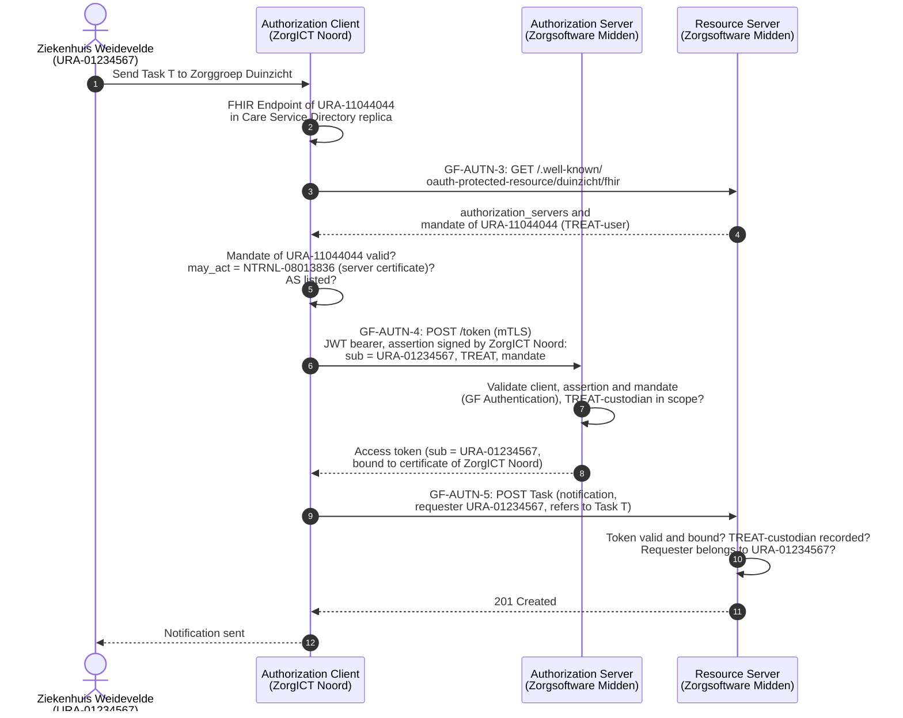
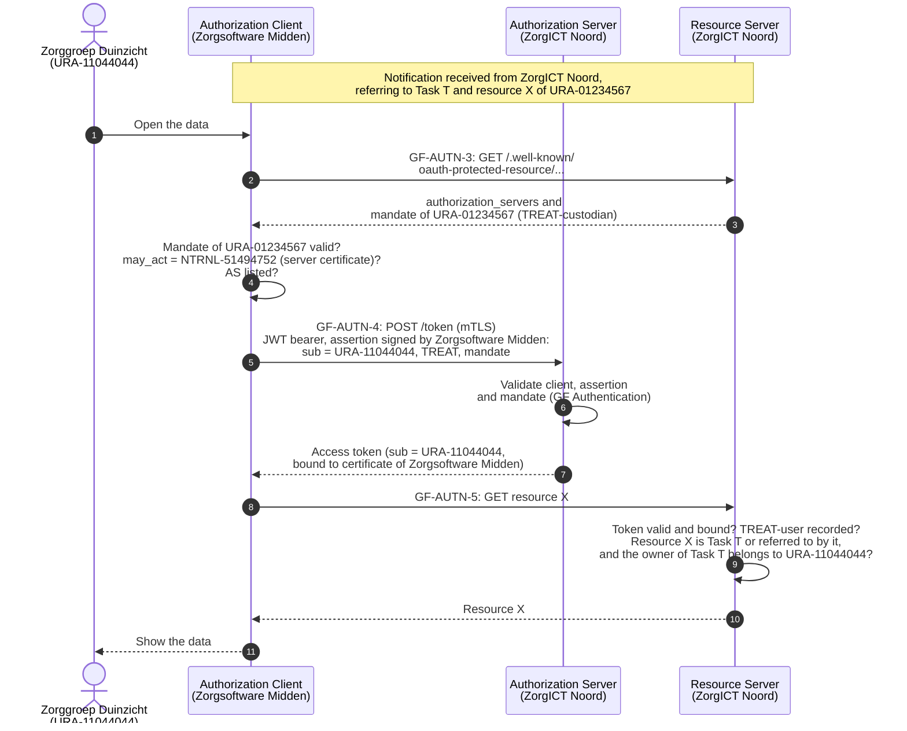

This page specifies how GF Authentication is applied in BgZ and eOverdracht. It supplements [GF Authentication](./authentication.html), which applies in full. This page adds only what is specific to BgZ and eOverdracht.
{: .ig-lead}

> **Note:** This page is a draft. The terms on this page are defined in [GF Authentication](./authentication.html#terminology).

### Scope

In BgZ and eOverdracht, the source first sends a notification to the receiving care provider about data that it makes available. The receiving service provider then retrieves that data from the source. Both steps are requests under GF Authentication, in opposite directions:
- **Sending the notification.** The source's service provider is the Authorization Client. It requests a token from the authorization server of the receiver, and creates the notification at the receiver's resource server.
- **Retrieving the data.** The receiving service provider is the Authorization Client. It requests a token from the authorization server of the source, and retrieves the data from the source's resource server.

[GF Authentication](./authentication.html#verification-of-the-source) requires that the Authorization Client verifies the other party before it requests a token, and leaves to each use case how the client finds what it verifies. Other use cases MAY do this differently, for example through the CapabilityStatement of the FHIR server.

### What is specific to BgZ and eOverdracht

Everything else is specified in [GF Authentication](./authentication.html) and [Obtaining a mandate](./authentication-mandate.html).

| Topic | BgZ and eOverdracht |
|---|---|
| Finding the other party | The receiver from the Care Service Directory; the source from the notification. See [Finding the other party](#finding-the-other-party). |
| Finding the mandate and the authorization server | In the Protected Resource Metadata of the resource. See [GF-AUTN-3](#gf-autn-3-get-protected-resource-metadata) and [Choosing the authorization server](#choosing-the-authorization-server). |
| Purpose | Only `TREAT`. See [Purpose and mandate codes](#purpose-and-mandate-codes). |
| Mandate codes | `TREAT-custodian` for the source's service provider and `TREAT-user` for the receiving service provider, in both steps. See [Purpose and mandate codes](#purpose-and-mandate-codes). |
| Token request | No `scope`; only the `nl-gis-v1` object in `authorization_details` ([GF-AUTN-4](./authentication.html#gf-autn-4-request-access-token)). |
| Authorization by the resource server | Based on the notification `Task`. See [Authorization by the resource server](#authorization-by-the-resource-server). |

### Actors

| Actor | Role | Transactions |
|---|---|---|
| Authorization Client | Sends the notification on behalf of the source; or finds and verifies the source and retrieves the data | Client for [GF-AUTN-3](#gf-autn-3-get-protected-resource-metadata) |
| Resource Server | Publishes its metadata and mandate; receives the notification or makes the data available, and applies the checks of the use case | Server for [GF-AUTN-3](#gf-autn-3-get-protected-resource-metadata) |

Both service providers act as Authorization Client and as Resource Server, each in one of the two steps. The other transactions, [GF-AUTN-2](./authentication-mandate.html#gf-autn-2-obtain-mandate) and [GF-AUTN-4](./authentication.html#gf-autn-4-request-access-token) to [GF-AUTN-6](./authentication.html#gf-autn-6-get-client-metadata), are specified in [GF Authentication](./authentication.html) and [Obtaining a mandate](./authentication-mandate.html).

### Finding the other party

To send the notification, the source's service provider finds the FHIR `Endpoint` of the receiving care provider in its [Care Service Directory](./csd.html) replica.

To retrieve the data, the Authorization Client takes the URL of the resource and the URA of the source care provider from the notification. It MAY also find them as the source's FHIR `Endpoint` in its Care Service Directory replica.

### GF-AUTN-3: Get Protected Resource Metadata

Before it requests a token, the Authorization Client retrieves the metadata of the resource ([RFC 9728](https://www.rfc-editor.org/rfc/rfc9728)). RFC 9728 inserts the well-known path between the host and the path of the resource. For `https://fhir.zorgict-noord.example/weidevelde/fhir` the request is:

```
GET /.well-known/oauth-protected-resource/weidevelde/fhir HTTP/1.1
Host: fhir.zorgict-noord.example
```

The resource server SHALL publish, besides the RFC 9728 parameters `resource` and `authorization_servers`, the mandates of the care providers that the resource serves. They are published in `attestations`: an object with a list of attestations per attestation type, as in the [assertion](./authentication.html#assertion). A mandate is published as an SD-JWT VC without disclosures and without key binding JWT, which ends in `~`.

```json
{
  "resource": "https://fhir.zorgict-noord.example/weidevelde/fhir",
  "authorization_servers": ["https://as.zorgict-noord.example"],
  "tls_client_certificate_bound_access_tokens": true,
  "attestations": { "URA-signed-mandate": ["<mandate of Ziekenhuis Weidevelde for ZorgICT Noord>~"] }
}
```

If the resource server does not accept the client certificate, the TLS handshake fails. If it has no valid mandate for a care provider, for example during renewal, `attestations` contains none for that care provider. The client treats a missing or invalid mandate as a failed [verification of the source](./authentication.html#verification-of-the-source), and requests no token.

The Authorization Client checks that `resource` equals the URL of the resource (RFC 9728, §3.3). It then verifies the source as specified in [Verification of the source](./authentication.html#verification-of-the-source), with the mandate from `attestations` whose `sub` is the URA of the care provider it wants to reach.

#### One document or one per care provider

RFC 9728 gives each resource URL its own metadata document. A service provider that registers one FHIR address for all its care providers therefore publishes one document with the mandates of all of them. A service provider that registers an address per care provider publishes a document per care provider. It can generate those documents from one service, based on the path.

A resource server MAY serve several care providers with one document. Each mandate contains its certificate chain and takes several kilobytes. A document with the mandates of a thousand care providers takes several megabytes, and every client retrieves it.

#### Caching and renewal

The Authorization Client MAY cache the metadata as indicated by its `Cache-Control` header, for at most 24 hours. It SHALL check the validity of the cached mandate before each use.

The resource server publishes a renewed mandate as specified in [Validity and renewal](./authentication.html#validity-and-renewal).

### Choosing the authorization server

The Authorization Client uses an authorization server from `authorization_servers`. It retrieves its metadata ([RFC 8414](https://www.rfc-editor.org/rfc/rfc8414)) to find the token endpoint.

If the client knows an authorization server for the source in another way, for example from an `Endpoint` in the LRZa, it uses it only if it is listed in `authorization_servers`.

### Purpose and mandate codes

BgZ and eOverdracht accept only the purpose `TREAT`. The assertion contains `TREAT` in `purpose_of_use`. The source's service provider needs the mandate code `TREAT-custodian` and the receiving service provider `TREAT-user`, in both steps ([Mandate codes](./authentication.html#mandate-codes)):

| Step | Authorization Client | Mandate code of the client | Mandate code of the resource server |
|---|---|---|---|
| Sending the notification | Source's service provider | `TREAT-custodian` | `TREAT-user` |
| Retrieving the data | Receiving service provider | `TREAT-user` | `TREAT-custodian` |

The authorization server of the receiver therefore accepts `TREAT-custodian` for the client. Its resource server allows only the creation of a notification with such a token.

### Authorization by the resource server

The notification is a `Task`. The resource server of the receiver allows the creation of a notification only if both conditions hold:
- the mandate codes recorded for the access token contain `TREAT-custodian`;
- the `Task.requester` belongs to the care provider on whose behalf access is granted (`sub`).

The notification refers to a `Task` at the source. The resource server of the source allows a request only if all conditions hold:
- the mandate codes recorded for the access token contain `TREAT-user`;
- the requested resource is that `Task`, or a resource that the `Task` refers to in `Task.focus` or `Task.input`;
- the `Task.owner`, a `HealthcareService`, belongs to the care provider on whose behalf access is granted (`sub`).

The access token therefore needs no reference to the `Task` or the patient.

### Privacy considerations

The Protected Resource Metadata shows which care providers have mandated the source's service provider. It is only available over mTLS. With one document for all care providers, a client sees all of them at once. This adds little: the care providers that a service provider serves can already be found in GF Adressering, through the `Endpoint` resources that it manages.

### Example: notification and retrieval

This example is illustrative. It does not follow the information standard of BgZ or eOverdracht, and uses placeholders for the notification and the data. The organizations are listed in [Example organizations](./authentication.html#example-organizations).

Ziekenhuis Weidevelde makes data about a patient available to Zorggroep Duinzicht. It creates Task T at its own resource server, with Duinzicht as owner.

#### Sending the notification

ZorgICT Noord, the service provider of Weidevelde, sends a notification to Zorgsoftware Midden, the service provider of Duinzicht. The notification refers to Task T.



#### Retrieving the data

Zorgsoftware Midden retrieves resource X, which Task T refers to.



The checks of the authorization server are shown in detail in the example of [GF Authentication](./authentication.html#use-case-requesting-an-access-token).
