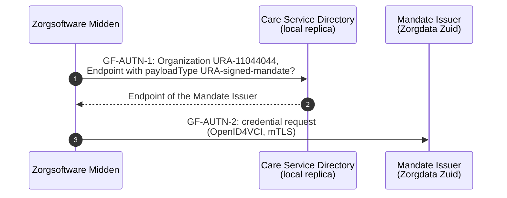
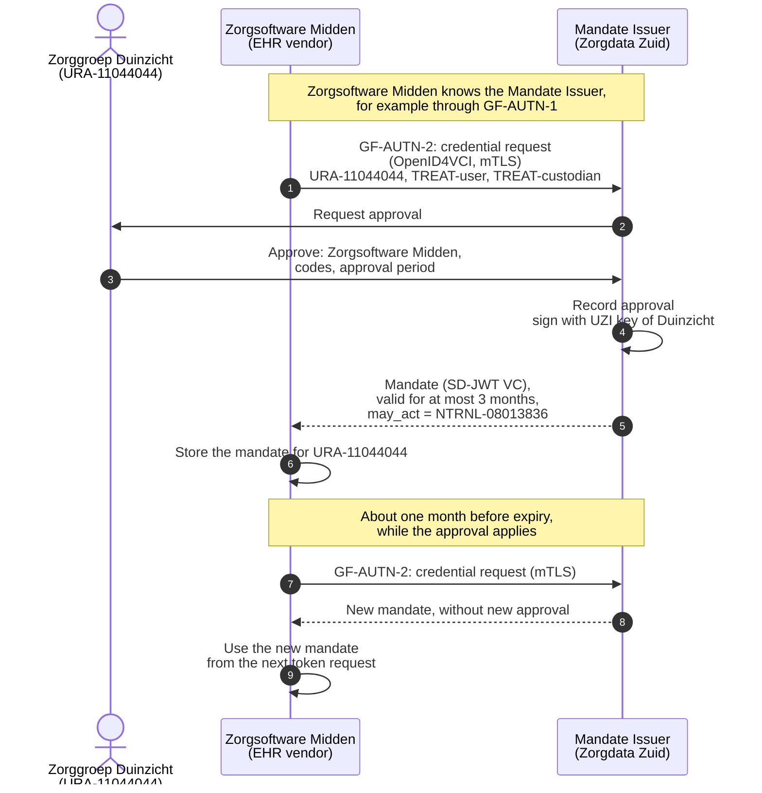

This page specifies how a service provider obtains and renews a mandate from a care provider: the Mandate Issuer, how a care provider publishes it in the LRZa, and how a service provider finds it and requests a mandate. It supplements [GF Authentication](./authentication.html), which specifies the mandate itself and how verifiers check it.
{: .ig-lead}

> **Note:** This page is a draft. The terms on this page are defined in [GF Authentication](./authentication.html#terminology).

### Scope

A service provider needs a mandate from the care provider before it can exchange data on its behalf ([GF-AUTN-2](#gf-autn-2-obtain-mandate)). It requests the mandate from the Mandate Issuer of a trusted service provider of that care provider. This page specifies how it finds that Mandate Issuer, and how it requests and renews the mandate.

A service provider MAY also know the Mandate Issuer in another way, for example because the care provider tells it. Verifiers of a mandate do not use this page: they only check that the mandate is signed with a valid UZI server certificate of the care provider ([Validation by the authorization server](./authentication.html#validation-by-the-authorization-server), step 5).

### Actors

| Actor | Role | Transactions |
|---|---|---|
| [Mandate Issuer](#mandate-issuer) | Issues mandates for a care provider, after its approval | Server for [GF-AUTN-2](#gf-autn-2-obtain-mandate) |
| Care Service Directory | Publishes the endpoints of the Mandate Issuers | Server for [GF-AUTN-1](#gf-autn-1-discover-mandate-issuer) |
| Authorization Client or Resource Server | Finds the Mandate Issuer of a care provider, and obtains and renews its mandate | Client for [GF-AUTN-1](#gf-autn-1-discover-mandate-issuer) and [GF-AUTN-2](#gf-autn-2-obtain-mandate) |

### Mandate Issuer

The Mandate Issuer is operated by the trusted service provider of a care provider. It holds the key of the care provider's UZI server certificate. It SHALL:
- issue a mandate only after the care provider has approved it: the service provider, the mandate codes, and the period during which the approval applies;
- renew mandates while the approval applies, and stop renewing when the care provider withdraws it (see [Renewal](#renewal)).

A care provider SHALL have at least one trusted service provider, so that its service providers can obtain mandates. It MAY have more than one, for example one per UZI server certificate. How a service provider finds the Mandate Issuer is specified in [GF-AUTN-1](#gf-autn-1-discover-mandate-issuer).

How the Mandate Issuer protects the key and organises approval is not specified here (see [Responsibility of the care provider](./authentication.html#responsibility-of-the-care-provider)).

### Publication in the LRZa

A care provider SHOULD publish the Mandate Issuer of each trusted service provider in the LRZa, so that service providers can find it in their local replica ([GF Care Service Directory](./csd.html)). It publishes it as an `Endpoint` that its `Organization` refers to in `Organization.endpoint`, with:
- connectionType `openid4vci` from the [NL GF Authorization Server CodeSystem](./CodeSystem-nl-gf-authorization-server-cs.html);
- payloadType `URA-signed-mandate` from the [NL GF Authorization Type CodeSystem](./CodeSystem-nl-gf-authorization-type-cs.html);
- `managingOrganization`: the trusted service provider;
- as address the OpenID4VCI Credential Issuer Identifier of the Mandate Issuer.

Who may register this `Endpoint` follows from the rules of [GF Care Service Directory](./csd.html): the care provider itself in the LRZa portal, or a service provider with the right to manage the care provider's endpoints.

The publication only tells service providers where to request a mandate. It grants no rights, and does not limit who can sign a mandate.

### GF-AUTN-1: Discover Mandate Issuer

A service provider that does not already know the Mandate Issuer searches its local Care Service Directory replica ([ITI-90-NL](./csd.html#search-care-services-iti-90-nl)) for the `Organization` of the care provider, and takes from `Organization.endpoint` an active `Endpoint` with payloadType `URA-signed-mandate`. If there is more than one, the care provider tells the service provider which one to use.

If the service provider is itself the trusted service provider, it issues the mandate to itself and skips [GF-AUTN-2](#gf-autn-2-obtain-mandate).

Example: the `Endpoint` of the Mandate Issuer of Zorggroep Duinzicht, operated by Zorgdata Zuid ([Example organizations](./authentication.html#example-organizations)). The `Organization` of Duinzicht refers to it in `Organization.endpoint`. Only the elements of this page are shown.

```json
{
  "resourceType": "Endpoint",
  "status": "active",
  "connectionType": {
    "system": "https://fhir.generiekefuncties.nl/CodeSystem/nl-gf-authorization-server-cs",
    "code": "openid4vci"
  },
  "payloadType": [
    {
      "coding": [
        {
          "system": "https://fhir.generiekefuncties.nl/CodeSystem/nl-gf-authorization-type-cs",
          "code": "URA-signed-mandate"
        }
      ]
    }
  ],
  "managingOrganization": {
    "identifier": { "system": "http://kvk.nl", "value": "34270859" },
    "display": "Zorgdata Zuid B.V."
  },
  "address": "https://mandaat.zorgdata-zuid.example"
}
```



### GF-AUTN-2: Obtain Mandate

The service provider finds the Mandate Issuer of the care provider, for example with [GF-AUTN-1](#gf-autn-1-discover-mandate-issuer). If it is itself the trusted service provider, it issues the mandate to itself. Otherwise it requests a mandate from the Mandate Issuer with [OpenID4VCI](https://openid.net/specs/openid-4-verifiable-credential-issuance-1_0.html), over mTLS with its certificate.

The Mandate Issuer publishes Credential Issuer Metadata (OpenID4VCI, §12.2) with a credential configuration `URA-signed-mandate`, with format `dc+sd-jwt` and the `vct` of the [mandate](./authentication.html#mandate), and with a `deferred_credential_endpoint`. Its authorization server supports the client credentials grant with `tls_client_auth` and certificate-bound access tokens ([RFC 8705](https://www.rfc-editor.org/rfc/rfc8705)). It MAY be the Mandate Issuer itself.

The service provider:
1. requests an access token with `grant_type` `client_credentials`. The `client_id` is the URL of its [Client ID Metadata Document](./authentication.html#client-id-metadata-document). The request contains `authorization_details` ([RFC 9396](https://www.rfc-editor.org/rfc/rfc9396)) with one object of type `openid_credential` (OpenID4VCI, §5.1.1), with:
   - `credential_configuration_id`: `URA-signed-mandate`;
   - `care_provider`: the URA of the care provider, as `URA-` followed by the 8 digits;
   - `mandate_codes`: the requested [mandate codes](./authentication.html#mandate-codes), as an array of strings.
2. sends a Credential Request (OpenID4VCI, §8) to the `credential_endpoint`, with that access token and `credential_configuration_id` `URA-signed-mandate`. The request contains no proof: a mandate is not bound to a key, but to the service provider identifier.

The authorization server of the Mandate Issuer checks that the host of the `client_id` is a `dNSName` in the client certificate, as in [Validation by the authorization server](./authentication.html#validation-by-the-authorization-server), step 2. It rejects a request for a care provider for which the Mandate Issuer does not sign. The access token records the care provider and the mandate codes.

The Mandate Issuer:
1. derives the service provider identifier from the certificate of the connection ([Service provider identifier](./authentication.html#service-provider-identifier)), and checks that the access token is bound to that certificate;
2. issues the mandate immediately if an approval of the care provider applies for this service provider and these codes. Otherwise it asks the care provider for approval, for example in its own application, and returns a deferred response (OpenID4VCI, §9): status `202` with a `transaction_id` and an `interval`;
3. returns the [mandate](./authentication.html#mandate) in `credentials`, with `may_act.sub` equal to the service provider identifier.

After a deferred response, the service provider sends the `transaction_id` to the `deferred_credential_endpoint` (OpenID4VCI, §9), with an access token bound to the same certificate, at most once per `interval`. It receives the mandate once the care provider has approved it.

Example token request of Zorgsoftware Midden to Zorgdata Zuid, for a mandate of Zorggroep Duinzicht ([Example organizations](./authentication.html#example-organizations)):

```
POST /token HTTP/1.1
Host: mandaat.zorgdata-zuid.example
Content-Type: application/x-www-form-urlencoded

grant_type=client_credentials
&client_id=https%3A%2F%2Fzorgsoftware-midden.example%2Foauth%2Fclient
&authorization_details=<URL-encoded JSON below>
```

```json
[
  {
    "type": "openid_credential",
    "credential_configuration_id": "URA-signed-mandate",
    "care_provider": "URA-11044044",
    "mandate_codes": ["TREAT-user", "TREAT-custodian"]
  }
]
```

Example Credential Request, and the deferred response while the approval is pending:

```
POST /credential HTTP/1.1
Host: mandaat.zorgdata-zuid.example
Authorization: Bearer <access token>
Content-Type: application/json

{ "credential_configuration_id": "URA-signed-mandate" }
```

```
HTTP/1.1 202 Accepted
Content-Type: application/json
Cache-Control: no-store

{ "transaction_id": "8xLOxBtZp8", "interval": 5 }
```

The requesting service provider presents the mandate in each token request ([GF-AUTN-4](./authentication.html#gf-autn-4-request-access-token)). The source's service provider makes it available as the use case specifies.

### Renewal

While the care provider's approval applies, the Mandate Issuer issues a new mandate in time, for example one month before the current one expires. The service provider retrieves it with [GF-AUTN-2](#gf-autn-2-obtain-mandate), without a new approval. When the care provider withdraws its approval, the Mandate Issuer stops renewing. What this means for the current mandate is specified in [Validity and renewal](./authentication.html#validity-and-renewal).

### Example: obtaining and renewing a mandate

Zorggroep Duinzicht uses the EHR of Zorgsoftware Midden for its exchanges, and has designated its hosting provider Zorgdata Zuid as trusted service provider. The organizations are listed in [Example organizations](./authentication.html#example-organizations).


