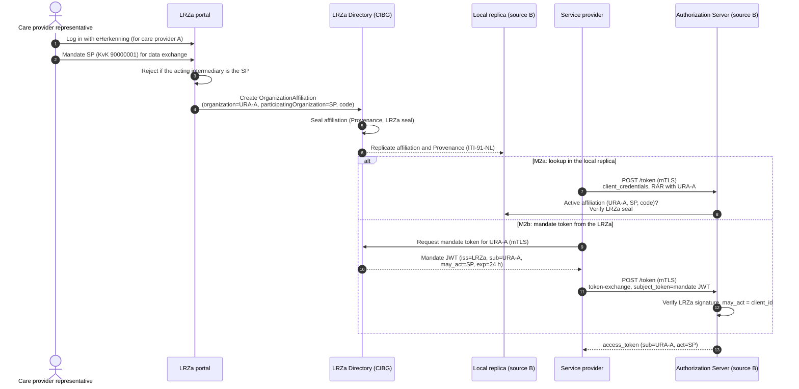
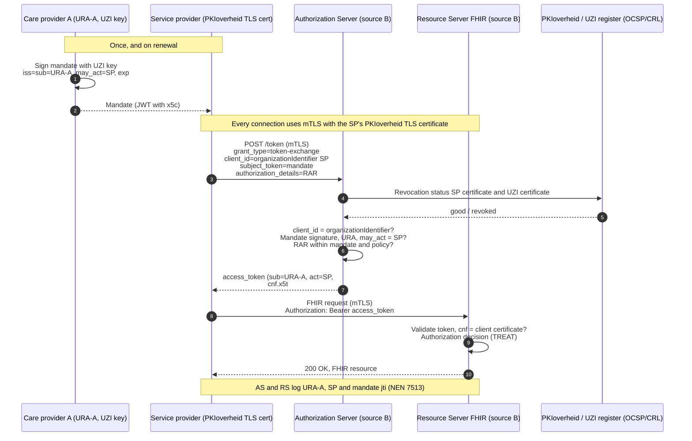

This page describes an alternative variant of [Authentication](authentication.html), modelled on the way PSD2 and the Berlin Group [NextGenPSD2/openFinance API Framework](https://www.berlin-group.org/standards/open-banking-nextgenpsd2/) let third-party providers access bank accounts on behalf of a customer. A service provider (SP) acts on behalf of a care provider in the same way a third-party provider (TPP) acts on behalf of a bank customer: the SP is identified by its own certificate on every connection, without prior client registration, and the care provider's authorization travels as a signed mandate.
{: .ig-lead}

> This page is an exploration of a variant, not a decision. It builds on [Service provider en mandatering](authenticatie-service-provider-mandatering.html) (solution O2) and on [Varianten voor Dynamic Client Registration](authenticatie-dynamic-client-registration.html) (variant V4). Facts about certificates and trust lists were checked on 15 October 2026.

### Key points

- **No client registration.** The authorization server (AS) derives the `client_id` from the SP's certificate, just as the Berlin Group uses the `organizationIdentifier` from the TPP's eIDAS certificate as `client_id`.
- **SP certificate in the QWAC role.** The SP authenticates with mutual TLS (mTLS, [RFC 8705](https://www.rfc-editor.org/rfc/rfc8705)) using its own PKIoverheid TLS certificate, on every connection to the AS and the resource server (RS).
- **Mandate from the care provider.** The care provider authorizes its SP with a long-lived mandate stating that the SP may act on its behalf. The care provider can sign the mandate with its UZI server certificate (QSealC role), or register it in the LRZa, which seals it, so that no care-provider signing infrastructure is needed (see [Issuing mandates](#issuing-mandates)). The SP never needs the care provider's private key.
- **Access token issued by the source.** The responding organization's AS issues the access token with its own signing key and binds it to the SP's certificate. The token is opaque to the client.

### Why PSD2 is a relevant model

PSD2 solves a problem that closely resembles the SP problem in healthcare:

- A third party (TPP) acts on behalf of a principal (the bank customer) to access data held by another party (the bank) with which the third party has no contract.
- Access is mandatory by law, the network is many-to-many, and it works in all EU member states.
- Banks may not require TPPs to register before they can access the API. The EBA considers "additional mandatory registration steps or processes with the ASPSP … other than the identification of the TPP via an eIDAS certificate in accordance with Article 34 RTS" an obstacle ([EBA/OP/2020/10, §51](https://www.eba.europa.eu/sites/default/files/document_library/Publications/Opinions/2020/884569/EBA%20Opinion%20on%20obstacles%20under%20Art.%2032%283%29%20RTS%20on%20SCA%26CSC.pdf)).

#### Role mapping

| PSD2 / Berlin Group | This variant |
|---|---|
| Bank that holds the account (ASPSP) | Responding care provider that holds the data (source), with its AS and FHIR RS |
| Licensed third-party provider (TPP) | Service provider (SP) acting on behalf of the requesting care provider |
| Bank customer who authorizes the TPP (PSU) | Requesting care provider that authorizes its SP |
| National competent authority (NCA) that licenses the TPP, and the EBA register | UZI register for the care provider (URA); no licensing body for SPs (see [Governance](#governance)) |
| Qualified trust service provider (QTSP) that issues certificates with PSD2 roles | PKIoverheid trust service provider for the SP certificate; CIBG (UZI register) for the care provider certificate |
| QWAC of the TPP (mTLS) | PKIoverheid TLS certificate of the SP |
| QSealC of the TPP (application-level signing) | UZI server certificate of the care provider, used to sign the mandate (M1); or the LRZa's seal on a registered mandate (M2) |
| Customer authentication and consent at the bank (SCA) | Mandate signed by the care provider, or registered by the care provider in the LRZa |
| Consent resource at the bank | Not needed; the purpose travels in the RAR object. Patient consent is out of scope, as in [Authentication](authentication.html#scope). |

The main deviation concerns the QSealC role. In PSD2 the TPP holds both the QWAC and the QSealC. The customer authorizes the TPP directly at its own bank, so no signed customer statement is needed. A requesting care provider has no relationship with the source, so its authorization must travel as a signed artifact. That is why the seal role moves to the care provider. If the mandate is registered in the LRZa (M2), the seal role moves once more, to the LRZa as registrar.

### Certificates

#### SP certificate (QWAC role)

The SP uses a PKIoverheid server certificate under the **G4 Private TLS** hierarchy (`G4 PKIo Priv G-TLS SYS`). According to the [PKIoverheid Programme of Requirements v5.4](https://cp.pkioverheid.nl/pkioverheid-por-v5.4.html):

- G4 Private TLS certificates contain the extended key usages `id-kp-serverAuth` **and** `id-kp-clientAuth` (§7.1.2.3.15), so they can be used as mTLS client certificates.
- Certificates with an `organizationName` contain `subject:organizationIdentifier`, with either a legal-person identifier following ETSI EN 319 412-1 §5.1.4 (for example `NTRNL-90000001` for a Dutch trade register number) or an OIN/HRN (§7.1.4.2.2.10). This is the same attribute the Berlin Group uses as `client_id`.

At the time of writing, [cert.pkioverheid.nl](https://cert.pkioverheid.nl/) lists G4 Private TLS issuing CAs for, among others, DigiCert and Digidentity.

> **This certificate is not a QWAC.** In the Dutch trusted list ([RDI, sequence 79, 26 June 2026](https://www.rdi.nl/site/binaries/content/assets/site-content/bestanden/current-tsl.xml)), the only granted qualified services for website authentication belong to DigiCert Europe Netherlands (QuoVadis). The former KPN PKIoverheid EV CA has the status *withdrawn*, and Digidentity has no qualified website-authentication service. KPN and Digidentity are qualified trust service providers, but their qualified PKIoverheid services cover electronic signatures and seals. Qualification is not required in this variant: the trust anchor (PKIoverheid G4 Private TLS root) is set by the system agreements, not by a regulation such as RTS Art. 34.

#### Care provider certificate (QSealC role)

This certificate is needed only when the care provider signs the mandate itself (M1 in [Issuing mandates](#issuing-mandates)). In that case the care provider signs with its **UZI server certificate** ([UZI register CPS v12.2](https://www.zorgcsp.nl/documents/Certification_Practice_Statement_UZI-register-EN.pdf)):

- Key usage `digitalSignature` and `keyEncipherment`; extended key usage server and client authentication.
- The URA is in the `subjectAltName.otherName`: `<OID CA>-1-<UZI no.>-S-<URA>-00.000-<AGB>` (Table 10). `O` contains the subscriber's name and `CN` the system's FQDN.

> **This certificate is not a QSealC.** The Dutch trusted list contains no qualified seal service for CIBG; the qualified UZI services are for signatures of natural persons. The CPS describes the server certificate as being "used for the authentication of systems and to protect communication" (Table 4) and states that certificates "are issued for the purpose indicated" (§1.4.2). Whether signing a mandate with it fits that purpose should be confirmed with CIBG. The [baseline](authentication.html) already signs JWTs with the same key.

### Signatures in this variant

The question of who signs what is the core of this variant. The SP authenticates the token request through mTLS; the mandate is signed by the care provider or, on its behalf, by the LRZa.

| Artifact | Signed or authenticated by | Certificate or key | Verified by |
|---|---|---|---|
| TLS handshake (client authentication) | SP | PKIoverheid TLS certificate of the SP | AS and RS, on every connection |
| Mandate | Requesting care provider (M1), or the LRZa as registrar (M2) | UZI server certificate (`x5c`), or the LRZa's seal certificate | AS, on every token request |
| Access token | AS of the source | The AS's own signing key, published via [RFC 8414](https://www.rfc-editor.org/rfc/rfc8414) `jwks_uri` | RS; the client treats the token as opaque |
| HTTP request seal (optional) | SP | A seal certificate of the SP | AS and RS |

Compared with the [baseline](authentication.html):

- **No client assertion.** A `private_key_jwt` client assertion is not needed, because mTLS already authenticates the SP.
- **No UZI signature on the access token.** The source no longer signs the access token with its UZI key, and the client no longer validates it. This follows normal OAuth practice and addresses the reviewers' objection that the access token should be opaque to the client (see [analysis of reviewer comments](authenticatie-service-provider-mandatering.html#analyse-van-reviewerreacties)).
- **Optional request seal.** If non-repudiation of individual requests is needed, the SP can additionally sign HTTP requests as the Berlin Group does with the TPP's QSealC (`Digest` and `x-jws-signature` headers; [Berlin Group V2.4.1 §6.2](https://berlin-group.org/wp-content/uploads/2026/09/11c.-Berlin-Group-openFinance-API-Framework-Core-PSD2-Compliance-V2-Suite-Protocol-Functions-and-Security-Measures-V2.4.1-20260731.pdf)). A PKIoverheid Organisatie Services certificate is a qualified seal certificate and could serve this role.

### Mandate

The care provider authorizes its SP with a signed mandate. Two options exist; option B is the default in this variant.

| | Option A: per-request grant | Option B: long-lived mandate (default) |
|---|---|---|
| OAuth mechanism | JWT authorization grant ([RFC 7523 §2.1](https://www.rfc-editor.org/rfc/rfc7523#section-2.1)) | Token exchange ([RFC 8693](https://www.rfc-editor.org/rfc/rfc8693)) with the mandate as `subject_token` |
| Signed when | For every token request | Once, for example per quarter, and on renewal |
| `aud` | The issuer identifier of the specific AS (RFC 7523 requires that the AS rejects a JWT that does not contain its own identity) | Omitted; the mandate is usable at every AS in the system |
| Lifetime | At most 5 minutes, with `jti` | For example 90 days, never beyond the certificate's `notAfter` |
| Care provider signing infrastructure | Must be online for every request | Only needed when the mandate is issued; not needed with M2–M5 (see [Issuing mandates](#issuing-mandates)) |
| Who holds the UZI private key | The care provider's signing service; if the SP hosts it, the key custody problem of O1 returns | The care provider (M1); with M2–M5 the UZI key is not used for the mandate |
| Revocation | Implicit through the short lifetime | Expiry, and optionally a status list |

Option B matches the long-lived mandate proposed by the reviewers (solution O2) and the Berlin Group consent, which a TPP can also reuse during its validity period.

#### Mandate claims (option B)

The example shows a mandate signed by the care provider itself (M1): a JWT signed with the private key of its UZI server certificate, with `x5c` containing the UZI certificate and chain. With M2b the LRZa issues the same claims under its own `iss` and seal; see [Issuing mandates](#issuing-mandates). An explicit type (`typ`) prevents the mandate from being accepted as another kind of JWT.

```json
{
  "typ": "nl-gf-mandate+jwt",
  "alg": "RS256",
  "x5c": ["<UZI server certificate of care provider A>", "<UZI-register Server CA>"]
}
```

```json
{
  "iss": "urn:oid:2.16.528.1.1007.3.3.11111111",
  "sub": "urn:oid:2.16.528.1.1007.3.3.11111111",
  "may_act": { "sub": "NTRNL-90000001" },
  "iat": 1792022400,
  "nbf": 1792022400,
  "exp": 1799798400,
  "jti": "5f0c2a8e-3b7d-4c1e-9a6f-2d8b7e4c1a90",
  "authorization_details": [
    {
      "type": "nl-gis-v1",
      "purpose_of_use": "http://terminology.hl7.org/CodeSystem/v3-ActReason|TREAT"
    }
  ]
}
```

| Claim | Description |
|---|---|
| `iss` | The issuer: the URA of the requesting care provider (M1), or the LRZa (M2b). |
| `sub` | The URA of the requesting care provider. With M1 it must equal the URA in the `otherName` of the signing certificate. |
| `may_act.sub` | The `client_id` of the SP that may act on behalf of the care provider ([RFC 8693 §4.4](https://www.rfc-editor.org/rfc/rfc8693#section-4.4)). |
| `iat`, `nbf`, `exp` | Validity period. |
| `jti` | Unique identifier, used for logging and revocation. |
| `authorization_details` | The maximum the SP may request on behalf of the care provider, for example the permitted purposes. |
| `status` (optional) | Reference to an entry in a status list ([draft-ietf-oauth-status-list](https://datatracker.ietf.org/doc/draft-ietf-oauth-status-list/), still a draft). |

### Issuing mandates

Option B needs a long-lived mandate, preferably without each care provider having to run its own signing infrastructure. Who creates and signs the mandate also determines whether an SP could mandate itself. In SaaS the SP often manages the care provider's UZI server certificate and its private key: the certificate manager "carries out activities relating to the server certificate on behalf of the subscriber" ([UZI register CPS v12.2](https://www.zorgcsp.nl/documents/Certification_Practice_Statement_UZI-register-EN.pdf), §1.3.5). A mandate signed with that key may then in practice be signed by the SP itself.

The options below are assessed on:

- **Self-mandating:** can the SP create or forge a mandate for itself?
- **Care provider effort:** what does the care provider need beyond what it already has?
- **Runtime dependency:** does the AS need a central service when it issues a token?
- **Revocation:** how quickly does withdrawing a mandate take effect?
- **Availability:** can the option be used today?

#### M1 — Care provider signs (reference)

The care provider signs the mandate itself, with the key of its UZI server certificate as in [Mandate claims](#mandate-claims-option-b), or with another certificate it controls.

- The care provider needs a signing service with access to that key.
- This prevents self-mandating only if the care provider, and not the SP, controls the key.
- The mandate can be verified offline, and the URA is in the certificate.

#### M2 — OrganizationAffiliation in the LRZa, sealed by the LRZa

A representative of the care provider registers the mandate in the LRZa portal after logging in with eHerkenning, in the same way as existing `OrganizationAffiliation` registrations ([Care Service Directory, use case 1](csd.html#use-case-1-admin-registers-affiliation-service-provider-publishes-resources)). The LRZa Directory accepts `OrganizationAffiliation` registrations only from care providers, "not by the parties that are being authorized" ([Care Service Directory, Security](csd.html#security)).

- **Scope:** a new code in [`NlGfAuthorizationTypeCS`](CodeSystem-nl-gf-authorization-type-cs.html), for example for exchanging data on behalf of the care provider, expresses what the SP may do. The existing codes cover only directory administration.
- **SP identity:** `participatingOrganization` identifies the SP by its trade register number, which matches the `NTRNL-` value of the `organizationIdentifier` in its PKIoverheid certificate. An SP identified by an OIN needs an additional mapping.
- **Seal:** the LRZa (CIBG), not the care provider, seals the registered affiliation as registrar, for example with a `Provenance` in the format of [Resource signing](signing.html). A PKIoverheid Organisatie Services certificate is listed in the Dutch trusted list as a qualified seal certificate. This means one signing service for the whole system instead of one per care provider.
- **Meaning of the seal:** "a representative of care provider X, authenticated with eHerkenning, registered this mandate". The LRZa keeps the eHerkenning login as evidence.

The AS can use the registered mandate in two ways:

- **M2a — lookup in the local replica.** The `OrganizationAffiliation` and the LRZa's `Provenance` are replicated to local replicas (ITI-91-NL), like other directory content. The AS checks that an active affiliation exists for the care provider's URA, the SP and the code, and verifies the LRZa seal. No mandate travels in the token request. The SP uses `client_credentials` and names the care provider's URA in a profile-defined field of `authorization_details`. This corresponds to solution O3 in [Service provider en mandatering](authenticatie-service-provider-mandatering.html).
- **M2b — mandate token issued by the LRZa.** The SP retrieves a mandate JWT from an LRZa endpoint over mTLS with its PKIoverheid certificate. The LRZa issues it only if an active affiliation exists with that SP as `participatingOrganization`. The JWT contains the [mandate claims](#mandate-claims-option-b), with `iss` set to the LRZa and a short lifetime, for example 24 hours. The SP refreshes it automatically and presents it as `subject_token`, and the AS verifies the LRZa signature offline.

Assessment of M2:

- **Self-mandating:** prevented at one central point, the LRZa portal. eHerkenning chain authorization ([ketenmachtiging](https://www.eherkenning.nl/nl/machtigen/ketenmachtiging)) lets an intermediary log in on behalf of an organization. The portal must therefore reject a registration in which the acting intermediary is the `participatingOrganization`, or not accept chain authorizations for this service.
- **Care provider effort:** an eHerkenning means at the level the LRZa requires; no keys or certificates.
- **Runtime dependency:**
  - M2a: none beyond the local replica.
  - M2b: the LRZa only when tokens are refreshed; an outage is bridged for the token lifetime. M2b does give the LRZa a limited operational role, which the [Care Service Directory](csd.html) currently excludes ("SHALL NOT have a direct operational role in healthcare data exchange transactions").
- **Revocation:** the care provider deactivates the affiliation in the portal.
  - M2a: takes effect at the replica's next synchronization (an interval of about 15 minutes is advised).
  - M2b: takes effect when the current mandate token expires, or immediately with a status list.
- **Availability:** builds on the existing portal, profile and replication. It needs a new authorization type, LRZa sealing and, for M2b, a mandate token endpoint.
- **Legal basis:** the LRZa's statutory basis is article 12 of the Wkkgz ([CIBG](https://www.cibg.nl/lrza)). Whether registering and sealing mandates for data exchange fits that basis has to be assessed.



#### M3 — European Business Wallet

The European Commission proposed a regulation on European Business Wallets in November 2025 ([COM(2025) 838](https://www.eerstekamer.nl/bijlage/20251121/com_2025_838_proposal_for_a/document3/f=/vmsoctgrbbeb.pdf)). According to Article 5(1), a business wallet lets its owner, among other things, "seal by means of qualified electronic seals" (point d) and "issue electronic attestations of attributes to European Business Wallets" (point f). Two patterns are possible:

- **Seal a prepared mandate.** The SP prepares the mandate with the claims above, and a representative of the care provider seals it with the care provider's business wallet.
- **Issue a mandate attestation.** The care provider's wallet issues a mandate attestation to the SP's business wallet, and the SP presents it.

Assessment:

- **Self-mandating:** prevented, provided that the care provider's wallet is not operated by the SP.
- **Care provider effort:** a business wallet; the wallet provider supplies the qualified seal, so no own signing infrastructure is needed.
- **Runtime dependency:** none; the seal is verified against the EU trusted lists.
- **Revocation:** expiry, or the status mechanism of the attestation.
- **Identity:** the wallet identifies the care provider by business identifiers, such as the trade register number, not by URA. The AS needs a mapping to the URA, for example from the LRZa replica, where an `Organization` carries both identifiers.
- **Delegation to an SP:** in the proposal, "mandate" (Art. 3(19)) means authorizing a representative to operate the wallet itself, not delegating to an external party. Delegation of powers between businesses is linked to the EU digital power of attorney of [Directive (EU) 2025/25](http://data.europa.eu/eli/dir/2025/25/oj). Whether this covers an IT service provider has not been established.
- **Availability:** the European Parliament confirmed its mandate for trilogue negotiations on 7 October 2026 ([procedure 2025/0358(COD)](https://oeil.europarl.europa.eu/oeil/en/procedure-file?reference=2025/0358(COD))). The regulation is still to be adopted and applies one year after entry into force (Art. 22).

#### M4 — Remote qualified seal

The care provider obtains a qualified seal certificate, for example a PKIoverheid Organisatie Services certificate, whose private key is held in a trust service provider's remote signing service, if such a service is offered for that certificate type. A representative approves and seals mandates through that service when needed.

- **Self-mandating:** prevented, provided that the signing account is not operated by the SP.
- **Care provider effort:** a seal certificate and an account per care provider, but no own HSM or signing service.
- **Identity:** as in M3, the certificate identifies the care provider by trade register number or OIN, so a mapping to the URA is needed.
- **Availability:** possible today. M4 is in effect M3 without a wallet.

#### M5 — Mandate in a UZI certificate for the SP

The UZI register could issue the SP a certificate that names both the care provider (URA) and the SP, just as PSD2 certificates carry the TPP's roles.

- **Current practice:** the UZI register records authorized applicants and certificate managers as natural persons (by BSN), not the SP as an organization (UZI register CPS, §1.3.5 and "Add authorized requester").
- **Required change:** the CPS and the certificate profile would have to change.
- **Fit with this variant:** a certificate would be needed for every combination of care provider and SP, which conflicts with this variant's principle that the SP uses one certificate of its own.

#### Comparison of the options

| Option | Who creates and signs | Care provider needs | Can the SP mandate itself? | Dependency when issuing a token | Revocation | Available |
|---|---|---|---|---|---|---|
| **M1** Care provider signs | Care provider (UZI key) | A signing service with the UZI key | Yes, if the SP manages the UZI key | None | Expiry or status list | Now |
| **M2a** LRZa affiliation, replica lookup | Care provider registers; LRZa seals | eHerkenning | No (portal check) | Local replica | At the next replica synchronization | Builds on the existing directory |
| **M2b** LRZa mandate token | Care provider registers; LRZa issues | eHerkenning | No (portal check) | None (LRZa only when refreshing) | When the token expires (for example 24 hours) | Requires a new LRZa endpoint |
| **M3** European Business Wallet | Care provider via its wallet | A business wallet | No, if the wallet is independent of the SP | None | Expiry or attestation status | After the regulation applies |
| **M4** Remote qualified seal | Care provider via a trust service provider | Seal certificate and signing account | No, if the account is independent of the SP | None | Expiry or status list | Now, where offered |
| **M5** Mandate in a UZI certificate | UZI register | A UZI application, as today | No (CIBG checks) | None | Certificate revocation | Requires a CPS change |

#### Observations

- **M2 builds on what care providers already use.** It uses the LRZa portal with eHerkenning, so care providers need no key or certificate. It also enforces in one place the rule that an SP cannot mandate itself. In PSD2 terms, the LRZa takes the role of the NCA and the EBA register (see [Governance](#governance)).
- **M2a and M2b can coexist.** M2a keeps the LRZa out of the data exchange, as the Care Service Directory requires. M2b makes the mandate portable, like the Berlin Group consent, at the cost of a periodic call to the LRZa.
- **M3 is the long-term path.** If the mandate claims stay the same, a wallet-sealed mandate can later replace or supplement the LRZa-sealed mandate without changing the token request. The URA mapping is the main point of attention.
- **M1 and M4 need a key per care provider.** In SaaS, M1 does not prevent an SP from mandating itself.

### Token request

The SP requests an access token at the AS of the source over mTLS with its PKIoverheid TLS certificate. RFC 8705 requires the `client_id` parameter in every request that uses mTLS client authentication. In this variant the `client_id` equals the `organizationIdentifier` of the SP's certificate.

```
POST /token HTTP/1.1
Host: as.zorgaanbieder-b.nl
Content-Type: application/x-www-form-urlencoded

grant_type=urn:ietf:params:oauth:grant-type:token-exchange
&client_id=NTRNL-90000001
&subject_token=eyJ0eXAiOiJubC1nZi1tYW5kYXRlK2p3dCIs...
&subject_token_type=urn:ietf:params:oauth:token-type:jwt
&requested_token_type=urn:ietf:params:oauth:token-type:access_token
&authorization_details=%5B%7B%22type%22%3A%22nl-gis-v1%22...%7D%5D
```

The `authorization_details` in the request are the same as in the [baseline](authentication.html#rich-authorization-requests-rar): purpose, target organization (`locations_organization_id`) and resource server (`locations`). They must fall within the `authorization_details` of the mandate ([RFC 9396 §6](https://www.rfc-editor.org/rfc/rfc9396#section-6)).

With option A, the SP sends `grant_type=urn:ietf:params:oauth:grant-type:jwt-bearer` with the grant signed by the care provider in the `assertion` parameter. The grant then contains `aud` (the issuer identifier of the AS), a short `exp` and a `jti`.

#### Validation by the authorization server

For every token request the AS:

1. **Validates the SP certificate** from the TLS handshake: chain up to the PKIoverheid G4 Private TLS root, validity period and revocation status (OCSP or CRL; the result may be cached for a period set in the profile).
2. **Derives and checks the client identity:** the `client_id` parameter must equal `subject:organizationIdentifier` of the certificate. The AS does not require prior registration. It may create a client record on first use, but that record must not outlive the certificate.
3. **Validates the mandate:**
   - the signature: with the key from `x5c`, including the UZI chain and revocation status (M1), or with the LRZa's seal certificate (M2b);
   - with M1, `iss` and `sub` against the URA in the certificate's `otherName`;
   - `typ`, `nbf` and `exp`;
   - `may_act.sub` against the authenticated `client_id`;
   - if present, the status list entry.

   With M2a the request contains no mandate. The AS instead looks up an active `OrganizationAffiliation` for the care provider and the SP in its local replica and verifies the LRZa seal.
4. **Checks the requested `authorization_details`** against the mandate and its own policy, for example `purpose_of_use=TREAT` and the target organization.
5. **Issues a sender-constrained access token** bound to the SP's certificate (`cnf.x5t#S256`, [RFC 8705 §3](https://www.rfc-editor.org/rfc/rfc8705#section-3)).
6. **Logs** the URA of the care provider, the `client_id` and certificate serial number of the SP, and the `jti` of the mandate, for traceability under NEN 7513.

### Access token

The AS issues the access token with its own key. If the token is a JWT ([RFC 9068](https://www.rfc-editor.org/rfc/rfc9068)), it contains for example:

```json
{
  "iss": "https://as.zorgaanbieder-b.nl",
  "sub": "urn:oid:2.16.528.1.1007.3.3.11111111",
  "client_id": "NTRNL-90000001",
  "act": { "sub": "NTRNL-90000001" },
  "aud": "https://fhir.zorgaanbieder-b.nl/fhir",
  "iat": 1792058400,
  "exp": 1792058700,
  "jti": "a1d4e6f8-0b2c-4d3e-8f7a-6b5c4d3e2f10",
  "authorization_details": [
    {
      "type": "nl-gis-v1",
      "purpose_of_use": "http://terminology.hl7.org/CodeSystem/v3-ActReason|TREAT",
      "locations_organization_id": "urn:oid:2.16.528.1.1007.3.3.12345678",
      "locations": ["https://fhir.zorgaanbieder-b.nl/fhir"]
    }
  ],
  "cnf": { "x5t#S256": "bwcK0esc3ACC3DB2Y5_lESsXE8o9ltc05O89jdN-dg2" }
}
```

- `sub` is the care provider on whose behalf access is granted; `client_id` and `act` identify the SP that acts ([RFC 8693 §4.1](https://www.rfc-editor.org/rfc/rfc8693#section-4.1)). The `client_id` uses a different namespace than the URA, so it cannot be mistaken for the subject (see FAPI 2.0 §6.7).
- The RS validates the token (signature via the AS's JWKS, or via introspection) and checks that the client certificate of the mTLS connection matches `cnf.x5t#S256`.
- Because the token is bound to the SP's certificate, a stolen token cannot be used without the SP's private key. DPoP is not needed.

### Example flow

The flow below shows a mandate signed by the care provider itself (M1). For mandates registered in the LRZa, see the flow under [M2](#m2--organizationaffiliation-in-the-lrza-sealed-by-the-lrza).



### Governance

PSD2 does not only define technology; the Berlin Group API works because of a surrounding governance structure. The table shows the counterparts in this variant and what is still missing.

| Element | PSD2 | This variant | Status |
|---|---|---|---|
| Legal duty to grant access | PSD2 obliges banks to give licensed TPPs access | Wegiz makes the BgZ and eOverdracht exchanges mandatory | Comparable |
| Who may act as a third party | NCA licenses the TPP; EBA register | No licensing of SPs; the care provider's mandate is the source of authority. With M2 the LRZa registers which SP may act for which care provider. | **Open:** whether the LRZa may register and seal mandates for data exchange (see [Issuing mandates](#issuing-mandates)) |
| Identity of the principal | — (customer authenticates at its own bank) | UZI register (URA) | Present |
| Certificates and roles | QTSP certificates with PSD2 roles ([ETSI TS 119 495](https://www.etsi.org/deliver/etsi_ts/119400_119499/119495/01.07.01_60/ts_119495v010701p.pdf)) | PKIoverheid certificate without healthcare role; authority in the mandate | Present, without roles |
| No extra registration | EBA/OP/2020/10 §51 | System agreement: an AS must not require prior registration of an SP; optional registration is allowed | To be agreed |
| Revocation | NCA asks the QTSP to revoke (ETSI TS 119 495, REV-6.2.6) | PKIoverheid trust service provider revokes the SP certificate; UZI register revokes the UZI certificate; care provider withdraws the mandate (with M2: deactivates the `OrganizationAffiliation` in the LRZa portal) | Depends on the issuing option |
| API specification | Berlin Group implementation guidelines | This IG and the FHIR IGs for BgZ and eOverdracht | Present |
| Discovery | AS metadata | [RFC 8414](https://www.rfc-editor.org/rfc/rfc8414), [RFC 9728](https://www.rfc-editor.org/rfc/rfc9728) and the LRZa endpoint directory | Present |

### Differences from the Berlin Group

This variant borrows the following from the Berlin Group:

- client identity from the certificate, without registration;
- mTLS on every connection to the AS and the RS ([V2.4.1 §5.1](https://berlin-group.org/wp-content/uploads/2026/09/11c.-Berlin-Group-openFinance-API-Framework-Core-PSD2-Compliance-V2-Suite-Protocol-Functions-and-Security-Measures-V2.4.1-20260731.pdf));
- `client_id` equal to the certificate's `organizationIdentifier` (§8.8.1);
- RFC 8705 client authentication at the token endpoint (§8.8.3).

It deliberately deviates on these points:

- **The seal role belongs to the principal or the registrar.** In the Berlin Group, the TPP's QSealC signs HTTP requests. Here the care provider's UZI certificate (M1) or the LRZa (M2) signs a mandate, because the care provider cannot authorize the SP at the source.
- **No qualified certificates.** Neither the PKIoverheid TLS certificate nor the UZI server certificate is qualified; see [Certificates](#certificates).
- **No customer redirect.** The exchange is system-to-system. Token exchange replaces the authorization code flow, so PKCE and PAR do not apply.
- **Explicitly bound tokens.** The access token carries `cnf.x5t#S256`. The Berlin Group refers to RFC 8705 but returns `token_type` `Bearer` and does not spell out the binding.

### Comparison with the baseline

| Aspect | [Baseline](authentication.html) | This variant |
|---|---|---|
| OAuth client | The care provider (URA) | The SP (`organizationIdentifier`) |
| Client authentication | `private_key_jwt` with the UZI key | mTLS with the SP's PKIoverheid TLS certificate |
| Client registration | Dynamic (UDAP) or manual | None; `client_id` derived from the certificate |
| Care provider identity | Client assertion signed with the UZI key | Mandate signed with the UZI key, or registered in and sealed by the LRZa |
| Holder of the UZI private key | The requesting side, in SaaS often the SP | The care provider (M1); not needed with M2–M5 |
| Grant | `client_credentials` | Token exchange (or JWT authorization grant) |
| Access token | Signed by the responding organization with its UZI key and validated by the client; bound with DPoP | Signed by the AS with its own key and opaque to the client; bound to the SP certificate |
| Transport and application trust | Organization identity at message level | SP identity at transport level; care provider identity at message level |

### FAPI 2.0

- **Compatible:** confidential client, client authentication with mTLS ([RFC 8705 §2](https://www.rfc-editor.org/rfc/rfc8705#section-2)), and sender-constrained access tokens. FAPI 2.0 does not prescribe how clients are registered.
- **Profile rule:** RFC 8705 compares the certificate with a single expected subject DN or SAN value per client. Binding on the `organizationIdentifier` attribute alone, as the Berlin Group does, is a rule this profile must define.
- **Not formally analysed:** FAPI 2.0 is structured to support other grants, but only the authorization code and CIBA flows have been through formal security analysis (FAPI 2.0 §5.3.2.1, Note 2). That applies to token exchange as it does to `client_credentials`.
- **Option A:** the grant's `aud` must be the AS's issuer identifier, in line with FAPI 2.0's rule for client authentication assertions.

### Considerations

- **TLS termination.** mTLS must reach the AS and the RS end to end. If a load balancer, gateway or GIS Veilig Netwerk component terminates TLS, the client certificate must be passed on in a trusted way ([RFC 9440](https://www.rfc-editor.org/rfc/rfc9440) is informational only). An alternative that keeps the rest of this variant is `private_key_jwt` with `x5c` of the SP's PKIoverheid certificate (the iSHARE pattern), combined with DPoP.
- **GISA choice A44.** This variant places the SP's identity at the transport layer, as PSD2 does. GISA prefers trust between sender and receiver at the application layer. The care provider's identity remains at the message level through the mandate.
- **Organization, not system.** The SP certificate identifies the SP organization. For traceability to a specific system, the AS and RS should also log the certificate's serial number and FQDN.
- **Revocation without registration.** There is no registration that can remain valid, so the AS checks the revocation status of the certificates on every token request. How quickly withdrawing a mandate takes effect depends on the issuing option; see [Issuing mandates](#issuing-mandates).
- **Product support.** Deriving the `client_id` from a certificate attribute and accepting an externally signed `subject_token` are not standard in every AS product.

### Open questions

- Which mandate issuing options does the system support, and does the LRZa's statutory basis (Wkkgz article 12) cover registering and sealing mandates for data exchange (M2)?
- Is registration of mandates in the LRZa sufficient as admission of SPs, comparable to the EBA register, or is a separate admission process needed?
- Which validity period and revocation mechanism apply to mandates, for example the lifetime of an LRZa mandate token (M2b)?
- (M1) May the UZI server certificate be used to sign mandates under the UZI register CPS?
- (M3) Does the EU digital power of attorney allow a care provider to delegate to an IT service provider, and how is the business wallet identity mapped to the URA?
- Which `organizationIdentifier` forms (trade register number or OIN) does the profile accept, and how does it handle SPs with multiple certificates?
- Does the system require qualified certificates (QWAC/QSealC) in the future, for example for cross-border exchange under the EHDS?

### Sources

Consulted on 15 October 2026.

- Berlin Group: [openFinance API Framework, Protocol Functions and Security Measures V2.4.1](https://berlin-group.org/wp-content/uploads/2026/09/11c.-Berlin-Group-openFinance-API-Framework-Core-PSD2-Compliance-V2-Suite-Protocol-Functions-and-Security-Measures-V2.4.1-20260731.pdf) (31 July 2026).
- PSD2: [Commission Delegated Regulation (EU) 2018/389, Art. 34](https://www.legislation.gov.uk/eur/2018/389/article/34), [EBA/OP/2020/10](https://www.eba.europa.eu/sites/default/files/document_library/Publications/Opinions/2020/884569/EBA%20Opinion%20on%20obstacles%20under%20Art.%2032%283%29%20RTS%20on%20SCA%26CSC.pdf) and [ETSI TS 119 495 V1.7.1](https://www.etsi.org/deliver/etsi_ts/119400_119499/119495/01.07.01_60/ts_119495v010701p.pdf).
- Certificates: [Dutch trusted list](https://www.rdi.nl/site/binaries/content/assets/site-content/bestanden/current-tsl.xml), [PKIoverheid Programme of Requirements v5.4](https://cp.pkioverheid.nl/pkioverheid-por-v5.4.html), [PKIoverheid CA certificates](https://cert.pkioverheid.nl/) and [UZI register CPS v12.2](https://www.zorgcsp.nl/documents/Certification_Practice_Statement_UZI-register-EN.pdf).
- Mandates: [CIBG, LRZa](https://www.cibg.nl/lrza), [eHerkenning, ketenmachtiging](https://www.eherkenning.nl/nl/machtigen/ketenmachtiging), the [proposal for a regulation on European Business Wallets, COM(2025) 838](https://www.eerstekamer.nl/bijlage/20251121/com_2025_838_proposal_for_a/document3/f=/vmsoctgrbbeb.pdf), [procedure 2025/0358(COD)](https://oeil.europarl.europa.eu/oeil/en/procedure-file?reference=2025/0358(COD)) and [Directive (EU) 2025/25](http://data.europa.eu/eli/dir/2025/25/oj).
- IETF and OpenID: [RFC 7523](https://www.rfc-editor.org/rfc/rfc7523), [RFC 8414](https://www.rfc-editor.org/rfc/rfc8414), [RFC 8693](https://www.rfc-editor.org/rfc/rfc8693), [RFC 8705](https://www.rfc-editor.org/rfc/rfc8705), [RFC 9068](https://www.rfc-editor.org/rfc/rfc9068), [RFC 9396](https://www.rfc-editor.org/rfc/rfc9396), [RFC 9440](https://www.rfc-editor.org/rfc/rfc9440), [RFC 9728](https://www.rfc-editor.org/rfc/rfc9728), [draft-ietf-oauth-status-list](https://datatracker.ietf.org/doc/draft-ietf-oauth-status-list/) and the [FAPI 2.0 Security Profile](https://openid.net/specs/fapi-security-profile-2_0.html).
