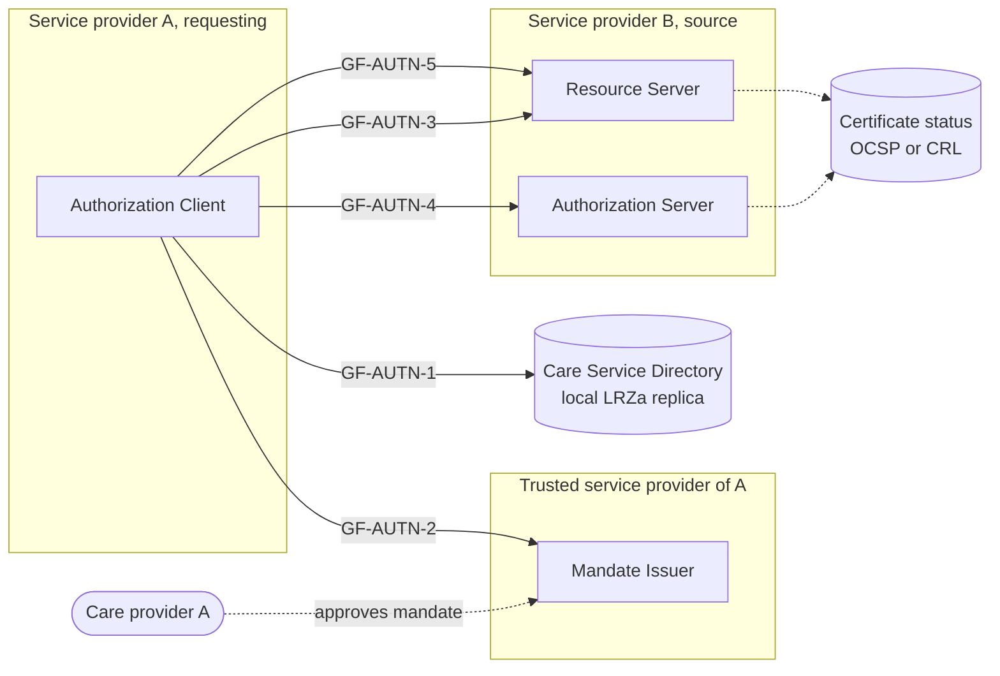
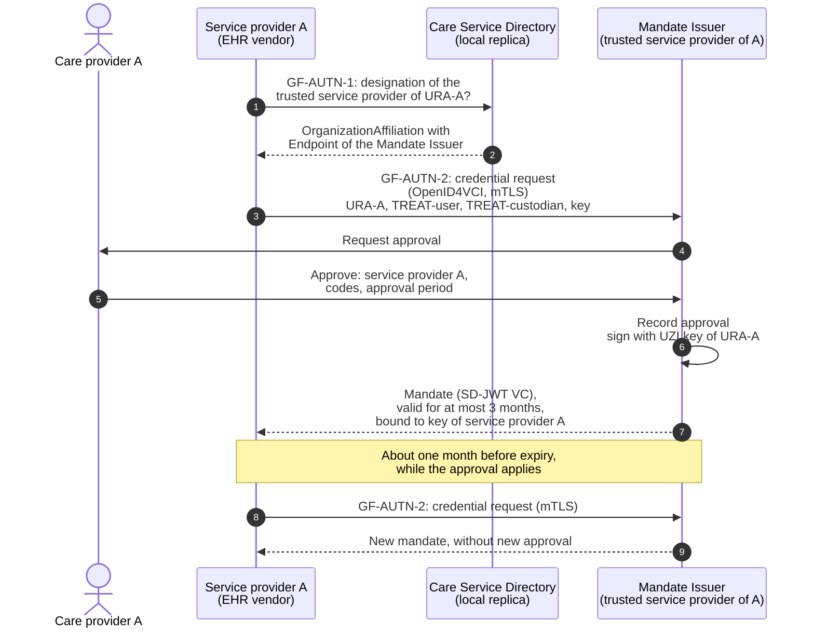
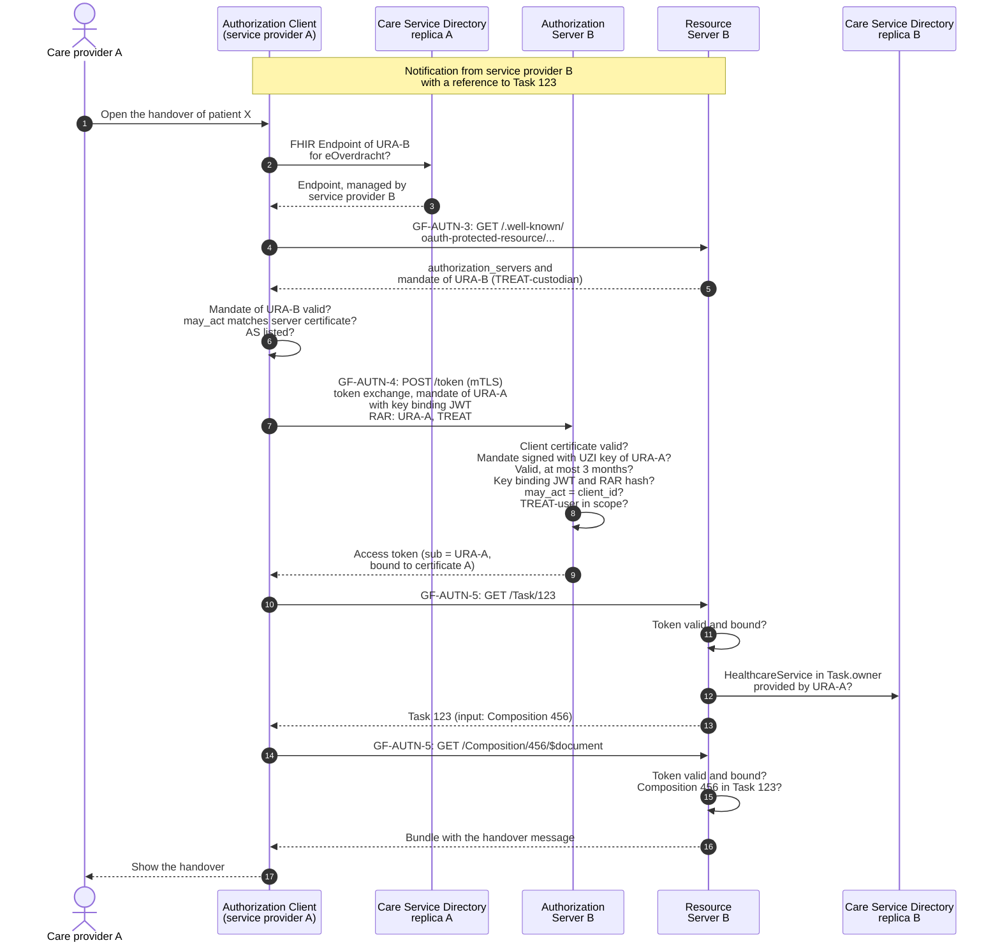

GF Authentication specifies how two healthcare providers establish each other's identity, and the purpose of an exchange, when they exchange health data through their service providers. It is a national initiative led by the Dutch Ministry of Health, Welfare and Sport (VWS) and applies first to the exchanges *Basisgegevensset Zorg* (BgZ) and *eOverdracht* (nursing handover), both mandatory under the Wegiz.
{: .ig-lead}

> **Note:** This specification is based on the memo [*Harmonisatie van authenticatie en autorisatie voor de gegevensuitwisselingen BgZ en eOverdracht*](./authenticatie-en-autorisatie-eOverdracht-BgZ-vMT-DICIO-20260818.html) and its follow-up [*Vervolg harmonisatie: clientregistratie en machtiging*](./authenticatie-en-autorisatie-vervolg-mandaat-clientregistratie.html), in which the alternatives are weighed. You should be able to read it without prior knowledge of these memos, but a basic understanding of OAuth 2.0 and FHIR is preferred.

### Scope

This page specifies:
- how a care provider mandates a service provider to act on its behalf, and how that mandate is issued, renewed and verified;
- how a service provider authenticates to the authorization server of another service provider, and obtains an access token for a care provider;
- how the requesting service provider establishes, before it sends a request, that the endpoint belongs to the source care provider and its mandated service provider;
- how the resource server validates each request.

This page does not specify:
- how a care provider authenticates its own practitioners and systems. Each care provider does that within its own domain;
- the authorization decision of the source beyond the checks on this page, such as patient consent;
- how endpoints and organizations are published. See [GF Care Service Directory](./csd.html).

The exchanges in scope are the targeted *sending* of health data between two care providers within BgZ and eOverdracht, where a referral, handover or *aanmelding* precedes the exchange. A (starting) treatment relationship then exists at the receiving care provider, and the patient's consent is implied in the agreement to the referral. Queries without a preceding referral, and exchanges that do not run between two care providers (for example from a PGO or a research institution), are out of scope.

### Terminology

| Term | Meaning |
|---|---|
| Care provider | The organization that provides care and is the controller of the health data (*zorgaanbieder*). It is identified by its URA. |
| URA | *UZI-Register Abonneenummer*, the identifier of a care provider in the UZI register, as `urn:oid:2.16.528.1.1007.3.3.<URA>`. |
| Service provider | The party that provides and operates the technical systems for a care provider (*dienstverlener*), such as an EHR vendor, SaaS platform or hub, or the care provider itself. It has its own certificate. |
| Trusted service provider | The one service provider that a care provider designates to issue mandates on its behalf, with the key of the care provider's UZI server certificate. A care provider can fulfil this role itself. |
| Mandate | A signed statement in which a care provider authorizes a service provider to act on its behalf for one or more mandate codes (*machtiging*). |
| Mandate code | The scope of a mandate, as `<purpose>-<role>`, for example `TREAT-user`. See [Mandate codes](#mandate-codes). |
| Source | The care provider that holds the requested data (custodian), and its service provider. |
| `client_id` | The identifier of a service provider as OAuth client, derived from its certificate. See [Client identification](#client-identification). |
| GIS | *Gezondheidsinformatiestelsel*, the national health information system under which this specification is agreed. |

### Solution overview

Key design principles:
- **International standards.** The solution builds on open, internationally adopted standards: OAuth 2.0 with the FAPI 2.0 security profile, mTLS (RFC 8705), token exchange (RFC 8693), Rich Authorization Requests (RFC 9396), Protected Resource Metadata (RFC 9728), and SD-JWT VC with OpenID4VCI for the mandate.
- **Federated trust.** Each care provider authenticates its own practitioners and systems within its own domain. Across the organizational boundary, the source verifies the identity of the other care provider, the service provider that acts for it, and the purpose of the exchange.
- **Transport trust and application trust are separated** (GISA choice A44). The service provider authenticates the connection with its own certificate. The identity of the care provider on whose behalf it acts is carried at the application layer, in the mandate. The executing system is therefore a recognizable actor in each exchange and in the logging.
- **Organization identity anchored in the UZI register.** A mandate is signed with the key of the care provider's UZI server certificate, so a verifier can check the URA against the UZI register.
- **No client registration.** An authorization server derives the `client_id` from the client certificate; no registration step or shared state between client and server is needed.

The process:
1. Each care provider designates one trusted service provider in the LRZa, with the endpoint of its Mandate Issuer.
2. Each service provider of the care provider, on the requesting and on the source side, obtains a mandate from that Mandate Issuer. The care provider approves the mandate once; the Mandate Issuer renews it every 3 months as long as the approval stands.
3. Before an exchange, the requesting service provider finds the source's endpoint in its Care Service Directory replica, and verifies the source's mandate that the resource server publishes.
4. The requesting service provider exchanges its mandate for an access token at the source's authorization server, over mTLS, with a RAR object that states the care provider and the purpose.
5. The requesting service provider sends its FHIR requests with the access token, over mTLS with the same certificate. The resource server validates the token, its binding to the certificate, and the request.



The source's service provider obtains its own mandate (`TREAT-custodian`) from the trusted service provider of care provider B in the same way (GF-AUTN-1 and GF-AUTN-2); this is not shown in the figure.

#### Federated trust model

The legal framework (WGBO, AVG and Wabvpz) leads to a federated trust model:
- Each care provider is responsible for the authentication and authorization of its own practitioners and systems. A care provider does not repeat the authentication of its exchange partner and may rely on its statement.
- The source care provider is responsible for establishing which care provider requests its data, which service provider acts for it, and for which purpose. For BgZ and eOverdracht the purpose is treatment: the exchange is necessary for the performance of the treatment agreement.
- Both care providers remain responsible for the systems that their service providers operate for them. The mandate records which service provider may act for a care provider, and for which purposes.

This trust is enforced through legally mandated standards (NEN 7510, NEN 7512 and NEN 7513), admission requirements, audits and supervision, and logging and liability after the fact. NEN 7513 and the patient's right of access (Wabvpz) require that it can be established afterwards which care provider and which system requested data.

#### Requirements

The legal framework leads to these requirements:
1. **Mutual establishment of the care provider identity.** Both parties establish, based on the URA, which care provider they exchange with, also when a service provider acts for it. Data is only delivered to the established care provider.
2. **Identification of the executing system.** The service provider that operates the requesting or responding system is identified by its certificate.
3. **No authentication of the partner's practitioners.** The exchange does not verify individual practitioners of the other care provider; it carries the context needed for authorization, logging and traceability at the organization level.
4. **Explicit purpose.** The purpose of the exchange is stated explicitly, so that the source can base its authorization decision on it and distinguish it from other purposes.

#### Standards

| Choice | Rationale |
|---|---|
| **OAuth 2.0** with the **FAPI 2.0** security profile | De-facto international standard for controlled access between systems; asymmetric client authentication, sender-constrained access tokens, mandatory transport security and strict validation. |
| **mTLS** for client authentication and sender-constrained tokens ([RFC 8705](https://www.rfc-editor.org/rfc/rfc8705)) | One mechanism for transport, client authentication and token binding, using the certificate of the service provider that operates the connection. |
| **Client identifier from the certificate** | No registration step, and no state to keep in sync; the identifier stays the same when the certificate is renewed. |
| **Mandate as SD-JWT VC**, issued with **OpenID4VCI** | The format and issuance protocol of attestations in European wallets, signed with the care provider's UZI key and bound to a key of the service provider. |
| **Token exchange** ([RFC 8693](https://www.rfc-editor.org/rfc/rfc8693)) | The mandate travels with each token request as the subject token; there is no interactive user in the exchange. |
| **Rich Authorization Requests** ([RFC 9396](https://www.rfc-editor.org/rfc/rfc9396)) | Carries the care provider, the purpose and the target of the request. |
| **Protected Resource Metadata** ([RFC 9728](https://www.rfc-editor.org/rfc/rfc9728)) | Publishes the authorization servers of an endpoint and the source's mandate, so the requesting service provider can verify the source before it sends a request. |

### Actors

| Actor | Role | Transactions | Requirements |
|---|---|---|---|
| [Mandate Issuer](#mandate-issuer) | Issues mandates for a care provider, after its approval | Server for [GF-AUTN-2](#GF-AUTN-2-obtain-mandate) | [Mandate](#mandate) |
| [Authorization Client](#authorization-client) | Requests data for a care provider | Client for [GF-AUTN-1](#GF-AUTN-1-discover-mandate-issuer) to [GF-AUTN-5](#GF-AUTN-5-access-resource) | [Client identification](#client-identification), [Mandate](#mandate), [RAR object](#rar-object) |
| [Authorization Server](#authorization-server) | Issues access tokens for the source | Server for [GF-AUTN-4](#GF-AUTN-4-token-exchange) | [Validation by the authorization server](#validation-by-the-authorization-server) |
| [Resource Server](#resource-server) | Serves the source's data, and publishes its metadata and mandate | Server for [GF-AUTN-3](#GF-AUTN-3-get-protected-resource-metadata) and [GF-AUTN-5](#GF-AUTN-5-access-resource); client for [GF-AUTN-1](#GF-AUTN-1-discover-mandate-issuer) and [GF-AUTN-2](#GF-AUTN-2-obtain-mandate) | [Validation by the resource server](#validation-by-the-resource-server) |
| [Care Service Directory](#care-service-directory) | Publishes the designation of trusted service providers and the endpoints | Server for [GF-AUTN-1](#GF-AUTN-1-discover-mandate-issuer) | [GF Care Service Directory](./csd.html) |

#### Mandate Issuer

The Mandate Issuer is operated by the trusted service provider of a care provider. It holds the key of the care provider's UZI server certificate, and SHALL keep that key non-exportable, for example in an HSM. It SHALL:
- let the care provider approve each mandate request: the service provider, the mandate codes, and the period during which the approval applies;
- issue a mandate only after a recorded approval, and keep the approval as evidence: who approved, when, and what;
- give the care provider an overview of the mandates that it has approved and issued, and let it withdraw an approval;
- renew mandates while the approval applies (see [Validity and renewal](#validity-and-renewal)).

A Mandate Issuer SHALL NOT issue mandates for a care provider that has not designated its trusted service provider in the LRZa.

#### Authorization Client

The Authorization Client is the OAuth client of the requesting service provider. It holds a mandate with the code `<purpose>-user` for each care provider it acts for, and SHALL support [GF-AUTN-1](#GF-AUTN-1-discover-mandate-issuer) to [GF-AUTN-5](#GF-AUTN-5-access-resource).

#### Authorization Server

The Authorization Server is operated by the source's service provider, and can serve many care providers. It SHALL support [GF-AUTN-4](#GF-AUTN-4-token-exchange) and publish its metadata ([RFC 8414](https://www.rfc-editor.org/rfc/rfc8414)), with at least:
- `token_endpoint_auth_methods_supported`: `["tls_client_auth"]`;
- `tls_client_certificate_bound_access_tokens`: `true`;
- `grant_types_supported`: including `urn:ietf:params:oauth:grant-type:token-exchange`;
- `authorization_details_types_supported`: `["nl-gis-v1"]`.

#### Resource Server

The Resource Server is the source's FHIR API, registered as an `Endpoint` in the [Care Service Directory](./csd.html). It holds a mandate with the code `<purpose>-custodian` for each care provider it serves, which it obtains through [GF-AUTN-1](#GF-AUTN-1-discover-mandate-issuer) and [GF-AUTN-2](#GF-AUTN-2-obtain-mandate), and publishes it in [GF-AUTN-3](#GF-AUTN-3-get-protected-resource-metadata).

#### Care Service Directory

A care provider designates its trusted service provider in the LRZa portal, as an [`OrganizationAffiliation`](./StructureDefinition-nl-gf-organizationaffiliation.html) with:
- `organization`: the care provider;
- `participatingOrganization`: the trusted service provider;
- `code`: the code for the designation as trusted service provider (see [Open issues](#open-issues));
- `endpoint`: the `Endpoint` of the Mandate Issuer, with the URL of its OpenID4VCI credential issuer.

A care provider SHALL have at most one active designation. Service providers find it in their local replica of the LRZa ([GF Care Service Directory](./csd.html)). The LRZa is only used to find the Mandate Issuer; the verification of a mandate relies on its signature.

### Transactions

| ID | Transaction | Client | Server |
|---|---|---|---|
| GF-AUTN-1 | [Discover Mandate Issuer](#GF-AUTN-1-discover-mandate-issuer) | Authorization Client or Resource Server | Care Service Directory (local replica) |
| GF-AUTN-2 | [Obtain Mandate](#GF-AUTN-2-obtain-mandate) | Authorization Client or Resource Server | Mandate Issuer |
| GF-AUTN-3 | [Get Protected Resource Metadata](#GF-AUTN-3-get-protected-resource-metadata) | Authorization Client | Resource Server |
| GF-AUTN-4 | [Token Exchange](#GF-AUTN-4-token-exchange) | Authorization Client | Authorization Server |
| GF-AUTN-5 | [Access Resource](#GF-AUTN-5-access-resource) | Authorization Client | Resource Server |

All transactions SHALL use mTLS with the certificate of the service provider (see [Transport and certificates](#transport-and-certificates)). GF-AUTN-1 and GF-AUTN-2 run in advance and on renewal; GF-AUTN-3 to GF-AUTN-5 run for each exchange.

#### GF-AUTN-1: Discover Mandate Issuer

The service provider searches its local Care Service Directory replica ([ITI-90-NL](./csd.html#search-care-services-iti-90-nl)) for the active `OrganizationAffiliation` in which the care provider designates its trusted service provider, and takes the Mandate Issuer's `Endpoint` from it. If the service provider is itself the trusted service provider, it issues the mandate to itself and skips GF-AUTN-2.

#### GF-AUTN-2: Obtain Mandate

The service provider requests a mandate from the Mandate Issuer with [OpenID4VCI](https://openid.net/specs/openid-4-verifiable-credential-issuance-1_0.html), and authenticates with its certificate (mTLS). The request names the care provider, the requested mandate codes, and the public key to which the mandate is bound (`cnf`).

The Mandate Issuer:
1. derives the service provider's `client_id` from its certificate ([Client identification](#client-identification));
2. issues the mandate immediately if an approval for this service provider and these codes applies; otherwise it asks the care provider for approval, for example in its own application, and issues the mandate after approval;
3. returns the [mandate](#mandate), with `may_act.sub` equal to the service provider's `client_id`.

When the service provider uses a new key, it requests a new mandate for that key; the Mandate Issuer issues it without a new approval.

#### GF-AUTN-3: Get Protected Resource Metadata

Before it requests a token, the Authorization Client establishes that the endpoint belongs to the source care provider and its mandated service provider:
1. It finds the source's FHIR `Endpoint` for the use case in its Care Service Directory replica, and so the URA of the source care provider.
2. It retrieves the resource's metadata ([RFC 9728](https://www.rfc-editor.org/rfc/rfc9728)). RFC 9728 inserts the well-known path between the host and the path of the resource. For `https://fhir.dienstverlener-b.nl/zorgaanbieder-b/fhir` the request is:

   ```
   GET /.well-known/oauth-protected-resource/zorgaanbieder-b/fhir HTTP/1.1
   Host: fhir.dienstverlener-b.nl
   ```

3. It verifies the mandate of the source care provider in the metadata, as in [Validation by the authorization server](#validation-by-the-authorization-server), steps 3 and 4, and checks that:
   - `sub` is the URA of the source care provider from step 1;
   - `scope` contains the code `<purpose>-custodian` for the purpose of the request;
   - `may_act.sub` equals the identifier derived from the resource server's TLS server certificate ([Client identification](#client-identification));
   - the authorization server it will use is listed in `authorization_servers`.

The resource server SHALL publish, besides the RFC 9728 parameters `resource` and `authorization_servers`, the mandates of the care providers that the endpoint serves. A resource server that serves several care providers SHOULD use a path per care provider, so that each endpoint has its own metadata.

```json
{
  "resource": "https://fhir.dienstverlener-b.nl/zorgaanbieder-b/fhir",
  "authorization_servers": ["https://as.dienstverlener-b.nl"],
  "tls_client_certificate_bound_access_tokens": true,
  "authorization_details_types_supported": ["nl-gis-v1"],
  "nl_gf_custodian_mandates": ["<mandate of care provider B>"]
}
```

The parameter name `nl_gf_custodian_mandates` is provisional (see [Open issues](#open-issues)). The Authorization Client MAY cache the metadata for at most a maximum time set by the GIS, and SHALL check the validity of the cached mandate before each use.

#### GF-AUTN-4: Token Exchange

The Authorization Client requests an access token with a token exchange ([RFC 8693](https://www.rfc-editor.org/rfc/rfc8693)), over mTLS with its certificate (`tls_client_auth`). The subject token is its mandate, followed by a key binding JWT: `<mandate>~<key binding JWT>`.

```
POST /token HTTP/1.1
Host: as.dienstverlener-b.nl
Content-Type: application/x-www-form-urlencoded

grant_type=urn:ietf:params:oauth:grant-type:token-exchange
&client_id=NTRNL-90000001
&subject_token=<mandate>~<key binding JWT>
&subject_token_type=<to be set by the GIS>
&authorization_details=%5B%7B%22type%22%3A%22nl-gis-v1%22...%7D%5D
```

| Parameter | Value |
|---|---|
| `grant_type` | `urn:ietf:params:oauth:grant-type:token-exchange` |
| `client_id` | The `client_id` derived from the client certificate (RFC 8705 requires the parameter). |
| `subject_token` | The mandate with a key binding JWT, see [Key binding JWT](#key-binding-jwt). |
| `subject_token_type` | A type for the mandate, to be set by the GIS (see [Open issues](#open-issues)). |
| `authorization_details` | The [RAR object](#rar-object). |

The authorization server validates the request as described in [Validation by the authorization server](#validation-by-the-authorization-server). On success it returns a sender-constrained access token:

```json
{
  "access_token": "<opaque to the client>",
  "issued_token_type": "urn:ietf:params:oauth:token-type:access_token",
  "token_type": "Bearer",
  "expires_in": 300,
  "authorization_details": [ { "type": "nl-gis-v1", "...": "..." } ]
}
```

#### GF-AUTN-5: Access Resource

The Authorization Client sends its FHIR requests over mTLS with the same certificate, with the access token in the `Authorization` header. The resource server validates each request as described in [Validation by the resource server](#validation-by-the-resource-server).

```
GET /zorgaanbieder-b/fhir/Task/123 HTTP/1.1
Host: fhir.dienstverlener-b.nl
Authorization: Bearer <access token>
```

### Validation

#### Validation by the authorization server

The authorization server SHALL reject the token request if any of these checks fails:
1. **Client certificate.** The certificate meets the requirements in [Transport and certificates](#transport-and-certificates), and its revocation status is good.
2. **Client identifier.** The `client_id` derived from the certificate ([Client identification](#client-identification)) equals the `client_id` parameter.
3. **Mandate signature.**
   - The signature is valid for the certificate in `x5c`, which chains to the UZI register CA.
   - The certificate is a UZI server certificate (card type `S`), and its revocation status is good.
   - The URA in the certificate equals `sub`.
4. **Mandate content.**
   - `vct` is the mandate type set by the GIS.
   - The current time is between `nbf` and `exp`, and `exp` minus `nbf` is at most 3 months (92 days).
5. **Key binding.** The key binding JWT is signed with the key in `cnf`, `aud` is the authorization server's issuer identifier, `iat` is recent, `nonce` has not been used before, `sd_hash` matches the mandate, and `authorization_details_hash` matches the `authorization_details` parameter.
6. **Mandated service provider.** `may_act.sub` equals the `client_id`.
7. **Care provider and purpose.**
   - The RAR object has type `nl-gis-v1`.
   - `subject_organization_id` equals `sub`.
   - `scope` contains the code `<purpose>-user` for `purpose_of_use` (see [Mandate codes](#mandate-codes)).
   - `locations_organization_id` and `locations` refer to a care provider and resource server that this authorization server serves.

The access token is opaque to the client. It SHALL record on whose behalf access is granted (`sub`, the URA from `subject_organization_id`), which service provider acts (`client_id`, and `act` as in RFC 8693), the `authorization_details`, and the hash of the client certificate (`cnf.x5t#S256`, RFC 8705). How the authorization server and resource server exchange it, as a signed token or through token introspection ([RFC 7662](https://www.rfc-editor.org/rfc/rfc7662)), is up to them.

#### Validation by the resource server

For each request, the resource server SHALL:
1. validate the access token and its expiry;
2. check that the hash of the client certificate of the mTLS connection equals `cnf.x5t#S256` in the token;
3. check the revocation status of the client certificate;
4. take its authorization decision based on `purpose_of_use` and `subject_organization_id`, and on the checks of the use case.

For eOverdracht, the resource server checks that the `HealthcareService` in `Task.owner` is provided by the care provider in `subject_organization_id`: `HealthcareService.providedBy` in its Care Service Directory replica refers to the `Organization` with that URA, or to a part of it (`partOf`). For a resource in `Task.input`, it applies that check to the Task that the resource belongs to.

### Data models

#### Client identification

The `client_id` of a service provider is derived from a persistent identifier in its certificate:
- PKIoverheid server certificate: the `organizationIdentifier` attribute with the KvK number or OIN ([PKIoverheid PvE v5.4](https://cp.pkioverheid.nl/pkioverheid-por-v5.4.html), §7.1.4.2.2.10), for example `NTRNL-90000001`;
- UZI server certificate: the URA in the `subjectAltName`.

The client sends this value as `client_id`. An authorization server SHALL NOT require any other registration of a client. It MAY create a client record on the first valid request, and MAY block a service provider locally.

#### Mandate

A mandate is an SD-JWT VC ([draft-ietf-oauth-sd-jwt-vc](https://datatracker.ietf.org/doc/draft-ietf-oauth-sd-jwt-vc/)) without selectively disclosable claims. The trusted service provider signs it with the key of the care provider's UZI server certificate; the JOSE header contains `typ` `dc+sd-jwt` and that certificate with its chain in `x5c`. Only a UZI server certificate (card type `S`) may sign a mandate.

| Claim | Description |
|---|---|
| `vct` | The mandate type, as set in the attestation schema of the GIS. |
| `iss` | The URL of the Mandate Issuer. |
| `sub` | The URA of the care provider. |
| `may_act.sub` | The `client_id` of the mandated service provider (RFC 8693, §4.4). |
| `scope` | The mandate codes, separated by spaces. |
| `jti` | A unique identifier of the mandate. |
| `iat`, `nbf`, `exp` | Issuance time and validity. `exp` minus `nbf` is at most 3 months, and `exp` is not later than the expiry of the signing certificate. |
| `cnf.jwk` | The public key of the service provider to which the mandate is bound. |

Example payload of a mandate with a validity of 90 days:

```json
{
  "vct": "https://gis.example.nl/vct/zorgaanbiederdienstverlenermachtiging",
  "iss": "https://machtigingen.epd-leverancier.example.nl",
  "sub": "urn:oid:2.16.528.1.1007.3.3.11111111",
  "may_act": { "sub": "NTRNL-90000001" },
  "scope": "TREAT-user TREAT-custodian",
  "jti": "5f0c2a8e-3b7d-4c1e-9a6f-2d8b7e4c1a90",
  "iat": 1792108800,
  "nbf": 1792108800,
  "exp": 1799884800,
  "cnf": { "jwk": { "kty": "EC", "crv": "P-256", "x": "<x coordinate>", "y": "<y coordinate>" } }
}
```

The key in `cnf` is a separate key of the service provider, not the key of its TLS certificate, which is often held by a proxy or HSM.

#### Validity and renewal

A mandate is valid for at most 3 months. While the care provider's approval applies, the Mandate Issuer issues a new mandate in time, for example one month before the current one expires, and the service provider retrieves it with OpenID4VCI without a new approval. Service providers SHALL renew automatically, so that renewal does not interrupt the exchange.

When a care provider withdraws its approval, for example because it ends the cooperation with a service provider, the mandate is not renewed and expires at the end of its validity. A mandate cannot be withdrawn earlier, except by revoking a certificate:
- revoking the certificate of a service provider closes it off for all care providers;
- revoking the care provider's UZI server certificate invalidates all its mandates.

There is no status list, so a verifier does not need to contact the Mandate Issuer to check a mandate.

#### Key binding JWT

The key binding JWT ([RFC 9901](https://www.rfc-editor.org/rfc/rfc9901), §4.3) has `typ` `kb+jwt` and is signed with the key in `cnf`. It binds the mandate to one token request:

| Claim | Description |
|---|---|
| `iat` | Time of creation. |
| `aud` | The issuer identifier of the authorization server. |
| `nonce` | A unique value per request. |
| `sd_hash` | The hash of the mandate, as in RFC 9901. |
| `authorization_details_hash` | The base64url-encoded SHA-256 hash of the `authorization_details` parameter value, after form decoding. |

```json
{
  "iat": 1792108800,
  "aud": "https://as.dienstverlener-b.nl",
  "nonce": "n-0S6_WzA2Mj",
  "sd_hash": "<hash of the mandate>",
  "authorization_details_hash": "<hash of the RAR object>"
}
```

#### RAR object

The `authorization_details` parameter carries one object of type `nl-gis-v1`:

```json
{
  "authorization_details": [
    {
      "type": "nl-gis-v1",
      "subject_organization_id": "urn:oid:2.16.528.1.1007.3.3.11111111",
      "purpose_of_use": "http://terminology.hl7.org/CodeSystem/v3-ActReason|TREAT",
      "locations_organization_id": "urn:oid:2.16.528.1.1007.3.3.12345678",
      "locations": ["https://fhir.dienstverlener-b.nl/zorgaanbieder-b/fhir"]
    }
  ]
}
```

| Field | Description |
|---|---|
| `type` | `nl-gis-v1`. |
| `subject_organization_id` | The URA of the care provider on whose behalf the service provider acts. |
| `purpose_of_use` | The purpose of the exchange, from [HL7 v3 ActReason](https://terminology.hl7.org/CodeSystem-v3-ActReason.html). For BgZ and eOverdracht: `TREAT`. |
| `locations_organization_id` | The URA of the source care provider. |
| `locations` | The resource server(s) for which access is requested (RFC 9396). |

Other purposes can use the same protocol with a different `purpose_of_use`; each purpose has its own legal basis and consent requirements.

#### Mandate codes

A mandate code consists of a purpose and a role: `<purpose>-<role>`. The purpose is a top-level code from [HL7 v3 ActReason](https://terminology.hl7.org/CodeSystem-v3-ActReason.html) (PurposeOfUse), the same code system as `purpose_of_use`. A mandate for a purpose also covers its specializations: `TREAT` covers, for example, emergency treatment (`ETREAT`) and coordination of care (`COC`).

The roles are:
- `user`: request and receive data on behalf of the care provider, usually as Authorization Client;
- `custodian`: make data available or register data on behalf of the care provider as the source, usually as Authorization Server and Resource Server; for registration in the LRZa or the NVI, as a client of that service.

| Purpose | `<purpose>-user`: the service provider may, on behalf of the care provider… | `<purpose>-custodian`: the service provider may, on behalf of the care provider… |
|---|---|---|
| `TREAT` (treatment) | request data for the treatment of patients, such as BgZ, European Patient Summary, eOverdracht, medication transfer, maternity care and emergency care, and search the NVI for that purpose. | make data available for the treatment of patients, consult consents for that purpose, and register patients at the NVI. |
| `PATRQT` (patient request) | request data at the patient's request. | make data available to the patient or the patient's PGO. |
| `HRESCH` (research) | request data for (medical) research. | provide data for research, and update dataset descriptions in the catalogue of the Health Data Access Body (EHDS). |
| `PUBHLTH` (public health) | request data for public health. | provide data for public health, such as notifications of infectious diseases. |
| `HSYSADMIN` (system administration) | request the care provider's data from the LRZa, and update its own resources (such as Endpoints) in the LRZa. | register and update the care provider's data in the LRZa. |

The authorization server derives the required code from `purpose_of_use`: a request with purpose `TREAT` requires the code `TREAT-user` in the mandate of the requesting service provider. The requesting service provider checks that the source's service provider has the code `TREAT-custodian`. For BgZ and eOverdracht, an EHR vendor that both requests and provides data receives both codes in one mandate.

### Error handling

| Status | Error | Cause | Client action |
|---|---|---|---|
| `400` | `invalid_request` | A required parameter is missing or malformed. | Correct the request. |
| `400` | `invalid_grant` | The mandate or key binding JWT is invalid or expired, or does not match the client or the RAR object. | Obtain a new mandate (GF-AUTN-2) or correct the request. Do not retry unchanged. |
| `400` | `invalid_authorization_details` | The RAR object is invalid, or the mandate does not contain the code for `purpose_of_use` (RFC 9396). | Correct the request; check the mandate codes. |
| `401` | `invalid_client` | The client certificate is invalid or revoked, or does not match `client_id`. | Do not retry with the same certificate. |
| `401` | `invalid_token` | The access token is missing, expired, invalid, or not bound to the client certificate (resource server). | Obtain a new access token (GF-AUTN-4) and retry once. |
| `403` | `insufficient_scope` | The request is not allowed for this care provider or purpose (resource server). | Do not retry. |

The authorization server and resource server SHALL fail closed: if the revocation status of a certificate cannot be determined, they reject the request.

### Security considerations

#### Transport and certificates

- All connections SHALL use mTLS, following the TLS guidelines of the NCSC, initially with PKIoverheid or UZI server certificates. The GIS Veilig Netwerk may require a different implementation later.
- Servers SHALL only accept certificates from a list of issuing CAs and certificate policies set by the GIS: PKIoverheid server certificates and UZI server certificates (card type `S`). They SHALL NOT use the default trust store of the operating system or gateway.
- The client certificate SHALL contain the extended key usage `clientAuth`.
- Personal certificates SHALL be rejected, even if they contain an `organizationIdentifier` or URA. This applies to PKIoverheid personal certificates and to UZI cards (card types `Z`, `N` and `M`).
- Servers SHALL check the revocation status of the client certificate through OCSP or the CRL of the trust service provider, with a maximum age of the response set by the GIS, independent of `nextUpdate`. The Authorization Client checks the resource server's certificate in the same way.
- mTLS SHALL run through to the authorization server and resource server. A hub or intermediary of another party SHALL NOT terminate the TLS connection: a forwarded client certificate, for example in a header as in [RFC 9440](https://www.rfc-editor.org/rfc/rfc9440), contains only the public certificate, so whoever can set that header can impersonate any service provider.

#### Trust in the trusted service provider

The trusted service provider holds the care provider's UZI key and can therefore issue mandates for any service provider, including itself, for all mandate codes. The care provider controls this through its designation in the LRZa, the overview of its mandates, and its agreements with the trusted service provider. The trusted service provider SHALL keep the key non-exportable, separate the approval application from the signing key, and log every issuance.

#### Withdrawal

A mandate expires at most 3 months after it was issued. Withdrawing an approval takes effect when the current mandate expires; immediate exclusion is only possible by revoking a certificate (see [Validity and renewal](#validity-and-renewal)). Care providers that change service providers should take this period into account.

#### Replay and binding

The key binding JWT binds the mandate to one request: to the authorization server (`aud`), the time (`iat`), the RAR object (`authorization_details_hash`) and a unique `nonce`. The access token is bound to the client certificate, so a stolen token cannot be used without the corresponding private key.

#### Logging

Both parties SHALL log each exchange according to NEN 7513, at the level of the requesting care provider, supplemented with:
- the `client_id` of the service provider, and the serial number and subject of its certificate, because all certificates of one organization yield the same `client_id`;
- the `jti` and `iss` of the mandate;
- `purpose_of_use` and the requested resources.

The Mandate Issuer logs each approval and issuance.

#### Privacy considerations

A mandate contains only organization identifiers and no personal data. The approval of a mandate records personal data of the approving employee at the Mandate Issuer, which processes it for the care provider.

See also the [security review](./authenticatie-en-autorisatie-security-review.html) of the alternatives.

### Example use cases

#### Use case: Obtaining and renewing a mandate

Care provider A uses EHR vendor A for its exchanges and has designated its own hosting provider as trusted service provider.



#### Use case: Retrieving a nursing handover

Care provider B, a hospital, hands over the care of patient X to a district nursing team of care provider A. Service provider B records the handover in Task 123, with the team's `HealthcareService` as `owner` and the handover message (Composition 456) in `Task.input`. It notifies service provider A with a reference to the Task. Service provider A then retrieves the Task and the handover message.



### Roadmap for GF Authentication

#### Open issues

- **Designation code.** The code in `OrganizationAffiliation.code` for the designation as trusted service provider, and the `Endpoint.connectionType` of the Mandate Issuer, still have to be added to the [NL GF Authorization Type CodeSystem](./CodeSystem-nl-gf-authorization-type-cs.html) and the CSD profiles.
- **Mandate codes.** The mandate codes still have to be published as a code system.
- **Attestation schema.** The GIS sets the `vct`, the attributes and the maximum validity in an attestation schema.
- **Token exchange.** The value of `subject_token_type`, and how the authorization server detects reuse of a `nonce`.
- **Protected Resource Metadata.** The name and format of the parameter that carries the source's mandates, and the maximum caching time.
- **Revocation checks.** The maximum age of OCSP responses and CRLs.
- **System identification.** Which certificate attributes, besides the organization identifier, identify the system in the logging.
- **UZI register.** The use of the UZI server certificate for signing mandates has to be agreed with the UZI register (CIBG).
- **Standards status.** SD-JWT VC is an IETF draft. A status list ([Token Status List](https://datatracker.ietf.org/doc/draft-ietf-oauth-status-list/)) for early withdrawal can be added once that specification is published as an RFC.

#### Growth path to the European Business Wallet

Once the European Business Wallet is operational, a care provider can issue the same type of mandate from its own wallet. The schema, format, presentation and verification stay the same; only the signer changes, and a status list for withdrawal is added. The trusted service provider is then no longer needed, and no service provider holds the care provider's UZI key.
