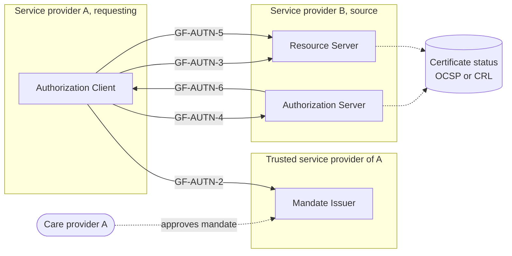
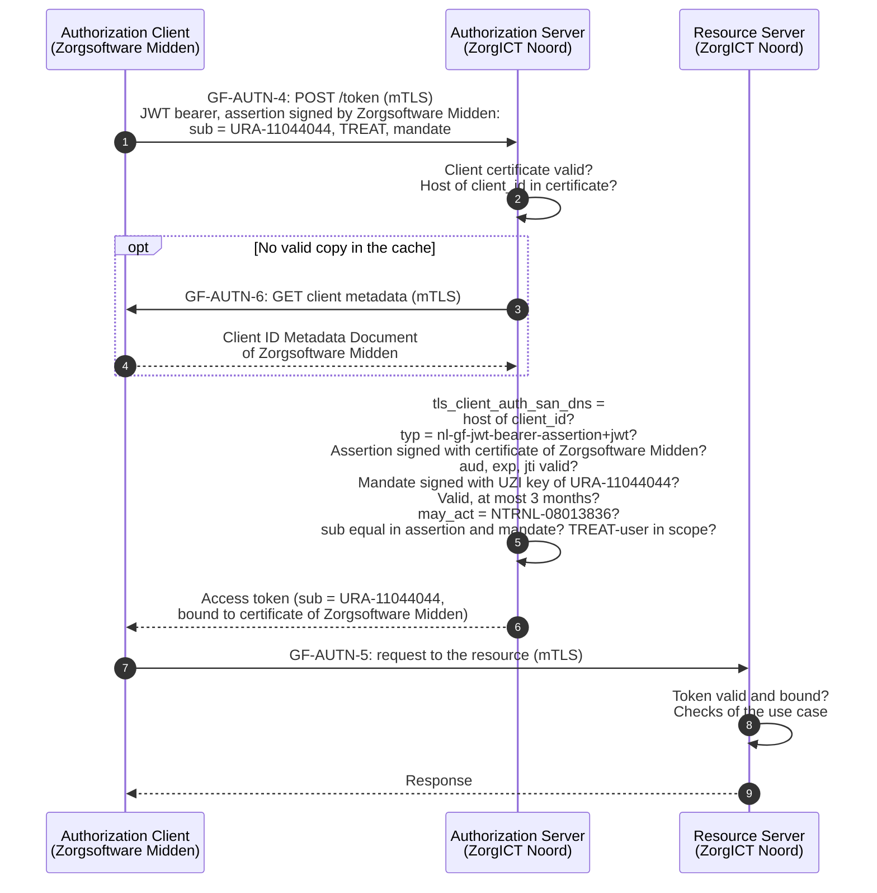

GF Authentication specifies how two healthcare providers establish each other's identity, and the purpose of an exchange, when they exchange health data through their service providers. It is a national initiative led by the Dutch Ministry of Health, Welfare and Sport (VWS) and applies first to the exchanges *Basisgegevensset Zorg* (BgZ) and *eOverdracht* (nursing handover), both mandatory under the Wegiz.
{: .ig-lead}

> **Note:** This page is a draft. It is based on version 0.95 of the memo [*Harmonisatie van authenticatie en autorisatie voor de gegevensuitwisselingen BgZ en eOverdracht*](./authenticatie-en-autorisatie-eOverdracht-BgZ-vMT-DICIO-20260818.html), approved by MT DICIO on 18 August 2026, and on version 0.6.0 (draft, 23 November 2026) of the follow-up memo [*Vervolg harmonisatie: clientregistratie en machtiging*](./authenticatie-en-autorisatie-vervolg-mandaat-clientregistratie.html), whose [proposal](./authenticatie-en-autorisatie-vervolg-mandaat-clientregistratie.html#voorstel-machtiging-in-het-tokenrequest-en-de-protected-resource-metadata) it specifies. The memos explain the choices; this page only specifies what is needed to implement them. A basic understanding of OAuth 2.0 and FHIR is assumed.

### Scope

This page specifies:
- how a care provider mandates a service provider to act on its behalf, and how that mandate is issued, renewed and verified;
- how a service provider publishes its OAuth client metadata, authenticates to the authorization server of another service provider, and obtains an access token for a care provider by presenting its mandate;
- how a client finds the authorization server and the mandate of the other party, and what it verifies before it requests a token;
- how the resource server validates each request.

This page does not specify:
- how a care provider authenticates its own practitioners and systems. Each care provider does that within its own domain;
- the authorization decision of the source beyond the checks on this page, such as patient consent;
- how endpoints and organizations are published. See [GF Care Service Directory](./csd.html);
- how a service provider obtains and renews a mandate, and finds the Mandate Issuer. See [Obtaining a mandate](./authentication-mandate.html);
- APIs that are not HTTPS APIs, such as DICOM DIMSE or HL7 v2 over MLLP.

The exchanges in scope are the targeted *sending* of health data between two care providers within BgZ and eOverdracht, where a referral, handover or *aanmelding* precedes the exchange (see [Afbakening](./authenticatie-en-autorisatie-eOverdracht-BgZ-vMT-DICIO-20260818.html#3-afbakening) in the memo). Queries without a preceding referral, and exchanges that do not run between two care providers (for example from a PGO or a research institution), are out of scope.

#### Extension points

This page specifies what BgZ and eOverdracht need now. It is designed to be extended for other use cases without changing what is specified here. The extension points are:
- **Scope of access.** A use case MAY define `scope` ([RFC 6749](https://www.rfc-editor.org/rfc/rfc6749), §3.3) in the token request, the token response and the access token, and MAY add fields to the `nl-gis-v1` object or other types to `authorization_details` ([RFC 9396](https://www.rfc-editor.org/rfc/rfc9396)) in the assertion. BgZ and eOverdracht use neither (see [GF-AUTN-4](#gf-autn-4-request-access-token)).
- **Finding the other party.** Each use case specifies how the client finds the URL of the resource and the URA of the care provider it wants to reach. It then finds the authorization server and the mandate with [GF-AUTN-3](#gf-autn-3-get-protected-resource-metadata).
- **Attestations.** The assertion carries attestations per attestation type. Other attestation types can be added next to the mandate; a verifier ignores types it does not use.
- **Purposes.** Each use case specifies which `purpose_of_use` codes it accepts. BgZ and eOverdracht accept only `TREAT`.
- **Mandate codes.** Other purposes and roles can be added; a verifier ignores codes it does not recognise (see [Mandate codes](#mandate-codes)).
- **Authorization rules.** Each use case defines the checks that the resource server applies (see [Validation by the resource server](#validation-by-the-resource-server)).

These pages specify the parts that differ per use case or that concern publication:
- [Obtaining a mandate](./authentication-mandate.html): the Mandate Issuer, how a care provider publishes it in the LRZa (GF-AUTN-1), and how a service provider obtains and renews a mandate (GF-AUTN-2);
- [Authentication for BgZ and eOverdracht](./authentication-bgz-eoverdracht.html): how the client finds the other party, the purpose and mandate codes, and the checks of the resource server.

### Terminology

| Term | Meaning |
|---|---|
| Care provider | The organization that provides care and is the controller of the health data (*zorgaanbieder*). It is identified by its URA. |
| URA | *UZI-Register Abonneenummer*, the identifier of a care provider in the UZI register. In claims it is written as `URA-` followed by the 8 digits of the URA, including leading zeros, for example `URA-01234567`. Identifiers of organizations in claims have the form `<scheme>-<value>`, so that other schemes can be added; a KvK number is written as `NTRNL-<KvK number>` (see [Service provider identifier](#service-provider-identifier)). |
| Service provider | The party that provides and operates the technical systems for a care provider (*dienstverlener*), such as an EHR vendor, SaaS platform or hub, or the care provider itself. It has its own certificate. |
| Trusted service provider | A party that a care provider designates to issue mandates on its behalf, with the key of one of the care provider's UZI server certificates. This can be a service provider, or the care provider itself, for example its own IT department. A care provider designates at least one. |
| Mandate | A signed statement in which a care provider authorizes a service provider to act on its behalf for one or more mandate codes (*machtiging*). |
| Mandate code | The scope of a mandate, as `<purpose>-<role>`, for example `TREAT-user`. See [Mandate codes](#mandate-codes). |
| Source | The care provider that holds the requested data (custodian), and its service provider. |
| `client_id` | The identifier of a service provider as OAuth client: the HTTPS URL of its Client ID Metadata Document. See [Client ID Metadata Document](#client-id-metadata-document). |
| Assertion | The JWT that the Authorization Client signs for each token request, with its mandate and the context of the request ([RFC 7523](https://www.rfc-editor.org/rfc/rfc7523)). See [Assertion](#assertion). |
| Client ID Metadata Document | A JSON document with the metadata of an OAuth client, which the client publishes at the URL that is its `client_id` ([draft-ietf-oauth-client-id-metadata-document](https://datatracker.ietf.org/doc/draft-ietf-oauth-client-id-metadata-document/)). |
| Service provider identifier | The identifier of a service provider, derived from its certificate. See [Service provider identifier](#service-provider-identifier). |
| GIS | *Gezondheidsinformatiestelsel*, the national health information system under which this specification is agreed. |

### Solution overview

The legal framework, the federated trust model and the requirements are described in the memo ([Juridisch kader](./authenticatie-en-autorisatie-eOverdracht-BgZ-vMT-DICIO-20260818.html#4-juridisch-kader), [Eisen aan de technische implementatie](./authenticatie-en-autorisatie-eOverdracht-BgZ-vMT-DICIO-20260818.html#5-eisen-aan-de-technische-implementatie)); the design decisions and their rationale in the follow-up memo ([Ontwerpbeslissingen](./authenticatie-en-autorisatie-vervolg-mandaat-clientregistratie.html#ontwerpbeslissingen)).

The process:
1. Each care provider designates at least one trusted service provider, which operates a Mandate Issuer.
2. Each service provider of the care provider, on the requesting and on the source side, obtains a mandate from that Mandate Issuer. The care provider approves the mandate once; the Mandate Issuer renews it every 3 months as long as the approval stands.
3. The requesting service provider publishes a Client ID Metadata Document with its client metadata.
4. Before an exchange, the requesting service provider verifies the source's mandate, and that the source designates the authorization server. How it finds them depends on the use case.
5. The requesting service provider requests an access token at the source's authorization server with the JWT bearer grant, over mTLS. It sends an assertion that it signs with the key of its certificate, with its mandate, the care provider and the purpose, and the URL of its document as `client_id`. The authorization server verifies the assertion, the mandate, and that the client is the mandated service provider.
6. The requesting service provider sends its requests with the access token, over mTLS with the same certificate. The resource server validates the token, its binding to the certificate, and the request.



The source's service provider obtains its own mandate (`TREAT-custodian`) from the trusted service provider of care provider B in the same way (GF-AUTN-2); this is not shown in the figure.

#### Standards

- OAuth 2.0 ([RFC 6749](https://www.rfc-editor.org/rfc/rfc6749)) with the JWT bearer grant ([RFC 7521](https://www.rfc-editor.org/rfc/rfc7521), [RFC 7523](https://www.rfc-editor.org/rfc/rfc7523)) and the security measures of the [FAPI 2.0 Security Profile](https://openid.net/specs/fapi-security-profile-2_0-final.html);
- mTLS client authentication (`tls_client_auth`) and certificate-bound access tokens ([RFC 8705](https://www.rfc-editor.org/rfc/rfc8705));
- Authorization Server Metadata ([RFC 8414](https://www.rfc-editor.org/rfc/rfc8414));
- OAuth Client ID Metadata Document ([draft-ietf-oauth-client-id-metadata-document](https://datatracker.ietf.org/doc/draft-ietf-oauth-client-id-metadata-document/));
- SD-JWT VC ([draft-ietf-oauth-sd-jwt-vc](https://datatracker.ietf.org/doc/draft-ietf-oauth-sd-jwt-vc/)) for the mandate, issued with [OpenID4VCI](https://openid.net/specs/openid-4-verifiable-credential-issuance-1_0.html).

### Actors

| Actor | Role | Transactions | Requirements |
|---|---|---|---|
| [Mandate Issuer](./authentication-mandate.html#mandate-issuer) | Issues mandates for a care provider, after its approval | Server for [GF-AUTN-2](./authentication-mandate.html#gf-autn-2-obtain-mandate) | [Mandate](#mandate) |
| [Authorization Client](#authorization-client) | Requests data for a care provider, and publishes its client metadata | Client for [GF-AUTN-2](./authentication-mandate.html#gf-autn-2-obtain-mandate), [GF-AUTN-4](#gf-autn-4-request-access-token) and [GF-AUTN-5](#gf-autn-5-access-resource); server for [GF-AUTN-6](#gf-autn-6-get-client-metadata) | [Client ID Metadata Document](#client-id-metadata-document), [Mandate](#mandate), [Assertion](#assertion), [Verification of the source](#verification-of-the-source) |
| [Authorization Server](#authorization-server) | Issues access tokens for the source | Server for [GF-AUTN-4](#gf-autn-4-request-access-token); client for [GF-AUTN-6](#gf-autn-6-get-client-metadata) | [Validation by the authorization server](#validation-by-the-authorization-server) |
| [Resource Server](#resource-server) | Serves the source's data, and makes its mandate available | Server for [GF-AUTN-5](#gf-autn-5-access-resource); client for [GF-AUTN-2](./authentication-mandate.html#gf-autn-2-obtain-mandate) | [Validation by the resource server](#validation-by-the-resource-server) |

#### Authorization Client

The Authorization Client is the OAuth client of the requesting service provider. It holds a mandate with the code `<purpose>-user` for each care provider it acts for (`<purpose>-custodian` when it acts on the source side, see [Mandate codes](#mandate-codes)), presents it in the assertion of [GF-AUTN-4](#gf-autn-4-request-access-token), publishes one [Client ID Metadata Document](#client-id-metadata-document), SHALL support [GF-AUTN-2](./authentication-mandate.html#gf-autn-2-obtain-mandate) and [GF-AUTN-4](#gf-autn-4-request-access-token) to [GF-AUTN-6](#gf-autn-6-get-client-metadata), and SHALL verify the source as in [Verification of the source](#verification-of-the-source).

#### Authorization Server

The Authorization Server is operated by the source's service provider, and can serve many care providers. It SHALL support [GF-AUTN-4](#gf-autn-4-request-access-token) and [GF-AUTN-6](#gf-autn-6-get-client-metadata), and publish its metadata ([RFC 8414](https://www.rfc-editor.org/rfc/rfc8414)), with at least:
- `token_endpoint_auth_methods_supported`: `["tls_client_auth"]`;
- `tls_client_certificate_bound_access_tokens`: `true`;
- `grant_types_supported`: including `urn:ietf:params:oauth:grant-type:jwt-bearer`;
- `client_id_metadata_document_supported`: `true`.

Common authorization server products need an extension that loads the client from the Client ID Metadata Document, and an extension for the JWT bearer grant that performs the checks in [Validation by the authorization server](#validation-by-the-authorization-server) and adds the claims to the access token. Their built-in support for this grant, if any, requires a trust relationship per issuer that is configured in advance. The follow-up memo describes this work for Keycloak and Duende IdentityServer ([Wat er moet gebeuren in Keycloak en Duende IdentityServer](./authenticatie-en-autorisatie-vervolg-mandaat-clientregistratie.html#wat-er-moet-gebeuren-in-keycloak-en-duende-identityserver)).

#### Resource Server

The Resource Server is the HTTPS API of the source, for example a FHIR API or DICOMweb. It MAY serve any content type. It holds a mandate with the code `<purpose>-custodian` for each care provider it serves (`<purpose>-user` when it receives requests from the source side, see [Mandate codes](#mandate-codes)), which it obtains through [GF-AUTN-2](./authentication-mandate.html#gf-autn-2-obtain-mandate). It publishes the mandate and its authorization servers in its Protected Resource Metadata ([GF-AUTN-3](#gf-autn-3-get-protected-resource-metadata)).

### Transactions

| ID | Transaction | Client | Server |
|---|---|---|---|
| GF-AUTN-1 | [Discover Mandate Issuer](./authentication-mandate.html#gf-autn-1-discover-mandate-issuer) | Authorization Client or Resource Server | Care Service Directory (local replica) |
| GF-AUTN-2 | [Obtain Mandate](./authentication-mandate.html#gf-autn-2-obtain-mandate) | Authorization Client or Resource Server | Mandate Issuer |
| GF-AUTN-3 | [Get Protected Resource Metadata](#gf-autn-3-get-protected-resource-metadata) | Authorization Client | Resource Server |
| GF-AUTN-4 | [Request Access Token](#gf-autn-4-request-access-token) | Authorization Client | Authorization Server |
| GF-AUTN-5 | [Access Resource](#gf-autn-5-access-resource) | Authorization Client | Resource Server |
| GF-AUTN-6 | [Get Client Metadata](#gf-autn-6-get-client-metadata) | Authorization Server | Authorization Client |

All transactions SHALL use mTLS with the certificates of the service providers (see [Transport and certificates](#transport-and-certificates)). GF-AUTN-1 and GF-AUTN-2 run in advance and on renewal; GF-AUTN-3 to GF-AUTN-5 run for each exchange. GF-AUTN-6 runs during GF-AUTN-4 when the authorization server has no valid copy of the client's document in its cache. GF-AUTN-1 and GF-AUTN-2 are specified in [Obtaining a mandate](./authentication-mandate.html).

#### GF-AUTN-3: Get Protected Resource Metadata

The Authorization Client finds the authorization server and the mandate of the other party in the Protected Resource Metadata of the resource. How it finds the URL of the resource and the URA of the care provider is specified per use case; for BgZ and eOverdracht in [Finding the other party](./authentication-bgz-eoverdracht.html#finding-the-other-party).

Before it requests a token, the Authorization Client retrieves the metadata of the resource ([RFC 9728](https://www.rfc-editor.org/rfc/rfc9728)). RFC 9728 inserts the well-known path between the host and the path of the resource. For `https://fhir.zorgict-noord.example/weidevelde/fhir` the request is:

```
GET /.well-known/oauth-protected-resource/weidevelde/fhir HTTP/1.1
Host: fhir.zorgict-noord.example
```

The resource server SHALL publish, besides the RFC 9728 parameters `resource` and `authorization_servers`, the mandates of the care providers that the resource serves. They are published in `attestations`: an object with a list of attestations per attestation type, as in the [assertion](#assertion). A mandate is published as an SD-JWT VC without disclosures and without key binding JWT, which ends in `~`.

```json
{
  "resource": "https://fhir.zorgict-noord.example/weidevelde/fhir",
  "authorization_servers": ["https://as.zorgict-noord.example"],
  "tls_client_certificate_bound_access_tokens": true,
  "attestations": { "URA-signed-mandate": ["<mandate of Ziekenhuis Weidevelde for ZorgICT Noord>~"] }
}
```

If the resource server does not accept the client certificate, the TLS handshake fails. If it has no valid mandate for a care provider, for example during renewal, `attestations` contains none for that care provider. The client treats a missing or invalid mandate as a failed [verification of the source](#verification-of-the-source), and requests no token.

The Authorization Client checks that `resource` equals the URL of the resource (RFC 9728, §3.3). It then verifies the source as specified in [Verification of the source](#verification-of-the-source), with the mandate from `attestations` whose `sub` is the URA of the care provider it wants to reach.

##### One document or one per care provider

RFC 9728 gives each resource URL its own metadata document. A service provider that registers one address for all its care providers therefore publishes one document with the mandates of all of them. A service provider that registers an address per care provider publishes a document per care provider. It can generate those documents from one service, based on the path.

A resource server MAY serve several care providers with one document. Each mandate contains its certificate chain and takes several kilobytes. A document with the mandates of a thousand care providers takes several megabytes, and every client retrieves it.

##### Caching and renewal

The Authorization Client MAY cache the metadata as indicated by its `Cache-Control` header, for at most 24 hours. It SHALL check the validity of the cached mandate before each use.

The resource server publishes a renewed mandate as specified in [Validity and renewal](#validity-and-renewal).

##### Choosing the authorization server

The Authorization Client uses an authorization server from `authorization_servers`. It retrieves its metadata ([RFC 8414](https://www.rfc-editor.org/rfc/rfc8414)) to find the token endpoint.

If the client knows an authorization server for the source in another way, for example from an `Endpoint` in the LRZa, it uses it only if it is listed in `authorization_servers`.

#### GF-AUTN-4: Request Access Token

The Authorization Client requests an access token with the JWT bearer grant ([RFC 7523](https://www.rfc-editor.org/rfc/rfc7523), §2.1), over mTLS with its certificate (`tls_client_auth`). The [assertion](#assertion) is a JWT that the client signs for this request, with its mandate, the care provider on whose behalf it acts, and the purpose. The `client_id` is the URL of its [Client ID Metadata Document](#client-id-metadata-document).

```
POST /token HTTP/1.1
Host: as.zorgict-noord.example
Content-Type: application/x-www-form-urlencoded

grant_type=urn%3Aietf%3Aparams%3Aoauth%3Agrant-type%3Ajwt-bearer
&client_id=https%3A%2F%2Fzorgsoftware-midden.example%2Foauth%2Fclient
&assertion=<assertion signed by Zorgsoftware Midden>
```

| Parameter | Value |
|---|---|
| `grant_type` | `urn:ietf:params:oauth:grant-type:jwt-bearer` |
| `client_id` | The URL of the Client ID Metadata Document of the service provider (RFC 8705 requires the parameter). |
| `assertion` | The [assertion](#assertion). |

For BgZ and eOverdracht, the request contains no `scope`, and the assertion contains only the `nl-gis-v1` object in `authorization_details`: the mandate codes come from the mandate, the purpose from the assertion, and what the client may access follows from the notification of the source (see [Validation by the resource server](#validation-by-the-resource-server)). Other use cases MAY define `scope`, or other fields or types in `authorization_details` (see [Extension points](#extension-points)); the token response then contains `scope` as in RFC 6749, §5.1. The token response MAY contain `authorization_details` as granted (RFC 9396, §7). The authorization server validates the request as described in [Validation by the authorization server](#validation-by-the-authorization-server). On success it returns a sender-constrained access token:

```json
{
  "access_token": "<opaque to the client>",
  "token_type": "Bearer",
  "expires_in": 300
}
```

The authorization server SHALL NOT issue a refresh token ([RFC 7521](https://www.rfc-editor.org/rfc/rfc7521), §4.1). When the access token expires, the client requests a new one with a new assertion.

#### GF-AUTN-5: Access Resource

The Authorization Client sends its requests over mTLS with the same certificate, with the access token in the `Authorization` header. The resource server validates each request as described in [Validation by the resource server](#validation-by-the-resource-server).

```
GET /weidevelde/fhir/Observation/123 HTTP/1.1
Host: fhir.zorgict-noord.example
Authorization: Bearer <access token>
```

#### GF-AUTN-6: Get Client Metadata

When the authorization server receives a token request with a `client_id` for which it has no valid copy of the Client ID Metadata Document, it retrieves the document at that URL ([draft-ietf-oauth-client-id-metadata-document](https://datatracker.ietf.org/doc/draft-ietf-oauth-client-id-metadata-document/), §6). It does so only after it has validated the client certificate and checked that the host of the `client_id` is in that certificate ([Validation by the authorization server](#validation-by-the-authorization-server), steps 1 and 2).

```
GET /oauth/client HTTP/1.1
Host: zorgsoftware-midden.example
Accept: application/json
```

The authorization server SHALL:
- use mTLS with its own certificate, and accept only a server certificate that meets the requirements in [Transport and certificates](#transport-and-certificates). A server certificate that does not meet them makes the document invalid. If its revocation status cannot be determined, the failure is transient;
- not follow redirects. A response with a `3xx` or `4xx` status, or a document that is not valid, is invalid. A `5xx` status or a connection failure is a transient failure;
- not connect to addresses that resolve to special-use IP addresses ([RFC 6890](https://www.rfc-editor.org/rfc/rfc6890)), except the address ranges of a network that the GIS designates for these exchanges;
- stop reading after 32 kilobytes, and treat a larger document as invalid;
- cache a valid document as indicated by the `Cache-Control` header of the response, for at most 24 hours, and for 1 hour if the response has no cache directive. It does not cache errors or invalid documents;
- on a transient failure, keep using a cached valid document for at most 24 hours after it was retrieved, and otherwise return HTTP status `503`; for an invalid document, return `invalid_client` (draft, §6.1).

### Validation

#### Verification of the source

The care provider that the client wants to reach is usually the source. When the client acts on the source side, for example to send a notification, it is the receiving care provider ([Mandate codes](#mandate-codes)).

Before it requests a token, the Authorization Client SHALL establish that the resource belongs to the care provider it wants to reach and its mandated service provider, and that the authorization server is designated by that resource. It therefore knows:
- the URL of the resource and the URA of the care provider it wants to reach;
- the mandate of the resource server's service provider for that care provider;
- the authorization servers that the resource designates.

It obtains them with [GF-AUTN-3](#gf-autn-3-get-protected-resource-metadata). The client verifies the mandate as in [Validation by the authorization server](#validation-by-the-authorization-server), steps 5 and 6, and checks that:
- `sub` is the URA of the care provider it wants to reach;
- `scope` contains the code for the purpose of the request and the opposite side: `<purpose>-custodian` if the client requests data, `<purpose>-user` if the client acts on the source side ([Mandate codes](#mandate-codes));
- `may_act.sub` equals the service provider identifier derived from the resource server's TLS server certificate ([Service provider identifier](#service-provider-identifier));
- the authorization server it will use is one that the resource designates.

If a check fails, the client SHALL NOT request a token.

#### Validation by the authorization server

The authorization server SHALL reject the token request if any of these checks fails:
1. **Client certificate.** The certificate meets the requirements in [Transport and certificates](#transport-and-certificates), and its revocation status is good.
2. **Client identifier.** The `client_id` is a URL as described in [Client ID Metadata Document](#client-id-metadata-document), and its host equals a `dNSName` in the `subjectAltName` of the client certificate.
3. **Client metadata.** The authorization server has a valid copy of the document, from its cache or from [GF-AUTN-6](#gf-autn-6-get-client-metadata), in which:
   - `client_id` equals the `client_id` parameter, by simple string comparison;
   - `token_endpoint_auth_method` is `tls_client_auth`, and `grant_types` contains `urn:ietf:params:oauth:grant-type:jwt-bearer`;
   - `tls_client_auth_san_dns` equals the host of the `client_id` ([RFC 8705](https://www.rfc-editor.org/rfc/rfc8705), §2.1.2);
4. **Assertion** ([RFC 7523](https://www.rfc-editor.org/rfc/rfc7523), §3).
   - `typ` in the JOSE header is `nl-gf-jwt-bearer-assertion+jwt`, and the header contains no `jku`, `x5u` or `jwk`.
   - The signature is valid for the first certificate in `x5c`, which equals the client certificate of the connection, with the algorithm PS256 or ES256.
   - `iss` equals the `client_id` parameter, and `aud` is the issuer identifier of this authorization server ([RFC 8414](https://www.rfc-editor.org/rfc/rfc8414)), as a single value.
   - `iat` is not later than the current time plus at most 60 seconds of clock skew, `exp` has not passed and is at most 5 minutes after `iat`, and `jti` has not been used before. The authorization server records the `jti` as soon as the signature of the assertion is valid, also when a later check fails, and keeps the `jti` values of a client until their `exp`.
   - `attestations` contains exactly one mandate, under the attestation type `URA-signed-mandate`, as an SD-JWT without disclosures and without key binding JWT.
5. **Mandate signature.**
   - `typ` in the JOSE header is `dc+sd-jwt`, and the header contains no `jku`, `x5u` or `jwk`. The signature is valid for the certificate in `x5c`, which chains to the UZI register CA, with the algorithm PS256 or ES256.
   - The certificate is a UZI server certificate (card type `S`), and its revocation status is good.
   - `sub` equals `URA-` followed by the URA in the certificate.
6. **Mandate content.**
   - `vct` is `https://fhir.generiekefuncties.nl/vct/URA-signed-mandate.json`.
   - The mandate contains no `iss` (see [Mandate](#mandate)).
   - The current time is between `nbf` and `exp`, and `exp` minus `nbf` is at most 3 months (92 days).
7. **Mandated service provider.** `may_act.sub` equals the service provider identifier derived from the client certificate ([Service provider identifier](#service-provider-identifier)); the client is the actor that the mandate authorizes (RFC 8693, §4.4).
8. **Care provider and purpose.**
   - `sub` of the assertion equals `sub` of the mandate.
   - `authorization_details` contains exactly one object with `type` `nl-gis-v1`. In it, `purpose_of_use` is present, is a string and not an array, and contains exactly one code from the [NL GF Purpose of Use ValueSet](./ValueSet-nl-gf-purpose-of-use-vs.html), and `scope` of the mandate contains a code for exactly that purpose: `<purpose>-user`, or `<purpose>-custodian` if the use case allows the client to act on the source side (see [Mandate codes](#mandate-codes)). The authorization server records with the access token the codes in `scope` of the mandate for that purpose.
   - `locations_organization_id` and `locations` refer to a care provider and resource server that this authorization server serves.

The authorization server MAY keep the result of the signature and chain verification in step 5 for a mandate that it has verified before, identified by its hash. It SHALL perform all other checks for each token request, including the validity period of the mandate and the revocation status of its signing certificate. It SHALL take the care provider from `sub` of the mandate.

The access token is opaque to the client. It SHALL record on whose behalf access is granted (`sub`, the URA from the mandate), which service provider acts (`client_id`, and the service provider identifier in `act.sub` as in [RFC 8693](https://www.rfc-editor.org/rfc/rfc8693), §4.1), the `jti` of the mandate and of the assertion, the `nl-gis-v1` object from `authorization_details`, and the hash of the client certificate (`cnf.x5t#S256`, RFC 8705). How the authorization server and resource server exchange it, as a signed token or through token introspection ([RFC 7662](https://www.rfc-editor.org/rfc/rfc7662)), is up to them. When a use case defines `scope` or `authorization_details`, the access token also records them, as in [RFC 9068](https://www.rfc-editor.org/rfc/rfc9068), RFC 7662 and RFC 9396, §9.

#### Validation by the resource server

For each request, the resource server SHALL:
1. validate the access token and its expiry;
2. check that the hash of the client certificate of the mTLS connection equals `cnf.x5t#S256` in the token;
3. check the revocation status of the client certificate;
4. take its authorization decision based on the care provider (`sub`), `purpose_of_use` and the mandate codes recorded for the access token, and on the checks of the use case. For BgZ and eOverdracht, these are in [Authorization by the resource server](./authentication-bgz-eoverdracht.html#authorization-by-the-resource-server).

### Data models

#### Service provider identifier

The service provider identifier is derived from a persistent identifier in the certificate of the service provider: the KvK number or OIN in a PKIoverheid server certificate, for example `NTRNL-08013836`, or the URA in a UZI server certificate. The rules are in [Appendix: Deriving the service provider identifier](#appendix-deriving-the-service-provider-identifier).

It identifies the service provider in `may_act.sub` of the mandate and in the logging. All certificates of one organization yield the same identifier, so the logging also records the certificate (see [Logging](#logging)).

#### Client ID Metadata Document

The Authorization Client publishes one Client ID Metadata Document ([draft-ietf-oauth-client-id-metadata-document](https://datatracker.ietf.org/doc/draft-ietf-oauth-client-id-metadata-document/)) for the service provider. It describes the service provider as OAuth client, and contains no mandates: the client presents its mandate in each token request. A service provider MAY publish a separate document per system.

The `client_id`, which is the URL of the document:
- SHALL meet the requirements of the draft (§3): the `https` scheme, a path other than `/`, and no userinfo, query or fragment;
- SHALL have a host that is a `dNSName` in the `subjectAltName` of the service provider's certificate. Wildcards are not allowed. For example `https://zorgsoftware-midden.example/oauth/client`.

| Property | Value |
|---|---|
| `client_id` | The URL of the document. |
| `client_name` | Optional and informative, for example `Zorgsoftware Midden`. |
| `grant_types` | `["urn:ietf:params:oauth:grant-type:jwt-bearer"]` |
| `token_endpoint_auth_method` | `tls_client_auth` |
| `tls_client_auth_san_dns` | The host of the `client_id`, which is a `dNSName` in the service provider's certificate. |
| `tls_client_certificate_bound_access_tokens` | `true` |

```json
{
  "client_id": "https://zorgsoftware-midden.example/oauth/client",
  "client_name": "Zorgsoftware Midden",
  "grant_types": ["urn:ietf:params:oauth:grant-type:jwt-bearer"],
  "token_endpoint_auth_method": "tls_client_auth",
  "tls_client_auth_san_dns": "zorgsoftware-midden.example",
  "tls_client_certificate_bound_access_tokens": true
}
```

The document SHALL NOT contain secrets or private keys (draft, §4.1), and its content SHALL NOT depend on the request, such as its headers or the authorization server that requests it (draft, §4.5).

A renewed certificate requires no change to the document, as long as it contains the same host. The document does not change when the service provider obtains, renews or loses a mandate.

An authorization server SHALL NOT require any other registration of a client. The authorization server MAY block a service provider or a `client_id` locally.

#### Mandate

A mandate is an SD-JWT VC ([draft-ietf-oauth-sd-jwt-vc](https://datatracker.ietf.org/doc/draft-ietf-oauth-sd-jwt-vc/)) without selectively disclosable claims. Verifiers depend only on its format, not on how it was obtained ([GF-AUTN-2](./authentication-mandate.html#gf-autn-2-obtain-mandate)). The trusted service provider signs it with the key of the care provider's UZI server certificate; it uses the algorithm PS256 or ES256. The JOSE header contains `typ` `dc+sd-jwt` and, in `x5c`, that certificate and its intermediate certificates, without the root certificate. It contains no `jku`, `x5u` or `jwk`: a verifier takes the key only from `x5c`. Only a UZI server certificate (card type `S`) may sign a mandate.

| Claim | Description |
|---|---|
| `vct` | The mandate type: `https://fhir.generiekefuncties.nl/vct/URA-signed-mandate.json`. Its Type Metadata (draft, §5) is published at that URL. In `attestations` in the [assertion](#assertion), the attestation type is `URA-signed-mandate`. An incompatible change of the type gets a new `vct`. |
| `sub` | The URA of the care provider. |
| `may_act.sub` | The [service provider identifier](#service-provider-identifier) of the mandated service provider (RFC 8693, §4.4). |
| `scope` | The mandate codes, separated by spaces. It contains only mandate codes. See [Mandate codes](#mandate-codes) for how a verifier treats codes it does not recognise. |
| `jti` | A unique identifier of the mandate. |
| `iat`, `nbf`, `exp` | Issuance time and validity. `exp` minus `nbf` is at most 3 months, and `exp` is not later than the expiry of the signing certificate. |

Example JOSE header of a mandate of Zorggroep Duinzicht:

```json
{
  "alg": "ES256",
  "typ": "dc+sd-jwt",
  "x5c": ["<UZI server certificate of Zorggroep Duinzicht>", "<intermediate certificate>"]
}
```

Example payload of that mandate for Zorgsoftware Midden, with a validity of 90 days:

```json
{
  "vct": "https://fhir.generiekefuncties.nl/vct/URA-signed-mandate.json",
  "sub": "URA-11044044",
  "may_act": { "sub": "NTRNL-08013836" },
  "scope": "TREAT-user TREAT-custodian",
  "jti": "5f0c2a8e-3b7d-4c1e-9a6f-2d8b7e4c1a90",
  "iat": 1792108800,
  "nbf": 1792108800,
  "exp": 1799884800
}
```

The Authorization Client presents its mandate in the [assertion](#assertion) of each token request ([GF-AUTN-4](#gf-autn-4-request-access-token)); the Resource Server publishes its mandate in its Protected Resource Metadata ([GF-AUTN-3](#gf-autn-3-get-protected-resource-metadata)).

A mandate has no `iss`. Its issuer is the care provider in the signing certificate ([draft-ietf-oauth-sd-jwt-vc](https://datatracker.ietf.org/doc/draft-ietf-oauth-sd-jwt-vc/), §2.5), whose URA equals `sub`. An `iss` would not be bound to that certificate, and an `iss` with an HTTPS URL would make a verifier retrieve keys from the Mandate Issuer. The URL of the Mandate Issuer is in its `Endpoint` (see [GF-AUTN-1](./authentication-mandate.html#gf-autn-1-discover-mandate-issuer)). A verifier SHALL reject a mandate that contains `iss`.

A mandate has no `aud`: the service provider presents the same mandate to every authorization server, and a resource server shows it to every client. It is bound to the service provider through `may_act.sub` instead (see [Binding to the certificate](#binding-to-the-certificate)). The assertion that carries it is bound to one authorization server through its `aud`.

A mandate has no `cnf`. It is not presented with a key binding JWT, but bound to the certificate of the service provider through `may_act.sub` (see [Binding to the certificate](#binding-to-the-certificate)), so that it remains valid when the service provider renews its certificate. A key binding JWT would add nothing: the assertion that carries the mandate is already signed with the key of the client certificate, for one authorization server and for one use.

#### Validity and renewal

A mandate is valid for at most 3 months. Service providers SHALL renew it automatically, as specified in [Obtaining a mandate](./authentication-mandate.html#renewal). The Authorization Client uses the new mandate from its next token request. The Resource Server makes the new mandate available at least 24 hours before the current one expires.

When a care provider withdraws its approval, the mandate is not renewed and expires at the end of its validity. A mandate cannot be withdrawn earlier, except by revoking a certificate:
- revoking the certificate of a service provider closes it off for all care providers;
- revoking the care provider's UZI server certificate invalidates all its mandates.

There is no status list: a verifier does not contact the Mandate Issuer. Care providers that change service providers should take the remaining validity of the current mandates into account. The follow-up memo explains this choice in [GF-AUTN-ADR-5](./authenticatie-en-autorisatie-vervolg-mandaat-clientregistratie.html#gf-autn-adr-5-intrekken-of-laten-verlopen).

#### Assertion

The assertion is a JWT ([RFC 7523](https://www.rfc-editor.org/rfc/rfc7523), §3) that the Authorization Client creates and signs for each token request. It signs it with the private key of its client certificate, with the algorithm PS256 or ES256. The JOSE header contains `typ` `nl-gf-jwt-bearer-assertion+jwt` and that certificate in `x5c`, and no `jku`, `x5u` or `jwk`.

The `typ` identifies the assertion as one of this profile (explicit typing, [RFC 8725](https://www.rfc-editor.org/rfc/rfc8725), §3.11). An authorization server that accepts other assertions with the JWT bearer grant as well SHALL apply the rules on this page only to an assertion with `typ` `nl-gf-jwt-bearer-assertion+jwt`, and SHALL NOT accept an assertion with that `typ` under other rules. A mandate (`typ` `dc+sd-jwt`) or another JWT can therefore not be used as an assertion, nor the other way around.

Example JOSE header and payload of an assertion of Zorgsoftware Midden, for a request to Ziekenhuis Weidevelde on behalf of Zorggroep Duinzicht:

```json
{
  "alg": "PS256",
  "typ": "nl-gf-jwt-bearer-assertion+jwt",
  "x5c": ["<client certificate of Zorgsoftware Midden>"]
}
```

```json
{
  "iss": "https://zorgsoftware-midden.example/oauth/client",
  "sub": "URA-11044044",
  "aud": "https://as.zorgict-noord.example",
  "iat": 1793836800,
  "exp": 1793837100,
  "jti": "0b6d9c2e-7f4a-4c1d-8e3b-5a9f2c7d1e64",
  "authorization_details": [
    {
      "type": "nl-gis-v1",
      "purpose_of_use": "http://terminology.hl7.org/CodeSystem/v3-ActReason|TREAT",
      "locations_organization_id": "URA-01234567",
      "locations": ["https://fhir.zorgict-noord.example/weidevelde/fhir"]
    }
  ],
  "attestations": { "URA-signed-mandate": ["<mandate of Zorggroep Duinzicht for Zorgsoftware Midden>~"] }
}
```

| Claim | Description |
|---|---|
| `iss` | The `client_id` of the Authorization Client: the URL of its Client ID Metadata Document. |
| `sub` | The URA of the care provider on whose behalf the service provider acts. It equals `sub` of the mandate. |
| `aud` | The issuer identifier of the authorization server ([RFC 8414](https://www.rfc-editor.org/rfc/rfc8414)), as a single value. |
| `iat`, `exp` | Issuance time and expiry; `exp` is at most 5 minutes after `iat`. |
| `jti` | A unique identifier of the assertion. The authorization server accepts each value once. |
| `authorization_details` | The context of the request, as an array of objects with the structure of [RFC 9396](https://www.rfc-editor.org/rfc/rfc9396), §2. It contains exactly one object with `type` `nl-gis-v1`, with the fields below. An authorization server ignores objects of other types that it does not use. |
| `attestations` | The attestations that the client presents, as an object with a list of attestations per attestation type. It contains the [mandate](#mandate) under `URA-signed-mandate`, as issued: an SD-JWT VC without disclosures and without key binding JWT, which ends in `~`. An authorization server ignores attestation types that it does not use. |

The `nl-gis-v1` object has these fields:

| Field | Description |
|---|---|
| `type` | `nl-gis-v1`. |
| `purpose_of_use` | The purpose of the exchange: exactly one code from the [NL GF Purpose of Use ValueSet](./ValueSet-nl-gf-purpose-of-use-vs.html), as a string in the form `<system>|<code>`. For BgZ and eOverdracht: `TREAT`. A client that needs data for more than one purpose requests a separate access token for each purpose. |
| `locations_organization_id` | The URA of the source care provider. |
| `locations` | The resource server(s) for which access is requested (RFC 9396, §2.2). |

RFC 9396 defines `authorization_details` as a parameter of the token request and as a claim of an access token. This profile places it in the assertion instead, so that the client signs it together with its mandate; this is a choice of this profile, similar to request parameters in a signed request object ([RFC 9101](https://www.rfc-editor.org/rfc/rfc9101)).

`attestations` has the structure of `vp_token` in [OpenID for Verifiable Presentations 1.0](https://openid.net/specs/openid-4-verifiable-presentations-1_0.html): an object with a list of presentations per key. The key is the attestation type, where `vp_token` uses the `id` of a DCQL query. It is not called `vp_token`, because it is not a response to an OpenID4VP request: there is no query and no nonce, and a use case can publish the same object elsewhere, such as in the Protected Resource Metadata. Each attestation is presented as issued; the signed assertion binds it to the request.

#### Mandate codes

A mandate code consists of a purpose and a role: `<purpose>-<role>`. The purpose is a code from the [NL GF Purpose of Use ValueSet](./ValueSet-nl-gf-purpose-of-use-vs.html): `TREAT`, `ETREAT`, `PATRQT`, `HRESCH` or `HSYSADMIN`, from [HL7 v3 ActReason](https://terminology.hl7.org/CodeSystem-v3-ActReason.html) (PurposeOfUse), the same code system as `purpose_of_use`. A mandate for a purpose does not cover its child codes in the ActReason hierarchy: a mandate for `TREAT` does not cover `ETREAT`, `BTG` or `POPHLTH`. A care provider that mandates a service provider for both treatment and emergency treatment gives both codes. The legal basis of each code is in [GF-AUTN-ADR-4](./authenticatie-en-autorisatie-vervolg-mandaat-clientregistratie.html#gf-autn-adr-4-wat-mag-de-dienstverlener-namens-de-zorgaanbieder).

The role states on which side of the exchange the service provider acts for the care provider. It does not state whether the service provider reads or writes data. The roles follow the terms *data user* and *custodian* of [GF Localization](./localization.html); [GF Authorization](./authorization.html) calls the custodian *data holder*. The roles are:
- `user` (data user): request and receive data on behalf of the care provider, usually as Authorization Client;
- `custodian` (data holder): make data available or register data on behalf of the care provider as the source, usually as Authorization Server and Resource Server; for registration in the LRZa or the NVI, as a client of that service.

| Purpose | `<purpose>-user`: the service provider may, on behalf of the care provider… | `<purpose>-custodian`: the service provider may, on behalf of the care provider… |
|---|---|---|
| `TREAT` (treatment) | request data for the treatment of patients, such as BgZ, European Patient Summary, eOverdracht, medication transfer and maternity care, and search the NVI for that purpose. | make data available for the treatment of patients, consult consents for that purpose, and register patients at the NVI. |
| `ETREAT` (emergency treatment) | request data for the emergency treatment of patients, such as in acute care. | make data available for the emergency treatment of patients. |
| `PATRQT` (patient request) | request data at the patient's request. | make data available to the patient or the patient's PGO. |
| `HRESCH` (research) | request data for (medical) research. | provide data for research, and update dataset descriptions in the catalogue of the Health Data Access Body (EHDS). |
| `HSYSADMIN` (system administration) | request the care provider's data from the LRZa, and update its own resources (such as Endpoints) in the LRZa. | register and update the care provider's data in the LRZa. |

The required code follows from `purpose_of_use` and from the side on which the client acts. Usually the client requests data and acts on the user side: a request with purpose `TREAT` requires the code `TREAT-user` in the mandate of the client, and the client checks that the resource server's service provider has the code `TREAT-custodian`. A use case MAY specify requests in which the client acts on the source side, such as sending a notification on behalf of the source. Then the client needs `<purpose>-custodian`, and it checks that the resource server's service provider has `<purpose>-user`.

A verifier only checks whether the code it requires is present in `scope`. It SHALL NOT reject a mandate because `scope` contains other codes, including codes it does not recognise, and such codes grant nothing. This allows new mandate codes to be added without changing existing verifiers. This rule applies to the codes in a mandate; a `purpose_of_use` in the assertion that is not in the ValueSet is still rejected. For BgZ and eOverdracht, an EHR vendor that both requests and provides data receives both codes in one mandate. The table also names uses outside BgZ and eOverdracht, such as the NVI and the LRZa; how mandates are used there is specified when those exchanges are added.

### Error handling

| Status | Error | Cause | Client action |
|---|---|---|---|
| `400` | `invalid_request` | A required parameter is missing or malformed. | Correct the request. |
| `400` | `invalid_grant` | The assertion is invalid, expired, replayed or not signed with the client certificate; the mandate in it is invalid, expired or not for this service provider; `sub` of the assertion does not equal the care provider of the mandate; `authorization_details` does not contain exactly one `nl-gis-v1` object; `purpose_of_use` is missing or contains more than one code; or the mandate does not contain the code for `purpose_of_use` (RFC 7523, §3.1). | Correct the assertion; check the mandate codes; obtain a new mandate (GF-AUTN-2) if it has expired. Do not retry unchanged. |
| `401` | `invalid_client` | The client certificate is invalid or revoked; the host of the `client_id` is not in the certificate; or the Client ID Metadata Document is invalid or does not match the certificate. | Check the certificate and the document. Do not retry unchanged. |
| `401` | `invalid_token` | The access token is expired, invalid, or not bound to the client certificate (resource server). A request without an access token gets `401` without an error code ([RFC 6750](https://www.rfc-editor.org/rfc/rfc6750), §3.1). | Obtain a new access token (GF-AUTN-4) and retry once. |
| `403` | `insufficient_scope` | The request is not allowed for this care provider or purpose (resource server). | Do not retry. |
| `503` | (none) | The authorization server could not retrieve the Client ID Metadata Document (GF-AUTN-6). The response MAY contain `Retry-After`. | Check that the document is available; retry later. |

The authorization server and resource server SHALL fail closed: if the revocation status of a certificate cannot be determined, they reject the request.

### Security considerations

The security risks of this specification and its alternatives are listed in [Bijlage C](./authenticatie-en-autorisatie-vervolg-mandaat-clientregistratie.html#bijlage-c-beveiligingsrisicos) of the follow-up memo.

#### Responsibility of the care provider

This specification adds no requirements on how service providers and trusted service providers protect their keys, organise their processes or set up their internal network, including where they terminate TLS and how they pass the client certificate on internally. These follow from the obligations of the certificate holder under the terms of PKIoverheid and the UZI register, from applicable law, and from the agreements between the care provider and its service providers. The care provider remains responsible for the use of its UZI server certificate.

#### Transport and certificates

- All connections SHALL use mTLS, following the TLS guidelines of the NCSC, initially with PKIoverheid or UZI server certificates. The GIS Veilig Netwerk may require a different implementation later.
- Servers SHALL only accept certificates from a list of issuing CAs and certificate policies set by the GIS: PKIoverheid server certificates and UZI server certificates (card type `S`). They SHALL NOT use the default trust store of the operating system or gateway.
- The client certificate SHALL contain the extended key usage `clientAuth`.
- Personal certificates SHALL be rejected, even if they contain an `organizationIdentifier` or URA. This applies to PKIoverheid personal certificates and to UZI cards (card types `Z`, `N` and `M`).
- Servers SHALL check the revocation status of the client certificate, preferably through OCSP and otherwise through the CRL of the trust service provider. They SHALL NOT use an OCSP response or CRL whose `thisUpdate` is more than 24 hours old, or whose `nextUpdate` has passed. The same applies to the certificate that signs a mandate, and to the resource server's certificate, which the Authorization Client checks. Because a CA processes a revocation within 24 hours (ETSI EN 319 411-1, REV-6.2.4-03A), a revocation takes effect at most about 48 hours after it is requested.
- An intermediary on the requesting side acts as a client itself, with its own certificate, Client ID Metadata Document and mandate.

#### Binding to the certificate

The assertion is signed with the private key of the client certificate, the key that also authenticates the connection. A mandate is bound to the service provider through `may_act.sub` and that certificate ([Validation by the authorization server](#validation-by-the-authorization-server), steps 4 and 7), and the access token is bound to the same certificate. Therefore:
- whoever holds the private key of the service provider's certificate can act as that service provider; its protection follows from [Responsibility of the care provider](#responsibility-of-the-care-provider);
- authorization servers SHOULD be tested with negative cases before they are admitted (see [Open issues](#open-issues)): one that omits step 7 lets a party that has seen a mandate, such as another authorization server to which the client presented it, use it;
- the authorization server SHALL log the assertion (see [Logging](#logging)); its signature shows third parties what the service provider requested.

#### Logging

Both parties SHALL log each exchange, at the level of the requesting care provider. Both log the `client_id`, the service provider identifier, and the issuer DN, serial number and SHA-256 thumbprint (`x5t#S256`) of the client certificate. In addition:
- the authorization server logs the assertion as received, and the serial number of the certificate that signed the mandate;
- the resource server logs the `jti` of the mandate and of the assertion, as recorded for the access token, and the requested resources.

The `jti` values link the two logs.

#### Privacy considerations

A mandate contains only organization identifiers. The Protected Resource Metadata shows which care providers have mandated the source's service provider. It is only available over mTLS. With one document for all care providers, a client sees all of them at once. This adds little: the care providers that a service provider serves can already be found in GF Adressering, through the `Endpoint` resources that it manages. The Client ID Metadata Documents contain no mandates; an authorization server only sees the mandates that clients present to it. The Mandate Issuer records personal data of the employee who approves a mandate, and processes it for the care provider.

### Example use cases

#### Example organizations

The examples on this page and the pages that supplement it use these fictitious organizations. Zorggroep Duinzicht and the three service providers are the same as in the examples of [GF Care Service Directory](./csd.html), with the same URA and KvK numbers. The hosts use the reserved domain `.example` ([RFC 2606](https://www.rfc-editor.org/rfc/rfc2606)).

| Organization | Role | Identifier | Hosts and URLs |
|---|---|---|---|
| Zorggroep Duinzicht | Requesting care provider | `URA-11044044` | |
| Ziekenhuis Weidevelde | Source care provider | `URA-01234567` | |
| Zorgsoftware Midden B.V. | Service provider of Duinzicht (Authorization Client; Authorization Server and Resource Server for notifications) | `NTRNL-08013836` | `client_id` `https://zorgsoftware-midden.example/oauth/client`, `https://as.zorgsoftware-midden.example`, `https://fhir.zorgsoftware-midden.example/duinzicht/fhir` |
| ZorgICT Noord B.V. | Service provider of Weidevelde (Authorization Server, Resource Server; Authorization Client for notifications) | `NTRNL-51494752` | `https://as.zorgict-noord.example`, `https://fhir.zorgict-noord.example/weidevelde/fhir`, `client_id` `https://zorgict-noord.example/oauth/client` |
| Zorgdata Zuid B.V. | Trusted service provider of Duinzicht (Mandate Issuer) | `NTRNL-34270859` | `https://mandaat.zorgdata-zuid.example` |

#### Use case: Requesting an access token

Zorgsoftware Midden requests data from Ziekenhuis Weidevelde on behalf of Zorggroep Duinzicht. It has verified the source as in [Verification of the source](#verification-of-the-source). For BgZ and eOverdracht, the full exchange is shown in [Authentication for BgZ and eOverdracht](./authentication-bgz-eoverdracht.html#example-notification-and-retrieval).



### Roadmap for GF Authentication

#### Open issues

- **Test suite.** Positive and negative tests for authorization servers, including a mandate presented by another service provider, a `client_id` whose host is not in the certificate, a revoked UZI certificate, an assertion whose `sub` differs from that of the mandate, a replayed assertion, an assertion not signed with the client certificate, and a mandate or other JWT presented as assertion. The test suite includes test vectors: encoded and signed mandates, assertions and Client ID Metadata Documents, with test certificates, so that implementers can verify their validation.
- **Standards status.** SD-JWT VC and the Client ID Metadata Document are IETF drafts, and the Client ID Metadata Document has hardly been used outside the authorization code flow. Authorization server products support the JWT bearer grant only with a trust relationship per issuer that is configured in advance, or not at all. A test with the authorization server products of pilot participants has to establish the feasibility.

### Appendix: Deriving the service provider identifier

A verifier derives the service provider identifier from the certificate with the first rule that applies, and rejects the certificate if no rule applies. The rules only apply to certificates from the CAs and certificate policies on the trust list of the GIS (see [Transport and certificates](#transport-and-certificates)).
1. **UZI server certificate:** `URA-` followed by the URA in the `subjectAltName`, with all 8 digits, for example `URA-01234567`. This is also the notation of `sub` in a mandate.
2. **PKIoverheid server certificate with `organizationIdentifier` (OID 2.5.4.97) `NTRNL-` followed by exactly 8 digits (the KvK number):** that value, for example `NTRNL-08013836`.
3. **PKIoverheid server certificate with an OIN**: an `organizationIdentifier` of exactly 20 digits, or else a `serialNumber` (OID 2.5.4.5) of exactly 20 digits:
   - with prefix `00000003`: `NTRNL-` followed by digits 9 to 16 of the OIN, which are the KvK number. For example, `00000003080138360000` yields `NTRNL-08013836`;
   - with another prefix: the OIN.

Background:
- An OIN has 20 digits: a prefix of 8 digits for the register, the number in that register, and a suffix of zeros. Prefix `00000003` stands for a KvK number of 8 digits, followed by `0000`. Other prefixes, such as `00000001` (RSIN) and `00000004` (SubOIN), do not contain a KvK number ([OIN Stelsel](https://logius-standaarden.github.io/OIN-Stelsel/), §6.1 and §6.2).
- The PKIoverheid PvE requires `organizationIdentifier` in server certificates since version 5.0 (June 2024), with an identifier as in ETSI EN 319 412-1 or an OIN ([PvE v5.4](https://cp.pkioverheid.nl/pkioverheid-por-v5.4.html), §7.1.4.2.2.10). Certificates without it are still in use, with the OIN in `serialNumber`. In a PKIoverheid certificate, a `serialNumber` of exactly 20 characters is always an OIN (§7.1.4.2.2.3).
- Rules 2 and 3 yield the same identifier for the same KvK number, so the identifier does not change when a renewed certificate carries the number in another field.
