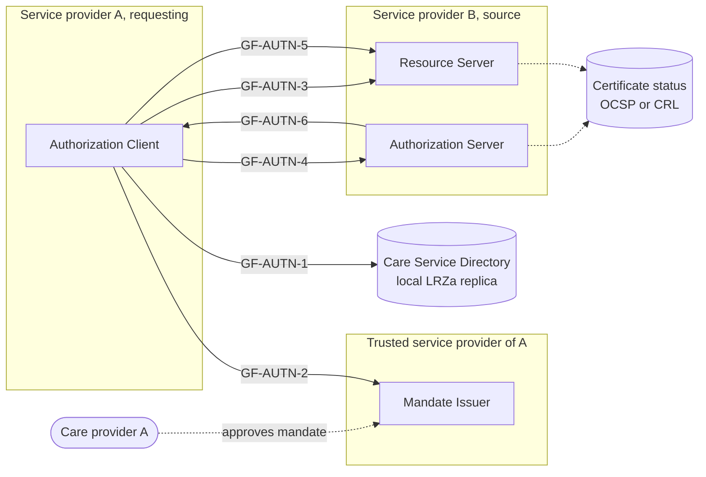
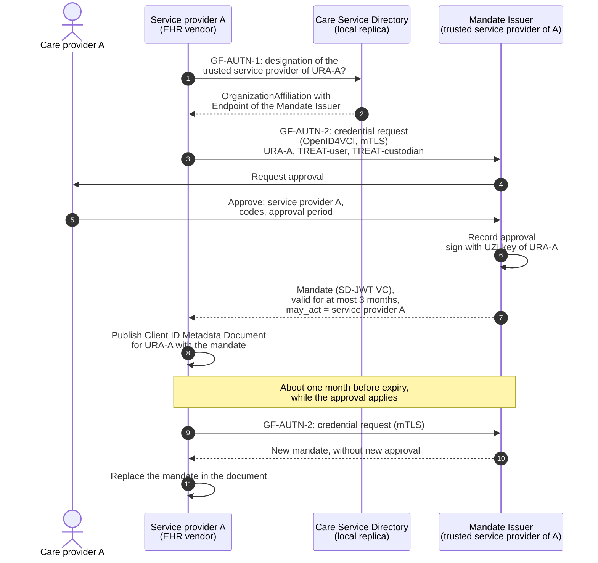
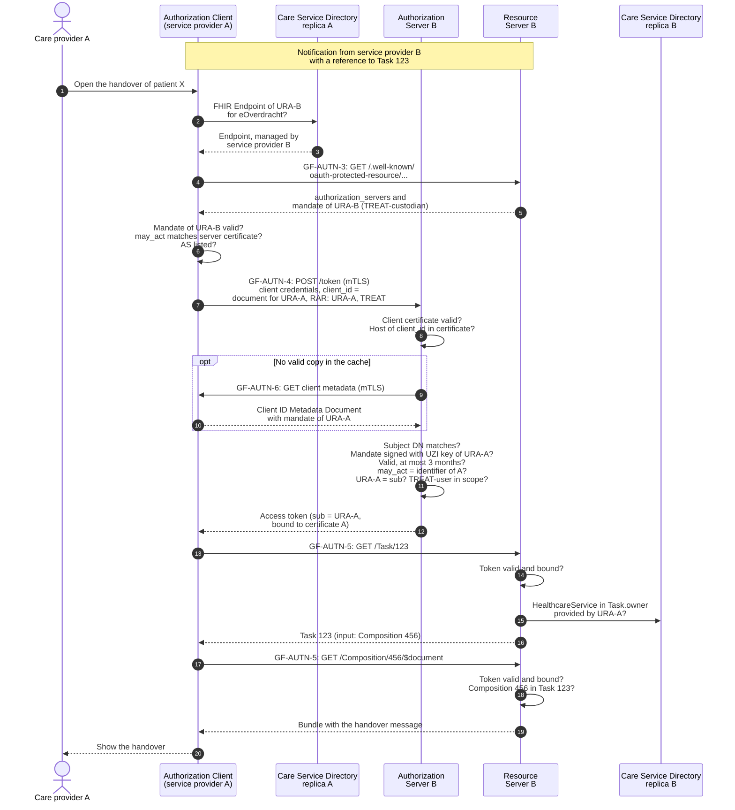

GF Authentication specifies how two healthcare providers establish each other's identity, and the purpose of an exchange, when they exchange health data through their service providers. It is a national initiative led by the Dutch Ministry of Health, Welfare and Sport (VWS) and applies first to the exchanges *Basisgegevensset Zorg* (BgZ) and *eOverdracht* (nursing handover), both mandatory under the Wegiz.
{: .ig-lead}

> **Note:** This specification is based on the memo [*Harmonisatie van authenticatie en autorisatie voor de gegevensuitwisselingen BgZ en eOverdracht*](./authenticatie-en-autorisatie-eOverdracht-BgZ-vMT-DICIO-20260818.html) and its follow-up [*Vervolg harmonisatie: clientregistratie en machtiging*](./authenticatie-en-autorisatie-vervolg-mandaat-clientregistratie.html), in which the alternatives are weighed. It specifies the proposal in [*Ontwerpbeslissingen: machtiging en clientregistratie*](./authenticatie-en-autorisatie-ontwerpbeslissingen.html): the mandate in a Client ID Metadata Document and in the Protected Resource Metadata, with the client credentials grant. You should be able to read it without prior knowledge of these memos, but a basic understanding of OAuth 2.0 and FHIR is preferred.

### Scope

This page specifies:
- how a care provider mandates a service provider to act on its behalf, and how that mandate is issued, renewed and verified;
- how a service provider publishes its mandates as OAuth client metadata, authenticates to the authorization server of another service provider, and obtains an access token for a care provider;
- how the requesting service provider establishes, before it sends a request, that the endpoint belongs to the source care provider and its mandated service provider;
- how the resource server validates each request.

This page does not specify:
- how a care provider authenticates its own practitioners and systems. Each care provider does that within its own domain;
- the authorization decision of the source beyond the checks on this page, such as patient consent;
- how endpoints and organizations are published. See [GF Care Service Directory](./csd.html).

The exchanges in scope are the targeted *sending* of health data between two care providers within BgZ and eOverdracht, where a referral, handover or *aanmelding* precedes the exchange. A (starting) treatment relationship then exists at the receiving care provider, and the patient's consent is implied in the agreement to the referral. Queries without a preceding referral, and exchanges that do not run between two care providers (for example from a PGO or a research institution), are out of scope.

### Terminology

| Term | Meaning |
|---|---|
| Care provider | The organization that provides care and is the controller of the health data (*zorgaanbieder*). It is identified by its URA. |
| URA | *UZI-Register Abonneenummer*, the identifier of a care provider in the UZI register, as `urn:oid:2.16.528.1.1007.3.3.<URA>`. |
| Service provider | The party that provides and operates the technical systems for a care provider (*dienstverlener*), such as an EHR vendor, SaaS platform or hub, or the care provider itself. It has its own certificate. |
| Trusted service provider | The one service provider that a care provider designates to issue mandates on its behalf, with the key of the care provider's UZI server certificate. A care provider can fulfil this role itself. |
| Mandate | A signed statement in which a care provider authorizes a service provider to act on its behalf for one or more mandate codes (*machtiging*). |
| Mandate code | The scope of a mandate, as `<purpose>-<role>`, for example `TREAT-user`. See [Mandate codes](#mandate-codes). |
| Source | The care provider that holds the requested data (custodian), and its service provider. |
| `client_id` | The identifier of a service provider as OAuth client on behalf of one care provider: the HTTPS URL of its Client ID Metadata Document. See [Client ID Metadata Document](#client-id-metadata-document). |
| Client ID Metadata Document | A JSON document with the metadata of an OAuth client, which the client publishes at the URL that is its `client_id` ([draft-ietf-oauth-client-id-metadata-document](https://datatracker.ietf.org/doc/draft-ietf-oauth-client-id-metadata-document/)). |
| Service provider identifier | The identifier of a service provider, derived from its certificate. See [Service provider identifier](#service-provider-identifier). |
| GIS | *Gezondheidsinformatiestelsel*, the national health information system under which this specification is agreed. |

### Solution overview

Key design principles:
- **International standards.** The solution builds on open, internationally adopted standards: OAuth 2.0 with the FAPI 2.0 security profile, the client credentials grant, mTLS (RFC 8705), Rich Authorization Requests (RFC 9396), Protected Resource Metadata (RFC 9728), the OAuth Client ID Metadata Document (IETF draft), and SD-JWT VC with OpenID4VCI for the mandate.
- **Federated trust.** Each care provider authenticates its own practitioners and systems within its own domain. Across the organizational boundary, the source verifies the identity of the other care provider, the service provider that acts for it, and the purpose of the exchange.
- **Transport trust and application trust are separated** (GISA choice A44). The service provider authenticates the connection with its own certificate. The identity of the care provider on whose behalf it acts is carried at the application layer, in the mandate. The executing system is therefore a recognizable actor in each exchange and in the logging.
- **Organization identity anchored in the UZI register.** A mandate is signed with the key of the care provider's UZI server certificate, so a verifier can check the URA against the UZI register.
- **No client registration.** A service provider publishes a Client ID Metadata Document with its mandate for each care provider. The authorization server learns the client and its mandate from that document, as the requesting service provider learns the source's mandate from the Protected Resource Metadata. No registration step or shared state between client and server is needed.

The process:
1. Each care provider designates one trusted service provider in the LRZa, with the endpoint of its Mandate Issuer.
2. Each service provider of the care provider, on the requesting and on the source side, obtains a mandate from that Mandate Issuer. The care provider approves the mandate once; the Mandate Issuer renews it every 3 months as long as the approval stands.
3. The requesting service provider publishes its mandate in a Client ID Metadata Document for that care provider. The source's resource server publishes its own mandate in its Protected Resource Metadata.
4. Before an exchange, the requesting service provider finds the source's endpoint in its Care Service Directory replica, and verifies the source's mandate.
5. The requesting service provider requests an access token at the source's authorization server with the client credentials grant, over mTLS. It sends the URL of its document as `client_id`, and a RAR object that states the care provider and the purpose. The authorization server retrieves the document and verifies the mandate in it.
6. The requesting service provider sends its FHIR requests with the access token, over mTLS with the same certificate. The resource server validates the token, its binding to the certificate, and the request.



The source's service provider obtains its own mandate (`TREAT-custodian`) from the trusted service provider of care provider B in the same way (GF-AUTN-1 and GF-AUTN-2); this is not shown in the figure.

#### Federated trust model

The legal framework (WGBO, AVG and Wabvpz) leads to a federated trust model:
- Each care provider is responsible for the authentication and authorization of its own practitioners and systems. A care provider does not repeat the authentication of its exchange partner and may rely on its statement.
- The source care provider is responsible for establishing which care provider requests its data, which service provider acts for it, and for which purpose. For BgZ and eOverdracht the purpose is treatment: the exchange is necessary for the performance of the treatment agreement.
- Both care providers remain responsible for the systems that their service providers operate for them. The mandate records which service provider may act for a care provider, and for which purposes.

This trust is enforced through legally mandated standards (NEN 7510, NEN 7512 and NEN 7513), admission requirements, audits and supervision, and logging and liability after the fact. NEN 7513 and the patient's right of access (Wabvpz) require that it can be established afterwards which care provider and which system requested data.

#### Requirements

The legal framework leads to these requirements:
1. **Mutual establishment of the care provider identity.** Both parties establish, based on the URA, which care provider they exchange with, also when a service provider acts for it. Data is only delivered to the established care provider.
2. **Identification of the executing system.** The service provider that operates the requesting or responding system is identified by its certificate.
3. **No authentication of the partner's practitioners.** The exchange does not verify individual practitioners of the other care provider; it carries the context needed for authorization, logging and traceability at the organization level.
4. **Explicit purpose.** The purpose of the exchange is stated explicitly, so that the source can base its authorization decision on it and distinguish it from other purposes.

#### Standards

| Choice | Rationale |
|---|---|
| **OAuth 2.0** with the **FAPI 2.0** security profile | De-facto international standard for controlled access between systems; asymmetric client authentication, sender-constrained access tokens, mandatory transport security and strict validation. |
| **mTLS** for client authentication and sender-constrained tokens ([RFC 8705](https://www.rfc-editor.org/rfc/rfc8705)) | One mechanism for transport, client authentication and token binding, using the certificate of the service provider that operates the connection. |
| **Client ID Metadata Document** ([IETF draft](https://datatracker.ietf.org/doc/draft-ietf-oauth-client-id-metadata-document/)) | No registration step, and no state to keep in sync. The service provider publishes its client metadata and mandate itself, as the source publishes its mandate in the Protected Resource Metadata. |
| **Mandate as SD-JWT VC**, issued with **OpenID4VCI** | The format and issuance protocol of attestations in European wallets, signed with the care provider's UZI key. |
| **Client credentials grant** ([RFC 6749](https://www.rfc-editor.org/rfc/rfc6749), §4.4) | A standard grant without an interactive user. The authorization server takes the mandate from the client metadata, and checks the requested authorization details against it ([RFC 9396](https://www.rfc-editor.org/rfc/rfc9396), §6). |
| **Rich Authorization Requests** ([RFC 9396](https://www.rfc-editor.org/rfc/rfc9396)) | Carries the care provider, the purpose and the target of the request. |
| **Protected Resource Metadata** ([RFC 9728](https://www.rfc-editor.org/rfc/rfc9728)) | Publishes the authorization servers of an endpoint and the source's mandate, so the requesting service provider can verify the source before it sends a request. |

### Actors

| Actor | Role | Transactions | Requirements |
|---|---|---|---|
| [Mandate Issuer](#mandate-issuer) | Issues mandates for a care provider, after its approval | Server for [GF-AUTN-2](#gf-autn-2-obtain-mandate) | [Mandate](#mandate) |
| [Authorization Client](#authorization-client) | Requests data for a care provider, and publishes its client metadata | Client for [GF-AUTN-1](#gf-autn-1-discover-mandate-issuer) to [GF-AUTN-5](#gf-autn-5-access-resource); server for [GF-AUTN-6](#gf-autn-6-get-client-metadata) | [Client ID Metadata Document](#client-id-metadata-document), [Mandate](#mandate), [RAR object](#rar-object) |
| [Authorization Server](#authorization-server) | Issues access tokens for the source | Server for [GF-AUTN-4](#gf-autn-4-request-access-token); client for [GF-AUTN-6](#gf-autn-6-get-client-metadata) | [Validation by the authorization server](#validation-by-the-authorization-server) |
| [Resource Server](#resource-server) | Serves the source's data, and publishes its metadata and mandate | Server for [GF-AUTN-3](#gf-autn-3-get-protected-resource-metadata) and [GF-AUTN-5](#gf-autn-5-access-resource); client for [GF-AUTN-1](#gf-autn-1-discover-mandate-issuer) and [GF-AUTN-2](#gf-autn-2-obtain-mandate) | [Validation by the resource server](#validation-by-the-resource-server) |
| [Care Service Directory](#care-service-directory) | Publishes the designation of trusted service providers and the endpoints | Server for [GF-AUTN-1](#gf-autn-1-discover-mandate-issuer) | [GF Care Service Directory](./csd.html) |

#### Mandate Issuer

The Mandate Issuer is operated by the trusted service provider of a care provider. It holds the key of the care provider's UZI server certificate, and SHALL keep that key non-exportable, for example in an HSM. It SHALL:
- let the care provider approve each mandate request: the service provider, the mandate codes, and the period during which the approval applies;
- issue a mandate only after a recorded approval, and keep the approval as evidence: who approved, when, and what;
- give the care provider an overview of the mandates that it has approved and issued, and let it withdraw an approval;
- renew mandates while the approval applies (see [Validity and renewal](#validity-and-renewal)).

A Mandate Issuer SHALL NOT issue mandates for a care provider that has not designated its trusted service provider in the LRZa.

#### Authorization Client

The Authorization Client is the OAuth client of the requesting service provider. It holds a mandate with the code `<purpose>-user` for each care provider it acts for, publishes a [Client ID Metadata Document](#client-id-metadata-document) with that mandate for each of them, and SHALL support [GF-AUTN-1](#gf-autn-1-discover-mandate-issuer) to [GF-AUTN-6](#gf-autn-6-get-client-metadata).

#### Authorization Server

The Authorization Server is operated by the source's service provider, and can serve many care providers. It SHALL support [GF-AUTN-4](#gf-autn-4-request-access-token) and [GF-AUTN-6](#gf-autn-6-get-client-metadata), and publish its metadata ([RFC 8414](https://www.rfc-editor.org/rfc/rfc8414)), with at least:
- `token_endpoint_auth_methods_supported`: `["tls_client_auth"]`;
- `tls_client_certificate_bound_access_tokens`: `true`;
- `grant_types_supported`: including `client_credentials`;
- `authorization_details_types_supported`: `["nl-gis-v1"]`;
- `client_id_metadata_document_supported`: `true`.

The token request is a standard client credentials request. Common authorization server products, however, do not retrieve a Client ID Metadata Document for a client credentials request, and do not validate mandates. Each needs an extension that loads the client from the document, performs the checks in [Validation by the authorization server](#validation-by-the-authorization-server), and adds the claims to the access token. No custom grant is needed:
- *Duende IdentityServer:* a custom client store (`IClientStore`) that retrieves the document and builds a client with the client credentials grant and a secret of type `X509CertificateName` with the subject DN, and an `ICustomTokenRequestValidator` for the checks per request, the RAR object and the claims. Both are documented extension points. Duende IdentityServer does not support Client ID Metadata Documents itself.
- *Keycloak:* a custom client authenticator that retrieves the document and creates or updates the client, a client policy executor that checks the RAR object, and a protocol mapper for the claims. The client authenticator and the executor are internal extension points, so the extension has to be retested on each upgrade. The experimental support for Client ID Metadata Documents in Keycloak (feature `cimd`) only applies to authorization requests.
- *Nuts node:* no Client ID Metadata Documents and no SD-JWT. Support has to be added to the Nuts node itself, once for all participants of the Nuts network. The Nuts node does not support `tls_client_auth`, so the organization's own reverse proxy handles mTLS.

The verification of the mandate is the same logic in every product. A shared open-source verification component limits the work per product to a thin integration.

Microsoft Entra ID cannot act as this authorization server: it supports `self_signed_tls_client_auth` with a certificate registered per application, but not `tls_client_auth` based on a PKI certificate; certificate-bound access tokens are in private preview; and it supports neither Client ID Metadata Documents nor RAR. An organization that uses Entra ID places a specialized authorization server, such as Keycloak, Duende IdentityServer or Curity, in front of or next to Entra ID, with Entra ID as upstream identity provider for its employees. The memo describes the impact per product in [appendix C](./authenticatie-en-autorisatie-vervolg-mandaat-clientregistratie.html#bijlage-c-impact-op-authorization-servers).

#### Resource Server

The Resource Server is the source's FHIR API, registered as an `Endpoint` in the [Care Service Directory](./csd.html). It holds a mandate with the code `<purpose>-custodian` for each care provider it serves, which it obtains through [GF-AUTN-1](#gf-autn-1-discover-mandate-issuer) and [GF-AUTN-2](#gf-autn-2-obtain-mandate), and publishes it in [GF-AUTN-3](#gf-autn-3-get-protected-resource-metadata).

#### Care Service Directory

A care provider designates its trusted service provider in the LRZa portal, as an [`OrganizationAffiliation`](./StructureDefinition-nl-gf-organizationaffiliation.html) with:
- `organization`: the care provider;
- `participatingOrganization`: the trusted service provider;
- `code`: the code for the designation as trusted service provider (see [Open issues](#open-issues));
- `endpoint`: the `Endpoint` of the Mandate Issuer, with the URL of its OpenID4VCI credential issuer.

A care provider SHALL have at most one active designation. Service providers find it in their local replica of the LRZa ([GF Care Service Directory](./csd.html)). The LRZa is only used to find the Mandate Issuer; the verification of a mandate relies on its signature.

### Transactions

| ID | Transaction | Client | Server |
|---|---|---|---|
| GF-AUTN-1 | [Discover Mandate Issuer](#gf-autn-1-discover-mandate-issuer) | Authorization Client or Resource Server | Care Service Directory (local replica) |
| GF-AUTN-2 | [Obtain Mandate](#gf-autn-2-obtain-mandate) | Authorization Client or Resource Server | Mandate Issuer |
| GF-AUTN-3 | [Get Protected Resource Metadata](#gf-autn-3-get-protected-resource-metadata) | Authorization Client | Resource Server |
| GF-AUTN-4 | [Request Access Token](#gf-autn-4-request-access-token) | Authorization Client | Authorization Server |
| GF-AUTN-5 | [Access Resource](#gf-autn-5-access-resource) | Authorization Client | Resource Server |
| GF-AUTN-6 | [Get Client Metadata](#gf-autn-6-get-client-metadata) | Authorization Server | Authorization Client |

All transactions SHALL use mTLS with the certificates of the service providers (see [Transport and certificates](#transport-and-certificates)). GF-AUTN-1 and GF-AUTN-2 run in advance and on renewal; GF-AUTN-3 to GF-AUTN-5 run for each exchange. GF-AUTN-6 runs during GF-AUTN-4 when the authorization server has no valid copy of the client's document in its cache.

#### GF-AUTN-1: Discover Mandate Issuer

The service provider searches its local Care Service Directory replica ([ITI-90-NL](./csd.html#search-care-services-iti-90-nl)) for the active `OrganizationAffiliation` in which the care provider designates its trusted service provider, and takes the Mandate Issuer's `Endpoint` from it. If the service provider is itself the trusted service provider, it issues the mandate to itself and skips GF-AUTN-2.

#### GF-AUTN-2: Obtain Mandate

The service provider requests a mandate from the Mandate Issuer with [OpenID4VCI](https://openid.net/specs/openid-4-verifiable-credential-issuance-1_0.html), and authenticates with its certificate (mTLS). The request names the care provider and the requested mandate codes.

The Mandate Issuer:
1. derives the service provider identifier from its certificate ([Service provider identifier](#service-provider-identifier));
2. issues the mandate immediately if an approval for this service provider and these codes applies; otherwise it asks the care provider for approval, for example in its own application, and issues the mandate after approval;
3. returns the [mandate](#mandate), with `may_act.sub` equal to the service provider identifier.

The requesting service provider publishes the mandate in the [Client ID Metadata Document](#client-id-metadata-document) for that care provider. The source's service provider publishes it in its Protected Resource Metadata ([GF-AUTN-3](#gf-autn-3-get-protected-resource-metadata)).

#### GF-AUTN-3: Get Protected Resource Metadata

Before it requests a token, the Authorization Client establishes that the endpoint belongs to the source care provider and its mandated service provider:
1. It finds the source's FHIR `Endpoint` for the use case in its Care Service Directory replica, and so the URA of the source care provider.
2. It retrieves the resource's metadata ([RFC 9728](https://www.rfc-editor.org/rfc/rfc9728)). RFC 9728 inserts the well-known path between the host and the path of the resource. For `https://fhir.dienstverlener-b.nl/zorgaanbieder-b/fhir` the request is:

   ```
   GET /.well-known/oauth-protected-resource/zorgaanbieder-b/fhir HTTP/1.1
   Host: fhir.dienstverlener-b.nl
   ```

3. It verifies the mandate of the source care provider in the metadata, as in [Validation by the authorization server](#validation-by-the-authorization-server), steps 4 and 5, and checks that:
   - `sub` is the URA of the source care provider from step 1;
   - `scope` contains the code `<purpose>-custodian` for the purpose of the request;
   - `may_act.sub` equals the service provider identifier derived from the resource server's TLS server certificate ([Service provider identifier](#service-provider-identifier));
   - the authorization server it will use is listed in `authorization_servers`.

The resource server SHALL publish, besides the RFC 9728 parameters `resource` and `authorization_servers`, the mandates of the care providers that the endpoint serves. They are published as an object with a list of attestations per attestation type, so that other attestations of the source can be added later. A mandate is published as an SD-JWT VC without disclosures and without key binding JWT, which ends in `~`. A resource server that serves several care providers SHOULD use a path per care provider, so that each endpoint has its own metadata.

```json
{
  "resource": "https://fhir.dienstverlener-b.nl/zorgaanbieder-b/fhir",
  "authorization_servers": ["https://as.dienstverlener-b.nl"],
  "tls_client_certificate_bound_access_tokens": true,
  "authorization_details_types_supported": ["nl-gis-v1"],
  "nl_gf_custodian_attestations": { "machtiging": ["<mandate of care provider B>~"] }
}
```

The parameter name `nl_gf_custodian_attestations` is provisional (see [Open issues](#open-issues)). The Authorization Client MAY cache the metadata for at most a maximum time set by the GIS, and SHALL check the validity of the cached mandate before each use.

#### GF-AUTN-4: Request Access Token

The Authorization Client requests an access token with the client credentials grant ([RFC 6749](https://www.rfc-editor.org/rfc/rfc6749), §4.4), over mTLS with its certificate (`tls_client_auth`). The `client_id` is the URL of the [Client ID Metadata Document](#client-id-metadata-document) for the care provider on whose behalf it acts. The request does not contain the mandate: the authorization server takes it from the document ([GF-AUTN-6](#gf-autn-6-get-client-metadata)).

```
POST /token HTTP/1.1
Host: as.dienstverlener-b.nl
Content-Type: application/x-www-form-urlencoded

grant_type=client_credentials
&client_id=https%3A%2F%2Fdienstverlener-a.nl%2Foauth%2Fclients%2Fura-11111111
&authorization_details=%5B%7B%22type%22%3A%22nl-gis-v1%22...%7D%5D
```

| Parameter | Value |
|---|---|
| `grant_type` | `client_credentials` |
| `client_id` | The URL of the Client ID Metadata Document for the care provider (RFC 8705 requires the parameter). |
| `authorization_details` | The [RAR object](#rar-object). |

The request has no `scope`: the mandate codes come from the mandate, and the purpose from the RAR object. The authorization server validates the request as described in [Validation by the authorization server](#validation-by-the-authorization-server). On success it returns a sender-constrained access token:

```json
{
  "access_token": "<opaque to the client>",
  "token_type": "Bearer",
  "expires_in": 300,
  "authorization_details": [ { "type": "nl-gis-v1", "...": "..." } ]
}
```

#### GF-AUTN-5: Access Resource

The Authorization Client sends its FHIR requests over mTLS with the same certificate, with the access token in the `Authorization` header. The resource server validates each request as described in [Validation by the resource server](#validation-by-the-resource-server).

```
GET /zorgaanbieder-b/fhir/Task/123 HTTP/1.1
Host: fhir.dienstverlener-b.nl
Authorization: Bearer <access token>
```

#### GF-AUTN-6: Get Client Metadata

When the authorization server receives a token request with a `client_id` for which it has no valid copy of the Client ID Metadata Document, it retrieves the document at that URL ([draft-ietf-oauth-client-id-metadata-document](https://datatracker.ietf.org/doc/draft-ietf-oauth-client-id-metadata-document/), §6). It does so only after it has validated the client certificate and checked that the host of the `client_id` is in that certificate ([Validation by the authorization server](#validation-by-the-authorization-server), steps 1 and 2). Only a holder of an accepted certificate for that host can therefore make the authorization server retrieve a URL.

```
GET /oauth/clients/ura-11111111 HTTP/1.1
Host: dienstverlener-a.nl
Accept: application/json
```

The authorization server SHALL:
- use mTLS with its own certificate, and accept only a server certificate that meets the requirements in [Transport and certificates](#transport-and-certificates);
- not follow redirects, and treat any status other than `200` as an error;
- not connect to addresses that resolve to special-use IP addresses ([RFC 6890](https://www.rfc-editor.org/rfc/rfc6890));
- stop reading at a maximum size set by the GIS. The draft recommends 5 kilobytes, but a document with a mandate and its signing certificate is about 5 kilobytes, and about 8 kilobytes with the intermediate certificate;
- cache a valid document for at most the maximum time set by the GIS, and never beyond `exp` of the mandate in it; it does not cache errors or invalid documents;
- retrieve the document again when the client certificate does not match `tls_client_auth_subject_dn` of the cached copy, at most once per minimum interval set by the GIS, so that a renewed certificate with a new subject DN is accepted without waiting for the cache to expire;
- on a transient failure, keep using a cached valid document within the maximum cache time, and otherwise return HTTP status `503`; for an invalid document, return `invalid_client` (draft, §6.1).

### Validation

#### Validation by the authorization server

The authorization server SHALL reject the token request if any of these checks fails:
1. **Client certificate.** The certificate meets the requirements in [Transport and certificates](#transport-and-certificates), and its revocation status is good.
2. **Client identifier.** The `client_id` is a URL as described in [Client ID Metadata Document](#client-id-metadata-document), and its host equals a `dNSName` in the `subjectAltName` of the client certificate.
3. **Client metadata.** The authorization server has a valid copy of the document, from its cache or from [GF-AUTN-6](#gf-autn-6-get-client-metadata), in which:
   - `client_id` equals the `client_id` parameter, by simple string comparison;
   - `token_endpoint_auth_method` is `tls_client_auth`, and `grant_types` contains `client_credentials`;
   - `tls_client_auth_subject_dn` equals the subject DN of the client certificate ([RFC 8705](https://www.rfc-editor.org/rfc/rfc8705), §2.1.2);
   - `software_statement` contains a mandate.
4. **Mandate signature.**
   - The signature is valid for the certificate in `x5c`, which chains to the UZI register CA.
   - The certificate is a UZI server certificate (card type `S`), and its revocation status is good.
   - The URA in the certificate equals `sub`.
5. **Mandate content.**
   - `vct` is the mandate type set by the GIS.
   - The current time is between `nbf` and `exp`, and `exp` minus `nbf` is at most 3 months (92 days).
6. **Mandated service provider.** `may_act.sub` equals the service provider identifier derived from the client certificate ([Service provider identifier](#service-provider-identifier)).
7. **Care provider and purpose.**
   - The `authorization_details` parameter contains exactly one RAR object, of type `nl-gis-v1`.
   - `subject_organization_id` equals `sub` of the mandate.
   - `scope` of the mandate contains the code `<purpose>-user` for `purpose_of_use` (see [Mandate codes](#mandate-codes)).
   - `locations_organization_id` and `locations` refer to a care provider and resource server that this authorization server serves.

The authorization server MAY verify the signature and certificate chain of the mandate (step 4) when it retrieves the document, and keep the result while it caches the document. It SHALL perform all other checks for each token request, including the validity period of the mandate and the revocation status of its signing certificate, so that an expired mandate or a revoked UZI certificate takes effect immediately. It SHALL take the care provider from `sub` of the mandate, never from the `client_id` URL.

Steps 2, 3 and 6 bind the published mandate to the service provider. Every participant can read the document, but only a client whose certificate contains the host of the `client_id`, matches the subject DN in the document, and carries the identifier in `may_act.sub` can use it. An authorization server that omits step 6 lets any participant use any published mandate (see [Binding to the certificate](#binding-to-the-certificate)).

The access token is opaque to the client. It SHALL record on whose behalf access is granted (`sub`, the URA from the mandate), which service provider acts (`client_id`, and the service provider identifier in `act.sub` as in RFC 8693, §4.1), the `jti` of the mandate, the `authorization_details`, and the hash of the client certificate (`cnf.x5t#S256`, RFC 8705). How the authorization server and resource server exchange it, as a signed token or through token introspection ([RFC 7662](https://www.rfc-editor.org/rfc/rfc7662)), is up to them.

#### Validation by the resource server

For each request, the resource server SHALL:
1. validate the access token and its expiry;
2. check that the hash of the client certificate of the mTLS connection equals `cnf.x5t#S256` in the token;
3. check the revocation status of the client certificate;
4. take its authorization decision based on `purpose_of_use` and `subject_organization_id`, and on the checks of the use case.

For eOverdracht, the resource server checks that the `HealthcareService` in `Task.owner` is provided by the care provider in `subject_organization_id`: `HealthcareService.providedBy` in its Care Service Directory replica refers to the `Organization` with that URA, or to a part of it (`partOf`). For a resource in `Task.input`, it applies that check to the Task that the resource belongs to.

### Data models

#### Service provider identifier

The service provider identifier is derived from a persistent identifier in the certificate of the service provider:
- PKIoverheid server certificate: the `organizationIdentifier` attribute with the KvK number or OIN ([PKIoverheid PvE v5.4](https://cp.pkioverheid.nl/pkioverheid-por-v5.4.html), §7.1.4.2.2.10), for example `NTRNL-90000001`;
- UZI server certificate: the URA in the `subjectAltName`.

It identifies the service provider in `may_act.sub` of the mandate and in the logging. All certificates of one organization yield the same identifier, so the logging also records the certificate (see [Logging](#logging)).

#### Client ID Metadata Document

The Authorization Client publishes a Client ID Metadata Document ([draft-ietf-oauth-client-id-metadata-document](https://datatracker.ietf.org/doc/draft-ietf-oauth-client-id-metadata-document/)) for each care provider that has mandated it, with the mandate as `software_statement` ([RFC 7591](https://www.rfc-editor.org/rfc/rfc7591), §2.3). Each document is a separate OAuth client, which stands for "service provider A on behalf of care provider X". There is no document for a care provider without a mandate.

The `client_id`, which is the URL of the document:
- SHALL meet the requirements of the draft (§3): the `https` scheme, a path other than `/`, and no userinfo, query or fragment;
- SHALL have a host that is a `dNSName` in the `subjectAltName` of the service provider's certificate. Wildcards are not allowed, so a service provider uses one host, with a path per care provider, for example `https://dienstverlener-a.nl/oauth/clients/ura-11111111`;
- MAY contain the URA in its path for readability. The authorization server does not use it.

| Property | Value |
|---|---|
| `client_id` | The URL of the document. |
| `client_name` | Optional and informative, for example `Dienstverlener A namens zorgaanbieder 11111111`. |
| `grant_types` | `["client_credentials"]` |
| `token_endpoint_auth_method` | `tls_client_auth` |
| `tls_client_auth_subject_dn` | The subject DN of the service provider's certificate, in the notation set by the GIS (see [Open issues](#open-issues)). |
| `tls_client_certificate_bound_access_tokens` | `true` |
| `authorization_details_types` | `["nl-gis-v1"]` |
| `software_statement` | The [mandate](#mandate) for this care provider: the JWT signed by the Mandate Issuer, without the `~` that ends an SD-JWT. |

```json
{
  "client_id": "https://dienstverlener-a.nl/oauth/clients/ura-11111111",
  "client_name": "Dienstverlener A namens zorgaanbieder 11111111",
  "grant_types": ["client_credentials"],
  "token_endpoint_auth_method": "tls_client_auth",
  "tls_client_auth_subject_dn": "<subject DN of the certificate of service provider A>",
  "tls_client_certificate_bound_access_tokens": true,
  "authorization_details_types": ["nl-gis-v1"],
  "software_statement": "<mandate of care provider 11111111>"
}
```

The document SHALL NOT contain secrets or private keys (draft, §4.1), and its content SHALL NOT depend on the request, such as its headers or the authorization server that requests it (draft, §4.5). Values in the `software_statement` take precedence over the same values in the document (RFC 7591, §2.3), so the service provider cannot widen its mandate codes through a `scope` in the document.

Products write subject DNs differently. An authorization server converts the notation of the GIS to its own before it compares, and SHALL compare exactly, not with a pattern.

When the mandate is renewed, the service provider publishes the new mandate in the document at least the maximum cache time before the current one expires. When its certificate is renewed with a different subject DN, it updates the document when it starts using the new certificate; the authorization server then retrieves the document again ([GF-AUTN-6](#gf-autn-6-get-client-metadata)). A service provider that stops acting for a care provider removes the document.

An authorization server SHALL NOT require any other registration of a client. Clients are not registered in advance, neither by the client nor by the administrator of the authorization server. The authorization server MAY block a service provider or a `client_id` locally.

#### Mandate

A mandate is an SD-JWT VC ([draft-ietf-oauth-sd-jwt-vc](https://datatracker.ietf.org/doc/draft-ietf-oauth-sd-jwt-vc/)) without selectively disclosable claims. The trusted service provider signs it with the key of the care provider's UZI server certificate; the JOSE header contains `typ` `dc+sd-jwt` and that certificate with its chain in `x5c`. Only a UZI server certificate (card type `S`) may sign a mandate.

| Claim | Description |
|---|---|
| `vct` | The mandate type, as set in the attestation schema of the GIS. |
| `iss` | The URL of the Mandate Issuer. |
| `sub` | The URA of the care provider. |
| `may_act.sub` | The [service provider identifier](#service-provider-identifier) of the mandated service provider (RFC 8693, §4.4). |
| `scope` | The mandate codes, separated by spaces. |
| `jti` | A unique identifier of the mandate. |
| `iat`, `nbf`, `exp` | Issuance time and validity. `exp` minus `nbf` is at most 3 months, and `exp` is not later than the expiry of the signing certificate. |

Example payload of a mandate with a validity of 90 days:

```json
{
  "vct": "https://gis.example.nl/vct/zorgaanbiederdienstverlenermachtiging",
  "iss": "https://machtigingen.epd-leverancier.example.nl",
  "sub": "urn:oid:2.16.528.1.1007.3.3.11111111",
  "may_act": { "sub": "NTRNL-90000001" },
  "scope": "TREAT-user TREAT-custodian",
  "jti": "5f0c2a8e-3b7d-4c1e-9a6f-2d8b7e4c1a90",
  "iat": 1792108800,
  "nbf": 1792108800,
  "exp": 1799884800
}
```

A mandate has no `cnf`. It is not presented with a key binding JWT, but bound to the certificate of the service provider through `may_act.sub` (see [Binding to the certificate](#binding-to-the-certificate)).

#### Validity and renewal

A mandate is valid for at most 3 months. While the care provider's approval applies, the Mandate Issuer issues a new mandate in time, for example one month before the current one expires, and the service provider retrieves it with OpenID4VCI without a new approval. Service providers SHALL renew automatically, so that renewal does not interrupt the exchange. The requesting service provider publishes the new mandate in its [Client ID Metadata Document](#client-id-metadata-document) at least the maximum cache time before the current one expires.

When a care provider withdraws its approval, for example because it ends the cooperation with a service provider, the mandate is not renewed and expires at the end of its validity. A mandate cannot be withdrawn earlier, except by revoking a certificate:
- revoking the certificate of a service provider closes it off for all care providers;
- revoking the care provider's UZI server certificate invalidates all its mandates.

There is no status list, so a verifier does not need to contact the Mandate Issuer to check a mandate.

#### RAR object

The `authorization_details` parameter carries one object of type `nl-gis-v1`:

```json
{
  "authorization_details": [
    {
      "type": "nl-gis-v1",
      "subject_organization_id": "urn:oid:2.16.528.1.1007.3.3.11111111",
      "purpose_of_use": "http://terminology.hl7.org/CodeSystem/v3-ActReason|TREAT",
      "locations_organization_id": "urn:oid:2.16.528.1.1007.3.3.12345678",
      "locations": ["https://fhir.dienstverlener-b.nl/zorgaanbieder-b/fhir"]
    }
  ]
}
```

| Field | Description |
|---|---|
| `type` | `nl-gis-v1`. |
| `subject_organization_id` | The URA of the care provider on whose behalf the service provider acts. It equals `sub` of the mandate. |
| `purpose_of_use` | The purpose of the exchange, from [HL7 v3 ActReason](https://terminology.hl7.org/CodeSystem-v3-ActReason.html). For BgZ and eOverdracht: `TREAT`. |
| `locations_organization_id` | The URA of the source care provider. |
| `locations` | The resource server(s) for which access is requested (RFC 9396). |

Other purposes can use the same protocol with a different `purpose_of_use`; each purpose has its own legal basis and consent requirements.

#### Mandate codes

A mandate code consists of a purpose and a role: `<purpose>-<role>`. The purpose is a top-level code from [HL7 v3 ActReason](https://terminology.hl7.org/CodeSystem-v3-ActReason.html) (PurposeOfUse), the same code system as `purpose_of_use`. A mandate for a purpose also covers its specializations: `TREAT` covers, for example, emergency treatment (`ETREAT`) and coordination of care (`COC`).

The roles are:
- `user`: request and receive data on behalf of the care provider, usually as Authorization Client;
- `custodian`: make data available or register data on behalf of the care provider as the source, usually as Authorization Server and Resource Server; for registration in the LRZa or the NVI, as a client of that service.

| Purpose | `<purpose>-user`: the service provider may, on behalf of the care provider… | `<purpose>-custodian`: the service provider may, on behalf of the care provider… |
|---|---|---|
| `TREAT` (treatment) | request data for the treatment of patients, such as BgZ, European Patient Summary, eOverdracht, medication transfer, maternity care and emergency care, and search the NVI for that purpose. | make data available for the treatment of patients, consult consents for that purpose, and register patients at the NVI. |
| `PATRQT` (patient request) | request data at the patient's request. | make data available to the patient or the patient's PGO. |
| `HRESCH` (research) | request data for (medical) research. | provide data for research, and update dataset descriptions in the catalogue of the Health Data Access Body (EHDS). |
| `PUBHLTH` (public health) | request data for public health. | provide data for public health, such as notifications of infectious diseases. |
| `HSYSADMIN` (system administration) | request the care provider's data from the LRZa, and update its own resources (such as Endpoints) in the LRZa. | register and update the care provider's data in the LRZa. |

The authorization server derives the required code from `purpose_of_use`: a request with purpose `TREAT` requires the code `TREAT-user` in the mandate of the requesting service provider. The requesting service provider checks that the source's service provider has the code `TREAT-custodian`. For BgZ and eOverdracht, an EHR vendor that both requests and provides data receives both codes in one mandate.

### Error handling

| Status | Error | Cause | Client action |
|---|---|---|---|
| `400` | `invalid_request` | A required parameter is missing or malformed. | Correct the request. |
| `400` | `invalid_authorization_details` | The RAR object is invalid, `subject_organization_id` does not equal the care provider of the mandate, or the mandate does not contain the code for `purpose_of_use` (RFC 9396). | Correct the request; check the mandate codes. |
| `401` | `invalid_client` | The client certificate is invalid or revoked; the host of the `client_id` is not in the certificate; or the Client ID Metadata Document is invalid, does not match the certificate, or contains a mandate that is invalid, expired or not for this service provider. | Check the certificate and the document; obtain a new mandate (GF-AUTN-2) if it has expired. Do not retry unchanged. |
| `401` | `invalid_token` | The access token is missing, expired, invalid, or not bound to the client certificate (resource server). | Obtain a new access token (GF-AUTN-4) and retry once. |
| `403` | `insufficient_scope` | The request is not allowed for this care provider or purpose (resource server). | Do not retry. |
| `503` | (none) | The authorization server could not retrieve the Client ID Metadata Document (GF-AUTN-6). | Check that the document is available; retry later. |

The authorization server and resource server SHALL fail closed: if the revocation status of a certificate cannot be determined, they reject the request.

### Security considerations

#### Transport and certificates

- All connections SHALL use mTLS, following the TLS guidelines of the NCSC, initially with PKIoverheid or UZI server certificates. The GIS Veilig Netwerk may require a different implementation later.
- Servers SHALL only accept certificates from a list of issuing CAs and certificate policies set by the GIS: PKIoverheid server certificates and UZI server certificates (card type `S`). They SHALL NOT use the default trust store of the operating system or gateway.
- The client certificate SHALL contain the extended key usage `clientAuth`.
- Personal certificates SHALL be rejected, even if they contain an `organizationIdentifier` or URA. This applies to PKIoverheid personal certificates and to UZI cards (card types `Z`, `N` and `M`).
- Servers SHALL check the revocation status of the client certificate through OCSP or the CRL of the trust service provider, with a maximum age of the response set by the GIS, independent of `nextUpdate`. The Authorization Client checks the resource server's certificate in the same way.
- The authorization server retrieves Client ID Metadata Documents over mTLS as well ([GF-AUTN-6](#gf-autn-6-get-client-metadata)). Only participants can read them, and the document is served by a host with an accepted certificate.
- mTLS SHALL run through to the authorization server and resource server. A hub or intermediary of another party SHALL NOT terminate the TLS connection: a forwarded client certificate, for example in a header as in [RFC 9440](https://www.rfc-editor.org/rfc/rfc9440), contains only the public certificate, so whoever can set that header can impersonate any service provider.

#### Trust in the trusted service provider

The trusted service provider holds the care provider's UZI key and can therefore issue mandates for any service provider, including itself, for all mandate codes. The care provider controls this through its designation in the LRZa, the overview of its mandates, and its agreements with the trusted service provider. The trusted service provider SHALL keep the key non-exportable, separate the approval application from the signing key, and log every issuance.

#### Withdrawal

A mandate expires at most 3 months after it was issued. Withdrawing an approval takes effect when the current mandate expires; immediate exclusion is only possible by revoking a certificate (see [Validity and renewal](#validity-and-renewal)). Because the authorization server checks the validity and the revocation status for each token request, caching the Client ID Metadata Document does not delay either. Care providers that change service providers should take this period into account.

#### Binding to the certificate

The token request contains no signed proof: every participant can read the mandate, and mTLS protects the request only in transit. The binding to the service provider rests on the client certificate. The authorization server compares the host of the `client_id`, the subject DN in the document and `may_act.sub` of the mandate with that certificate ([Validation by the authorization server](#validation-by-the-authorization-server), steps 2, 3 and 6). The access token is bound to the same certificate, so a stolen token cannot be used without the corresponding private key. As a consequence:
- the private key of the service provider's certificate is the only key that protects its mandates. It SHALL be non-exportable, for example in an HSM, also where a proxy or gateway in the service provider's own domain terminates TLS;
- an authorization server that omits one of these checks lets any participant with an accepted certificate use the published mandates of others. Authorization servers SHOULD be tested with negative cases before they are admitted (see [Open issues](#open-issues));
- the token request and the RAR object are not signed, so the authorization server cannot prove to third parties what the service provider requested. It SHALL log the request (see [Logging](#logging)).

#### Logging

Both parties SHALL log each exchange according to NEN 7513, at the level of the requesting care provider, supplemented with:
- the `client_id`, the service provider identifier, and the serial number and subject of the client certificate, because all certificates of one organization yield the same service provider identifier;
- the `jti` and `iss` of the mandate;
- the `authorization_details` of the token request as received, and the requested resources.

The Mandate Issuer logs each approval and issuance.

#### Privacy considerations

A mandate contains only organization identifiers and no personal data. The Client ID Metadata Documents and the Protected Resource Metadata show which care providers have mandated which service provider, and with which codes; they are only available over mTLS to holders of an accepted certificate. The approval of a mandate records personal data of the approving employee at the Mandate Issuer, which processes it for the care provider.

See also the [security review](./authenticatie-en-autorisatie-security-review.html) of the alternatives, and its [findings for this specification](./authenticatie-en-autorisatie-security-review.html#findings-for-the-proposed-variant).

### Example use cases

#### Use case: Obtaining and renewing a mandate

Care provider A uses EHR vendor A for its exchanges and has designated its own hosting provider as trusted service provider.



#### Use case: Retrieving a nursing handover

Care provider B, a hospital, hands over the care of patient X to a district nursing team of care provider A. Service provider B records the handover in Task 123, with the team's `HealthcareService` as `owner` and the handover message (Composition 456) in `Task.input`. It notifies service provider A with a reference to the Task. Service provider A then retrieves the Task and the handover message.



### Roadmap for GF Authentication

#### Open issues

- **Designation code.** The code in `OrganizationAffiliation.code` for the designation as trusted service provider, and the `Endpoint.connectionType` of the Mandate Issuer, still have to be added to the [NL GF Authorization Type CodeSystem](./CodeSystem-nl-gf-authorization-type-cs.html) and the CSD profiles.
- **Mandate codes.** The mandate codes still have to be published as a code system.
- **Attestation schema.** The GIS sets the `vct`, the attributes and the maximum validity in an attestation schema.
- **Client ID Metadata Document.** The notation of the subject DN in `tls_client_auth_subject_dn`, the maximum cache time, the minimum interval between retrievals, and the maximum document size.
- **Service provider identifier.** Some PKIoverheid server certificates in use carry the OIN in `serialNumber` and have no `organizationIdentifier`, although the PvE requires it since version 5.0. The GIS decides whether such certificates are accepted, and how the identifier is then derived.
- **Test suite.** Positive and negative tests for authorization servers, including a published mandate used by another service provider, a `client_id` whose host is not in the certificate, a revoked UZI certificate, and a `subject_organization_id` that differs from `sub`.
- **Protected Resource Metadata.** The name of the parameter that carries the source's attestations, and the maximum caching time.
- **Revocation checks.** The maximum age of OCSP responses and CRLs.
- **System identification.** Which certificate attributes, besides the organization identifier, identify the system in the logging.
- **UZI register.** The use of the UZI server certificate for signing mandates has to be agreed with the UZI register (CIBG).
- **Standards status.** SD-JWT VC and the Client ID Metadata Document are IETF drafts, and the Client ID Metadata Document has hardly been used with the client credentials grant. A test with the authorization server products of pilot participants has to establish the feasibility. A status list ([Token Status List](https://datatracker.ietf.org/doc/draft-ietf-oauth-status-list/)) for early withdrawal can be added once that specification is published as an RFC.

#### Attestations per request

This version does not let a service provider send other attestations per request, such as a proof of the treatment relationship; BgZ and eOverdracht do not need them. If a use case needs them, the client credentials grant can be replaced by the token exchange ([RFC 8693](https://www.rfc-editor.org/rfc/rfc8693)) that the memo describes for M1 and M6. Its subject token then contains only the other attestations, each with a key binding JWT; the mandate stays in the Client ID Metadata Document.

#### Growth path to the European Business Wallet

Once the European Business Wallet is operational, a care provider can issue the same type of mandate from its own wallet. The schema, format and verification stay the same; only the signer changes, and a status list for withdrawal is added. The trusted service provider is then no longer needed, and no service provider holds the care provider's UZI key.
