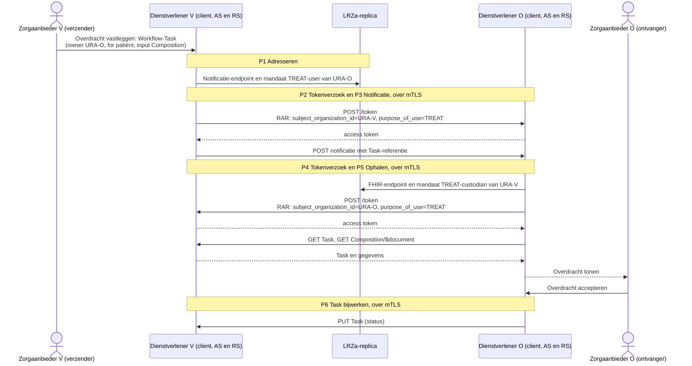

# Verkenning (AI-gegenereerd): autorisatiecontroles bij een push
Een 'push' bij eOverdracht en de BgZ-verwijzing verloopt als *notified pull* ([Twiin-01 Send Notification Task](https://vzvz.atlassian.net/wiki/spaces/Twiincon/pages/331847512/10.3.1+Twiin-01+Send+Notification+Task); [eOverdracht 4.0](https://informatiestandaarden.nictiz.nl/wiki/vpk:V4.0_FHIR_eOverdracht), paragraaf 3.2). De verzendende zorgaanbieder legt de overdracht of verwijzing vast in een Workflow-Task en stuurt de ontvangende zorgaanbieder een notificatie. De ontvanger haalt daarna de Task en de gegevens op bij de verzender, de bron, en werkt de status van de Task bij. Deze bijlage somt de autorisatiecontroles van die uitwisseling op, uitgaande van dit voorstel: mTLS, een client-id uit het certificaat, het RAR-object en mandaten volgens M4.

## Rollen en transacties
In een push wisselen de rollen per transactie. Bij de notificatie is de dienstverlener van de verzender de OAuth-client; bij het ophalen en bijwerken is dat de dienstverlener van de ontvanger. De mandaatcode volgt de rol in de gegevensuitwisseling, niet de OAuth-rol (paragraaf 2.3): de verzender stelt gegevens beschikbaar (`TREAT-custodian`), de ontvanger ontvangt ze (`TREAT-user`). Ook het Nuts-profiel voor de BgZ-verwijzing onderscheidt een beleid voor de ontvanger (de notificatie) en een voor de verzender (de Task en de gegevens) ([nuts-use-case-profile-bgz-referral](https://github.com/nuts-foundation/nuts-use-case-profile-bgz-referral)).

| Transactie | OAuth-client | Authorization server en resource server | Mandaat van de client | Mandaat van de server |
|---|---|---|---|---|
| P1 Adresseren, P2 Tokenverzoek, P3 Notificatie | Dienstverlener van de verzender | Dienstverlener van de ontvanger | `TREAT-custodian` van de verzendende zorgaanbieder | `TREAT-user` van de ontvangende zorgaanbieder |
| P4 Tokenverzoek, P5 Ophalen, P6 Task bijwerken | Dienstverlener van de ontvanger | Dienstverlener van de verzender | `TREAT-user` van de ontvangende zorgaanbieder | `TREAT-custodian` van de verzendende zorgaanbieder |

In de tabellen staan *verzender* en *ontvanger* voor het systeem van de dienstverlener van de verzendende of ontvangende zorgaanbieder, met de deelrol client, authorization server (AS) of resource server (RS).



## Soorten controles en Rego
De controles zijn ingedeeld in twee soorten:
- **Technisch:** controles op verbinding, certificaten, tokens en berichtvorm. Ze zijn gelijk voor alle zorgtoepassingen en worden meestal door standaardsoftware uitgevoerd, zoals de TLS-terminatie en een authorization server volgens FAPI 2.0.
- **Functioneel:** controles op wie namens welke zorgaanbieder handelt, met welk doel, voor welke patiënt en welke gegevens. Ze hangen af van de mandaten, de zorgtoepassing en de status van de Task, en vormen het autorisatiebeleid.

Volgens [GF Autorisatie](https://build.fhir.org/ig/minvws/generiekefuncties-docs/branches/authn-for-push/en/authorization.html) wordt autorisatiebeleid vastgelegd in de [Rego policy language](https://www.openpolicyagent.org/docs/policy-language), met het informatiemodel van OpenID AuthZEN (`subject`, `action`, `resource` en `context`). Implementaties hoeven Rego niet te gebruiken, maar moeten wel tot dezelfde beslissing komen. De controles hieronder hebben daarom een naam als Rego-regel (kolom *Regel*). De volgende Rego-begrippen worden gebruikt:
- **Regel** (*rule*): een benoemde controle. Een regel is waar als alle expressies in de body gelden (EN). Meerdere definities met dezelfde naam (*incremental definitions*) gelden als OF.
- **Package**: een verzameling regels. Voorgesteld wordt één package per actor, bijvoorbeeld `gf.push.as_verzender`.
- **`input`**: het verzoek zoals de beslisser het ontvangt. `subject` bevat de `client_id` en de vertegenwoordigde zorgaanbieder (`subject_organization_id`), `action` het tokenverzoek of de FHIR-interactie, `resource` het endpoint, de Task of de FHIR-resource, en `context` het doel en de bronhoudende zorgaanbieder. Technische controles worden doorgaans buiten het beleid uitgevoerd; hun uitkomst komt als `input` binnen, bijvoorbeeld de intrekkingsstatus van het clientcertificaat.
- **`data`**: referentiegegevens die de beslisser lokaal raadpleegt, zoals de LRZa-replica met de mandaten, de Workflow-Tasks van de verzender en de lijst met geschorste dienstverleners.
- **`default allow := false`**: weigeren, tenzij een `allow`-regel slaagt (*fail-closed*).
- **`some`** en **`every`**: er bestaat een (bijvoorbeeld een actief mandaat), en voor alle (bijvoorbeeld elke resource in een antwoord).
- **`not`**: negatie, bijvoorbeeld `not client_gemandateerd`.
- **`contains`**: een regel die een verzameling oplevert (*multi-value rule*), bijvoorbeeld de redenen van een weigering voor de logging.
- **Metadata-annotaties** (`# METADATA`): per regel onder meer `title`, `related_resources` en `custom`. In `custom` kunnen de controle, de actor en de soort uit de tabellen worden vastgelegd.
- **`opa test`** met **`with`**: geautomatiseerde tests waarin `input` en `data` worden vervangen.

Een aandachtspunt: in Rego is een expressie die naar een ontbrekende waarde verwijst *undefined*, ook een vergelijking met `!=`. Een `deny`-regel die door ontbrekende input niet kan worden geëvalueerd, weigert dan niet, en een beleid als `allow if count(deny) == 0` staat het verzoek toe. Formuleer controles daarom positief (wat moet gelden) en combineer ze in `allow`, zodat ontbrekende input tot weigering leidt.

## Basiscontroles bij elke verbinding

| # | Controle | Actor | Soort | Regel |
|---|---|---|---|---|
| B1 | Het clientcertificaat is van een toegestane CA en certificaatbeleid, heeft `clientAuth` en is niet persoonsgebonden (paragraaf 2.4) | AS en RS | Technisch | `clientcertificaat_toegestaan` |
| B2 | De intrekkingsstatus van het clientcertificaat is bekend en goed, binnen de maximale ouderdom (paragraaf 2.5) | AS en RS | Technisch | `clientcertificaat_niet_ingetrokken` |
| B3 | De `client_id` is afgeleid uit het certificaat, en een meegestuurde `client_id` is daaraan gelijk (paragraaf 2.4) | AS | Technisch | `client_id_uit_certificaat` |
| B4 | De dienstverlener is niet geschorst en niet lokaal geblokkeerd (paragraaf 2.5) | AS | Functioneel | `niet_geschorst` |
| B5 | Het servercertificaat is geldig: keten, toegestane CA, hostnaam en intrekkingsstatus | Client | Technisch | `servercertificaat_geldig` |
| B6 | Het access token is geldig (`exp`, en `aud` is dit endpoint) en gebonden aan het clientcertificaat van de verbinding (`cnf.x5t#S256`) | RS | Technisch | `token_geldig` |
| B7 | De LRZa-replica is actueel, binnen de maximale ouderdom (paragraaf 2.2, M3) | Client en AS | Technisch | `replica_actueel` |
| B8 | Het mandaat is actief en binnen `period`, met een geldige `Provenance`: handtekening, UZI-keten, intrekkingsstatus, en het URA in het certificaat is gelijk aan `organization` (paragraaf 2.2, M4) | Client en AS | Functioneel (actief, periode) en technisch (`Provenance`) | `mandaat_geldig` |
| B9 | Het RAR-object heeft type `nl-gis-v1` en de verplichte velden (paragraaf 2.7) | AS | Technisch | `rar_geldig` |

## Controles per transactie
Voorafgaand legt een zorgverlener van de verzendende zorgaanbieder de overdracht of verwijzing vast. Zijn systeem maakt een Workflow-Task aan met `owner` (de ontvangende zorgaanbieder), `requester` (de verzendende zorgaanbieder), `for` (de patiënt) en in `input` de gegevens, zoals de Composition met het overdrachtsbericht. Deze Task is de grondslag voor de controles bij P4 tot en met P6 (`data.tasks`).

**P1. Adresseren van de notificatie** (lokaal, zonder verbinding)

| # | Controle | Actor | Soort | Regel |
|---|---|---|---|---|
| P1.1 | De ontvangende zorgaanbieder (`Task.owner`) staat actief in de LRZa-replica | Client verzender | Functioneel | `ontvanger_bekend` |
| P1.2 | Er is een actief notificatie-endpoint van de ontvangende zorgaanbieder voor deze zorgtoepassing (`payloadType`); de `managingOrganization` is de dienstverlener van de ontvanger | Client verzender | Functioneel | `notificatie_endpoint` |
| P1.3 | De ontvangende zorgaanbieder heeft die dienstverlener gemandateerd met `TREAT-user` (B7, B8) | Client verzender | Functioneel | `ontvanger_gemandateerd` |

**P2. Tokenverzoek voor de notificatie** (client verzender naar AS ontvanger). RAR-object: `subject_organization_id` is de verzendende zorgaanbieder, `purpose_of_use` is `TREAT`, `locations_organization_id` is de ontvangende zorgaanbieder en `locations` het notificatie-endpoint.

| # | Controle | Actor | Soort | Regel |
|---|---|---|---|---|
| P2.1 | Het servercertificaat (B5) identificeert de dienstverlener uit P1.2 | Client verzender | Technisch | `server_is_gemandateerde` |
| P2.2 | Basiscontroles B1 tot en met B4 en B9 | AS ontvanger | Technisch en functioneel | |
| P2.3 | `purpose_of_use` is toegestaan voor het notificatie-endpoint | AS ontvanger | Functioneel | `doel_toegestaan` |
| P2.4 | `locations` is een eigen notificatie-endpoint, en de zorgaanbieder in `locations_organization_id` heeft deze dienstverlener gemandateerd met `TREAT-user` | AS ontvanger | Functioneel | `ontvanger_bediend` |
| P2.5 | De verzendende zorgaanbieder (`subject_organization_id`) heeft de client gemandateerd met `TREAT-custodian` (B7, B8) | AS ontvanger | Functioneel | `client_gemandateerd` |

**P3. Notificatie** (client verzender naar RS ontvanger): een `POST` van een Notification-Task volgens TA Notified Pull, of bij eOverdracht 4.0 een lege `POST [base]/[Task.id]`.

| # | Controle | Actor | Soort | Regel |
|---|---|---|---|---|
| P3.1 | Het servercertificaat (B5) identificeert de dienstverlener uit P1.2 | Client verzender | Technisch | `server_is_gemandateerde` |
| P3.2 | Basiscontroles B2 en B6 | RS ontvanger | Technisch | |
| P3.3 | Alleen een `POST` op het notificatie-endpoint is toegestaan | RS ontvanger | Functioneel | `actie_toegestaan` |
| P3.4 | De Notification-Task voldoet aan het profiel en bevat geen BSN of medische gegevens | RS ontvanger | Technisch | `notificatie_geldig` |
| P3.5 | `requester` in de notificatie is de zorgaanbieder namens wie het token is uitgegeven, en `owner` de zorgaanbieder in `locations_organization_id` | RS ontvanger | Functioneel | `notificatie_partijen` |
| P3.6 | `code` is een zorgtoepassing die de ontvangende zorgaanbieder ondersteunt | RS ontvanger | Functioneel | `zorgtoepassing_ondersteund` |

**P4. Tokenverzoek voor het ophalen** (client ontvanger naar AS verzender). RAR-object: `subject_organization_id` is de ontvangende zorgaanbieder, `purpose_of_use` is `TREAT`, `locations_organization_id` is de verzendende zorgaanbieder en `locations` diens FHIR-endpoint.

| # | Controle | Actor | Soort | Regel |
|---|---|---|---|---|
| P4.1 | Het FHIR-endpoint van de verzendende zorgaanbieder komt uit de LRZa-replica, niet uit de notificatie; de Task-referentie uit de notificatie ligt op dat endpoint | Client ontvanger | Functioneel | `bron_endpoint` |
| P4.2 | De verzendende zorgaanbieder heeft de `managingOrganization` van dat endpoint gemandateerd met `TREAT-custodian` (B7, B8) | Client ontvanger | Functioneel | `bron_gemandateerd` |
| P4.3 | Het servercertificaat (B5) identificeert die dienstverlener | Client ontvanger | Technisch | `server_is_gemandateerde` |
| P4.4 | Basiscontroles B1 tot en met B4 en B9 | AS verzender | Technisch en functioneel | |
| P4.5 | `purpose_of_use` is toegestaan voor deze zorgtoepassing | AS verzender | Functioneel | `doel_toegestaan` |
| P4.6 | `locations` is een eigen endpoint, en de zorgaanbieder in `locations_organization_id` heeft deze dienstverlener gemandateerd met `TREAT-custodian` | AS verzender | Functioneel | `bron_bediend` |
| P4.7 | De ontvangende zorgaanbieder (`subject_organization_id`) heeft de client gemandateerd met `TREAT-user` (B7, B8) | AS verzender | Functioneel | `client_gemandateerd` |
| P4.8 | Er is een open Workflow-Task van de verzendende zorgaanbieder met `owner` gelijk aan `subject_organization_id`, binnen `restriction.period` | AS verzender | Functioneel | `open_task` |

**P5. Task en gegevens ophalen** (client ontvanger naar RS verzender): `GET [base]/Task/[id]`, en daarna `GET [base]/Composition/[id]/$document` of afzonderlijke leesverzoeken.

| # | Controle | Actor | Soort | Regel |
|---|---|---|---|---|
| P5.1 | Het servercertificaat (B5) identificeert de dienstverlener uit P4.2 | Client ontvanger | Technisch | `server_is_gemandateerde` |
| P5.2 | Basiscontroles B2 en B6 | RS verzender | Technisch | |
| P5.3 | Alleen leesinteracties: `read` van de Task en van de resources, en `$document` op de Composition | RS verzender | Functioneel | `actie_toegestaan` |
| P5.4 | `Task.owner` is gelijk aan de zorgaanbieder in het token (`sub`), en de status van de Task geeft toegang, bijvoorbeeld `requested`, `accepted` of `in-progress`; per zorgtoepassing vast te stellen | RS verzender | Functioneel | `task_open` |
| P5.5 | De resource is de Task, de Composition uit `Task.input` of een resource waarnaar die Composition direct of indirect verwijst. Een zoekvraag wordt beperkt tot die resources en tot de patiënt in `Task.for` (*search narrowing*) | RS verzender | Functioneel | `resource_in_task` |
| P5.6 | De opgehaalde Task heeft als `owner` de eigen zorgaanbieder en als `requester` de verzendende zorgaanbieder uit de notificatie. Bij een lege notificatie (eOverdracht 4.0) is dit de eerste controle op de geadresseerde | Client ontvanger | Functioneel | `task_voor_mij` |

**P6. Task bijwerken** (client ontvanger naar RS verzender): `PUT [base]/Task/[id]` met een nieuwe status, bijvoorbeeld `accepted`, `rejected` of `completed`.

| # | Controle | Actor | Soort | Regel |
|---|---|---|---|---|
| P6.1 | Basiscontroles B2 en B6 | RS verzender | Technisch | |
| P6.2 | Alleen `update` van deze Task, en `Task.owner` is gelijk aan de zorgaanbieder in het token (`sub`) | RS verzender | Functioneel | `task_bijwerken` |
| P6.3 | Alleen toegestane elementen zijn gewijzigd, zoals `status`, en de statusovergang is toegestaan; anders volgt HTTP 422 | RS verzender | Functioneel | `statusovergang_toegestaan` |

Na een afsluitende status (`rejected`, `cancelled` of `completed`) of na `restriction.period` slagen P4.8 en P5.4 niet meer. De toegang vervalt dan zonder aparte intrekking. De verzender kan de Task ook zelf annuleren. Bij een vervolgstap, zoals het versturen van het overdrachtsbericht na een bevestiging, herhaalt de verzender P1 tot en met P3 voor dezelfde Task. Bij elke transactie loggen beide kanten de zorgaanbieders, de dienstverlener, de certificaatgegevens, het Task-id en het correlatiekenmerk (paragraaf 2.7), en bij een weigering ook de reden (NEN 7513).

## Overzicht per actor

| Actor | Transacties | Controles | Package (voorstel) |
|---|---|---|---|
| Client verzender | P1 tot en met P3 | B5, B7, B8, P1.1 tot en met P1.3, P2.1, P3.1 | `gf.push.client_verzender` |
| AS ontvanger | P2 | B1 tot en met B4, B9, P2.3 tot en met P2.5 | `gf.push.as_ontvanger` |
| RS ontvanger | P3 | B2, B6, P3.3 tot en met P3.6 | `gf.push.rs_ontvanger` |
| Client ontvanger | P4 tot en met P6 | B5, B7, B8, P4.1 tot en met P4.3, P5.1, P5.6 | `gf.push.client_ontvanger` |
| AS verzender | P4 | B1 tot en met B4, B9, P4.5 tot en met P4.8 | `gf.push.as_verzender` |
| RS verzender | P5 en P6 | B2, B6, P5.3 tot en met P5.5, P6.2 en P6.3 | `gf.push.rs_verzender` |

## Voorbeeld: beleid van de AS van de verzender (P4)
Het voorbeeld hieronder legt de functionele controles van P4 vast, met enkele basiscontroles. De technische controle van de `Provenance` is vooraf uitgevoerd; de uitkomst staat in de replica (`provenance_geldig`). Het voorbeeld is gecontroleerd met `opa check --strict` en getest met `opa test`.

```rego
# METADATA
# title: Tokenverzoek voor het ophalen bij een push (P4)
# description: Beleid van de authorization server van de dienstverlener van de verzender
# related_resources:
#   - https://build.fhir.org/ig/minvws/generiekefuncties-docs/branches/authn-for-push/en/authenticatie-en-autorisatie-vervolg-mandaat-clientregistratie.html
package gf.push.as_verzender

import rego.v1

# Weigeren, tenzij alle controles slagen (fail-closed)
default allow := false

allow if {
	clientcertificaat_niet_ingetrokken
	niet_geschorst
	replica_actueel
	doel_toegestaan
	bron_bediend
	client_gemandateerd
	open_task
}

# METADATA
# title: Intrekkingsstatus van het clientcertificaat is goed
# custom:
#   controle: B2
#   actor: AS verzender
#   soort: technisch
clientcertificaat_niet_ingetrokken if {
	input.subject.properties.certificaat.intrekkingsstatus == "good"
}

# B4
niet_geschorst if {
	geschorst := data.stelsel.geschorste_dienstverleners
	not input.subject.properties.client_id in geschorst
}

# B7: maximale ouderdom van één uur
replica_actueel if {
	time.now_ns() - data.lrza.laatste_synchronisatie_ns <= 3600000000000
}

# P4.5
doel_toegestaan if {
	input.context.purpose_of_use == "http://terminology.hl7.org/CodeSystem/v3-ActReason|TREAT"
}

# P4.6
bron_bediend if {
	some m in data.lrza.mandaten
	m.zorgaanbieder == input.context.data_holder_organization_id
	m.dienstverlener == data.eigen_dienstverlener
	mandaatcode("custodian") in m.codes
	mandaat_geldig(m)
}

# METADATA
# title: De opvragende zorgaanbieder heeft de client gemandateerd
# custom:
#   controle: P4.7
#   actor: AS verzender
#   soort: functioneel
client_gemandateerd if {
	some m in data.lrza.mandaten
	m.zorgaanbieder == input.subject.properties.subject_organization_id
	m.dienstverlener == input.subject.properties.client_id
	mandaatcode("user") in m.codes
	mandaat_geldig(m)
}

# P4.8
open_task if {
	some t in data.tasks
	t.requester == input.context.data_holder_organization_id
	t.owner == input.subject.properties.subject_organization_id
	t.status in {"requested", "received", "accepted", "in-progress"}
	binnen_periode(t)
}

# Mandaatcode volgt uit het doel: TREAT en user geeft TREAT-user (paragraaf 2.3)
mandaatcode(rol) := sprintf("%s-%s", [split(input.context.purpose_of_use, "|")[1], rol])

# B8: de Provenance is vooraf technisch gecontroleerd (provenance_geldig)
mandaat_geldig(m) if {
	m.actief == true
	m.provenance_geldig == true
	binnen_periode(m)
}

binnen_periode(x) if {
	x.start_ns <= time.now_ns()
	time.now_ns() < x.eind_ns
}

# Redenen van een weigering, voor de logging
redenen contains "geen geldig mandaat van de opvragende zorgaanbieder" if not client_gemandateerd

redenen contains "geen open Workflow-Task voor de opvragende zorgaanbieder" if not open_task
```
