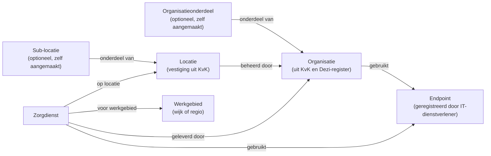
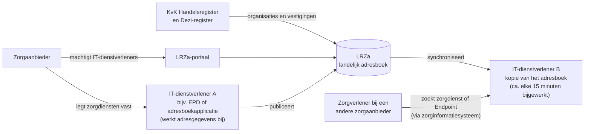

Dit handboek helpt zorgaanbieders op weg met de generieke functie Adressering (Engels: Care Service Directory). Het beschrijft wat Adressering is, welke adresgegevens u als zorgaanbieder beheert, hoe de rollen tussen u en uw IT-dienstverleners verdeeld zijn en welke stappen u zet om uw organisatie en zorgdiensten digitaal vindbaar en bereikbaar te maken.
{: .ig-lead}

> **Let op:** dit handboek is geschreven voor de pilotfase van de generieke functie Adressering. Het is gebaseerd op versie 1.0.0 van het Functioneel en Technisch Ontwerp (FO/TO) Adressering. Ervaringen uit de pilots kunnen tot aanpassingen leiden. De actuele en eerdere versies van het FO/TO staan op [www.generiekefuncties.nl/adressering](https://www.generiekefuncties.nl/adressering).

### Doel van dit handboek

Dit handboek ondersteunt zorgaanbieders bij het voorbereiden, inrichten en beheren van hun adresgegevens in de generieke functie Adressering. Het is bedoeld voor medewerkers die bij de implementatie betrokken zijn, zoals projectleiders, functioneel beheerders, informatiemanagers en ICT-specialisten.

#### Wat staat waar?

| Onderwerp | Waar vindt u het? |
|---|---|
| Wat Adressering is, welke adresgegevens u beheert, welke rol u en uw IT-dienstverleners hebben en welke stappen u zet | Dit handboek |
| Technische specificatie: actoren, transacties, FHIR-profielen, waardenlijsten en voorbeelden | De technische handleiding: [Care Service Directory](csd.html) in deze Implementation Guide (IG) |
| Functionele en technische ontwerpbeslissingen en de onderbouwing daarvan | Het FO en TO Adressering op [www.generiekefuncties.nl/adressering](https://www.generiekefuncties.nl/adressering) |
{: .grid}

Dit handboek herhaalt de technische specificatie en de ontwerpbeslissingen niet, maar verwijst ernaar waar dat helpt. Hoe u uw adresgegevens concreet invoert, hangt af van de applicatie van uw IT-dienstverlener. Raadpleeg daarvoor de handleiding van die applicatie.

### Doel van de generieke functie Adressering

De generieke functie Adressering zorgt voor landelijk gestandaardiseerde en complete informatie over:

1. **De zorgdiensten die andere zorgaanbieders leveren.** Voor welke zorgvraag kunt u een andere zorgaanbieder benaderen?
1. **De locatie van deze zorgdiensten**, met bijvoorbeeld de openingstijden.
1. **De wijk of regio die een zorgdienst bedient**, bijvoorbeeld het werkgebied van een wijkverpleegkundig team.
1. **De digitale locatie (URL)** waarop zorgdiensten en/of patiënt- en cliëntdossiers te bereiken zijn.

Met deze informatie vinden zorgverleners en hun systemen de juiste zorgaanbieder, zorgdienst en digitale bestemming, bijvoorbeeld voor een verwijzing, een notificatie of het opvragen van gegevens.

U legt uw adresgegevens één keer vast, via één IT-dienstverlener. Het Landelijk Register Zorgaanbieders (LRZa) verzamelt deze gegevens en verspreidt ze naar alle aangesloten systemen. U hoeft uw adresgegevens dus niet meer voor elk platform of elke dienst apart in te voeren en bij te houden.

### Relatie met andere functies en voorzieningen

#### Andere generieke functies

Adressering werkt samen met de andere generieke functies. Samen maken zij veilige, betrouwbare en gestandaardiseerde gegevensuitwisseling mogelijk.

| Generieke functie | Welke vraag beantwoordt deze functie? | Relatie met Adressering |
|---|---|---|
| Identificatie & Authenticatie | Wie is de persoon of organisatie, en ben je wie je zegt dat je bent? | Adressering identificeert zorgaanbieders met de nummers uit de bronregisters: het KvK-nummer en het URA-nummer (Dezi-register). Hoe partijen zich authenticeren, valt buiten Adressering. |
| Autorisatie | Welke gegevens mag je inzien of gebruiken? | Adressering vertelt *waar* een dienst bereikbaar is, niet *wie* er gebruik van mag maken. Het adres van een autorisatieserver kan wel als Endpoint in Adressering staan. De gebruiksvoorwaarden en beveiligingseisen volgen uit het afsprakenstelsel waarbinnen de uitwisseling plaatsvindt. |
| Toestemming | Heeft de patiënt toestemming gegeven voor het delen van gegevens? | Geen directe relatie. Adressering bevat geen patiëntgegevens. |
| Lokalisatie | Welke zorgaanbieder heeft gegevens over deze patiënt? | Lokalisatie gebruikt Adressering om relevante zorgaanbieders te selecteren (bijvoorbeeld op type zorgaanbieder of zorgdienst) en om daarna hun digitale adressen (Endpoints) te vinden. Zie [Lokalisatie](localization.html). |
| Logging | Wie heeft welke gegevens geraadpleegd of uitgewisseld, wanneer en waarom? | Geen directe relatie. |
{: .grid}

#### Communicatiepatronen: TA Routering, TA Notifications en TA Workflow

Twiin legt communicatiepatronen vast in technische afspraken (TA's). De TA's hieronder zijn afhankelijk van Adressering: zonder juiste en actuele adresgegevens werken deze patronen niet.

| Technische afspraak | Waar gaat het over? | Wat gebruikt de TA uit Adressering? |
|---|---|---|
| [TA Routering](https://nuts-foundation.github.io/nl-generic-functions-ig/routing.html) | Een verwijzing of opdracht bij de juiste afdeling, zorgdienst of locatie *binnen* de ontvangende zorgaanbieder laten aankomen. | De verzender zoekt in Adressering de passende zorgdienst (bijvoorbeeld 'eerste consult radiologie in de buurt van Zwolle'), richt de opdracht aan die zorgdienst en locatie en stuurt de notificatie naar het Endpoint van die zorgdienst. |
| [TA Notifications](https://ontwikkelsupplement.twiin.nl/actueel/10-3-1-1-ta-notifications-v0-10) | Een andere zorgaanbieder (of het systeem daarvan) laten weten dat er nieuwe of gewijzigde gegevens zijn. | Het adres waarop de ontvanger notificaties ontvangt en het adres waarop de verzender abonnementen (subscriptions) aanneemt, worden als Endpoint in Adressering opgezocht. Welke Endpoints een zorgaanbieder gebruikt, volgt uit de koppelingen aan de organisatie(-onderdelen) en zorgdiensten van die zorgaanbieder. |
| [TA Workflow](https://ontwikkelsupplement.twiin.nl/actueel/10-3-1-2-ta-workflow-v0-3) | Een verwijzing, opdracht of overdracht versturen en de status ervan volgen totdat het werk klaar is. | De opdracht is gericht aan een zorgdienst en eventueel een locatie uit Adressering. Systemen horen via Adressering dat een zorgdienst is gesplitst, samengevoegd, hernoemd of opgeheven. Voor een zorgdienst die niet meer in Adressering staat, wordt geen nieuwe opdracht aangemaakt. |
{: .grid}

Wilt u verwijzingen, opdrachten of notificaties digitaal ontvangen volgens deze afspraken? Dan moet u:

- uw zorgdiensten registreren in Adressering (zie [stap 2](#stap-2-registreer-uw-zorgdiensten));
- de juiste Endpoints aan uw organisatie en zorgdiensten koppelen (zie [stap 3](#stap-3-koppel-endpoints-aan-uw-organisatie-en-zorgdiensten));
- zorgvuldig omgaan met het wijzigen en beëindigen van zorgdiensten. Een nieuwe naam heeft geen gevolgen voor lopende opdrachten. Een ander Endpoint of het opheffen van een zorgdienst raakt de systemen van uw ketenpartners wél.

#### Positie ten opzichte van andere diensten met adresgegevens

Diensten zoals ZorgAB, ZorgDomein, Point, MedMij en VECOZO (verwijzen) hebben elk een eigen registratie van fysieke en/of digitale adressen van zorgaanbieders. Zorgaanbieders houden hun adresgegevens daardoor vaak in meerdere diensten apart bij.

Adressering heeft als doel deze adresgegevens te **standaardiseren** en te **verspreiden**:

- Een dienst kan namens u uw adresgegevens in het LRZa bijwerken. Een losstaande adresboekapplicatie kan bijvoorbeeld deze rol vervullen.
- Een dienst kan een kopie van het landelijke adresboek gebruiken om de adresgegevens van alle zorgaanbieders te tonen of te gebruiken.

Zo legt u uw adresgegevens één keer vast en gebruiken alle aangesloten diensten dezelfde gegevens. Dat vermindert uw administratieve lasten. De lijst met zorgvragen waarmee u uw zorgdiensten beschrijft, is gebaseerd op de zorgvraagboom van ZorgDomein. Dat maakt het makkelijker om aan te sluiten op bestaande verwijsprocessen.

Adressering is **geen** dienst om bijvoorbeeld een patiënt te verwijzen, een overdracht te versturen of berichten uit te wisselen. Adressering levert alleen de adresgegevens. De uitwisseling zelf verloopt via de applicaties van uw IT-dienstverleners, volgens de afspraken die daarvoor gelden (zoals de TA's hierboven).

### Adresgegevens: het datamodel

Adressering kent vier hoofdbegrippen: de organisatie, de locatie, de zorgdienst en het Endpoint.

| Begrip | FHIR-resource | Wat legt u ermee vast? | Wie beheert het? |
|---|---|---|---|
| Organisatie | Organization | De zorgaanbieder en eventueel organisatieonderdelen, zoals een afdeling. | Hoofdorganisatie: het LRZa, op basis van het KvK Handelsregister en het Dezi-register. Organisatieonderdelen: de zorgaanbieder. |
| Locatie | Location | Een fysieke plek waar zorg wordt geleverd, zoals een vestiging, gebouw, afdeling of kamer. | Vestigingen: het LRZa, op basis van het KvK Handelsregister. Sub-locaties: de zorgaanbieder. |
| Zorgdienst | HealthcareService | Voor welke zorgvragen u benaderd kunt worden, waar, voor welk gebied en hoe. | De zorgaanbieder. |
| Endpoint | Endpoint | Het digitale adres (URL) van een systeem. | Registreren: de IT-dienstverlener die het systeem beheert. Koppelen aan organisatie en zorgdiensten: de zorgaanbieder. |
{: .grid}

Daarnaast kent het datamodel samenwerkingsverbanden tussen organisaties (OrganizationAffiliation). Deze kunt u in de pilot buiten beschouwing laten. Het machtigen van uw IT-dienstverleners in het LRZa wordt technisch ook zo vastgelegd, maar dat regelt u via het LRZa-portaal (zie [stap 1](#stap-1-registreer-uw-it-dienstverleners-en-hun-rol-in-het-lrza)).

De voorbeelden in deze paragraaf komen van Stichting Rivas Zorggroep. Ze zijn gebaseerd op de gegevens van Rivas in het KvK Handelsregister en de verwijsproducten van Rivas in ZorgDomein.

#### Organisaties en locaties: de basis

De basis van Adressering wordt gevormd door organisaties en locaties. Het LRZa neemt deze over uit de bronregisters:

- het KvK-basisprofiel van uw organisatie wordt een **organisatie**, met onder meer de naam, het KvK-nummer, de SBI-codes, het adres van de hoofdvestiging en de website;
- elke KvK-vestiging wordt een **locatie**, met onder meer de naam, het vestigingsnummer, het adres en de geografische coördinaten;
- het URA-nummer uit het Dezi-register wordt aan de organisatie toegevoegd. Is het URA-nummer gekoppeld aan een vestiging, dan maakt het LRZa voor die vestiging ook een organisatieonderdeel aan.

Deze gegevens beheert u in het bronregister, niet in Adressering. Wijzigt u bijvoorbeeld een adres of een handelsnaam, doe dat dan in het KvK Handelsregister; het LRZa neemt de wijziging bij de volgende import over. Het LRZa weigert wijzigingen van deze gegevens via Adressering. Zie [LRZa-managed elements](lrza-managed-elements.html) voor de volledige lijst.

Aan de locaties uit de KvK kunt u wel zelf gegevens toevoegen die niet uit de KvK komen, zoals openingstijden en een omschrijving. Contactgegevens die niet in de KvK staan, zoals een telefoonnummer, legt u vast bij een zorgdienst of bij een zelf aangemaakt organisatieonderdeel of een zelf aangemaakte locatie.

U mag zelf **organisatieonderdelen** en **sub-locaties** aanmaken als daar een reden voor is, bijvoorbeeld:

- een afdeling met eigen contactgegevens of eigen Endpoints als organisatieonderdeel;
- een afdeling, verdieping of kamer binnen een vestiging als sub-locatie;
- een plek waar zorg wordt geleverd die niet als KvK-vestiging is ingeschreven als locatie.

Maak alleen extra organisatieonderdelen en locaties aan als iemand anders ze nodig heeft om u te vinden of te bereiken. Elke extra registratie moet u ook bijhouden.

Voorbeelden:

- [Stichting Rivas Zorggroep](Organization-7d5ae4d9-ca42-4bc7-b51c-58d48412c213.html): de organisatie, overgenomen uit het KvK-basisprofiel;
- vestigingen van Rivas als locatie, overgenomen uit de KvK, zoals de [hoofdvestiging in Gorinchem](Location-e4c09d6e-bf14-49f5-a14b-ff7514f9c6fc.html), [Rivas Wijkverpleging](Location-5cc69e99-b69b-4536-abd8-5d0c0701df44.html) en [Rivas locatie Lingesteyn](Location-46a0e08a-50f0-44fd-b685-4ddd4927ef5e.html);
- een zelf aangemaakt organisatieonderdeel: de [afdeling verpleging van een voorbeeldorganisatie](Organization-e1ce0872-8a80-5fdd-8b30-a3b2203ef46b.html).

#### Zorgdiensten

Organisaties leveren zorgdiensten, op een of meer locaties en/of voor een geografisch gebied. In een zorgdienst legt u vast:

| Wat | Toelichting | FHIR-element |
|---|---|---|
| Voor welke zorgvragen | Voor welke zorgvragen kan een andere zorgaanbieder u benaderen? U kiest codes uit de [NL-GF Service Types](ValueSet-nl-gf-service-types-vs.html), waaronder de [zorgvragen](CodeSystem-nl-gf-zorgvragen-cs.html). Eventueel vult u ook het specialisme in. | `type`, `specialty` |
| Wie levert de zorg | De organisatie of het organisatieonderdeel dat de zorgdienst levert. | `providedBy` |
| Waar | De locatie(s) waar de zorg wordt geleverd, en/of het werkgebied (bijvoorbeeld provincie, plaats of postcodegebied) als de zorg bij de patiënt of cliënt thuis wordt geleverd. | `location`, `coverageArea` |
| Wanneer en hoe bereikbaar | Naam, beschikbaarheid en contactgegevens van de zorgdienst. | `name`, `availableTime`, `telecom` |
| Voor wie | Bijvoorbeeld welke verwijzers de zorgdienst mogen benaderen. | `eligibility` |
| Welke informatie nodig is | Optioneel: welke informatie u nodig heeft om de zorgvraag in behandeling te nemen, vastgelegd in een ActivityDefinition. Een [voorbeeld voor verpleegzorg](ActivityDefinition-nl-gf-nursing-care-6VV.html) vraagt om de verzekeringsgegevens en de aandoening van de cliënt. | `type.extension:supportedActivityDefinitions` |
| Digitaal bereikbaar via | De Endpoints waarop u verwijzingen, opdrachten of notificaties voor deze zorgdienst ontvangt. | `endpoint` |
{: .grid}

**Vuistregel voor de indeling.** Maak een aparte zorgdienst als de locatie, het werkgebied, de contactgegevens, de beschikbaarheid of de Endpoints verschillen. Verschillen alleen de zorgvragen, voeg die dan toe aan dezelfde zorgdienst. In het voorbeeld van Rivas zijn de vele verwijsproducten uit ZorgDomein zo samengevoegd tot één zorgdienst per zorgcluster.

Voorbeelden:

- [Gynaecologie / verloskunde](HealthcareService-68f0a8c4-35dc-4c6c-a466-71a5d59a8647.html): een polikliniek op de hoofdvestiging van Rivas, met zorgvragen voor gynaecologie en verloskunde, de toegestane verwijzers en de Endpoints waarop Rivas verwijzingen ontvangt;
- [Verpleging en verzorging (wijkverpleging)](HealthcareService-9af72573-912c-43fd-81b6-058a6e46b622.html): zorg bij de cliënt thuis, met als werkgebied de plaatsen Gorinchem en Leerdam en postcodegebieden daarbinnen.

Een landelijk register voor werkgebieden (provincies, gemeenten, wijken, postcodegebieden) is nog in ontwikkeling; zie de [roadmap](csd.html#roadmap-for-care-service-directory).

#### Endpoints

Endpoints zijn de digitale adressen (URL's of API's) van systemen. De IT-dienstverlener die een systeem beheert, registreert de Endpoints van dat systeem. Eén Endpoint kan door meerdere zorgaanbieders worden gebruikt. In het Endpoint staat de IT-dienstverlener als beheerder (`managingOrganization`), niet de zorgaanbieder die het Endpoint gebruikt.

U als zorgaanbieder koppelt Endpoints aan:

- **uw organisatie**: hier staat waar andere zorgaanbieders patiënt- of cliëntgegevens bij u kunnen opvragen. De organisatie Rivas gebruikt bijvoorbeeld een [FHIR-Endpoint met de gegevenscategorieën van de BgZ](Endpoint-6358e7a0-d8ef-4f92-bdc5-ad02cc088b5b.html).
- **uw zorgdiensten**: hier staat waar andere zorgaanbieders verwijzingen, opdrachten of notificaties naartoe sturen. De zorgdiensten van Rivas gebruiken bijvoorbeeld een [HL7 v2-Endpoint](Endpoint-c40c117e-c6d9-4724-97af-1b6b6b788c9d.html) en een [FHIR-Endpoint](Endpoint-93b44d3e-e358-4f39-b9b6-6f97ac21e891.html) voor verwijzingen en opdrachten.

Rivas beheert deze Endpoints in het voorbeeld zelf. Meestal beheert een IT-dienstverlener ze, zoals in deze voorbeelden: een [FHIR-Endpoint](Endpoint-1034376c-cc6e-5518-b292-e6dc24a68826.html) en een [DICOM-Endpoint](Endpoint-30d6d76b-389f-58b8-9d40-4311a52bdf57.html) die door Nedap worden beheerd.

In een Endpoint staat:

- welke standaard of techniek het Endpoint gebruikt, bijvoorbeeld HL7 v2, CDA, FHIR of DICOM (`connectionType`);
- welke gegevenscategorieën het Endpoint ondersteunt, bijvoorbeeld medicatie, aandoeningen, contacten en opnames, of verwijzingen en opdrachten (`payloadType`, zie de [gegevenscategorieën](CodeSystem-nl-gf-data-categories-cs.html));
- welke versie van de standaard het Endpoint ondersteunt, bijvoorbeeld FHIR STU3 of R4 (`payloadMimeType`);
- het adres (URL), de status en de periode waarin het Endpoint geldig is.

> **Let op:** in een Endpoint staat **niet** welke gegevensdienst of informatiestandaard (zoals BgZ, Medicatieoverdracht of eOverdracht) wordt aangeboden. Er staat wel in welke standaard en welke gegevenscategorieën het Endpoint ondersteunt. Een systeem dat de BgZ aanbiedt, publiceert dus een Endpoint met de gegevenscategorieën van de BgZ, zoals in het voorbeeld van Rivas. Welke afspraken gelden voor het gebruik van een Endpoint, volgt uit het afsprakenstelsel waarbinnen de uitwisseling plaatsvindt.

Stapt u over naar een ander systeem? Dan krijgt het oude Endpoint een einddatum en het nieuwe Endpoint een startdatum op hetzelfde overstapmoment. Zo is er op elk moment precies één geldig Endpoint. Stem dit overstapmoment af met beide IT-dienstverleners. Zie [Endpoint lifecycle and transition](csd.html#endpoint-lifecycle-and-transition).

### Architectuur

#### Rollen

IT-dienstverleners implementeren de technische rollen van Adressering; zie [Actors](csd.html#actors) in de technische handleiding. U hoeft de techniek niet te kennen, maar u moet wel weten welke dienstverlener welke rol voor u vervult.

| Rol | Wat doet deze rol? | Voorbeelden |
|---|---|---|
| Zorgaanbieder | Bepaalt welke adresgegevens gepubliceerd worden en blijft verantwoordelijk voor de juistheid ervan. Registreert (machtigt) IT-dienstverleners in het LRZa. | |
| LRZa (beheerd door het CIBG) | Centraal, landelijk adresboek. Neemt organisaties en vestigingen over uit het KvK Handelsregister en het Dezi-register, verzamelt de adresgegevens van alle zorgaanbieders en verspreidt deze. Het LRZa wordt niet gebruikt om in te zoeken. | |
| IT-dienstverlener die adresgegevens bijwerkt (Data Source) | Werkt namens u uw adresgegevens bij in het LRZa. | EPD, ECD, HIS of een losstaande adresboekapplicatie zoals ZorgAB |
| IT-dienstverlener die Endpoints registreert | Registreert de Endpoints van zijn systeem in het LRZa, zodat u deze aan uw organisatie en zorgdiensten kunt koppelen. | Leverancier van uw EPD, ECD of HIS |
| IT-dienstverlener met een kopie van het adresboek (Update Client) | Maakt een kopie van het LRZa en werkt deze ongeveer elke 15 minuten bij, zodat applicaties erin kunnen zoeken. | EPD, ECD, HIS, verwijsplatform of adresboekapplicatie |
| Zorginformatiesysteem (Query Client) | Zoekt in de kopie naar zorgaanbieders, zorgdiensten en Endpoints, bijvoorbeeld in een zoekscherm of automatisch bij het versturen van een verwijzing. | EPD, ECD of HIS van een andere zorgaanbieder |
{: .grid}

Eén IT-dienstverlener kan meerdere rollen vervullen. Uw EPD-leverancier kan bijvoorbeeld uw adresgegevens bijwerken, de Endpoints van het EPD registreren én een kopie van het adresboek bijhouden.

#### Machtigen van IT-dienstverleners

Alle IT-dienstverleners die voor u adresgegevens in het LRZa bijwerken, of daar een kopie van maken, registreert u in het LRZa. Zo krijgen zij de rechten om gegevens te schrijven en/of te lezen. Een bevoegde medewerker van uw organisatie doet dit in het LRZa-portaal, bijvoorbeeld door in te loggen met eHerkenning.

Voor het bijwerken van adresgegevens zijn er twee soorten machtigingen:

| Machtiging | Wat mag de IT-dienstverlener? |
|---|---|
| Beheer van alle adresgegevens | Namens u organisatieonderdelen, locaties, zorgdiensten en Endpoints aanmaken en wijzigen. |
| Beheer van Endpoints | De eigen Endpoints registreren en deze koppelen aan uw organisatie en zorgdiensten. |
{: .grid}

#### Kopie van het adresboek

Zorginformatiesystemen zoeken niet in het LRZa zelf, maar in een kopie van het landelijke adresboek. Dat heeft voordelen:

- zoeken gaat snel, omdat de gegevens dicht bij de applicatie staan;
- als het LRZa tijdelijk niet bereikbaar is, kunnen zorgverleners gewoon blijven zoeken;
- het LRZa is geen *single point of failure* voor de gegevensuitwisseling.

De kopie wordt ongeveer elke 15 minuten bijgewerkt. Een wijziging die u doorvoert, is dus niet direct overal zichtbaar.

#### Status van het LRZa

Het LRZa wordt aangepast voor de generieke functie Adressering. Deze aanpassing is in realisatie. Informatiesystemen sluiten de komende jaren gefaseerd aan op het vernieuwde LRZa.

### Stappenplan

De stappen hieronder richten zich op wat u als zorgaanbieder doet. De technische uitvoering ligt bij uw IT-dienstverleners.

#### Voorbereiding

- **Wijs verantwoordelijken aan.** Wie is eigenaar van uw adresgegevens? Wie mag namens uw organisatie IT-dienstverleners machtigen in het LRZa-portaal?
- **Inventariseer uw systemen en IT-dienstverleners.** Welke systemen gebruikt u (EPD, ECD, HIS, adresboekapplicatie, verwijsplatform) en welke ondersteunen Adressering, in welke rol?
- **Controleer uw gegevens in de bronregisters.** Kloppen uw naam, vestigingen, adressen en website in het KvK Handelsregister, en uw URA-nummer in het Dezi-register? Corrigeer afwijkingen in het bronregister zelf.

Voorbeeld van een inventarisatie:

| Systeem | IT-dienstverlener | Rol in Adressering |
|---|---|---|
| ECD | Leverancier A | Registreert Endpoints van het ECD; houdt een kopie van het adresboek bij |
| Adresboekapplicatie | Leverancier B | Werkt de adresgegevens bij |
{: .grid}

#### Stap 1: Registreer uw IT-dienstverleners en hun rol in het LRZa

- Machtig in het LRZa-portaal elke IT-dienstverlener voor de rol die hij voor u vervult (zie [Machtigen van IT-dienstverleners](#machtigen-van-it-dienstverleners)).
- Kies bij voorkeur één IT-dienstverlener voor het beheer van al uw adresgegevens. Zo voorkomt u dubbel beheer en tegenstrijdige gegevens.
- Machtig elke leverancier van wie u Endpoints gaat gebruiken voor het beheer van Endpoints.
- Trek een machtiging in zodra de samenwerking met een IT-dienstverlener stopt.

*Voorbeeld:* een VVT-organisatie machtigt leverancier B (adresboekapplicatie) voor het beheer van alle adresgegevens en leverancier A (ECD) voor het beheer van Endpoints. Leverancier A registreert de Endpoints van het ECD. Via de adresboekapplicatie koppelt de organisatie deze Endpoints aan haar zorgdiensten.

#### Stap 2: Registreer uw zorgdiensten

- Bepaal voor welke zorgvragen u vindbaar en bereikbaar wilt zijn. Begin met de zorgdiensten waarvoor u nu al verwijzingen of opdrachten ontvangt, bijvoorbeeld via ZorgDomein of Point, of die nodig zijn voor uw pilot.
- Leg per zorgdienst vast: naam, zorgvragen, leverende organisatie, locatie(s) en/of werkgebied, beschikbaarheid en contactgegevens. Leg eventueel ook de toegestane verwijzers en de benodigde informatie vast (zie [Zorgdiensten](#zorgdiensten)).
- Gebruik de [vuistregel voor de indeling](#zorgdiensten) om te bepalen hoeveel zorgdiensten u nodig heeft.
- Ontbreekt een passende zorgvraag in de [zorgvragen](CodeSystem-nl-gf-zorgvragen-cs.html)? Meld dit via de [GitHub-issues](https://github.com/minvws/generiekefuncties-docs/issues).

*Voorbeeld:* de zorgdienst [Verpleging en verzorging](HealthcareService-9af72573-912c-43fd-81b6-058a6e46b622.html) van Rivas:

| Gegeven | Waarde |
|---|---|
| Naam | Verpleging en verzorging |
| Geleverd door | Stichting Rivas Zorggroep |
| Locaties | Rivas Wijkverpleging; Rivas Wijkverpleging regio Brabant |
| Werkgebied | Gorinchem en Leerdam, en postcodegebieden daarbinnen |
| Zorgvragen | o.a. verpleging, persoonlijke verzorging, specialistische verpleging, palliatieve zorg |
| Toegestane verwijzers | o.a. huisarts, specialist ouderengeneeskunde, verpleegkundig specialist, transfermedewerker |
| Endpoints | HL7 v2- en FHIR-Endpoint voor verwijzingen en opdrachten |
{: .grid}

#### Stap 3: Koppel Endpoints aan uw organisatie en zorgdiensten

- Vraag uw IT-dienstverleners welke Endpoints zij in het LRZa hebben geregistreerd, met welke standaard en voor welke gegevenscategorieën.
- Koppel aan **uw organisatie** de Endpoints waarop andere zorgaanbieders patiënt- of cliëntgegevens bij u kunnen opvragen.
- Koppel aan **uw zorgdiensten** de Endpoints waarop u verwijzingen, opdrachten en notificaties ontvangt.
- Heeft een zorgdienst (nog) geen Endpoint? Dan kunnen anderen de zorgdienst wel vinden, maar moeten zij u op een andere manier benaderen, bijvoorbeeld telefonisch.
- Stapt u over naar een ander systeem? Spreek dan met beide IT-dienstverleners een overstapmoment af (zie [Endpoints](#endpoints)).

*Voorbeeld:* Rivas koppelt het [BgZ-Endpoint](Endpoint-6358e7a0-d8ef-4f92-bdc5-ad02cc088b5b.html) aan de organisatie, en het [HL7 v2-Endpoint](Endpoint-c40c117e-c6d9-4724-97af-1b6b6b788c9d.html) en het [FHIR-Endpoint](Endpoint-93b44d3e-e358-4f39-b9b6-6f97ac21e891.html) voor verwijzingen aan de zorgdiensten.

#### Stap 4 (optioneel): Overige registraties

Afhankelijk van uw situatie registreert u ook:

- **eigen Endpoints**, als u zelf systemen beheert (zoals in het voorbeeld van Rivas);
- **organisatieonderdelen**, bijvoorbeeld een afdeling met eigen contactgegevens of eigen Endpoints;
- **sub-locaties**, bijvoorbeeld een afdeling of kamer binnen een vestiging, of een locatie die niet als KvK-vestiging is ingeschreven. Ook openingstijden van locaties kunt u toevoegen;
- **samenwerkingsverbanden** met andere zorgaanbieders. Deze zijn in de pilot nog niet nodig.

#### Stap 5: Controleer en onderhoud uw adresgegevens

- Controleer na publicatie in de applicatie van een IT-dienstverlener met een kopie van het adresboek of uw zorgdiensten en Endpoints goed vindbaar zijn. Houd rekening met een vertraging van ongeveer 15 minuten.
- Test met een ketenpartner of een verwijzing of notificatie bij de juiste zorgdienst aankomt.
- Houd uw adresgegevens actueel. U blijft verantwoordelijk voor de juistheid, ook als een IT-dienstverlener het beheer voor u uitvoert.

| Gebeurtenis | Wat doet u? |
|---|---|
| Wijziging van naam, adres of vestiging | Wijzig dit in het KvK Handelsregister. Het LRZa neemt de wijziging over. |
| Wijziging van het URA-nummer | Wijzig dit in het Dezi-register. |
| Nieuwe of gewijzigde zorgdienst | Leg de zorgdienst vast of wijzig deze via uw IT-dienstverlener. Behoud bij een nieuwe naam dezelfde zorgdienst. |
| Zorgdienst stopt | Zet de zorgdienst op inactief in plaats van deze te verwijderen. Informeer ketenpartners met lopende verwijzingen of opdrachten. |
| Overstap naar een ander systeem | Laat het oude Endpoint eindigen en het nieuwe Endpoint starten op hetzelfde overstapmoment. |
| Samenwerking met een IT-dienstverlener stopt | Trek de machtiging in het LRZa-portaal in. |
| Fusie of overname | Werk eerst de bronregisters bij; controleer daarna uw zorgdiensten, Endpoints en machtigingen. |
{: .grid}

#### Checklist

- ☐ Eigenaar van de adresgegevens en bevoegde medewerker(s) voor het LRZa-portaal zijn aangewezen.
- ☐ Gegevens in het KvK Handelsregister en het Dezi-register zijn gecontroleerd en waar nodig gecorrigeerd.
- ☐ IT-dienstverleners en hun rollen zijn geïnventariseerd en gemachtigd in het LRZa.
- ☐ Zorgdiensten zijn geregistreerd met zorgvragen, locatie en/of werkgebied en contactgegevens.
- ☐ Endpoints zijn gekoppeld aan de organisatie en de zorgdiensten.
- ☐ Vindbaarheid is gecontroleerd en met een ketenpartner getest.
- ☐ Afspraken over het bijhouden van de adresgegevens zijn vastgelegd, ook met de IT-dienstverleners.

### Begrippen

| Begrip | Betekenis |
|---|---|
| Adresboek (kopie) | Een kopie van het LRZa bij een IT-dienstverlener, waarin zorginformatiesystemen zoeken. Engels: *local replica*. |
| Data Source | De technische rol van de IT-dienstverlener die namens de zorgaanbieder adresgegevens bijwerkt in het LRZa. |
| Dezi-register | Register van het CIBG waarin onder meer het URA-nummer van zorgaanbieders staat. |
| Endpoint | Het digitale adres (URL) van een systeem, met de standaard en gegevenscategorieën die het ondersteunt. |
| IT-dienstverlener | Een leverancier van een EPD, ECD, HIS, adresboekapplicatie of andere dienst die een of meer rollen in Adressering vervult. |
| KvK Handelsregister | Register van de Kamer van Koophandel, bron voor organisaties en vestigingen in Adressering. |
| Locatie | Een fysieke plek waar zorg wordt geleverd, zoals een vestiging, gebouw, afdeling of kamer. |
| LRZa | Landelijk Register Zorgaanbieders: het centrale, landelijke adresboek van Adressering, beheerd door het CIBG. |
| LRZa-portaal | Webportaal waarin een bevoegde medewerker van een zorgaanbieder IT-dienstverleners machtigt. |
| Organisatie | De zorgaanbieder of een organisatieonderdeel daarvan. |
| Query Client | De technische rol van het zorginformatiesysteem dat in de kopie van het adresboek zoekt. |
| Update Client | De technische rol die de kopie van het adresboek maakt en regelmatig bijwerkt vanuit het LRZa. |
| URA-nummer | UZI-Register Abonneenummer: het identificerende nummer van een zorgaanbieder, vastgelegd in het Dezi-register. |
| Werkgebied | Het geografische gebied (wijk of regio) dat een zorgdienst bedient. |
| Zorgdienst | Een dienst die een zorgaanbieder levert, met de zorgvragen waarvoor anderen de zorgaanbieder kunnen benaderen. |
{: .grid}
