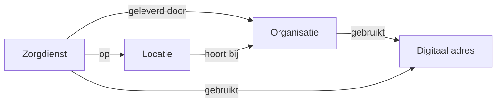
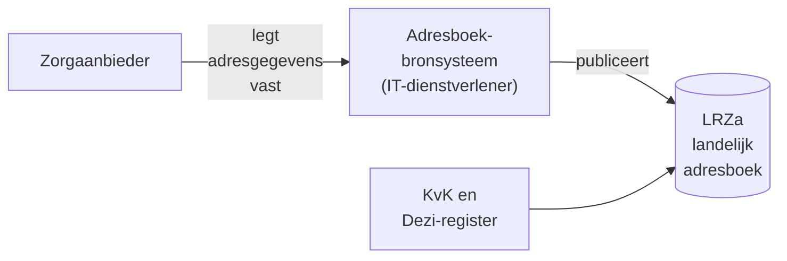
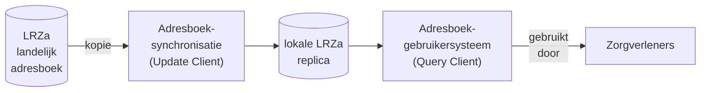

Dit handboek helpt zorgaanbieders op weg met de generieke functie Adressering (Engels: Care Service Directory). Het beschrijft wat Adressering is, welke adresgegevens u als zorgaanbieder beheert, hoe de rollen tussen u en uw IT-dienstverleners verdeeld zijn en welke stappen u zet om uw organisatie en zorgdiensten digitaal vindbaar en bereikbaar te maken.
{: .ig-lead}

> **Let op:** dit handboek is geschreven voor de pilotfase van de generieke functie Adressering. Het is gebaseerd op versie 1.0.0 van het Functioneel en Technisch Ontwerp (FO/TO) Adressering. Ervaringen uit de pilots kunnen tot aanpassingen leiden. De actuele en eerdere versies van het FO/TO staan op [www.generiekefuncties.nl/adressering](https://www.generiekefuncties.nl/adressering).

### Doel van dit handboek

Dit handboek ondersteunt zorgaanbieders bij het voorbereiden, inrichten en beheren van hun adresgegevens in de generieke functie Adressering. Het is bedoeld voor medewerkers die bij de implementatie betrokken zijn, zoals projectleiders, functioneel beheerders, informatiemanagers en ICT-specialisten.

#### Wat staat waar?

| Onderwerp | Waar vindt u het? |
|---|---|
| Wat Adressering is, welke adresgegevens u beheert, welke rol u en uw IT-dienstverleners hebben en welke stappen u zet | Dit handboek |
| Technische specificatie: actoren, transacties, FHIR-profielen, waardenlijsten en voorbeelden | De technische handleiding: [Care Service Directory](csd.html) in deze Implementation Guide (IG) |
| Functionele en technische ontwerpbeslissingen en de onderbouwing daarvan | Het FO en TO Adressering op [www.generiekefuncties.nl/adressering](https://www.generiekefuncties.nl/adressering) |
{: .grid}

Dit handboek herhaalt de technische specificatie en de ontwerpbeslissingen niet, maar verwijst ernaar waar dat helpt. Hoe u uw adresgegevens concreet invoert, hangt af van de applicatie van uw IT-dienstverlener. Raadpleeg daarvoor de handleiding van die applicatie.

### Generieke functies

Om gezondheidsgegevens veilig, betrouwbaar en gecontroleerd digitaal uit te wisselen, zijn zorgbrede afspraken, standaarden en voorzieningen nodig. Het ministerie van VWS legt deze vast in de generieke functies. Een generieke functie beschrijft **wat** er nodig is om gegevens uit te wisselen. Gemeenschappelijke voorzieningen, zoals het Landelijk Register Zorgaanbieders (LRZa), geven daar in de praktijk invulling aan: **hoe** het werkt.

Er zijn zes generieke functies. Elke functie beantwoordt een eigen vraag:

| Generieke functie | Welke vraag beantwoordt deze functie? |
|---|---|
| Identificatie & Authenticatie | Wie is de persoon of organisatie, en is die wie hij zegt te zijn? |
| Autorisatie | Welke gegevens mag iemand inzien of gebruiken? |
| Toestemming | Heeft de patiënt toestemming gegeven voor het delen van zijn gegevens? |
| Lokalisatie | Welke zorgaanbieder heeft gegevens over deze patiënt? |
| **Adressering** | **Waar kan ik terecht met een zorgvraag, en wat is de juiste digitale bestemming?** |
| Logging | Wie heeft welke gegevens geraadpleegd of uitgewisseld, wanneer en waarom? |
{: .grid}

De generieke functies werken samen. Als ze allemaal zijn ingericht, kunnen gegevens veilig en volgens wet- en regelgeving landelijk worden uitgewisseld. Niet alle generieke functies zijn al even ver uitgewerkt. Hoe Adressering samenhangt met de andere functies, leest u in [Relatie met andere functies en voorzieningen](#relatie-met-andere-functies-en-voorzieningen).

### De generieke functie Adressering

#### Waarom Adressering?

Wie een patiënt of cliënt wil verwijzen, een overdracht wil sturen of gegevens wil opvragen, moet weten bij welke zorgaanbieder en welke zorgdienst dat kan, en naar welk digitaal adres het bericht moet. Nederland telt duizenden zorgaanbieders, elk met een eigen zorgaanbod, eigen locaties en eigen systemen. Hun adresgegevens staan nu verspreid over veel adresboeken en diensten, die zorgaanbieders allemaal apart moeten bijhouden. Daardoor raken gegevens snel verouderd.

Actuele en betrouwbare adresgegevens:

- dragen bij aan patiëntveiligheid, omdat gegevens snel bij de juiste ontvanger aankomen;
- verkleinen de kans op fouten en datalekken door verkeerd geadresseerde berichten;
- verminderen handmatig zoek- en invoerwerk, voor zorgverleners én voor de beheerders van adresgegevens.

#### Wat levert Adressering?

De generieke functie Adressering zorgt voor landelijk gestandaardiseerde en complete informatie over:

1. **De zorgdiensten die andere zorgaanbieders leveren.** Voor welke zorgvraag kunt u een andere zorgaanbieder benaderen?
1. **De locatie van deze zorgdiensten**, met bijvoorbeeld de openingstijden.
1. **De wijk of regio die een zorgdienst bedient**, bijvoorbeeld het werkgebied van een wijkverpleegkundig team.
1. **Het digitale adres** waarop zorgdiensten en/of patiënt- en cliëntdossiers te bereiken zijn.

#### Hoe werkt het, in het kort?

1. U legt uw adresgegevens één keer vast in een adresboek-bronsysteem: de applicatie van een IT-dienstverlener die u daarvoor machtigt, zoals uw EPD of een adresboekapplicatie.
1. Dat systeem publiceert uw gegevens in het Landelijk Register Zorgaanbieders (LRZa): het landelijke adresboek. Uw organisatie en vestigingen staan daar al in, want het LRZa neemt ze over uit het KvK Handelsregister en het Dezi-register.
1. Een adresboek-synchronisatie van een IT-dienstverlener maakt een kopie van het landelijke adresboek en houdt die bij.
1. Zorgverleners zoeken in die kopie via een adresboek-gebruikersysteem, zoals hun EPD, ECD of HIS, de juiste zorgaanbieder, zorgdienst en het digitale adres.

U hoeft uw adresgegevens dus niet meer voor elk platform of elke dienst apart in te voeren en bij te houden. Meer hierover leest u in [Architectuur](#architectuur).

*Voorbeeld:* een huisarts wil een patiënt verwijzen naar de wijkverpleging. In het eigen huisartsinformatiesysteem (HIS) zoekt de huisarts op 'wijkverpleging' en de woonplaats van de patiënt. Het HIS toont de zorgaanbieders die deze zorg daar leveren, bijvoorbeeld de zorgdienst 'Verpleging en verzorging' van Rivas (een fictief voorbeeld). De huisarts kiest deze zorgdienst, en het HIS stuurt de verwijzing naar het digitale adres dat Rivas aan deze zorgdienst heeft gekoppeld.

### Relatie met andere functies en voorzieningen

#### Andere generieke functies

Zo hangt Adressering samen met de andere generieke functies:

| Generieke functie | Relatie met Adressering |
|---|---|
| Identificatie & Authenticatie | Adressering herkent zorgaanbieders aan de nummers uit de bronregisters: het KvK-nummer en het URA-nummer (Dezi-register). |
| Autorisatie | Adressering vertelt *waar* een dienst bereikbaar is, niet *wie* er gebruik van mag maken. Welke voorwaarden en beveiligingseisen gelden, volgt uit het afsprakenstelsel waarbinnen de uitwisseling plaatsvindt. |
| Toestemming | Geen directe relatie. Adressering bevat geen patiëntgegevens. |
| Lokalisatie | Lokalisatie geeft per patiënt of cliënt de zorgaanbieders (bronhouders) die gegevens over hem of haar hebben. Adressering geeft vervolgens de digitale adressen waar die gegevens kunnen worden opgevraagd. Lokalisatie gebruikt Adressering ook om relevante zorgaanbieders te selecteren, bijvoorbeeld op type zorgaanbieder of zorgdienst. Zie [Lokalisatie](localization.html). |
| Logging | Geen directe relatie. |
{: .grid}

#### Digitaal verwijzen, overdragen, notificeren en dossiers opvragen

Adressering is de basis voor het digitaal versturen van verwijzingen, opdrachten en overdrachten, voor het laten weten dat er nieuwe gegevens zijn, en voor het opvragen van gegevens uit het zorgdossier van een patiënt of cliënt bij andere zorgaanbieders. Dat levert u als zorgaanbieder het volgende op, mits u uw adresgegevens goed vastlegt:

| Wat levert het u op? | Wat legt u daarvoor vast in Adressering? | Technische afspraak |
|---|---|---|
| **Verwijzingen en opdrachten komen direct bij de juiste afdeling of zorgdienst aan**, in plaats van op een centrale plek waar ze met de hand moeten worden doorgezet. Verwijzers kunnen gericht zoeken op zorgvraag en regio. | Uw zorgdiensten, met zorgvragen, locaties en/of werkgebied, en het digitale adres waarop elke zorgdienst verwijzingen ontvangt. | [TA Routering](https://nuts-foundation.github.io/nl-generic-functions-ig/routing.html) |
| **U krijgt automatisch een seintje (notificatie)** als een andere zorgaanbieder nieuwe of gewijzigde gegevens voor u heeft, bijvoorbeeld bij een verwijzing of overdracht. Andersom kunt u anderen ook een seintje sturen. | Het digitale adres waarop u notificaties ontvangt, gekoppeld aan uw organisatie of zorgdienst. | [TA Notifications](https://ontwikkelsupplement.twiin.nl/actueel/10-3-1-1-ta-notifications-v0-10) |
| **U kunt de voortgang van een verwijzing, opdracht of overdracht volgen**: is deze ontvangen, geaccepteerd, gestart of afgerond? | Uw zorgdiensten en hun digitale adressen. Splitst, hernoemt of stopt u een zorgdienst, dan horen de systemen van uw ketenpartners dat via Adressering. | [TA Workflow](https://ontwikkelsupplement.twiin.nl/actueel/10-3-1-2-ta-workflow-v0-3) |
| **U kunt actuele gegevens uit het zorgdossier van een patiënt of cliënt opvragen bij andere zorgaanbieders**, bijvoorbeeld medicatie, allergieën of uitslagen, op het moment dat u ze nodig heeft. U hoeft niet te wachten tot een andere zorgaanbieder ze opstuurt. Andersom kunnen anderen, binnen de regels voor toestemming en autorisatie, gegevens bij u opvragen. | Het digitale adres waarop andere zorgaanbieders patiënt- of cliëntgegevens bij u kunnen opvragen, gekoppeld aan uw organisatie, met de soorten gegevens die u daar beschikbaar stelt. | [TA Pull](https://ontwikkelsupplement.twiin.nl/actueel/10-3-3-tta-fhir-pull) (concept) |
{: .grid}

De technische afspraken (TA's) hiervoor zijn (of worden) onderdeel van het Landelijk Afsprakenstelsel (beheerd door Twiin). Deze afspraken zijn bedoeld voor IT-dienstverleners en werken alleen als zorgaanbieders hun zorgdiensten en digitale adressen in Adressering juist en actueel houden. U hoeft de afspraken zelf niet te kennen. Vraag uw IT-dienstverleners wel of hun systemen ze ondersteunen.

**Dossiers opvragen gaat samen met Lokalisatie.** Om gegevens op te vragen, moet uw systeem eerst weten welke zorgaanbieders gegevens over de patiënt of cliënt hebben. Dat vertelt de generieke functie [Lokalisatie](localization.html): die geeft per patiënt of cliënt de bronhouders, de zorgaanbieders die gegevens over hem of haar hebben. Adressering geeft vervolgens de digitale adressen van die bronhouders, waar uw systeem de gegevens kan opvragen. Heeft u geen digitaal adres voor het opvragen aan uw organisatie gekoppeld, dan kunnen andere zorgaanbieders uw gegevens niet digitaal opvragen, ook al vindt Lokalisatie u wel als bronhouder.

#### Positie ten opzichte van andere diensten met adresgegevens

Diensten zoals ZorgAB, ZorgDomein, Point, MedMij en VECOZO (verwijzen) hebben elk een eigen registratie van fysieke en/of digitale adressen van zorgaanbieders. Zorgaanbieders houden hun adresgegevens daardoor vaak in meerdere diensten apart bij.

Adressering heeft als doel deze adresgegevens te **standaardiseren**, te **verzamelen** en te **distribueren**:

- Een dienst kan als adresboek-bronsysteem namens u uw adresgegevens in het LRZa bijwerken. Een losstaande adresboekapplicatie kan bijvoorbeeld deze rol vervullen.
- Een dienst kan met een adresboek-synchronisatie een kopie van het landelijke adresboek maken, en als adresboek-gebruikersysteem de adresgegevens van alle zorgaanbieders tonen of gebruiken.

Zo legt u uw adresgegevens één keer vast en gebruiken alle aangesloten diensten dezelfde gegevens. Dat vermindert uw administratieve lasten.

Adressering is **geen** dienst om bijvoorbeeld een patiënt te verwijzen, een overdracht te versturen of berichten uit te wisselen. Adressering levert alleen de adresgegevens. De uitwisseling zelf verloopt via de applicaties van uw IT-dienstverleners, volgens de afspraken die daarvoor gelden (zoals de technische afspraken hierboven).

### Adresgegevens: het datamodel

Adressering kent vier hoofdbegrippen: de organisatie, de locatie, de zorgdienst en het Endpoint (digitaal adres).

| Begrip | Datamodel | Wat legt u ermee vast? | Wie beheert het? |
|---|---|---|---|
| Organisatie | Organization | De zorgaanbieder en eventueel organisatieonderdelen, zoals een afdeling. | Hoofdorganisatie: het LRZa, op basis van het KvK Handelsregister en het Dezi-register. Organisatieonderdelen: de zorgaanbieder. |
| Locatie | Location | Een fysieke plek waar zorg wordt geleverd, zoals een vestiging, gebouw, afdeling of kamer. | Vestigingen: het LRZa, op basis van het KvK Handelsregister. Sub-locaties: de zorgaanbieder. |
| Zorgdienst | HealthcareService | Voor welke zorgvragen u benaderd kunt worden, waar, voor welk gebied en hoe. | De zorgaanbieder. |
| Endpoint (digitaal adres) | Endpoint | Het adres (URL) waarop een systeem berichten ontvangt of waar gegevens kunnen worden opgevraagd. | Registreren: de IT-dienstverlener die het systeem beheert. Koppelen aan organisatie en zorgdiensten: de zorgaanbieder. |
{: .grid}

Daarnaast kent het datamodel samenwerkingsverbanden tussen organisaties (OrganizationAffiliation). Deze kunt u in de pilot buiten beschouwing laten. Het machtigen van uw IT-dienstverleners in het LRZa wordt technisch ook zo vastgelegd, maar dat regelt u via het LRZa-portaal (zie [stap 1](#stap-1-registreer-uw-it-dienstverleners-en-hun-rol-in-het-lrza)).

> **Let op: voorbeeldgegevens.** De voorbeelden in dit handboek gebruiken Stichting Rivas Zorggroep en Nedap. De organisatie en vestigingen van Rivas zijn gebaseerd op het KvK Handelsregister, en de zorgdiensten op de verwijsproducten van Rivas in ZorgDomein. Het zijn **voorbeelden, geen echte of actuele gegevens**: ze zijn vereenvoudigd, kunnen verouderd zijn en geven niet weer hoe Rivas of Nedap Adressering werkelijk gebruiken.
{: #voorbeeldgegevens}

#### Organisaties en locaties: de basis

De basis van Adressering wordt gevormd door organisaties en locaties. Het LRZa neemt deze over uit de bronregisters:

- het KvK-basisprofiel van uw organisatie wordt een **organisatie**, met onder meer de naam, het KvK-nummer, de SBI-codes, het adres van de hoofdvestiging en de website;
- elke KvK-vestiging wordt een **locatie**, met onder meer de naam, het vestigingsnummer, het adres en de geografische coördinaten;
- het URA-nummer uit het Dezi-register wordt aan de organisatie toegevoegd. Is het URA-nummer gekoppeld aan een vestiging, dan maakt het LRZa voor die vestiging ook een organisatieonderdeel aan.

Deze gegevens beheert u in het bronregister, niet in Adressering. Wijzigt u bijvoorbeeld een adres of een handelsnaam, doe dat dan in het KvK Handelsregister; het LRZa neemt de wijziging bij de volgende import over. Het LRZa weigert wijzigingen van deze gegevens via Adressering. Zie [LRZa-managed elements](lrza-managed-elements.html) voor de volledige lijst.

Aan de locaties uit de KvK kunt u wel zelf gegevens toevoegen die niet uit de KvK komen, zoals openingstijden en een omschrijving. Contactgegevens die niet in de KvK staan, zoals een telefoonnummer, legt u vast bij een zorgdienst of bij een zelf aangemaakt organisatieonderdeel of een zelf aangemaakte locatie.

U mag zelf **organisatieonderdelen** en **sub-locaties** aanmaken als daar een reden voor is, bijvoorbeeld:

- een verpleegafdeling, verdieping of kamer binnen een vestiging als sub-locatie;
- een business unit om zorgdiensten te clusteren als sub-organisatie;
- een plek waar zorg wordt geleverd die niet als KvK-vestiging is ingeschreven als locatie.

Maak alleen extra organisatieonderdelen en locaties aan als iemand anders ze nodig heeft om u te vinden of te bereiken. Elke extra registratie moet u ook bijhouden.

Voorbeelden:

- [Stichting Rivas Zorggroep](Organization-7d5ae4d9-ca42-4bc7-b51c-58d48412c213.html): de organisatie, overgenomen uit het KvK-basisprofiel;
- vestigingen van Rivas als locatie, overgenomen uit de KvK, zoals de [hoofdvestiging in Gorinchem](Location-e4c09d6e-bf14-49f5-a14b-ff7514f9c6fc.html), [Rivas Wijkverpleging](Location-5cc69e99-b69b-4536-abd8-5d0c0701df44.html) en [Rivas locatie Lingesteyn](Location-46a0e08a-50f0-44fd-b685-4ddd4927ef5e.html);
- een zelf aangemaakt organisatieonderdeel: de [afdeling verpleging van een voorbeeldorganisatie](Organization-e1ce0872-8a80-5fdd-8b30-a3b2203ef46b.html).

#### Zorgdiensten

Organisaties leveren zorgdiensten, op een of meer locaties en/of voor een geografisch gebied. In een zorgdienst legt u vast:

| Wat | Toelichting | data-element |
|---|---|---|
| Voor welke zorgvragen | Voor welke zorgvragen kan een andere zorgaanbieder u benaderen? U kiest codes uit de [NL-GF Service Types](ValueSet-nl-gf-service-types-vs.html), waaronder de [zorgvragen](CodeSystem-nl-gf-zorgvragen-cs.html). Eventueel vult u ook het specialisme in. | `type`, `specialty` |
| Wie levert de zorg | De organisatie of het organisatieonderdeel dat de zorgdienst levert. | `providedBy` |
| Waar | De locatie(s) waar de zorg wordt geleverd, en/of het werkgebied (bijvoorbeeld provincie, plaats of postcodegebied) als de zorg bij de patiënt of cliënt thuis wordt geleverd. | `location`, `coverageArea` |
| Wanneer en hoe bereikbaar | Naam, beschikbaarheid en contactgegevens van de zorgdienst. | `name`, `availableTime`, `telecom` |
| Voor wie | Bijvoorbeeld welke verwijzers de zorgdienst mogen benaderen. | `eligibility` |
| Welke informatie nodig is | Optioneel: welke informatie u nodig heeft om de zorgvraag in behandeling te nemen, vastgelegd in een ActivityDefinition. Een [voorbeeld voor verpleegzorg](ActivityDefinition-nl-gf-nursing-care-6VV.html) vraagt om de verzekeringsgegevens en de aandoening van de cliënt. | `type.extension:supportedActivityDefinitions` |
| Digitaal bereikbaar via | De digitale adressen waarop u verwijzingen, opdrachten of notificaties voor deze zorgdienst ontvangt. | `endpoint` |
{: .grid}

**Vuistregel voor de indeling.** Maak een aparte zorgdienst als de locatie, het werkgebied, de contactgegevens, de beschikbaarheid of de digitale adressen verschillen. Verschillen alleen de zorgvragen, voeg die dan toe aan dezelfde zorgdienst. In het voorbeeld van Rivas zijn de vele zorgvragen samengevoegd tot één zorgdienst per zorgcluster.

Voorbeelden:

- [Gynaecologie / verloskunde](HealthcareService-68f0a8c4-35dc-4c6c-a466-71a5d59a8647.html): een polikliniek op de hoofdvestiging van Rivas, met zorgvragen voor gynaecologie en verloskunde, de toegestane verwijzers en de digitale adressen waarop Rivas verwijzingen ontvangt;
- [Verpleging en verzorging (wijkverpleging)](HealthcareService-9af72573-912c-43fd-81b6-058a6e46b622.html): zorg bij de cliënt thuis, met als werkgebied de plaatsen Gorinchem en Leerdam en postcodegebieden daarbinnen.

Een register voor werkgebieden (provincies, gemeenten, wijken, postcodegebieden) is nog in ontwikkeling; zie de [roadmap](csd.html#roadmap-for-care-service-directory).

#### Endpoints: digitale adressen

Een Endpoint is het digitale adres van een systeem, zoals een EPD, ECD of HIS. Vergelijk het met een postadres: het vertelt andere systemen waar ze een bericht naartoe kunnen sturen of waar ze gegevens kunnen opvragen. Zorgverleners zien deze adressen meestal niet; hun systeem gebruikt ze automatisch.

De IT-dienstverlener die een systeem beheert, registreert de digitale adressen van dat systeem. Hetzelfde adres kan door meerdere zorgaanbieders worden gebruikt. Daarom staat bij het adres de IT-dienstverlener als beheerder, en niet de zorgaanbieder die het gebruikt.

U als zorgaanbieder koppelt digitale adressen aan:

- **uw organisatie**: waar andere zorgaanbieders patiënt- of cliëntgegevens bij u kunnen opvragen. Rivas koppelt bijvoorbeeld een [adres waarop de basisgegevens van een patiënt kunnen worden opgevraagd](Endpoint-6358e7a0-d8ef-4f92-bdc5-ad02cc088b5b.html), zoals medicatie, allergieën en aandoeningen.
- **uw zorgdiensten**: waar andere zorgaanbieders verwijzingen, opdrachten of notificaties naartoe sturen. De zorgdiensten van Rivas gebruiken bijvoorbeeld [twee](Endpoint-c40c117e-c6d9-4724-97af-1b6b6b788c9d.html) [adressen](Endpoint-93b44d3e-e358-4f39-b9b6-6f97ac21e891.html) voor het ontvangen van verwijzingen en opdrachten, zodat verwijzers met verschillende soorten systemen ze kunnen bereiken.

In het voorbeeld beheert Rivas deze adressen zelf. Meestal doet een IT-dienstverlener dat, zoals bij een [(voorbeeld-)adres voor het opvragen van wilsverklaringen](Endpoint-1034376c-cc6e-5518-b292-e6dc24a68826.html) en een [(voorbeeld-)adres voor het opvragen van medische beelden](Endpoint-30d6d76b-389f-58b8-9d40-4311a52bdf57.html), die hier door Nedap worden beheerd. Nogmaals, deze digitale adressen van Rivas en Nedap zijn voorbeelden, geen echte adressen.

Bij een digitaal adres staat:

- **waarvoor het adres dient**: welke soort gegevens of berichten het ontvangt of levert, zoals verwijzingen en opdrachten, medicatie, aandoeningen, opnames of medische beelden (zie de [gegevenscategorieën](CodeSystem-nl-gf-data-categories-cs.html));
- **welke technische standaard het systeem gebruikt** (bijvoorbeeld HL7 v2, CDA, FHIR of DICOM), zodat het systeem van de verzender weet hoe het met het adres moet communiceren. Dit regelt uw IT-dienstverlener;
- **of het adres in gebruik is**, en vanaf en tot wanneer.

> **Let op:** bij een digitaal adres staat **niet** voor welke gegevensdienst of informatiestandaard (zoals BgZ, Medicatieoverdracht of eOverdracht) het wordt gebruikt, alleen welke soorten gegevens het ondersteunt. Zo kan hetzelfde adres voor meerdere toepassingen worden gebruikt. Rivas registreert dus geen 'BgZ-adres', maar een adres met de soorten gegevens die in de BgZ zitten. Welke afspraken gelden voor het gebruik van een adres, volgt uit het afsprakenstelsel waarbinnen de uitwisseling plaatsvindt.

Stapt u over naar een ander systeem? Dan krijgt het oude adres een einddatum en het nieuwe adres een startdatum op hetzelfde overstapmoment. Zo is altijd duidelijk welk adres op welk moment geldt. Stem dit overstapmoment af met beide IT-dienstverleners. Zij vinden de technische uitwerking in [Endpoint lifecycle and transition](csd.html#endpoint-lifecycle-and-transition).

### Architectuur

#### Rollen

IT-dienstverleners implementeren de technische rollen van Adressering; zie [Actors](csd.html#actors) in de technische handleiding. U hoeft de techniek niet te kennen, maar u moet wel weten welke dienstverlener welke rol voor u vervult.

| Rol | Wat doet deze rol? | Voorbeelden |
|---|---|---|
| Zorgaanbieder | Bepaalt welke adresgegevens gepubliceerd worden en blijft verantwoordelijk voor de juistheid ervan. Registreert (machtigt) IT-dienstverleners in het LRZa. | |
| LRZa (beheerd door het CIBG) | Centraal, landelijk adresboek. Neemt organisaties en vestigingen over uit het KvK Handelsregister en het Dezi-register, verzamelt de adresgegevens van alle zorgaanbieders en stelt deze beschikbaar. Het LRZa wordt niet gebruikt om in te zoeken. | |
| Adresboek-bronsysteem (Data Source) | Systeem van een IT-dienstverlener waarin u uw adresgegevens vastlegt. Werkt namens u uw adresgegevens bij in het LRZa. | EPD, ECD, HIS of een losstaande adresboekapplicatie zoals ZorgAB |
| IT-dienstverlener die digitale adressen registreert | Registreert de digitale adressen (Endpoints) van zijn systeem in het LRZa, zodat u deze aan uw organisatie en zorgdiensten kunt koppelen. | Leverancier van uw EPD, ECD of HIS |
| Adresboek-synchronisatie (Update Client) | Onderdeel van het systeem van een IT-dienstverlener dat een kopie van het LRZa maakt en deze ongeveer elke 15 minuten bijwerkt. | Onderdeel van een EPD, ECD, HIS, verwijsplatform of adresboekapplicatie |
| Adresboek-gebruikersysteem (Query Client) | Systeem waarmee zorgverleners in de kopie zoeken naar zorgaanbieders, zorgdiensten en digitale adressen, bijvoorbeeld in een zoekscherm of automatisch bij het versturen van een verwijzing. | EPD, ECD, HIS, verwijsplatform of adresboekapplicatie |
{: .grid}

Eén systeem kan meerdere rollen vervullen. Uw EPD kan bijvoorbeeld tegelijk adresboek-bronsysteem, adresboek-synchronisatie en adresboek-gebruikersysteem zijn; uw EPD-leverancier registreert dan meestal ook de digitale adressen van het EPD.

Registratie in het LRZa:

Synchronisatie en gebruik van het LRZa:

#### Machtigen van IT-dienstverleners

Alle IT-dienstverleners die voor u adresgegevens in het LRZa bijwerken, of daar een kopie van maken, registreert u in het LRZa. Zo krijgen zij de rechten om gegevens te schrijven en/of te lezen. Een bevoegde medewerker van uw organisatie doet dit in het LRZa-portaal, bijvoorbeeld door in te loggen met eHerkenning.

Voor het bijwerken van adresgegevens zijn er twee soorten machtigingen:

| Machtiging | Wat mag de IT-dienstverlener? |
|---|---|
| Beheer van alle adresgegevens | Namens u organisatieonderdelen, locaties, zorgdiensten en digitale adressen aanmaken en wijzigen. Koppelen van digitale adressen aan uw organisatie en zorgdiensten. |
| Beheer van digitale adressen | De digitale adressen van een systeem aanmaken en wijzigen. Leesrechten op het LRZa om een lokale kopie te kunnen maken (synchroniseren). |
{: .grid}

#### Kopie van het adresboek

Adresboek-gebruikersystemen zoeken niet in het LRZa zelf, maar in een kopie van het landelijke adresboek. Die kopie wordt gemaakt en bijgehouden door een adresboek-synchronisatie. Dat heeft voordelen:

- zoeken gaat snel, omdat de gegevens dicht bij de applicatie staan;
- als het LRZa tijdelijk niet bereikbaar is, kunnen zorgverleners gewoon blijven zoeken;
- het LRZa is geen *single point of failure* voor de gegevensuitwisseling.

De kopie wordt ongeveer elke 15 minuten bijgewerkt. Een wijziging die u doorvoert, is dus niet direct overal zichtbaar.

#### Status van het LRZa

Het LRZa wordt aangepast voor de generieke functie Adressering. Deze aanpassing is in realisatie. Informatiesystemen sluiten de komende jaren gefaseerd aan op het vernieuwde LRZa.

### Stappenplan

De stappen hieronder richten zich op wat u als zorgaanbieder doet. De technische uitvoering ligt bij uw IT-dienstverleners.

#### Voorbereiding

- **Wijs verantwoordelijken aan.** Wie is eigenaar van uw adresgegevens? Wie mag namens uw organisatie IT-dienstverleners machtigen in het LRZa-portaal?
- **Inventariseer uw systemen en IT-dienstverleners.** Welke systemen gebruikt u (EPD, ECD, HIS, adresboekapplicatie, verwijsplatform) en welke ondersteunen Adressering, in welke rol?
- **Controleer uw gegevens in de bronregisters.** Kloppen uw naam, vestigingen, adressen en website in het KvK Handelsregister, en uw URA-nummer in het Dezi-register? Corrigeer afwijkingen in het bronregister zelf.

Voorbeeld van een inventarisatie:

| Systeem | IT-dienstverlener | Rol in Adressering |
|---|---|---|
| ECD | Leverancier A | Adresboek-bronsysteem: werkt de adresgegevens bij van de zorgaanbieders |
| MDO-applicatie | Leverancier B | Registreert de digitale adressen van MDO-applicatie; is ook een adresboek-synchronisatie en adresboek-gebruikersysteem |
{: .grid}

#### Stap 1: Registreer uw IT-dienstverleners en hun rol in het LRZa

- Machtig in het LRZa-portaal elke IT-dienstverlener voor de rol die hij voor u vervult (zie [Machtigen van IT-dienstverleners](#machtigen-van-it-dienstverleners)).
- Kies bij voorkeur één IT-dienstverlener voor het beheer van al uw adresgegevens. Zo voorkomt u dubbel beheer en tegenstrijdige gegevens.
- Machtig elke leverancier van wie u digitale adressen gaat gebruiken voor het beheer van digitale adressen.
- Trek een machtiging in zodra de samenwerking met een IT-dienstverlener stopt.

*Voorbeeld:* een VVT-organisatie machtigt leverancier A (ECD) voor het beheer van alle adresgegevens en leverancier B (MDO-applicatie) voor het beheer van digitale adressen. Leverancier B registreert de digitale adressen van de MDO-applicatie. Via het ECD koppelt de zorgaanbieder deze adressen aan haar zorgdiensten.

#### Stap 2: Registreer uw zorgdiensten

- Bepaal voor welke zorgvragen u vindbaar en bereikbaar wilt zijn. Begin met de zorgdiensten waarvoor u nu al verwijzingen of opdrachten ontvangt, bijvoorbeeld via ZorgDomein of Point, of die nodig zijn voor uw pilot.
- Leg per zorgdienst vast: naam, zorgvragen, leverende organisatie, locatie(s) en/of werkgebied, beschikbaarheid en contactgegevens. Leg eventueel ook de toegestane verwijzers en de benodigde informatie vast (zie [Zorgdiensten](#zorgdiensten)).
- Gebruik de [vuistregel voor de indeling](#zorgdiensten) om te bepalen hoeveel zorgdiensten u nodig heeft.

*Voorbeeld (fictieve gegevens):* de zorgdienst [Verpleging en verzorging](HealthcareService-9af72573-912c-43fd-81b6-058a6e46b622.html) van Rivas:

| Gegeven | Waarde |
|---|---|
| Naam | Verpleging en verzorging |
| Geleverd door | Stichting Rivas Zorggroep |
| Locaties | Rivas Wijkverpleging; Rivas Wijkverpleging regio Brabant |
| Werkgebied | Gorinchem en Leerdam, en postcodegebieden daarbinnen |
| Zorgvragen | o.a. verpleging, persoonlijke verzorging, specialistische verpleging, palliatieve zorg |
| Toegestane verwijzers | o.a. huisarts, specialist ouderengeneeskunde, verpleegkundig specialist, transfermedewerker |
| Digitale adressen | Twee adressen voor het ontvangen van verwijzingen en opdrachten |
{: .grid}

#### Stap 3: Koppel digitale adressen aan uw organisatie en zorgdiensten

- Vraag uw IT-dienstverleners welke digitale adressen zij voor hun systemen in het LRZa hebben geregistreerd, en waarvoor die dienen: bijvoorbeeld verwijzingen ontvangen, notificaties ontvangen of gegevens laten opvragen.
- Koppel aan **uw organisatie** de adressen waarop andere zorgaanbieders patiënt- of cliëntgegevens bij u kunnen opvragen.
- Koppel aan **uw zorgdiensten** de adressen waarop u verwijzingen, opdrachten en notificaties ontvangt.
- Heeft een zorgdienst (nog) geen digitaal adres? Dan kunnen anderen de zorgdienst wel vinden, maar moeten zij u op een andere manier benaderen, bijvoorbeeld telefonisch.
- Stapt u over naar een ander systeem? Spreek dan met beide IT-dienstverleners een overstapmoment af (zie [Endpoints: digitale adressen](#endpoints-digitale-adressen)).

*Voorbeeld (fictieve gegevens):* Rivas koppelt het [adres voor het opvragen van basisgegevens](Endpoint-6358e7a0-d8ef-4f92-bdc5-ad02cc088b5b.html) aan de organisatie, en de [twee](Endpoint-c40c117e-c6d9-4724-97af-1b6b6b788c9d.html) [adressen](Endpoint-93b44d3e-e358-4f39-b9b6-6f97ac21e891.html) voor het ontvangen van verwijzingen aan de zorgdiensten.

#### Stap 4 (optioneel): Overige registraties

Afhankelijk van uw situatie registreert u ook:

- **eigen digitale adressen**, als u zelf systemen beheert (zoals in het voorbeeld van Rivas);
- **organisatieonderdelen**, bijvoorbeeld een business unit om zorgdiensten te clusteren;
- **sub-locaties**, bijvoorbeeld een afdeling of kamer binnen een vestiging, of een locatie die niet als KvK-vestiging is ingeschreven. Ook openingstijden van locaties kunt u toevoegen;
- **samenwerkingsverbanden** met andere zorgaanbieders. Deze zijn in de pilot nog niet nodig.

#### Stap 5: Controleer en onderhoud uw adresgegevens

- Controleer na publicatie in een adresboek-gebruikersysteem of uw zorgdiensten en digitale adressen goed vindbaar zijn. Houd rekening met een vertraging van ongeveer 15 minuten.
- Test met een ketenpartner of een verwijzing of notificatie bij de juiste zorgdienst aankomt.
- Houd uw adresgegevens actueel. U blijft verantwoordelijk voor de juistheid, ook als een IT-dienstverlener het beheer voor u uitvoert.

| Gebeurtenis | Wat doet u? |
|---|---|
| Wijziging van naam, adres of vestiging | Wijzig dit in het KvK Handelsregister. Het LRZa neemt de wijziging over. |
| Wijziging van het URA-nummer | Wijzig dit in het Dezi-register. |
| Nieuwe of gewijzigde zorgdienst | Leg de zorgdienst vast of wijzig deze via uw IT-dienstverlener. Behoud bij een nieuwe naam dezelfde zorgdienst. |
| Zorgdienst stopt | Zet de zorgdienst op inactief in plaats van deze te verwijderen. Informeer ketenpartners met lopende verwijzingen of opdrachten. |
| Overstap naar een ander systeem | Laat het oude digitale adres eindigen en het nieuwe ingaan op hetzelfde overstapmoment. |
| Samenwerking met een IT-dienstverlener stopt | Trek de machtiging in het LRZa-portaal in. |
| Fusie of overname | Werk eerst de bronregisters bij; controleer daarna uw zorgdiensten, digitale adressen en machtigingen. |
{: .grid}

#### Checklist

- ☐ Eigenaar van de adresgegevens en bevoegde medewerker(s) voor het LRZa-portaal zijn aangewezen.
- ☐ Gegevens in het KvK Handelsregister en het Dezi-register zijn gecontroleerd en waar nodig gecorrigeerd.
- ☐ IT-dienstverleners en hun rollen zijn geïnventariseerd en gemachtigd in het LRZa.
- ☐ Zorgdiensten zijn geregistreerd met zorgvragen, locatie en/of werkgebied en contactgegevens.
- ☐ Digitale adressen zijn gekoppeld aan de organisatie en de zorgdiensten.
- ☐ Vindbaarheid is gecontroleerd en met een ketenpartner getest.
- ☐ Afspraken over het bijhouden van de adresgegevens zijn vastgelegd, ook met de IT-dienstverleners.

### Begrippen

| Begrip | Betekenis |
|---|---|
| Adresboek-bronsysteem | Het systeem van een IT-dienstverlener waarin een zorgaanbieder zijn adresgegevens vastlegt, en dat deze bijwerkt in het LRZa. Technische rol: Data Source. |
| Adresboek-gebruikersysteem | Het systeem waarmee zorgverleners zoeken in de kopie van het LRZa, bijvoorbeeld een EPD, ECD of HIS. Technische rol: Query Client. |
| Adresboek-synchronisatie | Het onderdeel van het systeem van een IT-dienstverlener dat een kopie van het LRZa maakt en deze ongeveer elke 15 minuten bijwerkt. Technische rol: Update Client. De kopie heet in het Engels *local replica*. |
| Bronhouder | Een zorgaanbieder die gegevens over een patiënt of cliënt in zijn dossier heeft. |
| Data Source | De technische rol van het adresboek-bronsysteem. |
| Dezi-register | Register van het CIBG waarin onder meer het URA-nummer van zorgaanbieders staat. |
| Endpoint (digitaal adres) | Het adres waarop een systeem berichten ontvangt of waar gegevens kunnen worden opgevraagd. |
| Generieke functie | Zorgbrede afspraak over wat nodig is voor veilige, betrouwbare en gestandaardiseerde gegevensuitwisseling, zoals Adressering of Lokalisatie. |
| IT-dienstverlener | Een leverancier van een EPD, ECD, HIS, adresboekapplicatie of andere dienst die een of meer rollen in Adressering vervult. |
| KvK Handelsregister | Register van de Kamer van Koophandel, bron voor organisaties en vestigingen in Adressering. |
| Locatie | Een fysieke plek waar zorg wordt geleverd, zoals een vestiging, gebouw, afdeling of kamer. |
| LRZa | Landelijk Register Zorgaanbieders: het centrale, landelijke adresboek van Adressering, beheerd door het CIBG. |
| LRZa-portaal | Webportaal waarin een bevoegde medewerker van een zorgaanbieder IT-dienstverleners machtigt. |
| Notificatie | Een automatisch seintje van het ene systeem aan het andere dat er nieuwe of gewijzigde gegevens zijn. |
| Organisatie | De zorgaanbieder of een organisatieonderdeel daarvan. |
| Query Client | De technische rol van het adresboek-gebruikersysteem: zoeken in de kopie van het LRZa. |
| Update Client | De technische rol van de adresboek-synchronisatie: de kopie van het LRZa maken en regelmatig bijwerken. |
| URA-nummer | UZI-Register Abonneenummer: het identificerende nummer van een zorgaanbieder, vastgelegd in het Dezi-register. |
| Werkgebied | Het geografische gebied (wijk of regio) dat een zorgdienst bedient. |
| Zorgdienst | Een dienst die een zorgaanbieder levert, met de zorgvragen waarvoor anderen de zorgaanbieder kunnen benaderen. |
{: .grid}
