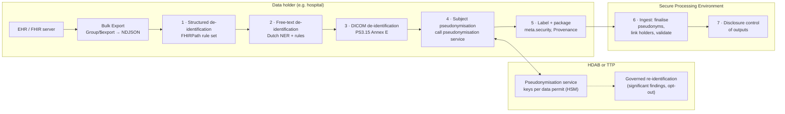
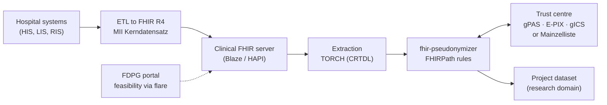

This page explores how a data holder (for example a hospital) can pseudonymise and de-identify health data at the source before it is made available for **secondary use** (research, innovation, policy making, statistics) in a Secure Processing Environment (SPE). It sets out the requirements, the standards that prescribe the process, candidate open-source building blocks for a pipeline, the approach taken by German university medicine, and how these requirements compare to what the national [Pseudonymization Service (PRS)](./pseudonymisation.html) delivers today.
{: .ig-lead}

This page is an exploratory draft. It does not yet define conformance requirements; the [proposed national choices](#proposed-national-choices) are input for discussion. It complements [GF Bulk Export](./bulk-export.html), which defines *how* data is requested and delivered, by describing *what happens to the data* between the source system and the SPE.

### Terminology

| Term | Meaning on this page |
| --- | --- |
| Direct identifier | A data element that identifies a person on its own: BSN, name, address, telephone number, e-mail, local patient number (MRN), but also accession numbers and free-text mentions of these. |
| Quasi-identifier | A data element that identifies a person in combination with other data or background knowledge: exact dates, postal code, rare diagnosis, extreme values, free-text details. |
| Pseudonymisation | Processing such that data can no longer be attributed to a person without *additional information* that is kept separately ([GDPR Art. 4(5)](https://eur-lex.europa.eu/eli/reg/2016/679/oj)). Pseudonymised data remains personal data. |
| Reversible pseudonymisation | Pseudonymisation where the holder of the pseudonymisation secret can recover the original identifier. |
| De-identification | The umbrella term for all transformations that reduce identifiability: removal, masking, generalisation, perturbation, date shifting, pseudonymisation ([ISO/IEC 20889](https://www.iso.org/standard/69373.html)). |
| Anonymisation | De-identification to the point where a person is no longer identifiable by any means reasonably likely to be used (GDPR Recital 26). Not the goal of this page. |
| Pseudonymisation domain | The set of parties and datasets within which one pseudonym for a person is used consistently ([EDPB Guidelines 01/2025](https://www.edpb.europa.eu/our-work-tools/documents/public-consultations/2025/guidelines-012025-pseudonymisation_en)). In the PRS this is the recipient organisation plus *recipient scope*. |
| Trusted third party (TTP) | An entity, independent of data holder and data user, that holds the pseudonymisation secrets ([ISO 25237](https://www.iso.org/standard/63553.html)). |

### Requirements

| ID | Requirement | Notes |
| --- | --- | --- |
| R1 | **Remove PII from unstructured data at the source.** Direct identifiers in free text, narratives, attached documents and images are removed at the data holder, before data leaves the organisation. | Free text appears in `Resource.text`, `Annotation` (`note`), `string` values, `DocumentReference`/`Binary` attachments (PDF, CDA, RTF) and DICOM (header and burned-in pixel text). |
| R2 | **Reversible pseudonymisation at the source, with secrets held by the HDAB or SPE organisation.** The data holder replaces identifiers, but does not hold the secret needed to reverse the pseudonyms. | Required by [EHDS Art. 66(3)](#legal-and-policy-context). Reversal is needed for notification of significant findings and for applying the opt-out to data already held ([TEHDAS2 D7.2](#legal-and-policy-context)). |
| R3 | **Open source and self-hostable** for the components that run at the data holder. | Avoids vendor lock-in and sending identifiable data to a cloud service. |
| R4 | **Referential integrity**, within one delivery, across repeated deliveries, and across multiple data holders under one data permit; and *no* linkability across data permits. | Covers subject pseudonyms, resource ids and references, and other identifiers (encounter numbers, accession numbers). |
| R5 | **FHIR R4 / NDJSON** as the data structure. | Aligns with [GF Bulk Export](./bulk-export.html). |
| R6 | **Standards prescribe the process**, not tools with proprietary logic. | The de-identification rules should be a published, versioned, declarative artefact that any conformant tool can execute. |

### Legal and policy context

The European Health Data Space Regulation, [Regulation (EU) 2025/327](https://eur-lex.europa.eu/eli/reg/2025/327/oj), sets the frame for secondary use:

- **Art. 66 — Data minimisation and purpose limitation.**
  > "2. Health data access bodies shall provide electronic health data in an anonymised format, where the purpose of processing by the health data user can be achieved with such data, taking into account the information provided by the health data user.
  > 3. Where the health data user has sufficiently demonstrated that the purpose of processing cannot be achieved with anonymised data in accordance with Article 68(1), point (c), health data access bodies shall provide access to electronic health data in pseudonymised format. The information necessary to reverse the pseudonymisation shall be available only to the health data access body or an entity that acts as a trusted third party in accordance with national law."
- **Art. 60 — Duties of health data holders**: make the data available to the HDAB for a data permit or data request.
- **Art. 71 — Opt-out** from secondary use; reversible, and without giving a reason.
- **Art. 73 — Secure processing environment**: access under a data permit only through an SPE; the Commission lays down SPE requirements by implementing act (due 26 March 2027).

The TEHDAS2 Joint Action published [D7.2 *Guideline for Health Data Access Bodies on data minimisation, pseudonymisation, anonymisation and synthetic data*](https://tehdas.eu/wp-content/uploads/2026/06/d7.2-guideline-for-health-data-access-bodies-on-data-minimisation-pseudonymisation-anonymisation-and-synthetic-data.pdf) (24 March 2026). Its recommendations most relevant to this page:

- EHDS should rely on **reversible** pseudonymisation; irreversible pseudonymisation is discouraged and limited to legacy situations.
- **Deterministic** pseudonymisation is advisable, so the data user can recognise the same person within a dataset.
- Pseudonyms **must not be reused across data permits**.
- Data holders may pseudonymise when HDAB-approved processes are in place. Pseudonymised data can pass through the HDAB without re-pseudonymisation only if the data holder generates per-project pseudonyms with an HDAB-approved algorithm.
- Linkable pseudonyms across multiple data holders in one country are generated by the HDAB, or by a TTP contracted by the HDAB or defined by law.
- Pseudonymisation secrets are kept separate from pseudonymised data. Quasi-identifiers are assessed on the *linked* dataset, because variables that are harmless per source can become identifying once combined.
- Free text needs particular attention; named-entity recognition, rule-based filtering, masking and surrogate generation are the common approaches.

### Standards that prescribe the process

| Standard | Type | What it prescribes | Use in the pipeline |
| --- | --- | --- | --- |
| [ISO 25237:2017](https://www.iso.org/standard/63553.html) Health informatics — Pseudonymization | International standard | Pseudonymisation concepts and methodology, re-identification policy, requirements on trustworthy pseudonymisation services (TTP). | Reference model for roles (data holder, TTP, data user) and for a governed re-identification process. |
| [ISO/IEC 20889:2018](https://www.iso.org/standard/69373.html) | International standard | Terminology and classification of de-identification techniques (suppression, masking, generalisation, randomisation, pseudonymisation, …). | Vocabulary for naming the transformation applied to each element. |
| [ISO/IEC 27559:2022](https://www.iso.org/standard/71677.html) | International standard | De-identification *framework*: context assessment, data assessment, risk assessment, governance and monitoring. | Process for deciding which rule set a data permit requires. |
| NEN 7524 — Pseudonimiseringsdienstverlening | Dutch standard | Requirements for organisations that provide pseudonymisation services in Dutch healthcare. | Conformance target for whoever operates the pseudonymisation service (PRS or another TTP). |
| [EDPB Guidelines 01/2025 on Pseudonymisation](https://www.edpb.europa.eu/our-work-tools/documents/public-consultations/2025/guidelines-012025-pseudonymisation_en) | EU guidance | Pseudonymisation domain, additional information, pseudonymising controller; separation of secrets. | Terminology and legal expectations. |
| ENISA reports on pseudonymisation ([2019](https://www.enisa.europa.eu/publications/pseudonymisation-techniques-and-best-practices), [2021](https://www.enisa.europa.eu/publications/data-pseudonymisation-advanced-techniques-and-use-cases), [2022](https://www.enisa.europa.eu/publications/deploying-pseudonymisation-techniques)) | EU guidance | Techniques (keyed hash, encryption, asymmetric and multi-party schemes), policies (deterministic, document-randomised, fully randomised), attack models; the 2022 report includes a health-sector use case. | Choice of cryptographic technique and pseudonymisation policy. |
| [TEHDAS2 D7.2](https://tehdas.eu/wp-content/uploads/2026/06/d7.2-guideline-for-health-data-access-bodies-on-data-minimisation-pseudonymisation-anonymisation-and-synthetic-data.pdf) (2026) | EU joint action guideline | See [Legal and policy context](#legal-and-policy-context). | Policy choices for EHDS. |
| [IHE ITI De-Identification Handbook](https://www.ihe.net/uploadedFiles/Documents/ITI/IHE_ITI_Handbook_De-Identification_Rev1.1_2014-06-06.pdf) (Rev. 1.1, 2014) | Implementation handbook | Method to classify each data element of a document or message and assign a de-identification algorithm per element, documented as a reusable profile. | Method for writing the FHIR rule set. |
| [DICOM PS3.15 Annex E](https://dicom.nema.org/medical/dicom/current/output/chtml/part15/chapter_E.html) — Attribute Confidentiality Profiles | Normative standard | A declarative per-attribute action table (remove, zero, dummy, clean, keep, replace UID) with named options such as *Retain Longitudinal Temporal Information*, *Clean Pixel Data* and *Clean Descriptors*. | Rule set for imaging; also the model of how a FHIR rule set could be standardised. |
| [FHIRPath](https://hl7.org/fhirpath/) | HL7 normative | Path language to select elements in FHIR resources. | Selector language for the FHIR rule set. |
| [HL7 security labels](https://hl7.org/fhir/R4/security-labels.html), [v3 ObservationValue](https://terminology.hl7.org/CodeSystem-v3-ObservationValue.html) codes `PSEUDED`, `REDACTED`, `MASKED`, `ABSTRED`, `AGGRED`, `ANONYED` | HL7 terminology | Codes that state how a resource was altered. | Placed in `meta.security` of each exported resource. |
| [RFC 2104](https://www.rfc-editor.org/rfc/rfc2104) HMAC, [RFC 5869](https://www.rfc-editor.org/rfc/rfc5869) HKDF, [RFC 9497](https://www.rfc-editor.org/rfc/rfc9497) OPRF, [RFC 8785](https://www.rfc-editor.org/rfc/rfc8785) JCS, [RFC 7516](https://www.rfc-editor.org/rfc/rfc7516) JWE | IETF | Cryptographic building blocks for deterministic, keyed and blinded pseudonyms and for protected transport. | Already used by the PRS. |
| [NIST SP 800-38G](https://csrc.nist.gov/pubs/sp/800/38/g/final) FF1 | NIST | Format-preserving encryption, for reversible pseudonyms that keep the format of the original value. | Only FF1; FF3 is weakened and FF3-1 is withdrawn in the 2025 draft revision. |
| [NIST SP 800-188](https://csrc.nist.gov/pubs/sp/800/188/final) (2023) | NIST guidance | De-identification process for government datasets, including a disclosure review board. | Reference for governance of rule sets. |

Two observations follow:

1. **There is no HL7 standard rule set for de-identifying FHIR resources.** DICOM has Annex E; FHIR only has security labels to describe the *result*. The de facto declarative format is the FHIRPath rule configuration of [Microsoft Tools for Health Data Anonymization](#structured-data-fhir-r4--ndjson), which the German MIRACUM consortium has adopted and extended in its [fhir-pseudonymizer](#german-university-medicine-mii--num). Publishing a national rule set in that format, versioned in this guide and referenced from the data permit, would satisfy R6 without tying data holders to one tool (see [proposed national choices](#proposed-national-choices)).
2. **There is no formal standard for privacy-preserving record linkage (PPRL)** without a shared identifier. Keyed Bloom-filter encodings (Schnell et al., 2009) are the de facto method.

### Reference pipeline

The pipeline below places every transformation that needs identifiable data inside the data holder, and every secret needed for reversal at the HDAB or a TTP acting on its behalf.

| Step | What happens | Standard | Candidate open-source tools |
| --- | --- | --- | --- |
| 1 | Remove, generalise, hash or encrypt FHIR elements according to the rule set; replace resource ids and references consistently. | FHIRPath, ISO/IEC 20889, HL7 security labels | Microsoft FHIR anonymizer, MIRACUM fhir-pseudonymizer |
| 2 | Remove direct identifiers from free text, or remove the free text. | IHE De-Identification Handbook | deduce, clinlp, nedap/deidentify, Presidio |
| 3 | Clean DICOM headers and burned-in text. | DICOM PS3.15 Annex E | pydicom/deid, dicognito, Microsoft DICOM anonymizer, Presidio image redactor |
| 4 | Replace the subject identifier by a pseudonym bound to the data permit; the data holder does not hold the secret. | ISO 25237, NEN 7524, RFC 9497 | PRS, gPAS, Vfps, Mainzelliste, PEP |
| 5 | Mark each resource with the applied transformations and the rule set version. | HL7 security labels, FHIR `Provenance` | Built into the tools of step 1 |
| 6 | Decrypt or finalise pseudonyms, link deliveries from several data holders. | — | Part of the SPE, PPRL tools when no shared identifier exists |
| 7 | Check outputs and quasi-identifiers on the linked dataset. | ISO/IEC 27559, NIST SP 800-188 | ARX, sdcMicro |

#### Structured data (FHIR R4 / NDJSON)

A FHIR rule set lists, per element or data type, one action. The actions supported by the Microsoft rule format are `keep`, `redact`, `dateShift`, `perturb`, `cryptoHash` (HMAC-SHA256), `encrypt` (AES, reversible by the key holder), `substitute` and `generalize`. Rules are evaluated in order, so a rule set typically ends with a catch-all. Typical rules:

- `nodesByType('HumanName')`, `nodesByType('ContactPoint')`, `nodesByType('Address').line` → `redact`;
- `nodesByType('Address').postalCode` → `generalize` to the four-digit area, or `redact` in small areas;
- `Patient.birthDate` → `generalize` to year or year-month;
- `Resource.id` and `nodesByType('Reference').reference` → `cryptoHash` with a per-permit key, so references between resources stay intact;
- `Resource.text` (narrative) → `redact`; narratives duplicate structured data and are free text;
- local identifiers (`Identifier` of type `MR`, `VN`, accession numbers) → pseudonymise or `cryptoHash`.

| Tool | Licence | Deployment | Notes |
| --- | --- | --- | --- |
| [Microsoft Tools for Health Data Anonymization](https://github.com/microsoft/Tools-for-Health-Data-Anonymization) | MIT | .NET command line tool or library; on-premises | FHIR R4 and STU3, JSON and NDJSON. FHIRPath rule configuration with a sample HIPAA Safe Harbor rule set. Date shift is keyed per *resource*, *file* or *folder* (not per patient), ±50 days, and removes the time of day. Includes a DICOM anonymizer. |
| [MIRACUM fhir-pseudonymizer](https://github.com/miracum/fhir-pseudonymizer) | MIT | Container service (REST and Kafka) | Uses the Microsoft rule format and adds a `pseudonymize` action that calls gPAS, Vfps or entici. Offers `$de-identify` and `$de-pseudonymize` FHIR operations, can add `meta.security` labels and emit `Provenance`. |
| [Alvearie de-identification](https://github.com/Alvearie/de-identification) (IBM) | Apache-2.0 | Java service | Masking providers per field; own JSON configuration format. |

The date-shift policy of [GF Bulk Export](./bulk-export.html#default-date-shift-policy) requires an offset that is constant *per subject and per data permit* and aligned across data holders, and preserves the time of day. None of the tools above implements that out of the box: they key the offset per resource or file. A per-subject offset that is equal across data holders requires a secret that all data holders share per subject and permit; see [Comparison with the PRS](#comparison-with-the-pseudonymization-service-prs).

#### Unstructured documents and free text

Free text is the main residual risk; no tool reaches perfect recall. The proposed approach, in order of preference:

1. **Leave it out.** Redact free-text elements and attachments that the data permit does not explicitly require (`_elements` in [GF Bulk Export](./bulk-export.html), plus the rule set).
2. **De-identify text the permit requires.** Extract the text, run Dutch-language detection of names, dates, BSNs, addresses, phone numbers, institutions and other identifiers, and replace hits by a tag or a realistic surrogate. Re-embed the result as `text/plain` and label the resource `REDACTED` or `MASKED`. Supplying the known patient name and the names of involved practitioners from the structured record as hints improves recall considerably.
3. **Drop what cannot be processed reliably**, such as scanned PDFs without a text layer, or use OCR plus redaction, as with burned-in DICOM text.
4. **Measure.** Validate recall on a sample from the own organisation before go-live and periodically after, as recommended by the tools themselves.

| Tool | Organisation | Licence | Dutch | Notes |
| --- | --- | --- | --- | --- |
| [deduce](https://github.com/vmenger/deduce) | UMC Utrecht | GPL-3.0 / LGPL-3.0 | Yes, designed for Dutch clinical text | Python library, version 3; rule- and lexicon-based (names, institutions, locations, dates, ages, BSN, phone, e-mail, URLs). Accepts known patient names. |
| [clinlp](https://github.com/umcu/clinlp) | UMC Utrecht | GPL-3.0 | Yes | spaCy-based Dutch clinical NLP toolkit (entity matching, context and negation); a building block rather than a complete de-identifier. |
| [nedap/deidentify](https://github.com/nedap/deidentify) | Nedap / Trienes et al. | MIT | Yes, models trained on Dutch healthcare records | Python; CRF and BiLSTM-CRF taggers. |
| [Presidio](https://github.com/data-privacy-stack/presidio) | data-privacy-stack (originally Microsoft) | MIT | Via a configured Dutch spaCy or transformer model and custom recognisers | Python library or containers; analyzer, anonymizer and image redactor (including DICOM burned-in text, beta). |

Managed cloud services such as [Azure Health Data Services de-identification](https://learn.microsoft.com/azure/healthcare-apis/deidentification/), the [Google Cloud Healthcare API](https://cloud.google.com/healthcare-api/docs/concepts/de-identification) and [AWS Comprehend Medical](https://docs.aws.amazon.com/comprehend-medical/) (English only) do not meet R3, because identifiable text would leave the data holder.

#### Imaging

[DICOM PS3.15 Annex E](https://dicom.nema.org/medical/dicom/current/output/chtml/part15/chapter_E.html) is applied with the *Basic Application Level Confidentiality Profile* and the options named in the data permit. *Retain Longitudinal Temporal Information with Modified Dates* matches the date-shift policy. Open-source implementations include [pydicom/deid](https://github.com/pydicom/deid) (MIT, recipe-based), [dicognito](https://github.com/blairconrad/dicognito) (MIT, consistent per-patient replacement of UIDs, names and dates, header only) and the DICOM anonymizer in the Microsoft repository. Burned-in text requires OCR-based pixel redaction, for example the Presidio DICOM image redactor.

#### Pseudonymisation and key management

Three architectures meet R2 to a different degree:

| Option | How it works | R2: secret not at data holder | R3: self-hosted at data holder | Examples |
| --- | --- | --- | --- | --- |
| A. Central pseudonymisation service | The data holder sends (or blinds) each identifier to a service at the HDAB or TTP, which returns a permit-bound pseudonym. Reversal is a function of that service. | Yes | Only a small client; the service is central | [PRS](./pseudonymisation.html), [gPAS](https://www.ths-greifswald.de/gpas) (AGPL-3.0), [Vfps](https://github.com/miracum/vfps) (Apache-2.0, optional RFC 9497 OPRF pseudonyms), [Mainzelliste](https://mainzelliste.de) (AGPL-3.0), [entici](https://www.entici.org) |
| B. Polymorphic encryption and pseudonymisation | The data holder encrypts identifiers locally under a public key. A *transcryptor* at the HDAB converts them, without decrypting, into pseudonyms for the SPE's domain. Trust can be split over several transcryptors. | Yes | Yes, no per-identifier call needed | [PEP](https://pep.cs.ru.nl) ([core](https://github.com/PEP-Repository/core), Apache-2.0; Radboud University, used by the Personalized Parkinson Project) and [libpep](https://github.com/NOLAI/libpep) (Apache-2.0, n-PEP) |
| C. Locally keyed pseudonyms | The HDAB issues a per-permit key; the data holder computes HMAC, AES-SIV or FF1 pseudonyms locally. | **No**, the key is at the data holder | Yes | Microsoft FHIR anonymizer `cryptoHash`/`encrypt` |

Option C is the simplest, but the data holder can reverse or recompute pseudonyms with the key. It is acceptable only for identifiers that never leave the holder in clear anyway, such as resource ids. Subject identifiers should use option A or B.

Referential integrity (R4) has four layers:

1. **Subject**: one deterministic pseudonym per person and data permit, equal across data holders. This requires all data holders to start from the same identifier (the BSN) and the same pseudonymisation domain.
2. **Resource ids and references**: a keyed hash with a per-permit key, prefixed by the data holder to avoid collisions. This keeps references intact across files and repeated exports.
3. **Persons without a shared identifier** (no BSN, or a foreign identifier): privacy-preserving record linkage on demographic data at a TTP. Examples are Bloom-filter encoding with [anonlink/clkhash](https://github.com/data61/anonlink) (Apache-2.0; the accompanying entity service has not been maintained since 2023), or [E-PIX](https://github.com/mosaic-hgw/E-PIX) or Mainzelliste holding identifying data at the TTP.
4. **Across data permits**: a new pseudonymisation domain per permit, so datasets from two permits cannot be joined.

#### Disclosure control in the SPE

Quasi-identifier risk is assessed on the linked dataset in the SPE. [ARX](https://arx.deidentifier.org) (Apache-2.0) and [sdcMicro](https://github.com/sdcTools/sdcMicro) (GPL-2.0) offer k-anonymity, l-diversity, t-closeness and related methods. Both work on tables, so FHIR data is flattened first, for example with [SQL on FHIR](https://sql-on-fhir.org/) view definitions.

### German university medicine (MII / NUM)

German university hospitals have operated a comparable infrastructure since about 2018 under the Medizininformatik-Initiative (MII) and the Netzwerk Universitätsmedizin (NUM). Each university hospital runs a Data Integration Centre (DIZ):

| Component | Organisation | Licence | Role |
| --- | --- | --- | --- |
| [MII Kerndatensatz](https://simplifier.net/organization/koordinationsstellemii) | MII | CC-BY-4.0 | FHIR R4 profiles for person, encounter, diagnosis, procedure, medication, laboratory, consent. |
| [Blaze](https://github.com/samply/blaze) | Samply community | Apache-2.0 | FHIR R4 server with CQL engine, widely used at MII sites. |
| [gPAS](https://github.com/mosaic-hgw/gPAS), [E-PIX](https://github.com/mosaic-hgw/E-PIX), [gICS](https://github.com/mosaic-hgw/gICS) | University Medicine Greifswald (THS) | AGPL-3.0 | Pseudonym administration with *domains* and reversal; master patient index with record linkage; consent management (MII Broad Consent). A TTP FHIR gateway exposes operations such as `$pseudonymize` and `$dePseudonymize`. |
| [Mainzelliste](https://mainzelliste.de) | Originally University Medicine Mainz | AGPL-3.0 | First-level pseudonymisation: identifying data, record linkage (EpiLink, optional Bloom filters) and PID generation behind a token-based REST API. |
| [fhir-pseudonymizer](https://github.com/miracum/fhir-pseudonymizer) and [Vfps](https://github.com/miracum/vfps) | MIRACUM | MIT / Apache-2.0 | FHIR de-identification with pluggable pseudonym backend; lightweight pseudonym service with namespaces and optional RFC 9497 OPRF. |
| [TORCH](https://github.com/medizininformatik-initiative/torch), [flare](https://github.com/medizininformatik-initiative/flare), [FDPG](https://forschen-fuer-gesundheit.de) | MII | Apache-2.0 | Central research portal; feasibility queries and consent-aware FHIR extraction driven by a cohort and data selection definition (CRTDL). |
| [Data Sharing Framework](https://github.com/datasharingframework/dsf) | MII community | Apache-2.0 | BPMN processes over FHIR between sites (feasibility, data transfer). |
| [fts-next](https://github.com/medizininformatik-initiative/fts-next) | MII / SMITH | Apache-2.0 | Reference transfer pipeline: clinical domain agent → trust centre agent (gPAS, gICS) → research domain agent. |
| [GeMTeX](https://github.com/medizininformatik-initiative/GeMTeX) | MII (SMITH, DIFUTURE) | Open source | German clinical text corpus and de-identification pipeline; automatic pre-annotation, manual review and surrogate generation. |

Cross-site referential integrity uses two pseudonym levels: a site-local pseudonym issued by the trust centre, and a project pseudonym derived per research project in gPAS. A cross-site match on identifying data is made at the trust centre, with human clearing for doubtful matches. Reversal is possible only at the trust centre, under a governed procedure following the TMF generic data protection concept. Free text is still handled with considerable manual effort in GeMTeX.

At national level, the Forschungsdatenzentrum Gesundheit at BfArM receives claims data that is pseudonymised by a separate Vertrauensstelle at the Robert Koch Institute, a statutory TTP. The 2024 Health Data Use Act (GDNG) creates a central data access and coordination body, which Germany positions as its HDAB node for HealthData@EU.

Lessons for the Dutch situation:

- **Domains are the unit of unlinkability.** The gPAS domain, the Vfps namespace and the PRS recipient scope are the same concept. One domain per data permit meets the TEHDAS2 requirement that pseudonyms are not reused across permits.
- **The de-identification rules are declarative and shared.** MIRACUM reuses the Microsoft FHIRPath format instead of writing its own logic, which supports R6.
- **Pseudonymisation is exposed as FHIR operations** on `Parameters` and `Bundle`, so a de-identification engine can switch between backends (gPAS, Vfps, entici). A PRS backend could be added in the same way.
- **Vfps uses the same primitive as the PRS** (RFC 9497 OPRF with a separate key holder), which shows that the PRS cryptography fits a secondary-use pipeline.
- **A trust centre holding identifying data** is what makes linkage without a BSN and governed reversal possible. A blinded service such as the PRS OPRF flow cannot offer either.

### Comparison with the Pseudonymization Service (PRS)

This comparison is based on [GF Pseudonymisation](./pseudonymisation.html) and on the public proof-of-concept implementation [gfmodules-pseudoniemendienst](https://github.com/minvws/gfmodules-pseudoniemendienst) (EUPL-1.2, explicitly not intended for production). Besides the OPRF flow specified in this guide, the proof of concept offers:

- `POST /oprf/eval`: the client sends a *blinded* identifier. The PRS never sees the BSN. The pseudonym is deterministic per recipient organisation, recipient scope and key version, and is **irreversible by design**: no function maps it back to a BSN.
- `POST /exchange/reversible-pseudonym`: the client sends the identifier itself, over mTLS. The PRS returns an AES-encrypted pseudonym under a key per recipient organisation and key version, held in an HSM. **Only the PRS can reverse it**, and only organisations authorised for that ("max-key-usage" `BSN`).
- `POST /exchange/irreversible-pseudonym`: an HMAC-SHA256 pseudonym under an HSM key. It accepts a BSN or a reversible pseudonym issued to the caller.
- Results are returned as a JWE encrypted to the recipient's public key for that scope, with a lifetime of five minutes.
- Key versions with rotation (older versions returned in `extraVersions`) and destruction of expired keys. No identifier-pseudonym mapping is stored.
- Organisations are authorised per pseudonym type, both for requesting and for receiving.

| Requirement | What the PRS delivers | Gap |
| --- | --- | --- |
| R1 — PII removal from unstructured data | Not in scope. The PRS transforms one identifier at a time; it does not process FHIR resources, free text or images. | Everything except the subject identifier needs a separate pipeline at the data holder, and a national rule set. |
| R2 — Reversible at source, secrets at HDAB/SPE | **Partly.** The flow specified in this guide and referenced by [GF Bulk Export](./bulk-export.html) is the OPRF flow, which is irreversible. That conflicts with the TEHDAS2 preference for reversible pseudonyms (significant findings, opt-out). The reversible-pseudonym exchange exists in the proof of concept, but its secrets are held by the PRS operator, not by the HDAB, and no reversal endpoint is exposed. | Specify the reversible flow for secondary use. Designate the PRS operator as TTP under national law (EHDS Art. 66(3)), or give the HDAB custody of the secondary-use keys. Define a governed reversal transaction for the HDAB only. |
| R3 — Open source, self-hosted | The PRS code is open source (EUPL-1.2), but it is a central national service and a proof of concept. The data holder only runs a small client (HKDF + OPRF, or a REST call). | Acceptable for subject pseudonyms; the de-identification tools at the data holder must come from elsewhere. |
| R4 — Referential integrity | **Subject level: yes.** Pseudonyms are deterministic per recipient and scope, so deliveries from different data holders to the same SPE under the same scope link up. A scope per data permit gives unlinkability across permits. | No support for persons without a BSN, nor for local identifiers and resource ids. Key rotation changes pseudonyms (bridged only during the overlap of key versions). The data holder never sees the final pseudonym, so it cannot derive the per-subject, cross-holder date-shift offset that [GF Bulk Export](./bulk-export.html#default-date-shift-policy) requires. |
| R5 — FHIR R4 / NDJSON | No. JSON over REST, one identifier per call, no batch operation. The JWE expires after five minutes, and this guide states it SHALL NOT be persisted beyond one transaction. That conflicts with embedding pseudonyms in NDJSON files that the SPE ingests later. | A batch operation, preferably a FHIR operation (as in the German TTP gateway). A FHIR representation of the pseudonym (`Patient.identifier` with a per-permit naming system). A delivery rule that lets the SPE finalise pseudonyms at ingest. |
| R6 — Standards prescribe the process | Strong on cryptography: RFC 5869, RFC 9497 (OPRF ristretto255-SHA512), RFC 7516. The proof of concept uses compact JSON rather than full RFC 8785 canonicalisation. ISO 25237, NEN 7524 and the EDPB pseudonymisation-domain terminology are not referenced. | Reference ISO 25237 and NEN 7524 for the service and its governance. The de-identification rule set itself is outside the PRS. |

In short: the PRS solves the hardest *cryptographic* part, a national, recipient-scoped, deterministic subject pseudonym with keys in an HSM. It does not de-identify data, and the flow specified today is not reversible. For secondary use it needs a reversible, permit-scoped profile with HDAB-controlled reversal, a batch or FHIR interface suited to bulk delivery, and a defined place in a pipeline whose other steps run at the data holder.

### Proposed national choices

The following choices are proposed for discussion. They are not yet normative.

1. **National de-identification rule set.** Publish a versioned FHIRPath rule set in this guide, in the Microsoft / MIRACUM rule format, with one rule per element of the EHDS priority data categories in [GF Bulk Export](./bulk-export.html#data-scope). Name each action with ISO/IEC 20889 terminology, modelled on DICOM PS3.15 Annex E. The data permit references the rule set version and any options, in the way Annex E options are named.
2. **Security labels.** Every exported resource carries `meta.security` codes from v3 ObservationValue (`PSEUDED`, `REDACTED`, `MASKED`, `ABSTRED`) and a `Provenance` that references the rule set version.
3. **Free text off by default.** Free-text elements and attachments are redacted unless the permit lists them; when listed, they pass a Dutch-language de-identification step whose recall is validated by the data holder.
4. **Reversible, permit-scoped subject pseudonyms.** Secondary-use pseudonyms use the reversible PRS flow, with the SPE (or HDAB) as recipient and the data permit identifier as recipient scope. Reversal is available only to the HDAB, for significant findings and opt-out, under a procedure based on ISO 25237. The PRS operator is designated as TTP under national law, or the HDAB holds the keys of the secondary-use domain.
5. **Bulk interface.** The PRS offers a batch operation (preferably a FHIR operation on `Parameters`) for whole cohorts. Its output can be embedded in NDJSON and finalised by the SPE at ingest, which means a lifetime tied to the export job rather than five minutes.
6. **Resource ids and references** are replaced with HMAC-SHA256 under a per-permit key, prefixed by the data holder, so internal references stay intact without revealing source ids.
7. **Date shifting moves to the SPE ingest step,** keyed by the final subject pseudonym and a per-permit secret. This gives an offset that is constant per subject and aligned across data holders, without data holders needing a shared secret. The alternative is that the PRS returns a per-subject, per-permit shift secret to the data holder.
8. **Persons without a BSN** are out of scope for the PRS. If a permit requires them, linkage is done by PPRL at a TTP.
9. **Evaluate polymorphic pseudonymisation (PEP)** as a future alternative. It moves the pseudonymisation computation to the data holder without giving it a reversal secret, and removes the per-identifier online call.
