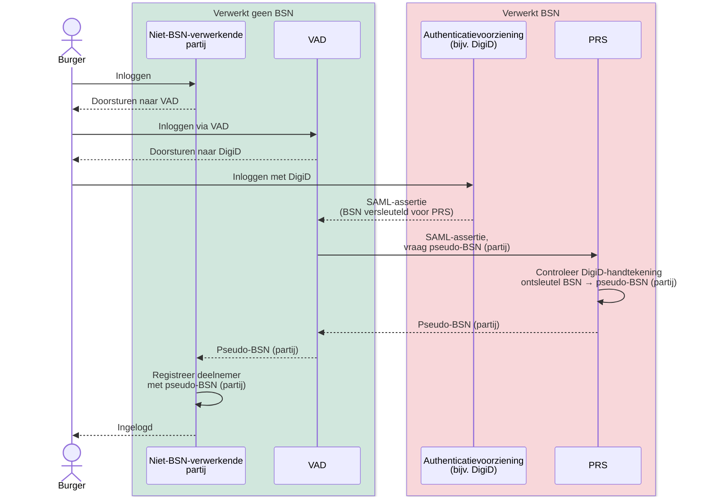
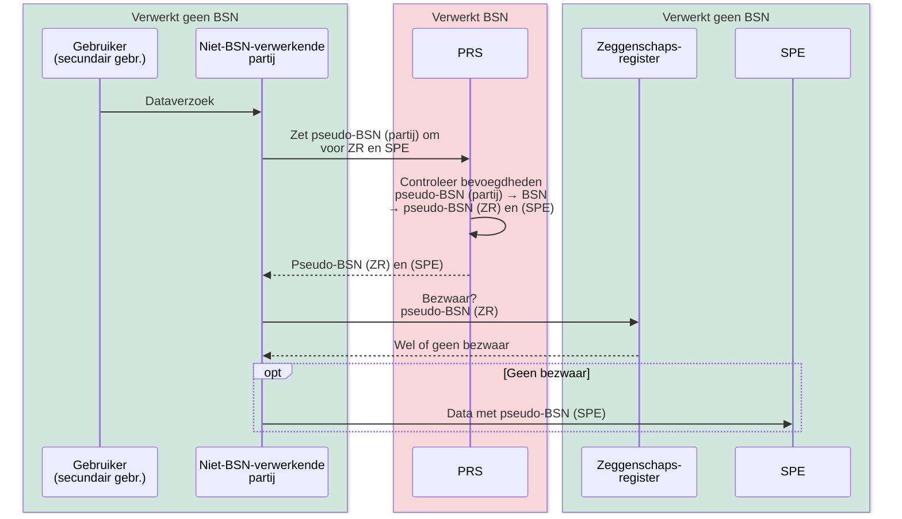
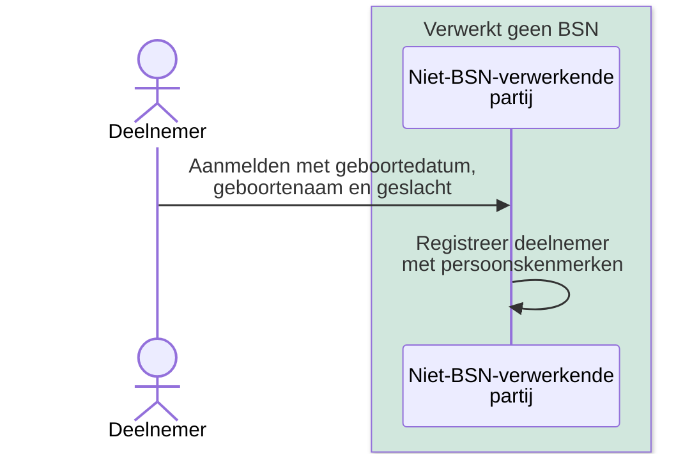
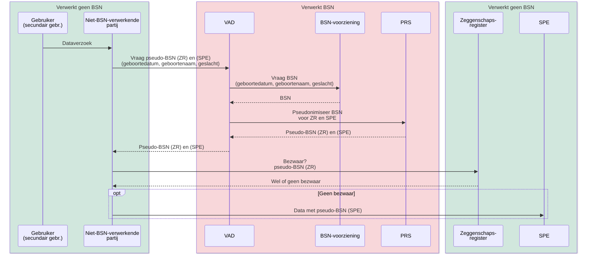
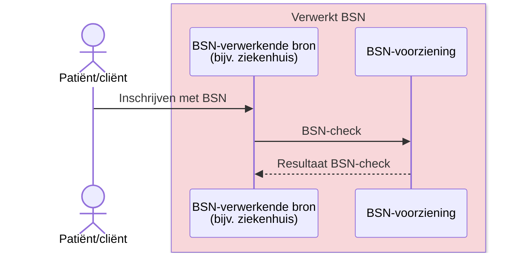
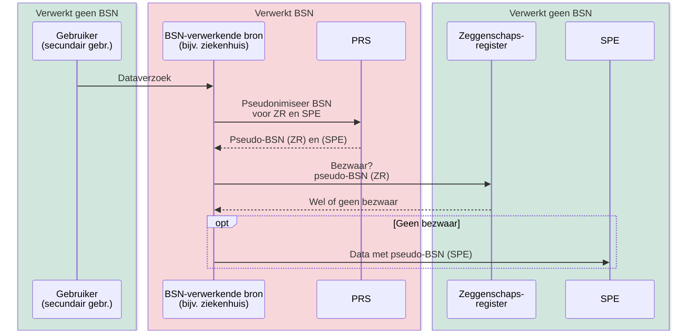
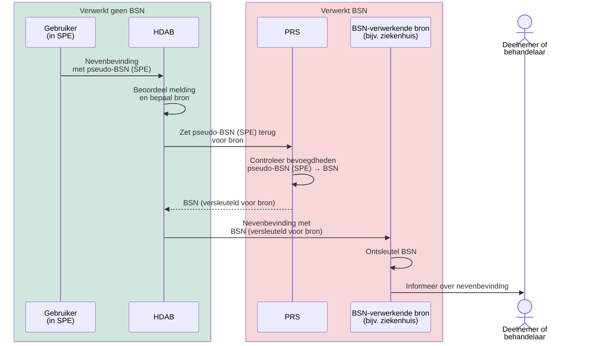

# Identificatiepatronen voor deelnemers secundair gebruik

Status: concept  
Datum: 19 november 2026
> **Let op:** Deze pagina is een conceptuitwerking. De aannames in deze flows zijn nog niet juridisch bevestigd en de communicatiepatronen zijn nog niet technisch gespecificeerd.

# SG-ID-1: Pseudo-BSN via VAD met DigiD
## regulier proces

## datauitgifte

# SG-ID-2: Pseudo-BSN via VAD met persoonskenmerken
## regulier proces

## datauitgifte

# SG-ID-3: Pseudo-BSN via BSN-verwerkende bron
## regulier proces

## datauitgifte

## SG-ID-4: Re-identificatie

