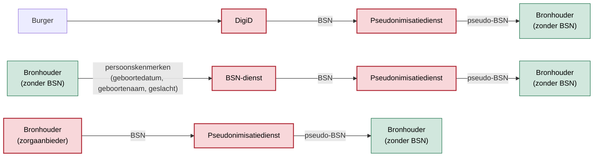
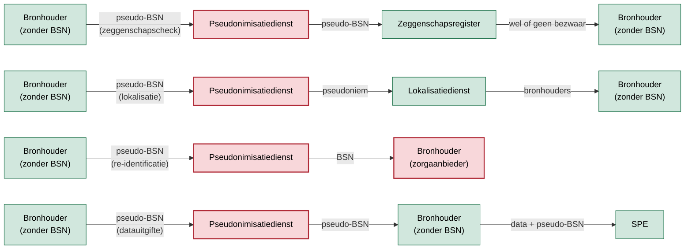
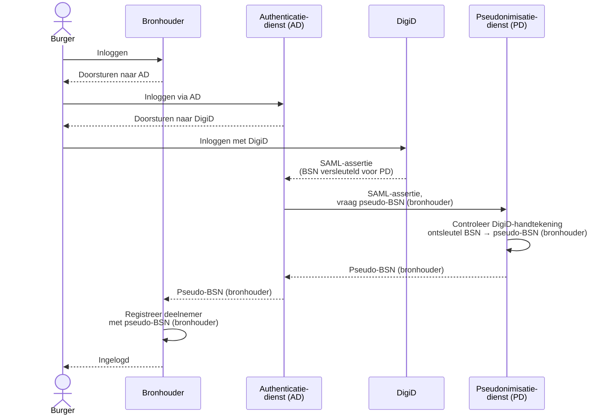
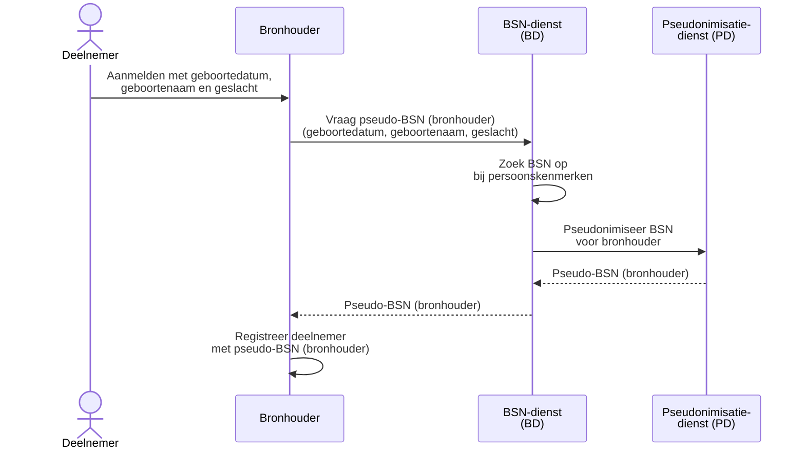
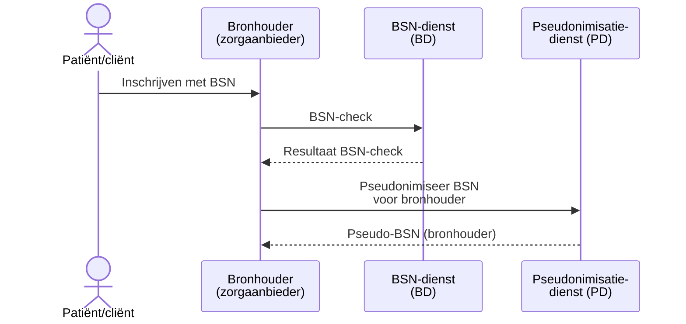
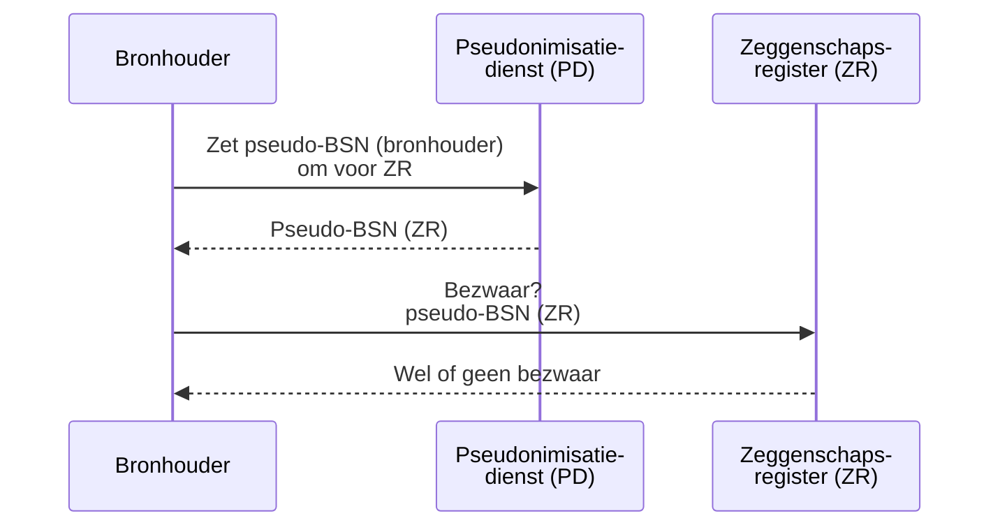
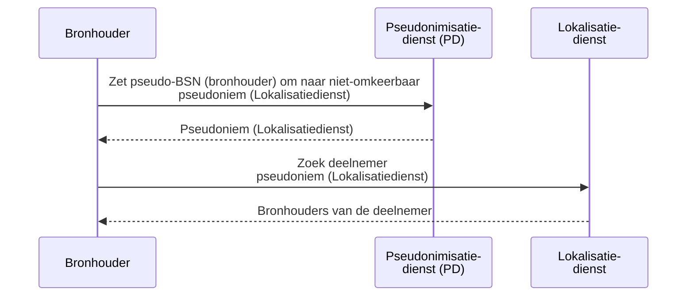
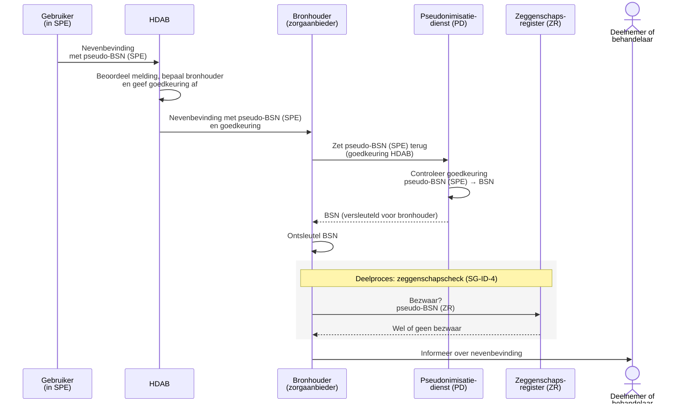
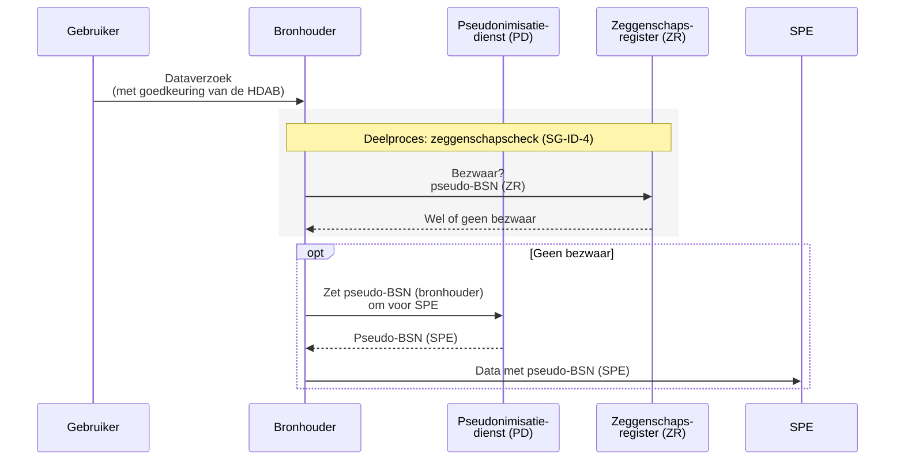

GF Identificatie voor Secundair Gebruik (SG) beschrijft hoe deelnemers bij secundair gebruik van gezondheidsgegevens betrouwbaar geïdentificeerd en over bronnen heen gekoppeld worden met een pseudo-BSN. Bronhouders die het BSN niet mogen verwerken, verkrijgen een pseudo-BSN via een vertrouwde authenticatiedienst (AD) of een vertrouwde BSN-dienst (BD); BSN-verwerkende bronhouders laten het BSN zelf pseudonimiseren. Het pseudo-BSN wordt daarna gebruikt voor de zeggenschapscheck, lokalisatie, re-identificatie bij een nevenbevinding en datauitgifte met een pseudo-BSN. Per communicatiepatroon geeft deze pagina aan welke partijen het BSN verwerken.
{: .ig-lead}

> **Let op:** Deze pagina is een conceptuitwerking. De [aannames](#aannames) zijn nog niet juridisch bevestigd en de communicatiepatronen zijn nog niet technisch gespecificeerd. Zie de [roadmap](#roadmap-voor-gf-identificatie-voor-sg) voor de openstaande punten.

### Scope

Deze pagina beschrijft:
- waarom deelnemers bij secundair gebruik geïdentificeerd en gekoppeld moeten worden;
- de aannames over het BSN en het pseudo-BSN;
- drie communicatiepatronen waarmee een bronhouder een eigen pseudo-BSN verkrijgt;
- vier use-cases voor het gebruik van dat pseudo-BSN: de zeggenschapscheck, lokalisatie, re-identificatie bij een nevenbevinding en datauitgifte met een pseudo-BSN;
- per patroon welke partijen het BSN verwerken en welke alleen een pseudo-BSN;
- in een [bijlage](#bijlage-omkeerbare-pseudoniemen-in-de-pd) een voorbeeldimplementatie van functies voor omkeerbare pseudoniemen, die nog niet in [GF Pseudonymisation](./pseudonymisation.html) staan.

Deze pagina beschrijft niet:
- de cryptografie van pseudonimisering. Zie [GF Pseudonymisation](./pseudonymisation.html) voor de OPRF-functie en de [pseudoniemendienst](https://github.com/minvws/gfmodules-pseudoniemendienst) als voorbeeld voor omkeerbare pseudoniemen;
- de identificatie van patiënten in het zorgproces (primair gebruik);
- het datauitgifteproces zelf, zoals datavergunningen en de beoordeling door de HDAB; deze pagina beschrijft alleen het gebruik van het pseudo-BSN daarbij;
- de koppelvlakken van DigiD, de BD, het zeggenschapsregister, de Lokalisatiedienst, de HDAB en de SPE.

De genoemde diensten beschrijven rollen in de patronen, geen verplichte keuze voor een specifieke implementatie. Een implementatie moet wel de benodigde functies en bevoegdheden bieden. De bijlage beschrijft één mogelijke invulling van de pseudonimisatiedienst.

### Terminologie

| Term | Betekenis |
|---|---|
| BSN | Burgerservicenummer. |
| Pseudo-BSN | Een omkeerbaar pseudoniem dat de [PD](#pd) van het BSN maakt voor één ontvanger (organisatie en scope). Elke ontvanger krijgt voor dezelfde deelnemer een ander pseudo-BSN. In de diagrammen staat de ontvanger tussen haakjes, bijvoorbeeld pseudo-BSN (SPE). Alleen de PD kan een pseudo-BSN terugzetten naar het BSN. |
| Secundair gebruik (SG) | Gebruik van gezondheidsgegevens voor andere doelen dan de zorgverlening aan de deelnemer, zoals wetenschappelijk onderzoek. |
| Deelnemer | De burger of patiënt van wie gegevens voor SG worden gebruikt. |
| Bronhouder | Een partij die gegevens van deelnemers beheert. Een BSN-verwerkende bronhouder mag het BSN verwerken, zoals een zorgaanbieder. Een niet-BSN-verwerkende bronhouder mag dat niet, zoals een wellness-app of een onderzoekscohort, en gebruikt bij SG een pseudo-BSN. |
| Gebruiker | Een partij die gegevens voor SG gebruikt, zoals een onderzoeker. De gebruiker verwerkt de gegevens in een SPE. |
| Tussenpartij | Een partij die identificerende kenmerken van deelnemers uit meerdere bronnen ontvangt om die bronnen te koppelen. |
| Regulier proces | Het eigen proces waarin een bronhouder de deelnemer registreert, los van SG. Bij een zorgaanbieder is dat het zorgproces. |
| Datauitgifte | Het leveren van gegevens door een bronhouder aan de SPE, na een dataverzoek van de gebruiker. |
| Re-identificatie | Het terugvinden van de deelnemer bij een pseudo-BSN, bijvoorbeeld om de deelnemer te informeren over een nevenbevinding. |
| Nevenbevinding | Een bevinding over een deelnemer die de gebruiker bij SG doet en die voor de gezondheid van de deelnemer van belang is. |
| AD | Een vertrouwde authenticatiedienst. Ondersteunt authenticatie van de burger via DigiD en levert de bronhouder een pseudo-BSN in plaats van het BSN. Zie [AD](#ad). |
| BD | Een vertrouwde BSN-dienst. Zoekt bij persoonskenmerken het BSN op of controleert een BSN, en levert de bronhouder een pseudo-BSN in plaats van het BSN. Zie [BD](#bd). |
| PD | Een vertrouwde pseudonimisatiedienst. Maakt van een BSN een pseudo-BSN, zet een pseudo-BSN om naar een pseudoniem voor een andere ontvanger, en zet een pseudo-BSN terug naar het BSN. Zie [PD](#pd). |
| Zeggenschapsregister (ZR) | Het register waarin de burger vastlegt of hij bezwaar maakt tegen secundair gebruik van zijn gegevens (opt-out, EHDS artikel 71). |
| Lokalisatiedienst | De dienst die per deelnemer bijhoudt welke bronhouders gegevens hebben. Zie [GF Localization](./localization.html). |
| HDAB | Health Data Access Body. Beoordeelt onder de European Health Data Space (EHDS) dataverzoeken voor SG. |
| SPE | Secure Processing Environment, de beveiligde verwerkingsomgeving (EHDS artikel 73). De gebruiker krijgt alleen in de SPE toegang tot uitgegeven gegevens. |

### Achtergrond

In het zorgproces moet een zorgaanbieder de patiënt identificeren met het BSN en dat BSN controleren (authenticatie). Bij spoed gebeurt dit niet altijd direct.

Bij secundair gebruik is identificatie ook nodig. Identificerende kenmerken van deelnemers worden gebruikt om datasets en registers met gegevens van dezelfde persoon te koppelen. Soms koppelt een tussenpartij twee datasets, partijen of registers. Tussen twee (of drie) partijen kan daarbij dataminimalisatie plaatsvinden.

#### Voorbeeld: koppelen zonder BSN

Een ziekenhuis (bronhouder) levert gegevens aan een onderzoeker (gebruiker). Beide kennen de deelnemer aan andere kenmerken:

| Partij | Identificerende kenmerken van de deelnemer |
|---|---|
| Bronhouder: ziekenhuis | BSN, geboortedatum, NAW, UUID, e-mailadres |
| Gebruiker: onderzoeker | UUID, geboortejaar, woonplaats |

De UUID is uniek per bronhouder. Met de UUID kan de bronhouder de deelnemer her-identificeren, bijvoorbeeld bij een nevenbevinding.

Als de onderzoeker van een andere bronhouder gegevens van dezelfde personen krijgt, kan hij die vaak niet koppelen. Geboortejaar en woonplaats zijn niet uniek identificerend.

Om toch te kunnen koppelen, worden tussenpartijen ingezet. Een tussenpartij slaat geboortedatum, NAW, UUID en e-mailadres van deelnemers uit alle bronnen op, en matcht de kenmerken van verschillende bronnen aan elkaar. Niet elke bron hoeft precies dezelfde kenmerken te hebben. Hoe meer kenmerken een bron van de deelnemer heeft, hoe groter de kans op een match.

#### EHDS

De EHDS ([Verordening (EU) 2025/327](https://eur-lex.europa.eu/eli/reg/2025/327/oj)) noemt in artikel 51, lid 1, zeventien minimumcategorieën van elektronische gezondheidsgegevens voor secundair gebruik. Voorbeelden zijn gegevens uit EPD's, genetische gegevens, gegevens uit registers en gegevens uit biobanken. Lidstaten mogen categorieën toevoegen (artikel 51, lid 2). De categorieën hebben verschillende bronhouders met gegevens van dezelfde deelnemer.

Ook het zeggenschapsregister moet betrouwbaar aan een deelnemer kunnen koppelen. Een burger heeft het recht om bezwaar te maken tegen secundair gebruik van zijn gegevens (artikel 71).

De gebruiker krijgt alleen toegang tot gegevens in een SPE (artikel 73). Volgens artikel 66, lid 3, levert de HDAB gepseudonimiseerde gegevens als het doel niet met geanonimiseerde gegevens te bereiken is. Alleen de HDAB of een vertrouwde derde partij mag de pseudonimisering terugdraaien.

Een gebruiker meldt een nevenbevinding over een deelnemer aan de HDAB (artikel 61, lid 5). De HDAB informeert de bronhouder, en de bronhouder informeert de deelnemer of diens behandelaar (artikel 58, lid 3).

Deze pagina werkt uit hoe het pseudo-BSN als gemeenschappelijk koppelkenmerk kan dienen.

### Aannames

1. Een pseudo-BSN wordt juridisch beschouwd als een nummer, zolang de houder er niet zelfstandig mee kan her-identificeren. Het gebruik ervan vraagt geen aanpassing van wetgeving.
2. Het verwerken van het BSN tot pseudo-BSN, of andersom, vraagt voor SG wel een aanpassing van wetgeving.
3. Het zeggenschapsregister en de [Lokalisatiedienst](./localization.html) bevatten alleen pseudoniemen.

Door aanname 2 is van belang welke partijen het BSN verwerken, in beide richtingen. Deze pagina geeft dat daarom per communicatiepatroon aan.

### Oplossingsoverzicht

Een bronhouder verkrijgt één keer een eigen pseudo-BSN (bronhouder), via een van drie patronen:

1. [SG-ID-1](#sg-id-1-pseudo-bsn-via-ad-met-digid): via de AD, nadat de burger via DigiD heeft ingelogd bij de bronhouder.
2. [SG-ID-2](#sg-id-2-pseudo-bsn-via-bd-met-persoonskenmerken): via de BD, op basis van persoonskenmerken.
3. [SG-ID-3](#sg-id-3-pseudo-bsn-via-bsn-verwerkende-bronhouder): de BSN-verwerkende bronhouder laat het BSN zelf pseudonimiseren.

Daarna gebruikt de bronhouder dat pseudo-BSN in vier use-cases. De PD zet het per use-case om naar het pseudoniem voor de ontvanger; de bronhouder ziet daarbij het BSN niet:

4. [SG-ID-4](#sg-id-4-zeggenschapscheck): de zeggenschapscheck, als deelproces van SG-ID-6 en SG-ID-7.
5. [SG-ID-5](#sg-id-5-lokalisatie): lokalisatie via de Lokalisatiedienst.
6. [SG-ID-6](#sg-id-6-re-identificatie-bij-een-nevenbevinding): re-identificatie bij een nevenbevinding.
7. [SG-ID-7](#sg-id-7-datauitgifte-met-een-pseudo-bsn): datauitgifte met een pseudo-BSN aan de SPE.

In alle patronen verwerkt de PD het BSN: zij ontvangt het BSN om er een pseudo-BSN van te maken, en kan een pseudo-BSN later omzetten of terugzetten. De patronen gaan uit van de toegangs- en ontvangerregels uit de voorbeeldimplementatie in de [bijlage](#bijlage-omkeerbare-pseudoniemen-in-de-pd); een andere invulling moet gelijkwaardige waarborgen bieden. SG-ID-6 vraagt daarnaast een goedkeuringsmechanisme (permit) van de HDAB dat de voorbeeldimplementatie nog niet biedt. Zie [PD](#pd).

Het eerste overzicht toont vereenvoudigd hoe een bronhouder zonder BSN een pseudo-BSN verkrijgt. Elke stroom eindigt bij deze bronhouder, die alleen een pseudo-BSN ontvangt. De AD (die in SG-ID-1 de uitwisseling afhandelt zonder het BSN te kunnen lezen) staat in de communicatiepatronen. *Legenda: rood verwerkt het BSN, groen verwerkt geen BSN.*



Het tweede overzicht toont vereenvoudigd de vier use-cases. Re-identificatie is de onderste verkrijgstroom in omgekeerde richting: de PD zet het pseudo-BSN terug naar het BSN voor een bronhouder die het BSN mag verwerken, zoals een zorgaanbieder. Voor datauitgifte en re-identificatie is goedkeuring van de HDAB nodig.



### Actoren

| Actor | Rol in de patronen | Verwerkt BSN |
|---|---|---|
| Burger (deelnemer) | Logt in of meldt zich aan bij een bronhouder (SG-ID-1, SG-ID-2), schrijft zich in bij een zorgaanbieder (SG-ID-3) en wordt bij een nevenbevinding geïnformeerd (SG-ID-6) | n.v.t. (eigen BSN) |
| Niet-BSN-verwerkende bronhouder | Verkrijgt een eigen pseudo-BSN (SG-ID-1, SG-ID-2) en gebruikt dat in de use-cases (SG-ID-4 tot en met SG-ID-7) | Nee |
| BSN-verwerkende bronhouder | Laat het BSN pseudonimiseren (SG-ID-3) en ontvangt bij re-identificatie het BSN terug (SG-ID-6) | **Ja** |
| [AD](#ad) | Handelt in SG-ID-1 de uitwisseling tussen de bronhouder, DigiD en de PD af | Nee, stuurt het BSN alleen versleuteld door |
| [DigiD](#digid) | Authenticeert de burger (SG-ID-1) | **Ja** |
| [BD](#bd) | Zoekt het BSN op bij persoonskenmerken (SG-ID-2) of controleert het BSN (SG-ID-3) | **Ja** |
| [PD](#pd) | Maakt pseudo-BSN's, zet ze om en zet ze terug (alle patronen) | **Ja** |
| Zeggenschapsregister | Beantwoordt de zeggenschapscheck (SG-ID-4) | Nee |
| Lokalisatiedienst | Wijst de bronhouders van een deelnemer aan (SG-ID-5) | Nee |
| Gebruiker | Meldt nevenbevindingen (SG-ID-6) en stuurt dataverzoeken (SG-ID-7) | Nee |
| [HDAB](#hdab) | Geeft goedkeuring voor re-identificatie (SG-ID-6) en beoordeelt dataverzoeken (SG-ID-7) | Nee |
| SPE | Ontvangt gegevens met het pseudo-BSN (SPE), waarmee de gebruiker bronnen koppelt (SG-ID-7) | Nee |

#### AD

Een vertrouwde authenticatiedienst (AD) levert een niet-BSN-verwerkende bronhouder een pseudo-BSN; de bronhouder ontvangt nooit het BSN. In SG-ID-1 logt de burger via de AD in bij DigiD. In de uitgewerkte variant stuurt de AD een SAML-assertie door naar de PD. Het BSN in die assertie is versleuteld voor de PD, dus de AD kan het niet lezen en verwerkt zelf geen BSN.

#### DigiD

DigiD authenticeert de burger. In SG-ID-1 geeft DigiD de AD een SAML-assertie met het BSN versleuteld voor de PD. Deze uitwisseling is een aanname voor het patroon, geen garantie dat DigiD dit al ondersteunt.

#### BD

Een vertrouwde BSN-dienst (BD) verwerkt het BSN voor bronhouders:
- In SG-ID-2 zoekt de BD met persoonskenmerken het BSN op, laat zij de PD er een pseudo-BSN van maken en levert zij dat aan de bronhouder, die nooit het BSN ontvangt. Volgens [aanname 2](#aannames) vraagt dit een aanpassing van wetgeving.
- In SG-ID-3 controleert de BD het BSN voor de zorgaanbieder.

De SBV-Z en de [BV BRP](https://www.digitaleoverheid.nl/overzicht-van-alle-onderwerpen/stelsel-van-basisregistraties/10-basisregistraties/brp/) zijn voorbeelden van onderliggende voorzieningen. Welke functies een BD biedt en welke partijen deze mogen gebruiken, moet voor de gekozen invulling worden vastgesteld; een controlefunctie betekent niet automatisch dat opvragen mogelijk is.

#### PD

Een vertrouwde pseudonimisatiedienst (PD) maakt een pseudo-BSN voor één ontvanger. De dienst kan dat pseudo-BSN later omzetten naar een pseudoniem voor een andere ontvanger (SG-ID-4, SG-ID-5, SG-ID-7), of terugzetten naar het BSN (SG-ID-6). Deze omkeerbare functies staan nog niet in [GF Pseudonymisation](./pseudonymisation.html). De [bijlage](#bijlage-omkeerbare-pseudoniemen-in-de-pd) beschrijft de pseudoniemendienst als mogelijke invulling.

[GF Localization](./localization.html) gebruikt daarnaast niet-omkeerbare OPRF-evaluatie ([GF-PSD-1](./pseudonymisation.html#gf-psd-1-evaluate-blinded-input)) op het BSN. Deze staat los van de omkeerbare pseudoniemen voor SG. In de voorbeeldimplementatie gebruiken beide functies verschillende sleutels en komen hun pseudoniemen niet overeen; zie de [roadmap](#roadmap-voor-gf-identificatie-voor-sg).

Daarmee verwerkt de PD het BSN:
- De PD ontvangt het BSN, niet geblindeerd, als een bronhouder of de BD er een pseudo-BSN van laat maken. In SG-ID-1 ontsleutelt de PD het BSN zelf uit de SAML-assertie van DigiD. Bij het omzetten van een pseudo-BSN zet de PD het intern terug naar het BSN.
- Alleen de PD kan een pseudo-BSN terugzetten naar het BSN. De sleutels moeten daarvoor beschermd worden; de voorbeeldimplementatie gebruikt een HSM. Volgens EHDS artikel 66, lid 3, mag die mogelijkheid alleen bij de HDAB of een vertrouwde derde partij liggen.

#### HDAB

De Health Data Access Body beoordeelt dataverzoeken voor secundair gebruik en biedt de SPE aan (EHDS artikel 73). Bij een nevenbevinding beoordeelt de HDAB de melding, informeert zij de bronhouder en geeft zij die een goedkeuring (permit) om het pseudo-BSN (SPE) door de PD te laten terugzetten (SG-ID-6). Het pseudo-BSN (SPE) is uitgegeven aan de HDAB, met de SPE als scope; de PD zet het alleen terug met een goedkeuring van de HDAB. De HDAB ontvangt het BSN zelf niet, ook niet versleuteld.

### Communicatiepatronen

#### Verkrijgen van een pseudo-BSN

In SG-ID-1 tot en met SG-ID-3 verkrijgt de bronhouder een eigen pseudo-BSN (bronhouder) en registreert zij de deelnemer daarmee.

#### SG-ID-1: Pseudo-BSN via AD met DigiD

Een burger logt bij een niet-BSN-verwerkende bronhouder in via DigiD. DigiD levert het BSN in een SAML-assertie, versleuteld voor de PD.

1. De burger logt in bij de bronhouder.
2. De bronhouder stuurt de burger door naar de AD, en de AD stuurt de burger door naar DigiD.
3. De burger logt in met DigiD. DigiD geeft de AD een SAML-assertie, met het BSN versleuteld voor de PD. De AD kan het BSN niet lezen.
4. De AD stuurt de SAML-assertie naar de PD, en vraagt om het pseudo-BSN (bronhouder).
5. De PD controleert de handtekening van DigiD, ontsleutelt het BSN en maakt het pseudo-BSN (bronhouder).
6. De AD geeft het pseudo-BSN (bronhouder) aan de bronhouder, die de deelnemer ermee registreert.

> **Let op:** De voorbeeldimplementatie van de PD biedt deze SAML-uitwisseling (`/saml-exchange/reversible-pseudonym`) nu nog alleen als mock aan. De ondersteuning door DigiD moet ook worden vastgesteld. Zie de [bijlage](#bijlage-omkeerbare-pseudoniemen-in-de-pd).



#### SG-ID-2: Pseudo-BSN via BD met persoonskenmerken

Een niet-BSN-verwerkende bronhouder kent de deelnemer alleen aan persoonskenmerken, bijvoorbeeld een onderzoekscohort.

1. De deelnemer meldt zich aan bij de bronhouder, die geboortedatum, geboortenaam en geslacht registreert.
2. De bronhouder vraagt de BD om het pseudo-BSN (bronhouder) en stuurt deze persoonskenmerken mee.
3. De BD zoekt met de kenmerken het BSN op.
4. De BD laat de PD van het BSN het pseudo-BSN (bronhouder) maken.
5. De BD geeft het pseudo-BSN (bronhouder) aan de bronhouder, die de deelnemer ermee registreert.

Stap 3 en 4 vragen volgens [aanname 2](#aannames) een aanpassing van wetgeving.



#### SG-ID-3: Pseudo-BSN via BSN-verwerkende bronhouder

Een BSN-verwerkende bronhouder, zoals een zorgaanbieder, heeft het BSN al vanuit het zorgproces.

1. De patiënt of cliënt schrijft zich in bij de bronhouder met BSN.
2. De bronhouder controleert het BSN via een BD die dit ondersteunt en waarvoor zij bevoegd is.
3. De bronhouder laat de PD van het BSN het pseudo-BSN (bronhouder) maken.

Stap 3 vraagt volgens [aanname 2](#aannames) een aanpassing van wetgeving. In de use-cases kan een BSN-verwerkende bronhouder ook het BSN zelf als invoer aan de PD geven, in plaats van het pseudo-BSN (bronhouder).



#### Gebruik van het pseudo-BSN

Elke use-case begint bij een bronhouder met een eigen pseudo-BSN (bronhouder). De PD zet dit om naar het pseudoniem voor de beoogde ontvanger; de bronhouder ziet daarbij het BSN niet.

#### SG-ID-4: Zeggenschapscheck

De bronhouder controleert of de deelnemer bezwaar heeft tegen secundair gebruik (opt-out, EHDS artikel 71). De zeggenschapscheck is een deelproces van re-identificatie (SG-ID-6) en datauitgifte (SG-ID-7).

1. De bronhouder laat de PD haar pseudo-BSN (bronhouder) omzetten naar het pseudo-BSN (ZR).
2. De bronhouder vraagt het zeggenschapsregister met het pseudo-BSN (ZR) of de deelnemer bezwaar heeft.
3. Het zeggenschapsregister antwoordt: wel of geen bezwaar.

Het zeggenschapsregister bevat alleen pseudo-BSN's ([aanname 3](#aannames)). Als de burger zelf zijn keuze in het register vastlegt, verkrijgt het register daarvoor zelf een pseudo-BSN als niet-BSN-verwerkende bronhouder (SG-ID-1).



#### SG-ID-5: Lokalisatie

De bronhouder zoekt via de Lokalisatiedienst welke bronhouders gegevens van een deelnemer hebben, of registreert zichzelf als bronhouder. [GF Localization](./localization.html) beschrijft de lokalisatie volledig.

1. De bronhouder laat de PD haar pseudo-BSN (bronhouder) omzetten naar het niet-omkeerbare pseudoniem (Lokalisatiedienst).
2. De bronhouder vraagt de Lokalisatiedienst met dit pseudoniem welke bronhouders gegevens van de deelnemer hebben.
3. De Lokalisatiedienst geeft de bronhouders terug.

> **Let op:** [GF Localization](./localization.html) gebruikt nu OPRF-evaluatie op het BSN ([GF-PSD-1](./pseudonymisation.html#gf-psd-1-evaluate-blinded-input)). In de voorbeeldimplementatie komt een pseudoniem dat uit een pseudo-BSN is omgezet daar niet mee overeen. Zie de [roadmap](#roadmap-voor-gf-identificatie-voor-sg).



#### SG-ID-6: Re-identificatie bij een nevenbevinding

Een gebruiker vindt in de SPE een nevenbevinding over een deelnemer. Volgens de EHDS meldt de gebruiker die aan de HDAB, informeert de HDAB de bronhouder, en informeert de bronhouder de deelnemer of diens behandelaar (zie [EHDS](#ehds)). Daarvoor moet het pseudo-BSN (SPE) terugleiden naar de deelnemer.

1. De gebruiker meldt de nevenbevinding met het pseudo-BSN (SPE) aan de HDAB.
2. De HDAB beoordeelt de melding, bepaalt welke bronhouder de deelnemer moet informeren en geeft een goedkeuring (permit) af voor het terugzetten van het pseudo-BSN (SPE).
3. De HDAB stuurt de nevenbevinding met het pseudo-BSN (SPE) en de goedkeuring naar de bronhouder.
4. De bronhouder vraagt de PD met de goedkeuring om het pseudo-BSN (SPE) terug te zetten naar het BSN. De PD controleert de goedkeuring en of de bronhouder het BSN mag ontvangen, en geeft het BSN terug, versleuteld voor de bronhouder.
5. Deelproces [zeggenschapscheck](#sg-id-4-zeggenschapscheck): de bronhouder controleert of de deelnemer inmiddels bezwaar heeft gemaakt.
6. De bronhouder informeert de deelnemer of diens behandelaar.

De HDAB ontvangt het BSN zelf niet, ook niet versleuteld. Is de bronhouder niet-BSN-verwerkend, dan zet de PD het pseudo-BSN (SPE) om naar het pseudo-BSN (bronhouder) in plaats van naar het BSN.



#### SG-ID-7: Datauitgifte met een pseudo-BSN

De bronhouder levert gegevens met het pseudo-BSN (SPE) aan de SPE. Deze use-case beschrijft alleen het gebruik van het pseudo-BSN; het datauitgifteproces zelf, zoals de datavergunning en de beoordeling door de HDAB, valt buiten de scope van deze pagina.

1. De gebruiker stuurt, met goedkeuring van de HDAB, een dataverzoek aan de bronhouder.
2. Deelproces [zeggenschapscheck](#sg-id-4-zeggenschapscheck): de bronhouder controleert of de deelnemer bezwaar heeft. Gegevens van deelnemers met bezwaar verlaten de bronhouder niet.
3. De bronhouder laat de PD haar pseudo-BSN (bronhouder) omzetten naar het pseudo-BSN (SPE).
4. De bronhouder levert de gegevens met het pseudo-BSN (SPE) aan de SPE. Met dit pseudo-BSN koppelt de gebruiker in de SPE gegevens van verschillende bronhouders.



#### Overzicht: wie verwerkt het BSN?

| Partij | SG-ID-1 | SG-ID-2 | SG-ID-3 | SG-ID-4 | SG-ID-5 | SG-ID-6 | SG-ID-7 |
|---|---|---|---|---|---|---|---|
| DigiD | **BSN** | – | – | – | – | – | – |
| AD | versleuteld BSN | – | – | – | – | – | – |
| BD | – | **BSN** | **BSN** | – | – | – | – |
| PD | **BSN** | **BSN** | **BSN** | **BSN** | **BSN** | **BSN** | **BSN** |
| BSN-verwerkende bronhouder | – | – | **BSN** | – | – | **BSN** | – |
| Niet-BSN-verwerkende bronhouder | pseudo-BSN | persoonskenmerken, pseudo-BSN | – | pseudo-BSN | pseudo-BSN | pseudo-BSN | pseudo-BSN |
| Zeggenschapsregister | – | – | – | pseudo-BSN | – | pseudo-BSN | pseudo-BSN |
| Lokalisatiedienst | – | – | – | – | pseudoniem | – | – |
| HDAB | – | – | – | – | – | pseudo-BSN | – |
| SPE | – | – | – | – | – | pseudo-BSN | pseudo-BSN |

Een BSN-verwerkende bronhouder kan in SG-ID-4, SG-ID-5 en SG-ID-7 ook het BSN als invoer aan de PD geven. De PD zet een pseudo-BSN bij het omzetten intern terug naar het BSN; daarom verwerkt zij het BSN in alle patronen. Het zeggenschapsregister en de Lokalisatiedienst bevatten volgens [aanname 3](#aannames) alleen pseudoniemen.

### Privacy- en beveiligingsoverwegingen

- **Verzameling identificerende gegevens:** een verzameling identificerende gegevens (wie is bekend bij welke bron) is een interessant doelwit voor kwaadwillenden. Dat geldt voor een tussenpartij die kenmerken uit alle bronnen opslaat. Ook de AD en de BD zien voor welke bronhouder een pseudo-BSN wordt gemaakt.
- **PD als sleutelhouder:** de PD kan elk pseudo-BSN terugzetten naar het BSN. Daarom is een dubbele bevoegdheidscontrole nodig: de aanvrager moet het gevraagde type mogen aanvragen, en de ontvanger moet het mogen ontvangen. De voorbeeldimplementatie laat beheerders deze bevoegdheden instellen en logt elke omzetting met de betrokken organisaties, maar niet het BSN of het pseudo-BSN.
- **Zeggenschapsregister:** bij elke zeggenschapscheck ziet het zeggenschapsregister welke bronhouder naar welk pseudo-BSN (ZR) vraagt. Het register kan daarmee afleiden welke deelnemers bij welke bronhouder bekend zijn.
- **Bezwaar blijft bij de bronhouder:** de bronhouder voert de zeggenschapscheck uit vóór levering. Gegevens van deelnemers met bezwaar verlaten de bronhouder niet.
- **Andere identificerende kenmerken:** in SG-ID-2 stuurt de bronhouder geboortedatum, geboortenaam en geslacht naar de BD. Deze kenmerken zijn geen BSN, maar wel identificerend.
- **Versleuteld BSN bij de AD:** in SG-ID-1 stuurt de AD het BSN door, versleuteld voor de PD. Zij kan het BSN niet lezen.

### Roadmap voor GF Identificatie voor SG

#### Openstaande punten

- **Juridische bevestiging.** De [aannames](#aannames) moeten nog juridisch worden bevestigd.
- **Wettelijke grondslag.** De BD, de BSN-verwerkende bronhouder en de PD hebben een grondslag nodig om het BSN voor SG om te zetten naar een pseudo-BSN, en terug.
- **Versleuteld BSN.** Geldt het doorsturen van een versleuteld BSN door de AD (SG-ID-1) als verwerking van het BSN?
- **Vertrouwde derde partij.** Is de PD de vertrouwde derde partij uit EHDS artikel 66, lid 3, of vervult de HDAB die rol zelf?
- **Goedkeuring bij re-identificatie.** De PD moet bij re-identificatie (SG-ID-6) een goedkeuring (permit) van de HDAB kunnen controleren. De voorbeeldimplementatie ondersteunt dit nog niet: zij zet een pseudoniem alleen om of terug voor de organisatie waaraan het is uitgegeven. Ook de vorm van de goedkeuring moet worden vastgesteld.
- **Lokalisatie met een pseudo-BSN.** [GF Localization](./localization.html) gebruikt OPRF-evaluatie op het BSN ([GF-PSD-1](./pseudonymisation.html#gf-psd-1-evaluate-blinded-input)). In de voorbeeldimplementatie komt een pseudoniem dat uit een pseudo-BSN is omgezet daar niet mee overeen. Hoe een niet-BSN-verwerkende bronhouder aansluit op de Lokalisatiedienst (SG-ID-5), moet worden vastgesteld.
- **PD in GF Pseudonymisation.** De uitwisselfuncties van de PD moeten worden beschreven in [GF Pseudonymisation](./pseudonymisation.html). Deze pagina beschrijft ze voorlopig in de [bijlage](#bijlage-omkeerbare-pseudoniemen-in-de-pd).
- **Authenticatie en SAML-uitwisseling.** De SAML-uitwisseling in de voorbeeldimplementatie van de PD is nog een mock. Ook moet worden vastgesteld of DigiD het BSN versleuteld voor de PD kan leveren. Als de AD het BSN zelf ontvangt, verwerkt zij het BSN en wijkt SG-ID-1 af van het getoonde patroon.
- **BSN-dienst.** Welke invulling van de BD, met welke onderliggende voorzieningen, ondersteunt het opvragen en controleren van een BSN voor de betrokken partijen, en onder welke bevoegdheden?
- **Sleutelrotatie.** In de voorbeeldimplementatie hangt een pseudo-BSN af van de sleutelversie van de ontvanger. Na een rotatie maakt de PD van hetzelfde BSN een ander pseudo-BSN. Na het vernietigen van een sleutelversie kan de PD een oud pseudo-BSN niet meer omzetten of terugzetten. Dat raakt bronhouders en registers die pseudo-BSN's lang bewaren, zoals het zeggenschapsregister.
- **Logging.** Er zijn nog geen eisen aan logging bij de AD, de BD, de PD en het zeggenschapsregister.
- **Scope van het pseudo-BSN (SPE).** Wordt het pseudo-BSN (SPE) per SPE of per datavergunning aan de HDAB uitgegeven? Binnen één datavergunning moet het voor alle bronhouders gelijk zijn, anders kan de gebruiker niet koppelen.
- **Nevenbevinding bij meerdere bronnen.** Welke bronhouder informeert de HDAB als de gegevens van de deelnemer uit meerdere bronnen komen?
- **BSN-verwerkende bronhouders.** Welke bronhouders van de EHDS-datacategorieën (artikel 51) zijn BSN-verwerkend (SG-ID-3), en welke niet (SG-ID-1 of SG-ID-2)?
- **Tussenpartijen.** Welke rol houden tussenpartijen naast het pseudo-BSN?

### Bijlage: omkeerbare pseudoniemen in de PD

Deze bijlage beschrijft de [pseudoniemendienst](https://github.com/minvws/gfmodules-pseudoniemendienst) als voorbeeldimplementatie van de PD-rol en de functies die de patronen kunnen gebruiken. Andere implementaties zijn mogelijk; de onderstaande endpoints, cryptografie en regels zijn geen generieke eigenschappen van elke pseudonimisatiedienst. De functies voor omkeerbare pseudoniemen staan nog niet in [GF Pseudonymisation](./pseudonymisation.html). De bron is de documentatie van de pseudoniemendienst: [endpoints](https://github.com/minvws/gfmodules-pseudoniemendienst/blob/main/docs/endpoints.md), [cryptografie](https://github.com/minvws/gfmodules-pseudoniemendienst/blob/main/docs/component-crypto.md) en [vertrouwensmodel](https://github.com/minvws/gfmodules-pseudoniemendienst/blob/main/docs/trust-model.md).

#### Functies

| Functie | Invoer | Resultaat voor de ontvanger | Gebruikt in |
|---|---|---|---|
| `POST /oprf/eval` | Geblindeerde invoer | OPRF-evaluatie, niet omkeerbaar | [GF Localization](./localization.html) ([GF-PSD-1](./pseudonymisation.html#gf-psd-1-evaluate-blinded-input)) |
| `POST /saml-exchange/reversible-pseudonym` | SAML-assertie van DigiD, versleuteld voor de PD | Omkeerbaar pseudoniem. Nu nog een mock, die geen pseudoniem maakt. | SG-ID-1 |
| `POST /exchange/reversible-pseudonym` | BSN, of een omkeerbaar pseudoniem van de aanvrager | Omkeerbaar pseudoniem | SG-ID-2, SG-ID-3, SG-ID-4, SG-ID-7 |
| `POST /exchange/irreversible-pseudonym` | BSN, of een omkeerbaar pseudoniem van de aanvrager | Niet-omkeerbaar pseudoniem | SG-ID-5 |
| `POST /exchange/personal-id` | Omkeerbaar pseudoniem van de aanvrager | BSN | SG-ID-6 |

Elk verzoek noemt de ontvanger met `recipientOrganization` (een OIN) en `recipientScope`. De PD geeft het resultaat terug als JWE, versleuteld voor de ontvanger.

#### Voorbeelden

Een pseudo-BSN maken van een BSN (SG-ID-2 en SG-ID-3), hier voor de bronhouder zelf:

```
POST [pd-base-url]/exchange/reversible-pseudonym HTTP/1.1
Content-Type: application/json

{
  "personalId": "NL:bsn:950000012",
  "recipientOrganization": "oin:<OIN van de bronhouder>",
  "recipientScope": "<scope van de bronhouder>"
}
```

Een pseudo-BSN omzetten (SG-ID-4 en SG-ID-7), hier naar het pseudo-BSN (SPE):

```
POST [pd-base-url]/exchange/reversible-pseudonym HTTP/1.1
Content-Type: application/json

{
  "reversiblePseudonym": "pseudonym:reversible:AQAB...",
  "recipientOrganization": "oin:<OIN van de HDAB>",
  "recipientScope": "<scope van de SPE>"
}
```

Een pseudo-BSN terugzetten naar het BSN (SG-ID-6):

```
POST [pd-base-url]/exchange/personal-id HTTP/1.1
Content-Type: application/json

{
  "reversiblePseudonym": "pseudonym:reversible:AQAB...",
  "recipientOrganization": "oin:<OIN van de bronhouder>",
  "recipientScope": "<scope van de bronhouder>"
}
```

De PD antwoordt met `201 Created` en `Content-Type: application/jwe`. De ontsleutelde `subject`-claim is `pseudonym:reversible:<...>`, met de sleutelversie in `keyVersion`. Bij `/exchange/personal-id` is de `subject`-claim het BSN, bijvoorbeeld `NL:bsn:950000012`.

#### Omkeerbaar pseudoniem

- Het pseudoniem is een versleuteling (AES-256-CBC) van `<BSN> | oin:<ontvanger> | <scope>`. De sleutels horen bij de ontvanger en een sleutelversie, en staan in een HSM.
- De IV is afgeleid met een dubbele HMAC van dezelfde invoer. Daardoor is het pseudoniem deterministisch: hetzelfde BSN geeft voor dezelfde ontvanger, scope en sleutelversie steeds hetzelfde pseudoniem.
- Het pseudoniem bevat de sleutelversie. Alleen de PD kan het terugzetten. Na het vernietigen van een sleutelversie kan dat niet meer (`410 Gone`).

#### Regels

- **Alleen voor de eigen organisatie:** de PD zet een omkeerbaar pseudoniem alleen om of terug voor de organisatie waaraan het is uitgegeven. Dat is de vertegenwoordigde organisatie in het verzoek (`x-gf-sub`). Bij het omzetten krijgt de aanvrager het BSN niet te zien.
- **Dubbele bevoegdheidscontrole:** de aanvrager moet het type resultaat (omkeerbaar pseudoniem, niet-omkeerbaar pseudoniem of BSN) mogen aanvragen, en de ontvanger moet het mogen ontvangen. De beheerders van de PD stellen deze bevoegdheden in, niet de organisaties zelf.
- **Versleuteld voor de ontvanger:** het resultaat is een JWE (`RSA-OAEP`, `A256GCM`) voor de publieke sleutel die de ontvanger voor de scope heeft geregistreerd. Een aanvrager die niet zelf de ontvanger is, kan het resultaat doorsturen maar niet lezen.
- **Authenticatie:** een OIN-verifier vóór de PD authenticeert de aanvrager met mTLS en een access token. De OIN-verifier geeft de vertegenwoordigde organisatie (`x-gf-sub`) en de handelende organisatie (`x-gf-act-sub`) door aan de PD. De uitwisselfuncties vragen de scope `prs:pseudonym`.
- **Logging:** de PD logt elke omzetting met de handelende, vertegenwoordigde en ontvangende organisatie, de scope en de sleutelversie. Het BSN en het pseudoniem staan niet in de log.
- **Geen koppeling met OPRF:** omkeerbare pseudoniemen gebruiken andere sleutels dan de OPRF-evaluatie. Ze komen niet overeen met de OPRF-pseudoniemen van de Lokalisatiedienst.

#### Toepassing in de communicatiepatronen

| Patroon | Fase | Functie | Aanvrager | Invoer | Ontvanger |
|---|---|---|---|---|---|
| SG-ID-1 | Verkrijgen | `/saml-exchange/reversible-pseudonym` | AD | SAML-assertie van DigiD | Bronhouder |
| SG-ID-2 | Verkrijgen | `/exchange/reversible-pseudonym` | BD | BSN | Bronhouder |
| SG-ID-3 | Verkrijgen | `/exchange/reversible-pseudonym` | Bronhouder | BSN | Bronhouder |
| SG-ID-4 | Zeggenschapscheck | `/exchange/reversible-pseudonym` | Bronhouder | Pseudo-BSN (bronhouder) | Zeggenschapsregister |
| SG-ID-5 | Lokalisatie | `/exchange/irreversible-pseudonym` | Bronhouder | Pseudo-BSN (bronhouder) | Lokalisatiedienst |
| SG-ID-6 | Re-identificatie | `/exchange/personal-id` | Bronhouder, met goedkeuring van de HDAB | Pseudo-BSN (SPE) | Bronhouder |
| SG-ID-6 | Re-identificatie bij een niet-BSN-verwerkende bronhouder | `/exchange/reversible-pseudonym` | Bronhouder, met goedkeuring van de HDAB | Pseudo-BSN (SPE) | Bronhouder |
| SG-ID-7 | Datauitgifte | `/exchange/reversible-pseudonym` | Bronhouder | Pseudo-BSN (bronhouder) | HDAB met scope SPE |

> **Let op:** In SG-ID-6 is de aanvrager niet de organisatie waaraan het pseudo-BSN (SPE) is uitgegeven. De voorbeeldimplementatie ondersteunt dit nog niet: zij zet een pseudoniem alleen om of terug voor de organisatie waaraan het is uitgegeven (zie [Regels](#regels)). Hiervoor is een goedkeuringsmechanisme (permit) van de HDAB nodig.
