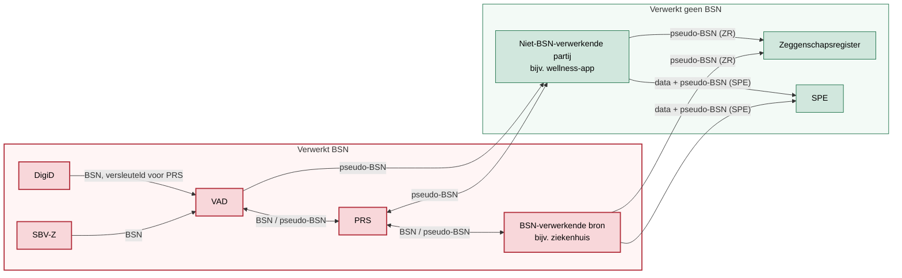
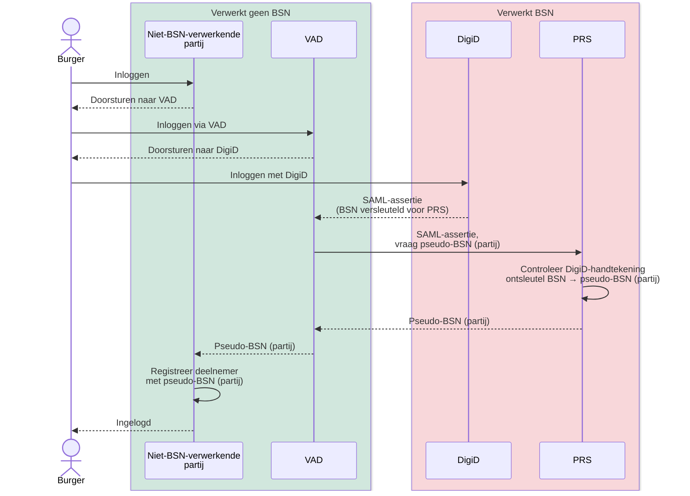
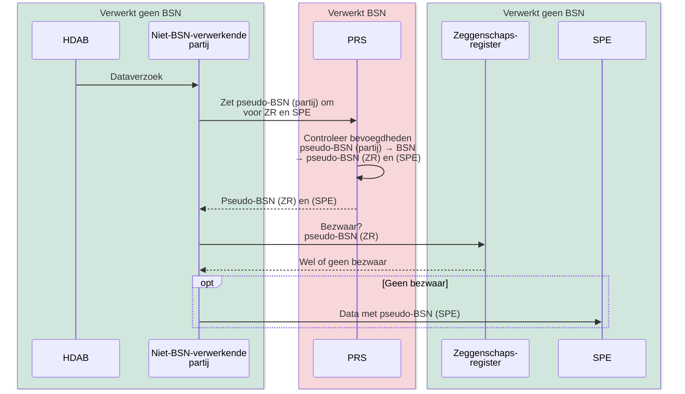
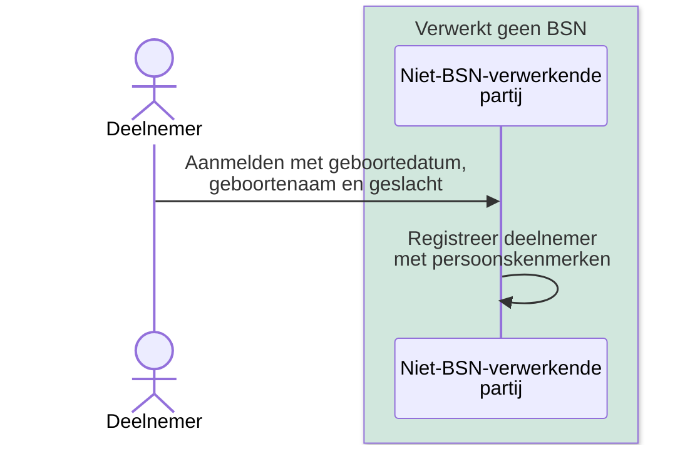
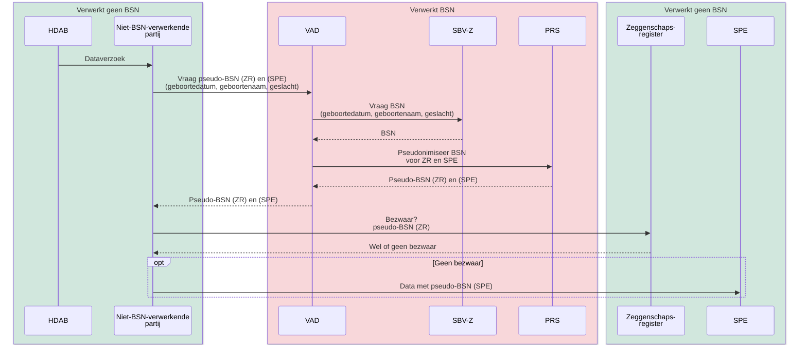
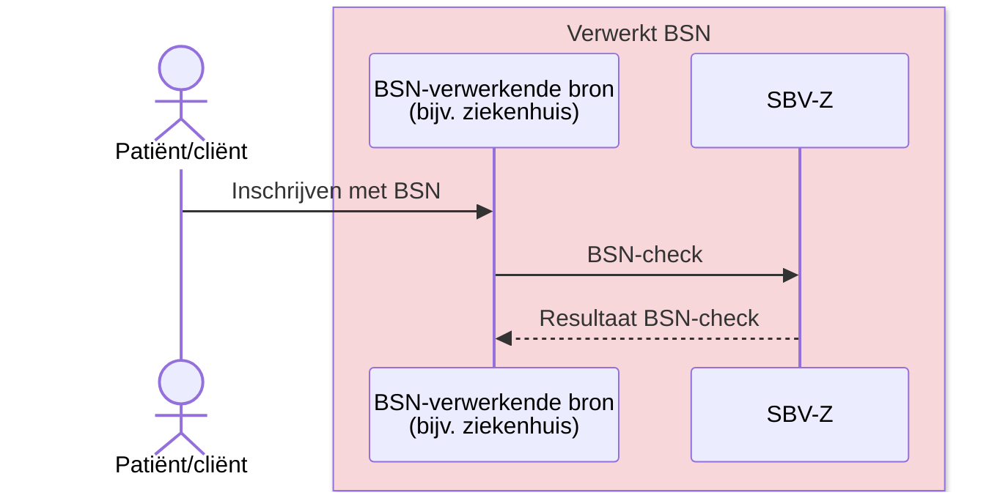
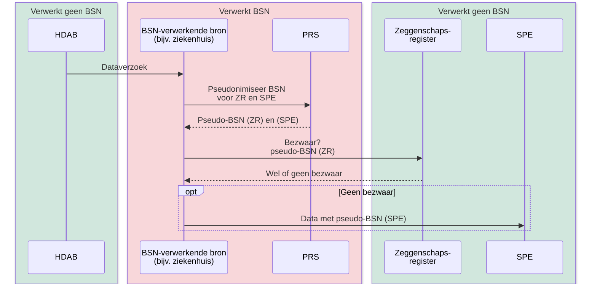
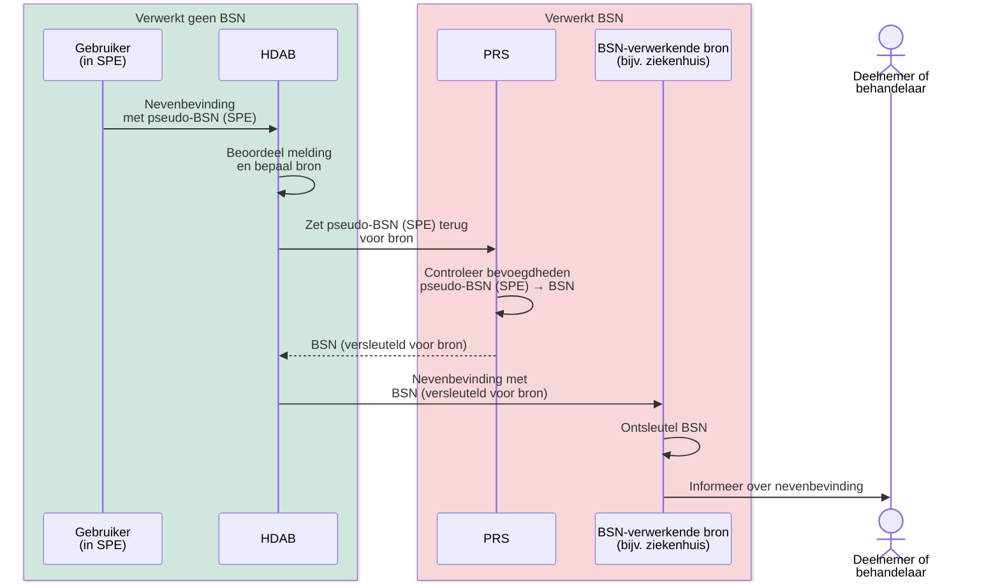

GF Identificatie voor Secundair Gebruik (SG) beschrijft hoe deelnemers bij secundair gebruik van gezondheidsgegevens betrouwbaar geïdentificeerd en over bronnen heen gekoppeld worden met een pseudo-BSN. Partijen die het BSN niet mogen verwerken, krijgen een pseudo-BSN via de Vertrouwde Authenticatiedienst (VAD). BSN-verwerkende bronnen laten het BSN zelf pseudonimiseren. Per communicatiepatroon geeft deze pagina aan welke partijen het BSN verwerken.
{: .ig-lead}

> **Let op:** Deze pagina is een conceptuitwerking. De [aannames](#aannames) zijn nog niet juridisch bevestigd en de communicatiepatronen zijn nog niet technisch gespecificeerd. Zie de [roadmap](#roadmap-voor-gf-identificatie-voor-sg) voor de openstaande punten.

### Scope

Deze pagina beschrijft:
- waarom deelnemers bij secundair gebruik geïdentificeerd en gekoppeld moeten worden;
- de aannames over het BSN en het pseudo-BSN;
- drie communicatiepatronen waarmee een partij of bron een pseudo-BSN verkrijgt, elk met een regulier proces en een datauitgifte aan de SPE;
- de controle van het zeggenschapsregister bij datauitgifte;
- re-identificatie van een deelnemer na een nevenbevinding;
- per patroon welke partijen het BSN verwerken en welke alleen een pseudo-BSN;
- in een [bijlage](#bijlage-omkeerbare-pseudoniemen-in-de-prs) de functies van de PRS voor omkeerbare pseudoniemen, die nog niet in [GF Pseudonymisation](./pseudonymisation.html) staan.

Deze pagina beschrijft niet:
- de cryptografie van de PRS. Zie [GF Pseudonymisation](./pseudonymisation.html) voor de OPRF-functie en de [pseudoniemendienst](https://github.com/minvws/gfmodules-pseudoniemendienst) voor de omkeerbare pseudoniemen;
- de identificatie van patiënten in het zorgproces (primair gebruik);
- de koppelvlakken van DigiD, de SBV-Z, het zeggenschapsregister, de HDAB en de SPE.

### Terminologie

| Term | Betekenis |
|---|---|
| BSN | Burgerservicenummer. |
| Pseudo-BSN | Een omkeerbaar pseudoniem dat de [PRS](#prs) van het BSN maakt voor één ontvanger (organisatie en scope), zoals een partij, het zeggenschapsregister of de SPE. Elke ontvanger krijgt voor dezelfde deelnemer een ander pseudo-BSN. In de diagrammen staat de ontvanger tussen haakjes, bijvoorbeeld pseudo-BSN (SPE). Alleen de PRS kan een pseudo-BSN terugzetten naar het BSN. |
| Secundair gebruik (SG) | Gebruik van gezondheidsgegevens voor andere doelen dan de zorgverlening aan de deelnemer, zoals wetenschappelijk onderzoek. |
| Deelnemer | De burger of patiënt van wie gegevens voor SG worden gebruikt. |
| Bron (bronhouder) | Een partij die gegevens van deelnemers beheert, zoals een ziekenhuis of een register. |
| Gebruiker | Een partij die gegevens voor SG gebruikt, zoals een onderzoeker. De gebruiker verwerkt de gegevens in een SPE. |
| BSN-verwerkende partij | Een partij die het BSN mag verwerken, zoals een zorgaanbieder. |
| Niet-BSN-verwerkende partij | Een partij die het BSN niet mag verwerken, zoals een wellness-app of een onderzoekscohort. Deze partij gebruikt bij SG een pseudo-BSN. |
| Tussenpartij | Een partij die identificerende kenmerken van deelnemers uit meerdere bronnen ontvangt om die bronnen te koppelen. |
| Regulier proces | Het eigen proces waarin een partij of bron de deelnemer registreert, los van SG. Bij een zorgaanbieder is dat het zorgproces. |
| Datauitgifte | Het leveren van gegevens door een partij of bron aan de SPE, na een dataverzoek van de HDAB. |
| Re-identificatie | Het terugvinden van de deelnemer bij een pseudo-BSN, bijvoorbeeld om de deelnemer te informeren over een nevenbevinding. |
| HDAB | Health Data Access Body. Beoordeelt onder de European Health Data Space (EHDS) dataverzoeken voor SG en vraagt partijen en bronnen om gegevens. |
| SPE | Secure Processing Environment, de beveiligde verwerkingsomgeving (EHDS artikel 73). De gebruiker krijgt alleen in de SPE toegang tot uitgegeven gegevens. |
| Zeggenschapsregister (ZR) | Het register waarin de burger vastlegt of hij bezwaar maakt tegen secundair gebruik van zijn gegevens (opt-out, EHDS artikel 71). |
| VAD | Vertrouwde Authenticatiedienst. Laat de burger inloggen met DigiD, of zoekt het BSN op via de SBV-Z, en levert de partij een pseudo-BSN in plaats van het BSN. |
| DigiD | Het inlogmiddel van de overheid voor burgers. Geeft na het inloggen een SAML-assertie terug, met het BSN versleuteld voor de PRS. |
| SBV-Z | Sectorale Berichtenvoorziening in de Zorg. Zorgpartijen gebruiken de SBV-Z om het BSN op te vragen en te controleren. |
| PRS | Pseudoniemendienst (Pseudonym Registration Service). Maakt van een BSN een pseudo-BSN, zet een pseudo-BSN om naar een pseudo-BSN voor een andere ontvanger, en zet een pseudo-BSN terug naar het BSN. Zie [PRS](#prs) en de [bijlage](#bijlage-omkeerbare-pseudoniemen-in-de-prs). |

### Achtergrond

In het zorgproces moet een zorgaanbieder de patiënt identificeren met het BSN en dat BSN controleren (authenticatie). Bij spoed gebeurt dit niet altijd direct.

Bij secundair gebruik is identificatie ook nodig. Identificerende kenmerken van deelnemers worden gebruikt om datasets en registers met gegevens van dezelfde persoon te koppelen. Soms koppelt een tussenpartij twee datasets, partijen of registers. Tussen twee (of drie) partijen kan daarbij dataminimalisatie plaatsvinden.

#### Voorbeeld: koppelen zonder BSN

Een ziekenhuis (bron) levert gegevens aan een onderzoeker (gebruiker). Beide kennen de deelnemer aan andere kenmerken:

| Partij | Identificerende kenmerken van de deelnemer |
|---|---|
| Bron: ziekenhuis | BSN, geboortedatum, NAW, UUID, e-mailadres |
| Gebruiker: onderzoeker | UUID, geboortejaar, woonplaats |

De UUID is uniek per bron. Met de UUID kan de bron de deelnemer her-identificeren, bijvoorbeeld bij een nevenbevinding.

Als de onderzoeker van een andere bron gegevens van dezelfde personen krijgt, kan hij die vaak niet koppelen. Geboortejaar en woonplaats zijn niet uniek identificerend.

Om toch te kunnen koppelen, worden tussenpartijen ingezet. Een tussenpartij slaat geboortedatum, NAW, UUID en e-mailadres van deelnemers uit alle bronnen op, en matcht de kenmerken van verschillende bronnen aan elkaar. Niet elke bron hoeft precies dezelfde kenmerken te hebben. Hoe meer kenmerken een bron van de deelnemer heeft, hoe groter de kans op een match.

#### EHDS

De EHDS ([Verordening (EU) 2025/327](https://eur-lex.europa.eu/eli/reg/2025/327/oj)) noemt in artikel 51, lid 1, zeventien minimumcategorieën van elektronische gezondheidsgegevens voor secundair gebruik. Voorbeelden zijn gegevens uit EPD's, genetische gegevens, gegevens uit registers en gegevens uit biobanken. Lidstaten mogen categorieën toevoegen (artikel 51, lid 2). De categorieën hebben verschillende bronhouders met gegevens van dezelfde deelnemer.

Ook het zeggenschapsregister moet betrouwbaar aan een deelnemer kunnen koppelen. Een burger heeft het recht om bezwaar te maken tegen secundair gebruik van zijn gegevens (artikel 71).

De gebruiker krijgt alleen toegang tot gegevens in een SPE (artikel 73). Volgens artikel 66, lid 3, levert de HDAB gepseudonimiseerde gegevens als het doel niet met geanonimiseerde gegevens te bereiken is. Alleen de HDAB of een vertrouwde derde partij mag de pseudonimisering terugdraaien.

Een gebruiker meldt een nevenbevinding over een deelnemer aan de HDAB (artikel 61, lid 5). De HDAB informeert de bronhouder, en de bronhouder informeert de deelnemer of diens behandelaar (artikel 58, lid 3).

Deze pagina werkt uit hoe het pseudo-BSN als gemeenschappelijk koppelkenmerk kan dienen.

### Aannames

1. Een pseudo-BSN wordt juridisch beschouwd als een nummer, zolang de houder er niet zelfstandig mee kan her-identificeren. Het gebruik ervan vraagt geen aanpassing van wetgeving.
2. Het verwerken van het BSN tot pseudo-BSN, of andersom, vraagt voor SG wel een aanpassing van wetgeving.
3. Het zeggenschapsregister en het lokalisatieregister ([NVI](./localization.html#nvi)) bevatten alleen pseudo-BSN's.

Door aanname 2 is van belang welke partijen het BSN verwerken, in beide richtingen. Deze pagina geeft dat daarom per communicatiepatroon aan.

### Oplossingsoverzicht

Elk communicatiepatroon heeft twee fasen:

1. **Regulier proces:** de partij of bron registreert de deelnemer voor haar eigen doel.
2. **Datauitgifte:** de HDAB stuurt een dataverzoek. De partij of bron haalt twee pseudo-BSN's op: het pseudo-BSN (ZR) en het pseudo-BSN (SPE). Met het pseudo-BSN (ZR) controleert zij in het zeggenschapsregister of de deelnemer bezwaar heeft. Gegevens van deelnemers zonder bezwaar levert zij met het pseudo-BSN (SPE) aan de SPE. Gegevens van deelnemers met bezwaar verlaten de partij of bron niet.

De patronen verschillen in hoe de partij of bron aan de pseudo-BSN's komt:

1. [SG-ID-1](#sg-id-1-pseudo-bsn-via-vad-met-digid): via de VAD, nadat de burger met DigiD heeft ingelogd bij de partij. Bij datauitgifte laat de partij haar eigen pseudo-BSN door de PRS omzetten.
2. [SG-ID-2](#sg-id-2-pseudo-bsn-via-vad-met-persoonskenmerken): via de VAD, op basis van persoonskenmerken en de SBV-Z.
3. [SG-ID-3](#sg-id-3-pseudo-bsn-via-bsn-verwerkende-bron): de BSN-verwerkende bron laat het BSN zelf pseudonimiseren.

[SG-ID-4](#sg-id-4-re-identificatie) beschrijft hoe een pseudo-BSN na een nevenbevinding terugleidt naar de deelnemer.

In alle patronen maakt de PRS van het BSN een omkeerbaar pseudo-BSN. De PRS ontvangt daarvoor het BSN, en kan het pseudo-BSN later omzetten of terugzetten naar het BSN. Daardoor verwerkt de PRS het BSN. Zie [PRS](#prs).

In de diagrammen op deze pagina zijn partijen gekleurd naar wat ze verwerken:
- **rood:** verwerkt het BSN;
- **groen:** verwerkt geen BSN.

Het overzicht hieronder toont hoe het BSN en de pseudo-BSN's tussen de partijen stromen. De VAD staat in het rode kader, omdat zij in SG-ID-2 het BSN verwerkt. In SG-ID-1 stuurt zij het BSN alleen versleuteld door. De HDAB en de BSN-check bij de SBV-Z staan alleen in de [communicatiepatronen](#communicatiepatronen).



### Actoren

| Actor | Rol | Verwerkt BSN | Patronen |
|---|---|---|---|
| [Burger](#burger) | Logt in bij een partij, meldt zich aan bij een partij, of schrijft zich in bij een bron | n.v.t. (eigen BSN) | SG-ID-1 tot en met SG-ID-4 |
| [Niet-BSN-verwerkende partij](#niet-bsn-verwerkende-partij) | Registreert de deelnemer zonder BSN, laat in SG-ID-1 haar pseudo-BSN omzetten, en levert gegevens met pseudo-BSN aan de SPE | Nee | SG-ID-1, SG-ID-2 |
| [BSN-verwerkende bron](#bsn-verwerkende-bron) | Registreert de deelnemer met BSN, levert gegevens met pseudo-BSN aan de SPE en informeert de deelnemer bij een nevenbevinding | **Ja** | SG-ID-3, SG-ID-4 |
| [VAD](#vad) | Laat de burger inloggen met DigiD of zoekt het BSN op via de SBV-Z, en levert pseudo-BSN's | **Ja**, alleen in SG-ID-2 | SG-ID-1, SG-ID-2 |
| [DigiD](#digid) | Authenticeert de burger en geeft het BSN versleuteld voor de PRS terug | **Ja** | SG-ID-1 |
| [SBV-Z](#sbv-z) | Geeft het BSN terug of controleert het | **Ja** | SG-ID-2, SG-ID-3 |
| [PRS](#prs) | Maakt van een BSN een pseudo-BSN, zet pseudo-BSN's om en zet ze terug naar het BSN | **Ja** | SG-ID-1 tot en met SG-ID-4 |
| [Zeggenschapsregister](#zeggenschapsregister) | Geeft aan of de deelnemer bezwaar heeft tegen SG | Nee | SG-ID-1, SG-ID-2, SG-ID-3 |
| [HDAB](#hdab) | Stuurt dataverzoeken en handelt nevenbevindingen af | Nee | SG-ID-1 tot en met SG-ID-4 |
| [SPE](#spe) | Ontvangt gegevens met pseudo-BSN. De gebruiker meldt vanuit de SPE nevenbevindingen | Nee | SG-ID-1 tot en met SG-ID-4 |

#### Burger

De burger is de deelnemer. In SG-ID-1 logt de burger met DigiD in bij een partij. In SG-ID-2 meldt de burger zich met persoonskenmerken aan bij een partij. In SG-ID-3 schrijft de burger zich als patiënt of cliënt in bij een bron. In SG-ID-4 wordt de burger geïnformeerd over een nevenbevinding.

#### Niet-BSN-verwerkende partij

Een bron of andere partij die het BSN niet mag verwerken, zoals een wellness-app of een onderzoekscohort. In het reguliere proces registreert de partij de deelnemer met een eigen pseudo-BSN (SG-ID-1) of met persoonskenmerken (SG-ID-2). Bij datauitgifte heeft de partij het pseudo-BSN (ZR) en het pseudo-BSN (SPE) nodig. In SG-ID-1 laat de partij daarvoor haar eigen pseudo-BSN door de PRS omzetten. De PRS zet een pseudo-BSN alleen om voor de organisatie waaraan het is uitgegeven. In SG-ID-2 krijgt de partij de pseudo-BSN's via de VAD. In SG-ID-2 verwerkt de partij wel andere identificerende kenmerken: geboortedatum, geboortenaam en geslacht.

#### BSN-verwerkende bron

Een partij die het BSN mag verwerken, zoals een zorgaanbieder. De bron heeft het BSN vanuit het zorgproces. Bij datauitgifte laat de bron het BSN via de PRS omzetten naar het pseudo-BSN (ZR) en het pseudo-BSN (SPE). Bij een nevenbevinding ontvangt de bron het BSN van de deelnemer en informeert zij de deelnemer of diens behandelaar (SG-ID-4). Volgens [aanname 2](#aannames) vragen deze omzettingen een aanpassing van wetgeving.

#### VAD

De Vertrouwde Authenticatiedienst levert een niet-BSN-verwerkende partij een pseudo-BSN. De partij ontvangt nooit het BSN.
- In SG-ID-1 logt de burger via de VAD in met DigiD. De VAD stuurt de SAML-assertie van DigiD door naar de PRS. Het BSN in die assertie is versleuteld voor de PRS, dus de VAD kan het niet lezen.
- In SG-ID-2 vraagt de VAD met persoonskenmerken het BSN op bij de SBV-Z, en laat de PRS er pseudo-BSN's van maken. Hier verwerkt de VAD het BSN. Volgens [aanname 2](#aannames) vraagt dat een aanpassing van wetgeving.

#### DigiD

DigiD authenticeert de burger en geeft de VAD een SAML-assertie, met het BSN versleuteld voor de PRS.

#### SBV-Z

De SBV-Z geeft bij persoonskenmerken het BSN aan de VAD (SG-ID-2), en controleert het BSN voor de bron (SG-ID-3).

#### PRS

De pseudoniemendienst (PRS) heeft twee soorten functies:
- **OPRF-evaluatie** ([GF-PSD-1](./pseudonymisation.html#gf-psd-1-evaluate-blinded-input)): de invoer is geblindeerd, de PRS ziet het BSN niet, en het resultaat is niet omkeerbaar. De [NVI](./localization.html#nvi) gebruikt deze functie.
- **Uitwisselfuncties voor omkeerbare pseudoniemen:** de PRS ontvangt het BSN en maakt er een pseudo-BSN van voor één ontvanger. Later kan de PRS dat pseudo-BSN omzetten naar een pseudo-BSN voor een andere ontvanger (SG-ID-1, datauitgifte), of terugzetten naar het BSN (SG-ID-4). Deze functies staan nog niet in [GF Pseudonymisation](./pseudonymisation.html). Zie de [bijlage](#bijlage-omkeerbare-pseudoniemen-in-de-prs).

SG gebruikt de uitwisselfuncties. De twee soorten functies gebruiken verschillende sleutels. Een OPRF-pseudoniem van de NVI komt daarom niet overeen met een pseudo-BSN voor SG.

Daarmee verwerkt de PRS het BSN:
- De PRS ontvangt het BSN, niet geblindeerd, als een partij of bron er een pseudo-BSN van laat maken. In SG-ID-1 ontsleutelt de PRS het BSN zelf uit de SAML-assertie van DigiD.
- Alleen de PRS kan een pseudo-BSN terugzetten naar het BSN. De sleutels staan in een HSM van de PRS. Volgens EHDS artikel 66, lid 3, mag die mogelijkheid alleen bij de HDAB of een vertrouwde derde partij liggen.

#### Zeggenschapsregister

Het zeggenschapsregister legt vast of een deelnemer bezwaar heeft tegen SG. Het register bevat alleen pseudo-BSN's ([aanname 3](#aannames)). Bij datauitgifte vraagt een partij of bron met het pseudo-BSN (ZR) of de deelnemer bezwaar heeft. Als de burger zelf zijn keuze vastlegt, is het zeggenschapsregister de niet-BSN-verwerkende partij uit SG-ID-1.

#### HDAB

De Health Data Access Body stuurt dataverzoeken aan partijen en bronnen. Bij een nevenbevinding laat de HDAB het pseudo-BSN (SPE) door de PRS terugzetten, en informeert zij de bron (SG-ID-4). De PRS zet een pseudo-BSN alleen terug voor de organisatie waaraan het is uitgegeven. Het pseudo-BSN (SPE) is daarom uitgegeven aan de HDAB, met de SPE als scope. De HDAB biedt de SPE aan (EHDS artikel 73). De HDAB ontvangt het BSN alleen versleuteld voor de bron, en kan het niet lezen.

#### SPE

De Secure Processing Environment ontvangt gegevens met het pseudo-BSN (SPE). Met dit pseudo-BSN koppelt de gebruiker gegevens van verschillende partijen en bronnen. De gebruiker meldt een nevenbevinding met het pseudo-BSN (SPE) aan de HDAB.

### Communicatiepatronen

De diagrammen groeperen de partijen in gekleurde kaders. Het rode kader **Verwerkt BSN** toont de partijen die in dat patroon het BSN verwerken.

#### SG-ID-1: Pseudo-BSN via VAD met DigiD

Een burger logt met DigiD in bij een niet-BSN-verwerkende partij, bijvoorbeeld een wellness-app.

##### Regulier proces

1. De burger logt in bij de partij.
2. De partij stuurt de burger door naar de VAD, en de VAD stuurt de burger door naar DigiD.
3. De burger logt in met DigiD. DigiD geeft de VAD een SAML-assertie, met het BSN versleuteld voor de PRS. De VAD kan het BSN niet lezen.
4. De VAD stuurt de SAML-assertie naar de PRS, en vraagt om het pseudo-BSN (partij).
5. De PRS controleert de handtekening van DigiD, ontsleutelt het BSN en maakt het pseudo-BSN (partij).
6. De VAD geeft het pseudo-BSN (partij) aan de partij. De partij registreert de deelnemer met dit pseudo-BSN.

> **Let op:** De PRS biedt deze SAML-uitwisseling (`/saml-exchange/reversible-pseudonym`) nu nog alleen als mock aan. Zie de [bijlage](#bijlage-omkeerbare-pseudoniemen-in-de-prs).



##### Datauitgifte

1. De HDAB stuurt een dataverzoek aan de partij.
2. De partij vraagt de PRS om haar pseudo-BSN (partij) om te zetten naar het pseudo-BSN (ZR) en het pseudo-BSN (SPE).
3. De PRS controleert de bevoegdheden, zet het pseudo-BSN (partij) intern terug naar het BSN, en maakt daarvan het pseudo-BSN (ZR) en het pseudo-BSN (SPE). De partij ziet het BSN niet.
4. De partij vraagt het zeggenschapsregister met het pseudo-BSN (ZR) of de deelnemer bezwaar heeft.
5. Als de deelnemer geen bezwaar heeft, levert de partij de gegevens met het pseudo-BSN (SPE) aan de SPE.



**BSN-verwerkers:** DigiD en PRS. De VAD stuurt het BSN alleen versleuteld door. In de datauitgifte verwerkt alleen de PRS het BSN.

#### SG-ID-2: Pseudo-BSN via VAD met persoonskenmerken

Een niet-BSN-verwerkende partij kent de deelnemer alleen aan persoonskenmerken, bijvoorbeeld een onderzoekscohort.

##### Regulier proces

1. De deelnemer meldt zich aan bij de partij.
2. De partij registreert de deelnemer met geboortedatum, geboortenaam en geslacht. De partij heeft geen BSN en geen pseudo-BSN nodig.



##### Datauitgifte

1. De HDAB stuurt een dataverzoek aan de partij.
2. De partij vraagt de VAD om het pseudo-BSN (ZR) en het pseudo-BSN (SPE). De partij stuurt geboortedatum, geboortenaam en geslacht van de deelnemer mee.
3. De VAD vraagt met deze kenmerken het BSN op bij de SBV-Z.
4. De VAD laat het BSN via de PRS omzetten naar het pseudo-BSN (ZR) en het pseudo-BSN (SPE).
5. De VAD geeft beide pseudo-BSN's aan de partij.
6. De partij vraagt het zeggenschapsregister met het pseudo-BSN (ZR) of de deelnemer bezwaar heeft.
7. Als de deelnemer geen bezwaar heeft, levert de partij de gegevens met het pseudo-BSN (SPE) aan de SPE.



**BSN-verwerkers:** SBV-Z, VAD en PRS, alleen in de datauitgifte.

#### SG-ID-3: Pseudo-BSN via BSN-verwerkende bron

Een BSN-verwerkende bron, zoals een zorgaanbieder, heeft het BSN al vanuit het zorgproces.

##### Regulier proces

Het reguliere proces is het zorgproces:

1. De patiënt of cliënt schrijft zich in bij de bron met BSN.
2. De bron controleert het BSN via de SBV-Z.



##### Datauitgifte

1. De HDAB stuurt een dataverzoek aan de bron.
2. De bron laat het BSN via de PRS omzetten naar het pseudo-BSN (ZR) en het pseudo-BSN (SPE).
3. De bron vraagt het zeggenschapsregister met het pseudo-BSN (ZR) of de deelnemer bezwaar heeft.
4. Als de deelnemer geen bezwaar heeft, levert de bron de gegevens met het pseudo-BSN (SPE) aan de SPE.

Stap 2 vraagt volgens [aanname 2](#aannames) een aanpassing van wetgeving.



**BSN-verwerkers:** BSN-verwerkende bron, SBV-Z en PRS.

#### SG-ID-4: Re-identificatie

Een gebruiker vindt in de SPE een nevenbevinding over een deelnemer. Volgens de EHDS meldt de gebruiker die aan de HDAB, informeert de HDAB de bron, en informeert de bron de deelnemer of diens behandelaar (zie [EHDS](#ehds)). Daarvoor moet het pseudo-BSN (SPE) terugleiden naar de deelnemer.

1. De gebruiker meldt de nevenbevinding met het pseudo-BSN (SPE) aan de HDAB.
2. De HDAB beoordeelt de melding en bepaalt welke bron de deelnemer moet informeren.
3. De HDAB vraagt de PRS om het pseudo-BSN (SPE) terug te zetten naar het BSN, met de bron als ontvanger. Dat kan omdat het pseudo-BSN (SPE) aan de HDAB is uitgegeven (zie [HDAB](#hdab)).
4. De PRS controleert of de HDAB het BSN mag aanvragen en of de bron het mag ontvangen. De PRS zet het pseudo-BSN (SPE) terug en geeft het BSN terug, versleuteld voor de bron.
5. De HDAB stuurt de nevenbevinding met het versleutelde BSN naar de bron.
6. De bron ontsleutelt het BSN en informeert de deelnemer of diens behandelaar.

Is de bron een niet-BSN-verwerkende partij, dan zet de PRS het pseudo-BSN (SPE) om naar het pseudo-BSN (partij) in plaats van naar het BSN.



**BSN-verwerkers:** PRS en BSN-verwerkende bron.

#### Overzicht: wie verwerkt het BSN?

| Partij | SG-ID-1 (VAD met DigiD) | SG-ID-2 (VAD met persoonskenmerken) | SG-ID-3 (bron) | SG-ID-4 (re-identificatie) |
|---|---|---|---|---|
| DigiD | **BSN** | – | – | – |
| SBV-Z | – | **BSN** | **BSN** | – |
| VAD | versleuteld BSN | **BSN** | – | – |
| PRS | **BSN** | **BSN** | **BSN** | **BSN** |
| BSN-verwerkende bron | – | – | **BSN** | **BSN** |
| Niet-BSN-verwerkende partij | pseudo-BSN | persoonskenmerken, pseudo-BSN | – | – |
| Zeggenschapsregister | pseudo-BSN | pseudo-BSN | pseudo-BSN | – |
| HDAB | – | – | – | pseudo-BSN, versleuteld BSN |
| SPE | pseudo-BSN | pseudo-BSN | pseudo-BSN | pseudo-BSN |

Het zeggenschapsregister en de NVI bevatten volgens [aanname 3](#aannames) alleen pseudo-BSN's.

### Privacy- en beveiligingsoverwegingen

- **Verzameling identificerende gegevens:** een verzameling identificerende gegevens (wie is bekend bij welke bron) is een interessant doelwit voor kwaadwillenden. Dat geldt voor een tussenpartij die kenmerken uit alle bronnen opslaat. Ook de VAD ziet voor welke partij een pseudo-BSN wordt gemaakt.
- **PRS als sleutelhouder:** de PRS kan elk pseudo-BSN terugzetten naar het BSN. De PRS voert daarom een dubbele bevoegdheidscontrole uit: de aanvrager moet het gevraagde type mogen aanvragen, en de ontvanger moet het mogen ontvangen. De beheerders van de PRS stellen deze bevoegdheden in, niet de organisaties zelf. De PRS logt elke omzetting met de betrokken organisaties, maar niet het BSN of het pseudo-BSN.
- **Zeggenschapsregister:** bij elke controle ziet het zeggenschapsregister welke partij of bron naar welk pseudo-BSN (ZR) vraagt. Het register kan daarmee afleiden welke deelnemers bij welke partij of bron bekend zijn.
- **Bezwaar blijft bij de bron:** de partij of bron controleert het zeggenschapsregister vóór levering. Gegevens van deelnemers met bezwaar verlaten de partij of bron niet.
- **Andere identificerende kenmerken:** in SG-ID-2 stuurt de partij geboortedatum, geboortenaam en geslacht naar de VAD. Deze kenmerken zijn geen BSN, maar wel identificerend.
- **Versleuteld BSN bij de VAD en de HDAB:** in SG-ID-1 stuurt de VAD het BSN door, versleuteld voor de PRS. In SG-ID-4 stuurt de HDAB het BSN door, versleuteld voor de bron. Beide kunnen het BSN niet lezen.

### Roadmap voor GF Identificatie voor SG

#### Openstaande punten

- **Juridische bevestiging.** De [aannames](#aannames) moeten nog juridisch worden bevestigd.
- **Wettelijke grondslag.** De VAD, de bron en de PRS hebben een grondslag nodig om het BSN voor SG om te zetten naar een pseudo-BSN, en terug.
- **Versleuteld BSN.** Geldt het doorsturen van een versleuteld BSN door de VAD (SG-ID-1) en de HDAB (SG-ID-4) als verwerking van het BSN?
- **Vertrouwde derde partij.** Is de PRS de vertrouwde derde partij uit EHDS artikel 66, lid 3, of vervult de HDAB die rol zelf?
- **PRS in GF Pseudonymisation.** De uitwisselfuncties van de PRS moeten worden beschreven in [GF Pseudonymisation](./pseudonymisation.html). Deze pagina beschrijft ze voorlopig in de [bijlage](#bijlage-omkeerbare-pseudoniemen-in-de-prs).
- **DigiD SAML-uitwisseling.** De SAML-uitwisseling van de PRS is nog een mock. Totdat die beschikbaar is, ontvangt de VAD in SG-ID-1 het BSN zelf van DigiD.
- **Sleutelrotatie.** Een pseudo-BSN hangt af van de sleutelversie van de ontvanger. Na een rotatie maakt de PRS van hetzelfde BSN een ander pseudo-BSN. Na het vernietigen van een sleutelversie kan de PRS een oud pseudo-BSN niet meer omzetten of terugzetten. Dat raakt partijen en registers die pseudo-BSN's lang bewaren, zoals het zeggenschapsregister.
- **Logging.** Er zijn nog geen eisen aan logging bij de VAD, de PRS en het zeggenschapsregister.
- **Scope van het pseudo-BSN (SPE).** Wordt het pseudo-BSN (SPE) per SPE of per datavergunning aan de HDAB uitgegeven? Binnen één datavergunning moet het voor alle partijen en bronnen gelijk zijn, anders kan de gebruiker niet koppelen.
- **Nevenbevinding bij meerdere bronnen.** Welke bron informeert de HDAB als de gegevens van de deelnemer uit meerdere bronnen komen?
- **BSN-verwerkende bronhouders.** Welke bronhouders van de EHDS-datacategorieën (artikel 51) zijn BSN-verwerkend (SG-ID-3), en welke niet (SG-ID-1 of SG-ID-2)?
- **Tussenpartijen.** Welke rol houden tussenpartijen naast het pseudo-BSN?

### Bijlage: omkeerbare pseudoniemen in de PRS

Deze bijlage beschrijft de functies van de [pseudoniemendienst](https://github.com/minvws/gfmodules-pseudoniemendienst) die deze pagina gebruikt. De functies staan nog niet in [GF Pseudonymisation](./pseudonymisation.html). De bron is de documentatie van de pseudoniemendienst: [endpoints](https://github.com/minvws/gfmodules-pseudoniemendienst/blob/main/docs/endpoints.md), [cryptografie](https://github.com/minvws/gfmodules-pseudoniemendienst/blob/main/docs/component-crypto.md) en [vertrouwensmodel](https://github.com/minvws/gfmodules-pseudoniemendienst/blob/main/docs/trust-model.md).

#### Functies

| Functie | Invoer | Resultaat voor de ontvanger | Gebruikt in |
|---|---|---|---|
| `POST /oprf/eval` | Geblindeerde invoer | OPRF-evaluatie, niet omkeerbaar | NVI ([GF-PSD-1](./pseudonymisation.html#gf-psd-1-evaluate-blinded-input)) |
| `POST /saml-exchange/reversible-pseudonym` | SAML-assertie van DigiD, versleuteld voor de PRS | Omkeerbaar pseudoniem. Nu nog een mock, die geen pseudoniem maakt. | SG-ID-1, regulier proces |
| `POST /exchange/reversible-pseudonym` | BSN, of een omkeerbaar pseudoniem van de aanvrager | Omkeerbaar pseudoniem | SG-ID-1 (datauitgifte), SG-ID-2, SG-ID-3 |
| `POST /exchange/irreversible-pseudonym` | BSN, of een omkeerbaar pseudoniem van de aanvrager | Niet-omkeerbaar pseudoniem | – |
| `POST /exchange/personal-id` | Omkeerbaar pseudoniem van de aanvrager | BSN | SG-ID-4 |

Elk verzoek noemt de ontvanger met `recipientOrganization` (een OIN) en `recipientScope`. De PRS geeft het resultaat terug als JWE, versleuteld voor de ontvanger.

#### Voorbeelden

Een pseudo-BSN maken van een BSN (SG-ID-2 en SG-ID-3), hier voor het zeggenschapsregister:

```
POST [prs-base-url]/exchange/reversible-pseudonym HTTP/1.1
Content-Type: application/json

{
  "personalId": "NL:bsn:950000012",
  "recipientOrganization": "oin:<OIN van het zeggenschapsregister>",
  "recipientScope": "<scope van het zeggenschapsregister>"
}
```

Een pseudo-BSN omzetten (SG-ID-1, datauitgifte), hier naar het pseudo-BSN (SPE):

```
POST [prs-base-url]/exchange/reversible-pseudonym HTTP/1.1
Content-Type: application/json

{
  "reversiblePseudonym": "pseudonym:reversible:AQAB...",
  "recipientOrganization": "oin:<OIN van de HDAB>",
  "recipientScope": "<scope van de SPE>"
}
```

Een pseudo-BSN terugzetten naar het BSN (SG-ID-4):

```
POST [prs-base-url]/exchange/personal-id HTTP/1.1
Content-Type: application/json

{
  "reversiblePseudonym": "pseudonym:reversible:AQAB...",
  "recipientOrganization": "oin:<OIN van de bron>",
  "recipientScope": "<scope van de bron>"
}
```

De PRS antwoordt met `201 Created` en `Content-Type: application/jwe`. De ontsleutelde `subject`-claim is `pseudonym:reversible:<...>`, met de sleutelversie in `keyVersion`. Bij `/exchange/personal-id` is de `subject`-claim het BSN, bijvoorbeeld `NL:bsn:950000012`.

#### Omkeerbaar pseudoniem

- Het pseudoniem is een versleuteling (AES-256-CBC) van `<BSN> | oin:<ontvanger> | <scope>`. De sleutels horen bij de ontvanger en een sleutelversie, en staan in een HSM.
- De IV is afgeleid met een dubbele HMAC van dezelfde invoer. Daardoor is het pseudoniem deterministisch: hetzelfde BSN geeft voor dezelfde ontvanger, scope en sleutelversie steeds hetzelfde pseudoniem.
- Het pseudoniem bevat de sleutelversie. Alleen de PRS kan het terugzetten. Na het vernietigen van een sleutelversie kan dat niet meer (`410 Gone`).

#### Regels

- **Alleen voor de eigen organisatie:** de PRS zet een omkeerbaar pseudoniem alleen om of terug voor de organisatie waaraan het is uitgegeven. Dat is de vertegenwoordigde organisatie in het verzoek (`x-gf-sub`). Bij het omzetten krijgt de aanvrager het BSN niet te zien.
- **Dubbele bevoegdheidscontrole:** de aanvrager moet het type resultaat (omkeerbaar pseudoniem, niet-omkeerbaar pseudoniem of BSN) mogen aanvragen, en de ontvanger moet het mogen ontvangen. De beheerders van de PRS stellen deze bevoegdheden in, niet de organisaties zelf.
- **Versleuteld voor de ontvanger:** het resultaat is een JWE (`RSA-OAEP`, `A256GCM`) voor de publieke sleutel die de ontvanger voor de scope heeft geregistreerd. Een aanvrager die niet zelf de ontvanger is, kan het resultaat doorsturen maar niet lezen.
- **Authenticatie:** een OIN-verifier vóór de PRS authenticeert de aanvrager met mTLS en een access token. De OIN-verifier geeft de vertegenwoordigde organisatie (`x-gf-sub`) en de handelende organisatie (`x-gf-act-sub`) door aan de PRS. De uitwisselfuncties vragen de scope `prs:pseudonym`.
- **Logging:** de PRS logt elke omzetting met de handelende, vertegenwoordigde en ontvangende organisatie, de scope en de sleutelversie. Het BSN en het pseudoniem staan niet in de log.
- **Geen koppeling met OPRF:** omkeerbare pseudoniemen gebruiken andere sleutels dan de OPRF-evaluatie. Ze komen niet overeen met de OPRF-pseudoniemen van de NVI.

#### Toepassing in de communicatiepatronen

| Patroon | Fase | Functie | Aanvrager | Invoer | Ontvanger |
|---|---|---|---|---|---|
| SG-ID-1 | Regulier proces | `/saml-exchange/reversible-pseudonym` | VAD | SAML-assertie van DigiD | Partij |
| SG-ID-1 | Datauitgifte | `/exchange/reversible-pseudonym`, twee keer | Partij | Pseudo-BSN (partij) | Zeggenschapsregister; HDAB met scope SPE |
| SG-ID-2 | Datauitgifte | `/exchange/reversible-pseudonym`, twee keer | VAD | BSN | Zeggenschapsregister; HDAB met scope SPE |
| SG-ID-3 | Datauitgifte | `/exchange/reversible-pseudonym`, twee keer | Bron | BSN | Zeggenschapsregister; HDAB met scope SPE |
| SG-ID-4 | Re-identificatie | `/exchange/personal-id` | HDAB | Pseudo-BSN (SPE) | Bron |
| SG-ID-4 | Re-identificatie bij een niet-BSN-verwerkende partij | `/exchange/reversible-pseudonym` | HDAB | Pseudo-BSN (SPE) | Partij |
