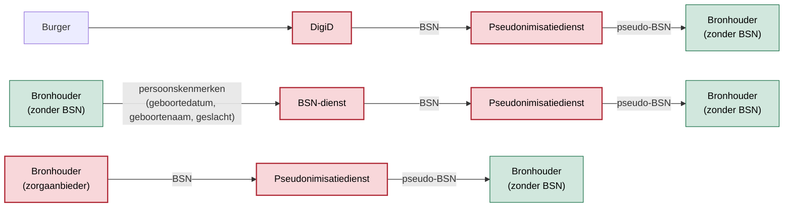
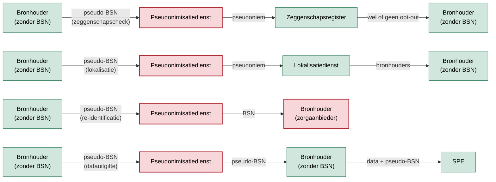
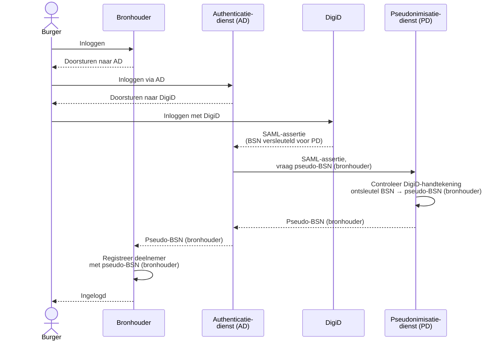
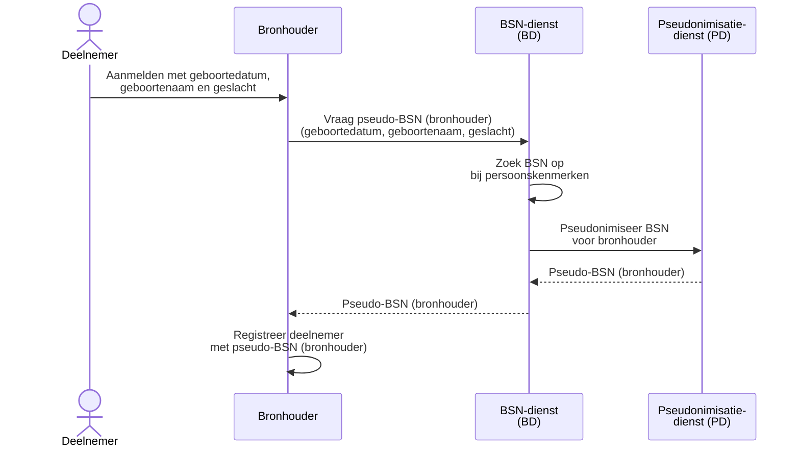
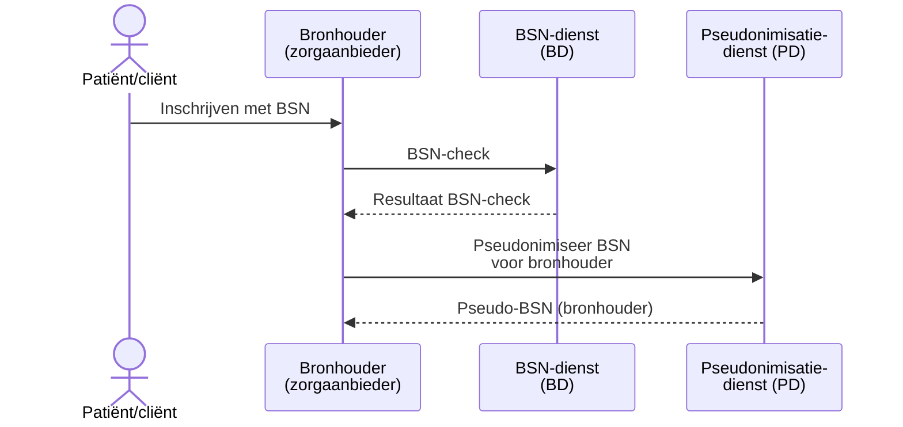
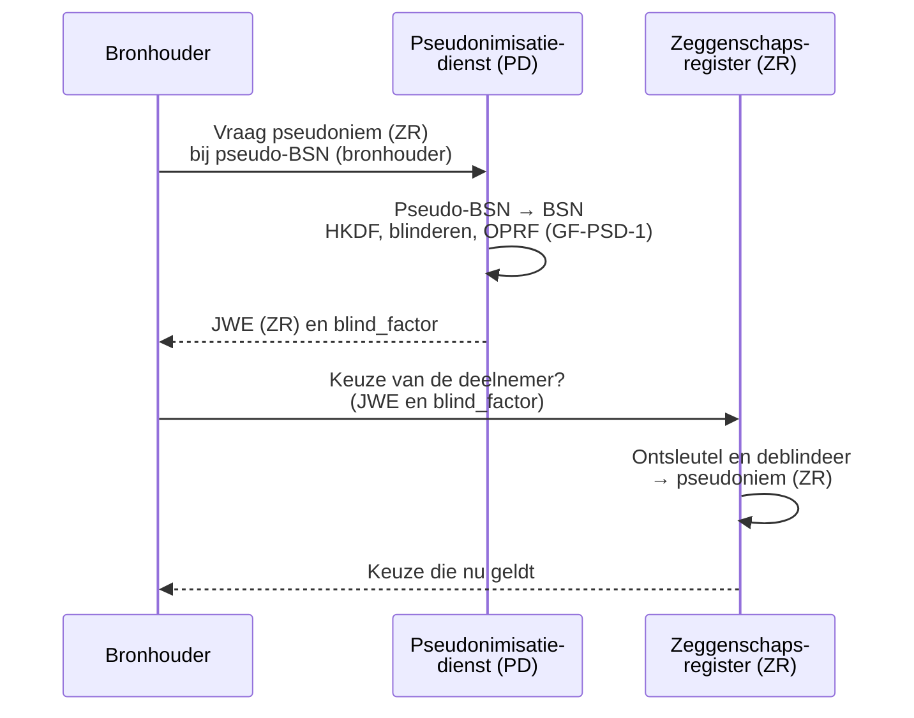
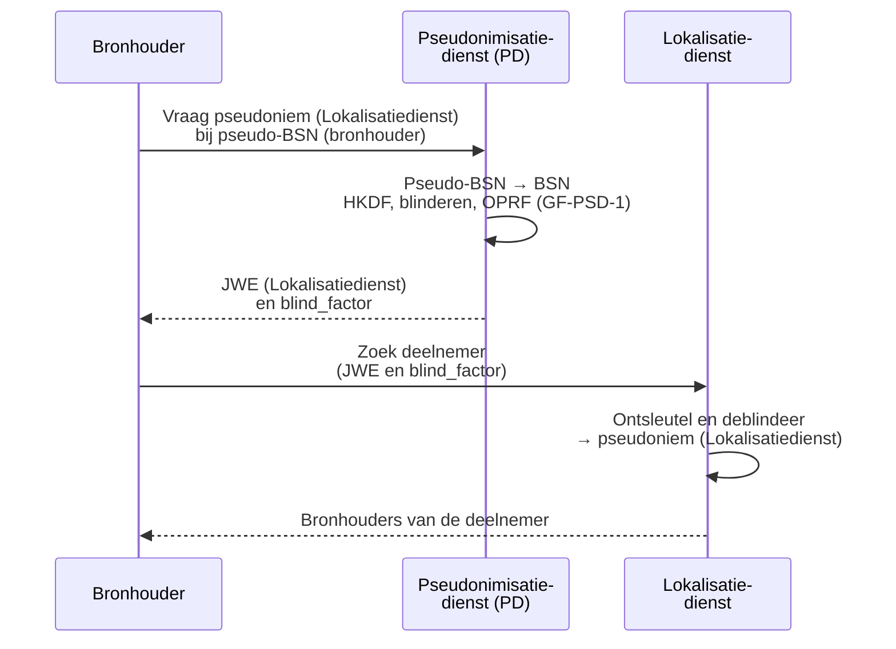
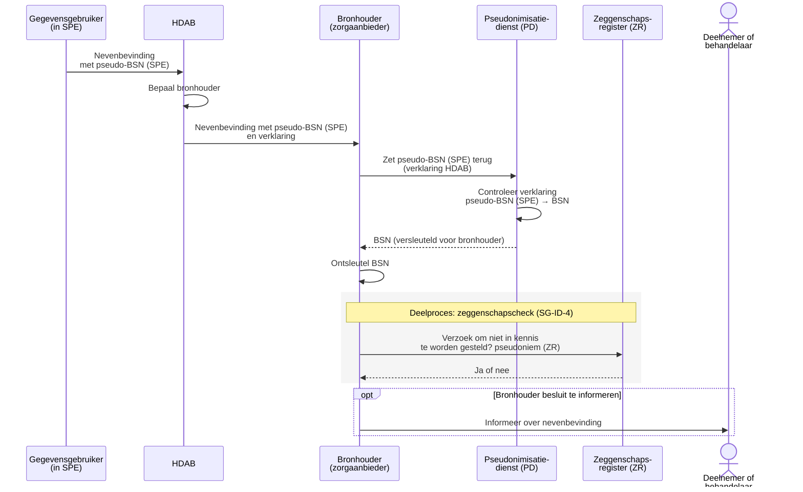
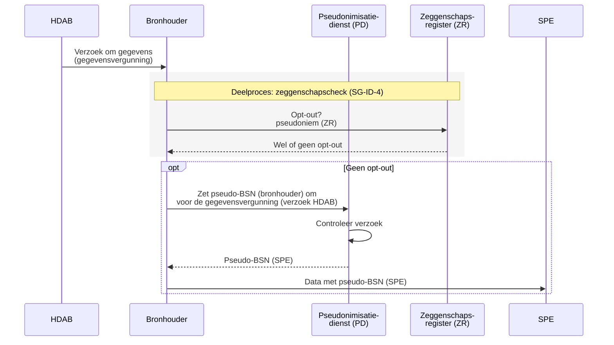

GF Identificatie voor Secundair Gebruik (SG) beschrijft hoe deelnemers bij secundair gebruik van gezondheidsgegevens betrouwbaar geïdentificeerd en over bronnen heen gekoppeld worden met een pseudo-BSN. Bronhouders die het BSN niet mogen verwerken, verkrijgen een pseudo-BSN via een vertrouwde authenticatiedienst (AD) of een vertrouwde BSN-dienst (BD); BSN-verwerkende bronhouders laten het BSN zelf pseudonimiseren. Het pseudo-BSN wordt daarna gebruikt voor de zeggenschapscheck, lokalisatie, re-identificatie bij een nevenbevinding en datauitgifte met een pseudo-BSN. Deze pagina werkt de [ontwerpbeslissingen](./identification-sg-ontwerpbeslissingen.html) uit in communicatiepatronen, en geeft per patroon aan welke partijen het BSN verwerken.
{: .ig-lead}

> **Let op:** Deze pagina is een conceptuitwerking. De [aannames](./identification-sg-ontwerpbeslissingen.html#aannames) zijn nog niet juridisch bevestigd en de communicatiepatronen zijn nog niet technisch gespecificeerd. Zie de [roadmap](#roadmap-voor-gf-identificatie-voor-sg) voor de openstaande punten.

### Scope

Deze pagina beschrijft:
- waarom deelnemers bij secundair gebruik geïdentificeerd en gekoppeld moeten worden;
- drie communicatiepatronen waarmee een bronhouder een eigen pseudo-BSN verkrijgt;
- vier use-cases voor het gebruik van dat pseudo-BSN: de zeggenschapscheck, lokalisatie, re-identificatie bij een nevenbevinding en datauitgifte met een pseudo-BSN;
- per patroon welke partijen het BSN verwerken en welke alleen een pseudo-BSN;
- in een [bijlage](#bijlage-omkeerbare-pseudoniemen-in-de-pd) een voorbeeldimplementatie van functies voor omkeerbare pseudoniemen, die nog niet in [GF Pseudonymisation](./pseudonymisation.html) staan.

Deze pagina beschrijft niet:
- de ontwerpbeslissingen, de aannames, de begrippen, de onderzochte alternatieven (zoals ZorgTTP) en de toetsing aan de EHDS. Die staan in [Identificatie voor Secundair Gebruik: ontwerpbeslissingen](./identification-sg-ontwerpbeslissingen.html);
- de cryptografie van pseudonimisering. Zie [GF Pseudonymisation](./pseudonymisation.html) voor de OPRF-functie en de [pseudoniemendienst](https://github.com/minvws/gfmodules-pseudoniemendienst) als voorbeeld voor omkeerbare pseudoniemen;
- de identificatie van patiënten in het zorgproces (primair gebruik);
- het datauitgifteproces zelf, zoals het aanvragen en verlenen van gegevensvergunningen; deze pagina beschrijft alleen het gebruik van het pseudo-BSN daarbij;
- de koppelvlakken van DigiD, de BD, het zeggenschapsregister, de Lokalisatiedienst, de HDAB en de SPE.

De genoemde diensten beschrijven rollen in de patronen, geen verplichte keuze voor een specifieke implementatie. Een implementatie moet wel de benodigde functies en bevoegdheden bieden. De bijlage beschrijft één mogelijke invulling van de pseudonimisatiedienst.

### Terminologie

De begrippen op deze pagina, zoals bronhouder, pseudo-BSN, AD, BD, PD en zeggenschapsregister, staan in de [begrippen](./identification-sg-ontwerpbeslissingen.html#begrippen) van de ontwerpbeslissingen.

### Achtergrond

In het zorgproces moet een zorgaanbieder de patiënt identificeren met het BSN en dat BSN controleren (authenticatie). Bij spoed gebeurt dit niet altijd direct.

Bij secundair gebruik is identificatie ook nodig. Identificerende kenmerken van deelnemers worden gebruikt om datasets en registers met gegevens van dezelfde persoon te koppelen. Nu gebeurt dat vaak met persoonskenmerken, soms via een tussenpartij die de kenmerken uit meerdere bronnen bewaart en aan elkaar matcht. Dat koppelt niet altijd betrouwbaar, en de tussenpartij houdt een verzameling bij van wie bij welke bron bekend is. [GF-ID-ADR-1](./identification-sg-ontwerpbeslissingen.html#gf-id-adr-1-waarmee-wordt-gekoppeld) weegt de alternatieven en licht toe waarom het pseudo-BSN het koppelkenmerk is.

#### EHDS

De EHDS ([Verordening (EU) 2025/327](https://eur-lex.europa.eu/eli/reg/2025/327/oj)) noemt in artikel 51, lid 1, zeventien minimumcategorieën van elektronische gezondheidsgegevens voor secundair gebruik. Voorbeelden zijn gegevens uit EPD's, genetische gegevens, gegevens uit registers en gegevens uit biobanken. Lidstaten mogen categorieën toevoegen (artikel 51, lid 2). De categorieën hebben verschillende bronhouders met gegevens van dezelfde deelnemer.

Ook het zeggenschapsregister moet betrouwbaar aan een deelnemer kunnen koppelen. Een burger heeft het recht op een opt-out voor secundair gebruik van zijn gegevens (artikel 71).

De gegevensgebruiker krijgt alleen toegang tot gegevens in een SPE (artikel 73). Volgens artikel 66, lid 3, levert de HDAB gepseudonimiseerde gegevens als het doel niet met geanonimiseerde gegevens te bereiken is. Alleen de HDAB of een vertrouwde derde partij mag de pseudonimisering terugdraaien.

Een gegevensgebruiker meldt een nevenbevinding over een deelnemer aan de HDAB (artikel 61, lid 5). De HDAB informeert de bronhouder, en de bronhouder informeert de deelnemer of diens behandelaar (artikel 58, lid 3).

Deze pagina werkt uit hoe het pseudo-BSN als gemeenschappelijk koppelkenmerk kan dienen. De patronen gaan uit van de [aannames](./identification-sg-ontwerpbeslissingen.html#aannames) in de ontwerpbeslissingen. Omdat het verwerken van het BSN voor SG een aanpassing van wetgeving vraagt (aanname 2), geeft deze pagina per patroon aan welke partijen het BSN verwerken.

### Oplossingsoverzicht

Een bronhouder verkrijgt één keer een eigen pseudo-BSN (bronhouder), via een van drie patronen:

1. [SG-ID-1](#sg-id-1-pseudo-bsn-via-ad-met-digid): via de AD, nadat de burger via DigiD heeft ingelogd bij de bronhouder.
2. [SG-ID-2](#sg-id-2-pseudo-bsn-via-bd-met-persoonskenmerken): via de BD, op basis van persoonskenmerken. Voor bestaande datasets gebeurt dit bij de uitgifte.
3. [SG-ID-3](#sg-id-3-pseudo-bsn-via-bsn-verwerkende-bronhouder): de BSN-verwerkende bronhouder laat het BSN zelf pseudonimiseren.

Daarna gebruikt de bronhouder dat pseudo-BSN in vier use-cases. De PD zet het per use-case om naar het pseudoniem voor de ontvanger; de bronhouder ziet daarbij het BSN niet:

4. [SG-ID-4](#sg-id-4-zeggenschapscheck): de zeggenschapscheck, als deelproces van SG-ID-6 en SG-ID-7.
5. [SG-ID-5](#sg-id-5-lokalisatie): lokalisatie via de Lokalisatiedienst.
6. [SG-ID-6](#sg-id-6-re-identificatie-bij-een-nevenbevinding): re-identificatie bij een nevenbevinding.
7. [SG-ID-7](#sg-id-7-datauitgifte-met-een-pseudo-bsn): datauitgifte met een pseudo-BSN aan de SPE.

In alle patronen verwerkt de PD het BSN: zij ontvangt het BSN om er een pseudo-BSN van te maken, en kan een pseudo-BSN later omzetten of terugzetten. De patronen gaan uit van de toegangs- en ontvangerregels uit de voorbeeldimplementatie in de [bijlage](#bijlage-omkeerbare-pseudoniemen-in-de-pd); een andere invulling moet gelijkwaardige waarborgen bieden. SG-ID-6 en SG-ID-7 vragen daarnaast dat de PD een verklaring of verzoek van de HDAB controleert; de voorbeeldimplementatie biedt dat nog niet. Zie [PD](#pd).

Het eerste overzicht toont vereenvoudigd hoe een bronhouder zonder BSN een pseudo-BSN verkrijgt. Elke stroom eindigt bij deze bronhouder, die alleen een pseudo-BSN ontvangt. De AD (die in SG-ID-1 de uitwisseling afhandelt zonder het BSN te kunnen lezen) staat in de communicatiepatronen. *Legenda: rood verwerkt het BSN, groen verwerkt geen BSN.*



Het tweede overzicht toont vereenvoudigd de vier use-cases. Re-identificatie is de onderste verkrijgstroom in omgekeerde richting: de PD zet het pseudo-BSN terug naar het BSN voor een bronhouder die het BSN mag verwerken, zoals een zorgaanbieder. Datauitgifte gebeurt op verzoek van de HDAB, na een gegevensvergunning; re-identificatie na een melding van de HDAB.



### Actoren

| Actor | Rol in de patronen | Verwerkt BSN |
|---|---|---|
| Burger (deelnemer) | Logt in of meldt zich aan bij een bronhouder (SG-ID-1, SG-ID-2), schrijft zich in bij een zorgaanbieder (SG-ID-3) en wordt bij een nevenbevinding geïnformeerd (SG-ID-6) | n.v.t. (eigen BSN) |
| Niet-BSN-verwerkende bronhouder | Verkrijgt een eigen pseudo-BSN (SG-ID-1, SG-ID-2) en gebruikt dat in de use-cases (SG-ID-4 tot en met SG-ID-7) | Nee |
| BSN-verwerkende bronhouder | Laat het BSN pseudonimiseren (SG-ID-3) en ontvangt bij re-identificatie het BSN terug (SG-ID-6) | **Ja** |
| [AD](#ad) | Handelt in SG-ID-1 de uitwisseling tussen de bronhouder, DigiD en de PD af | Nee, stuurt het BSN alleen versleuteld door |
| [DigiD](#digid) | Authenticeert de burger (SG-ID-1) | **Ja** |
| [BD](#bd) | Zoekt het BSN op bij persoonskenmerken (SG-ID-2) of controleert het BSN (SG-ID-3) | **Ja** |
| [PD](#pd) | Maakt pseudo-BSN's, zet ze om en zet ze terug (alle patronen) | **Ja** |
| Zeggenschapsregister | Beantwoordt de zeggenschapscheck: de opt-out voor secundair gebruik en het verzoek om niet in kennis te worden gesteld van nevenbevindingen (SG-ID-4) | Nee |
| Lokalisatiedienst | Wijst de bronhouders van een deelnemer aan (SG-ID-5) | Nee |
| Gegevensgebruiker | Meldt nevenbevindingen aan de HDAB (SG-ID-6) en koppelt gegevens in de SPE (SG-ID-7) | Nee |
| [HDAB](#hdab) | Meldt nevenbevindingen aan de bronhouder, met een verklaring (SG-ID-6), en vraagt na een gegevensvergunning de gegevens op (SG-ID-7) | Nee |
| SPE | Ontvangt gegevens met het pseudo-BSN (SPE), waarmee de gegevensgebruiker bronnen koppelt (SG-ID-7) | Nee |

#### AD

Een vertrouwde authenticatiedienst (AD) levert een niet-BSN-verwerkende bronhouder een pseudo-BSN; de bronhouder ontvangt nooit het BSN. In SG-ID-1 logt de burger via de AD in bij DigiD. In de uitgewerkte variant stuurt de AD een SAML-assertie door naar de PD. Het BSN in die assertie is versleuteld voor de PD, dus de AD kan het niet lezen en verwerkt zelf geen BSN.

#### DigiD

DigiD authenticeert de burger. In SG-ID-1 geeft DigiD de AD een SAML-assertie met het BSN versleuteld voor de PD: de AD is aangesloten op DigiD, maar DigiD versleutelt de assertie met een sleutel van de PD. Deze uitwisseling is een aanname voor het patroon, geen garantie dat DigiD dit al ondersteunt.

#### BD

Een vertrouwde BSN-dienst (BD) verwerkt het BSN voor bronhouders:
- In SG-ID-2 zoekt de BD met persoonskenmerken het BSN op, laat zij de PD er een pseudo-BSN van maken en levert zij dat aan de bronhouder, die nooit het BSN ontvangt. Volgens [aanname 2](./identification-sg-ontwerpbeslissingen.html#aannames) vraagt dit een aanpassing van wetgeving.
- In SG-ID-3 controleert de BD het BSN voor de zorgaanbieder.

De SBV-Z en de [BV BRP](https://www.digitaleoverheid.nl/overzicht-van-alle-onderwerpen/stelsel-van-basisregistraties/10-basisregistraties/brp/) zijn voorbeelden van onderliggende voorzieningen. Welke functies een BD biedt en welke partijen deze mogen gebruiken, moet voor de gekozen invulling worden vastgesteld; een controlefunctie betekent niet automatisch dat opvragen mogelijk is.

#### PD

Een vertrouwde pseudonimisatiedienst (PD) maakt een pseudo-BSN voor één ontvanger. De dienst kan dat pseudo-BSN later omzetten naar een pseudoniem voor een andere ontvanger (SG-ID-4, SG-ID-5, SG-ID-7), of terugzetten naar het BSN (SG-ID-6). Het pseudo-BSN is daarom omkeerbaar; alleen de pseudoniemen voor de Lokalisatiedienst en het zeggenschapsregister zijn niet-omkeerbaar ([GF-ID-ADR-7](./identification-sg-ontwerpbeslissingen.html#gf-id-adr-7-omkeerbaar-of-niet-omkeerbaar)). Deze omkeerbare functies staan nog niet in [GF Pseudonymisation](./pseudonymisation.html). De [bijlage](#bijlage-omkeerbare-pseudoniemen-in-de-pd) beschrijft de pseudoniemendienst als mogelijke invulling.

Voor de Lokalisatiedienst en het zeggenschapsregister maakt de PD hetzelfde niet-omkeerbare pseudoniem als in het primair gebruik, zoals in [GF Localization](./localization.html): de OPRF-evaluatie uit [GF-PSD-1](./pseudonymisation.html#gf-psd-1-evaluate-blinded-input). Zo vindt een bronhouder bij SG ook de lokalisatierecords die voor primair gebruik zijn geregistreerd, en kent het zeggenschapsregister de burger onder één pseudoniem ([GF-ID-ADR-8](./identification-sg-ontwerpbeslissingen.html#gf-id-adr-8-voor-wie-geldt-een-pseudoniem)). Voor een bronhouder met alleen een pseudo-BSN voert de PD de stappen van de client zelf uit (SG-ID-4 en SG-ID-5).

Daarmee verwerkt de PD het BSN:
- De PD ontvangt het BSN, niet geblindeerd, als een bronhouder of de BD er een pseudo-BSN van laat maken ([GF-ID-ADR-5](./identification-sg-ontwerpbeslissingen.html#gf-id-adr-5-centraal-lokaal-of-blind-pseudonimiseren)). In SG-ID-1 ontsleutelt de PD het BSN zelf uit de SAML-assertie van DigiD. Bij het omzetten van een pseudo-BSN zet de PD het intern terug naar het BSN.
- Alleen de PD kan een pseudo-BSN terugzetten naar het BSN. De sleutels moeten daarvoor beschermd worden; de voorbeeldimplementatie gebruikt een HSM.

Volgens EHDS artikel 66, lid 3, mag de informatie om de pseudonimisering terug te draaien alleen bij de HDAB liggen, of bij een vertrouwde derde partij volgens nationale wet. De PD is die vertrouwde derde partij: één dienst voor alle bronhouders, los van de HDAB, aangewezen bij nationale wet. Voor de taken voor secundair gebruik werkt zij onder toezicht van de HDAB ([GF-ID-ADR-4](./identification-sg-ontwerpbeslissingen.html#gf-id-adr-4-wie-is-verantwoordelijk-voor-de-pseudonimisatiedienst)).

#### HDAB

De Health Data Access Body verleent gegevensvergunningen voor secundair gebruik en biedt de SPE aan (EHDS artikel 73). Het pseudo-BSN (SPE) wordt uitgegeven aan de HDAB, met de gegevensvergunning als scope. Zo koppelt de gegevensgebruiker binnen één vergunning de gegevens van alle bronhouders, maar niet tussen vergunningen ([GF-ID-ADR-8](./identification-sg-ontwerpbeslissingen.html#gf-id-adr-8-voor-wie-geldt-een-pseudoniem)). In twee patronen geeft de HDAB de bronhouder een bewijs mee, dat de PD controleert:
- *Verzoek* (SG-ID-7). Na een vergunning vraagt de HDAB de gegevens op bij de bronhouder (EHDS artikel 68, lid 7). Met dat verzoek laat de bronhouder zijn pseudo-BSN omzetten naar het pseudo-BSN (SPE) voor die vergunning.
- *Verklaring* (SG-ID-6). Bij een nevenbevinding meldt de HDAB die aan de bronhouder (EHDS artikel 58, lid 3), met een verklaring. Met die verklaring laat de bronhouder het pseudo-BSN (SPE) terugzetten. De verklaring toont aan dat de melding via de HDAB is gekomen. Of en hoe de deelnemer wordt geïnformeerd, beslist de bronhouder ([GF-ID-ADR-9](./identification-sg-ontwerpbeslissingen.html#gf-id-adr-9-wie-re-identificeert-bij-een-nevenbevinding)).

De HDAB ontvangt het BSN zelf niet, ook niet versleuteld.

### Communicatiepatronen

#### Verkrijgen van een pseudo-BSN

In SG-ID-1 tot en met SG-ID-3 verkrijgt de bronhouder een eigen pseudo-BSN (bronhouder) en registreert zij de deelnemer daarmee.

#### SG-ID-1: Pseudo-BSN via AD met DigiD

Een burger logt bij een niet-BSN-verwerkende bronhouder in via DigiD. DigiD levert het BSN in een SAML-assertie, versleuteld voor de PD.

1. De burger logt in bij de bronhouder.
2. De bronhouder stuurt de burger door naar de AD, en de AD stuurt de burger door naar DigiD.
3. De burger logt in met DigiD. DigiD geeft de AD een SAML-assertie, met het BSN versleuteld voor de PD. De AD kan het BSN niet lezen.
4. De AD stuurt de SAML-assertie naar de PD, en vraagt om het pseudo-BSN (bronhouder).
5. De PD controleert de handtekening van DigiD, ontsleutelt het BSN en maakt het pseudo-BSN (bronhouder).
6. De AD geeft het pseudo-BSN (bronhouder) aan de bronhouder, die de deelnemer ermee registreert.

> **Let op:** De voorbeeldimplementatie van de PD biedt deze SAML-uitwisseling (`/saml-exchange/reversible-pseudonym`) nu nog alleen als mock aan. De ondersteuning door DigiD moet ook worden vastgesteld. Zie de [bijlage](#bijlage-omkeerbare-pseudoniemen-in-de-pd).

Dit patroon werkt de variant uit met DigiD-SAML en een sleutel van de PD. Een alternatief is BSNk van Logius, met een versleutelde identiteit voor de PD ([GF-ID-ADR-3](./identification-sg-ontwerpbeslissingen.html#gf-id-adr-3-hoe-verkrijgt-een-bronhouder-zonder-bsn-een-pseudo-bsn)).



#### SG-ID-2: Pseudo-BSN via BD met persoonskenmerken

Een niet-BSN-verwerkende bronhouder kent de deelnemer alleen aan persoonskenmerken, bijvoorbeeld een onderzoekscohort. Een bronhouder met een bestaande dataset voert dit patroon uit bij de uitgifte, voor elke deelnemer die nog geen pseudo-BSN heeft, en bewaart het pseudo-BSN daarna ([GF-ID-ADR-2](./identification-sg-ontwerpbeslissingen.html#gf-id-adr-2-vooraf-registreren-of-koppelen-bij-uitgifte)).

1. De deelnemer meldt zich aan bij de bronhouder, die geboortedatum, geboortenaam en geslacht registreert.
2. De bronhouder vraagt de BD om het pseudo-BSN (bronhouder) en stuurt deze persoonskenmerken mee.
3. De BD zoekt met de kenmerken het BSN op.
4. De BD laat de PD van het BSN het pseudo-BSN (bronhouder) maken.
5. De BD geeft het pseudo-BSN (bronhouder) aan de bronhouder, die de deelnemer ermee registreert.

Stap 3 en 4 vragen volgens [aanname 2](./identification-sg-ontwerpbeslissingen.html#aannames) een aanpassing van wetgeving.



#### SG-ID-3: Pseudo-BSN via BSN-verwerkende bronhouder

Een BSN-verwerkende bronhouder, zoals een zorgaanbieder, heeft het BSN al vanuit het zorgproces.

1. De patiënt of cliënt schrijft zich in bij de bronhouder met BSN.
2. De bronhouder controleert het BSN via een BD die dit ondersteunt en waarvoor zij bevoegd is.
3. De bronhouder laat de PD van het BSN het pseudo-BSN (bronhouder) maken.

Stap 3 vraagt volgens [aanname 2](./identification-sg-ontwerpbeslissingen.html#aannames) een aanpassing van wetgeving. In de use-cases kan een BSN-verwerkende bronhouder ook het BSN zelf als invoer aan de PD geven, in plaats van het pseudo-BSN (bronhouder).



#### Gebruik van het pseudo-BSN

Elke use-case begint bij een bronhouder met een eigen pseudo-BSN (bronhouder). De PD zet dit om naar het pseudoniem voor de beoogde ontvanger; de bronhouder ziet daarbij het BSN niet.

#### SG-ID-4: Zeggenschapscheck

De bronhouder vraagt het zeggenschapsregister naar de keuze van de deelnemer: of hij een opt-out voor secundair gebruik heeft (EHDS artikel 71), of dat hij heeft verzocht om niet in kennis te worden gesteld van nevenbevindingen (recht op niet-weten, EHDS artikel 58, lid 3). De zeggenschapscheck is een deelproces van re-identificatie (SG-ID-6, het verzoek om niet in kennis te worden gesteld) en datauitgifte (SG-ID-7, de opt-out). Het register geeft de keuze die op het moment van de vraag geldt ([GF-ID-ADR-10](./identification-sg-ontwerpbeslissingen.html#gf-id-adr-10-waar-en-wanneer-vindt-de-zeggenschapscheck-plaats)).

1. De bronhouder vraagt de PD om het pseudoniem (ZR) bij haar pseudo-BSN (bronhouder).
2. De PD zet het pseudo-BSN terug naar het BSN, en voert daarop de stappen van de client uit [GF-PSD-1](./pseudonymisation.html#gf-psd-1-evaluate-blinded-input) uit: HKDF, blinderen en OPRF-evaluatie. Zij geeft de JWE voor het zeggenschapsregister en de `blind_factor` terug.
3. De bronhouder vraagt het zeggenschapsregister met de JWE en de `blind_factor` naar de keuze van de deelnemer.
4. Het zeggenschapsregister ontsleutelt en deblindeert het pseudoniem (ZR), en antwoordt met de keuze die op dat moment geldt.

Een BSN-verwerkende bronhouder gebruikt GF-PSD-1 zelf, met het BSN. Het pseudoniem (ZR) is niet-omkeerbaar, en hetzelfde als in het primair gebruik ([GF-ID-ADR-7](./identification-sg-ontwerpbeslissingen.html#gf-id-adr-7-omkeerbaar-of-niet-omkeerbaar), [GF-ID-ADR-8](./identification-sg-ontwerpbeslissingen.html#gf-id-adr-8-voor-wie-geldt-een-pseudoniem)). Het zeggenschapsregister bevat alleen deze pseudoniemen ([aanname 3](./identification-sg-ontwerpbeslissingen.html#aannames)). Legt de burger zelf een keuze vast, dan verkrijgt het register het pseudoniem (ZR) via DigiD en de AD, zoals in SG-ID-1; de PD maakt dan het pseudoniem (ZR) in plaats van een pseudo-BSN.

> **Let op:** De voorbeeldimplementatie van de PD biedt de omzetting in stap 2 nog niet, en het zeggenschapsregister gebruikt in zijn koppelvlakken nu nog het BSN. Zie de [roadmap](#roadmap-voor-gf-identificatie-voor-sg).



#### SG-ID-5: Lokalisatie

De bronhouder zoekt via de Lokalisatiedienst welke bronhouders gegevens van een deelnemer hebben, of registreert zichzelf als bronhouder. [GF Localization](./localization.html) beschrijft de lokalisatie volledig. Het pseudoniem (Lokalisatiedienst) is hetzelfde als in het primair gebruik. Een zoekvraag vindt dus ook de lokalisatierecords die zorgaanbieders voor primair gebruik hebben geregistreerd ([GF-ID-ADR-8](./identification-sg-ontwerpbeslissingen.html#gf-id-adr-8-voor-wie-geldt-een-pseudoniem)).

1. De bronhouder vraagt de PD om het pseudoniem (Lokalisatiedienst) bij haar pseudo-BSN (bronhouder).
2. De PD zet het pseudo-BSN terug naar het BSN, en voert daarop de stappen van de client uit [GF-PSD-1](./pseudonymisation.html#gf-psd-1-evaluate-blinded-input) uit: HKDF, blinderen en OPRF-evaluatie. Zij geeft de JWE voor de Lokalisatiedienst en de `blind_factor` terug, zoals de Lokalisatiedienst die van elke client ontvangt.
3. De bronhouder zoekt met de JWE en de `blind_factor` in de Lokalisatiedienst ([GF-LOC-4](./localization.html#gf-loc-4-search-localization)), of registreert zich ([GF-LOC-1](./localization.html#gf-loc-1-register-patient)). Bij een zoekvraag stuurt hij het verzoek van de HDAB mee, zoals in SG-ID-7: het doel van de zoekvraag is het doel van de gegevensvergunning.
4. De Lokalisatiedienst geeft de bronhouders terug die de deelnemer hebben geregistreerd en de zoekvraag toestaan. Zij toetsen de zoekvraag aan de gegevensvergunning ([GF-LOC-5](./localization.html#gf-loc-5-authorization-decision)).

Een BSN-verwerkende bronhouder gebruikt GF-PSD-1 zelf, met het BSN.

> **Let op:** De voorbeeldimplementatie van de PD biedt de omzetting in stap 2 nog niet. Haar niet-omkeerbare pseudoniem (`/exchange/irreversible-pseudonym`) gebruikt andere sleutels dan de OPRF-evaluatie, en komt niet overeen met het pseudoniem (Lokalisatiedienst). Zie de [roadmap](#roadmap-voor-gf-identificatie-voor-sg).



#### SG-ID-6: Re-identificatie bij een nevenbevinding

Een gegevensgebruiker vindt in de SPE een nevenbevinding over een deelnemer. Volgens de EHDS meldt de gegevensgebruiker die aan de HDAB, informeert de HDAB de bronhouder, en informeert de bronhouder de deelnemer of diens behandelaar (zie [EHDS](#ehds)). Daarvoor moet het pseudo-BSN (SPE) terugleiden naar de deelnemer.

1. De gegevensgebruiker meldt de nevenbevinding met het pseudo-BSN (SPE) aan de HDAB.
2. De HDAB bepaalt welke bronhouder de deelnemer moet informeren, en stuurt de nevenbevinding met het pseudo-BSN (SPE) en een verklaring naar die bronhouder.
3. De bronhouder vraagt de PD met de verklaring om het pseudo-BSN (SPE) terug te zetten naar het BSN. De PD controleert de verklaring en of de bronhouder het BSN mag ontvangen, en geeft het BSN terug, versleuteld voor de bronhouder.
4. Deelproces [zeggenschapscheck](#sg-id-4-zeggenschapscheck): de bronhouder controleert of de deelnemer heeft verzocht om niet in kennis te worden gesteld.
5. De bronhouder beslist of en hoe hij de deelnemer of diens behandelaar informeert, onder de voorwaarden van de nationale wet. Hij betrekt daarbij het verzoek om niet in kennis te worden gesteld. Dat verzoek is geen absoluut verbod; de voorwaarden en uitzonderingen volgen uit de nationale procedure.

De verklaring toont aan dat de melding via de HDAB is gekomen ([GF-ID-ADR-9](./identification-sg-ontwerpbeslissingen.html#gf-id-adr-9-wie-re-identificeert-bij-een-nevenbevinding)). De HDAB ontvangt het BSN zelf niet, ook niet versleuteld. Is de bronhouder niet-BSN-verwerkend, dan zet de PD het pseudo-BSN (SPE) om naar het pseudo-BSN (bronhouder) in plaats van naar het BSN.



#### SG-ID-7: Datauitgifte met een pseudo-BSN

De bronhouder levert gegevens met het pseudo-BSN (SPE) aan de SPE. Deze use-case beschrijft alleen het gebruik van het pseudo-BSN; het aanvragen en verlenen van de gegevensvergunning valt buiten de scope van deze pagina.

1. Na het verlenen van een gegevensvergunning vraagt de HDAB de gegevens op bij de bronhouder (EHDS artikel 68, lid 7).
2. Deelproces [zeggenschapscheck](#sg-id-4-zeggenschapscheck): de bronhouder controleert per deelnemer of die op het moment van levering een opt-out heeft. Gegevens van deelnemers met een opt-out verlaten de bronhouder niet, ook als de opt-out na de vergunning is vastgelegd ([GF-ID-ADR-10](./identification-sg-ontwerpbeslissingen.html#gf-id-adr-10-waar-en-wanneer-vindt-de-zeggenschapscheck-plaats)).
3. De bronhouder laat de PD, met het verzoek van de HDAB, haar pseudo-BSN (bronhouder) omzetten naar het pseudo-BSN (SPE) voor de gegevensvergunning. De PD controleert dat de bronhouder voor deze vergunning mag leveren.
4. De bronhouder levert de gegevens met het pseudo-BSN (SPE) aan de SPE (EHDS artikel 73, lid 2). Met dit pseudo-BSN koppelt de gegevensgebruiker in de SPE gegevens van verschillende bronhouders binnen dezelfde vergunning.



#### Overzicht: wie verwerkt het BSN?

| Partij | SG-ID-1 | SG-ID-2 | SG-ID-3 | SG-ID-4 | SG-ID-5 | SG-ID-6 | SG-ID-7 |
|---|---|---|---|---|---|---|---|
| DigiD | **BSN** | – | – | – | – | – | – |
| AD | versleuteld BSN | – | – | – | – | – | – |
| BD | – | **BSN** | **BSN** | – | – | – | – |
| PD | **BSN** | **BSN** | **BSN** | **BSN** | **BSN** | **BSN** | **BSN** |
| BSN-verwerkende bronhouder | – | – | **BSN** | – | – | **BSN** | – |
| Niet-BSN-verwerkende bronhouder | pseudo-BSN | persoonskenmerken, pseudo-BSN | – | pseudo-BSN | pseudo-BSN | pseudo-BSN | pseudo-BSN |
| Zeggenschapsregister | – | – | – | pseudoniem | – | pseudoniem | pseudoniem |
| Lokalisatiedienst | – | – | – | – | pseudoniem | – | – |
| HDAB | – | – | – | – | – | pseudo-BSN | – |
| SPE | – | – | – | – | – | pseudo-BSN | pseudo-BSN |

Een BSN-verwerkende bronhouder kan in SG-ID-7 ook het BSN als invoer aan de PD geven, en gebruikt in SG-ID-4 en SG-ID-5 GF-PSD-1 zelf. De PD zet een pseudo-BSN bij het omzetten intern terug naar het BSN; daarom verwerkt zij het BSN in alle patronen. Het zeggenschapsregister en de Lokalisatiedienst bevatten volgens [aanname 3](./identification-sg-ontwerpbeslissingen.html#aannames) alleen pseudoniemen.

### Privacy- en beveiligingsoverwegingen

- **Verzameling identificerende gegevens:** een verzameling identificerende gegevens (wie is bekend bij welke bron) is een interessant doelwit voor kwaadwillenden. Dat geldt voor een tussenpartij die kenmerken uit alle bronnen opslaat. Ook de AD en de BD zien voor welke bronhouder een pseudo-BSN wordt gemaakt.
- **PD als sleutelhouder:** de PD kan elk pseudo-BSN terugzetten naar het BSN. Daarom is een dubbele bevoegdheidscontrole nodig: de aanvrager moet het gevraagde type mogen aanvragen, en de ontvanger moet het mogen ontvangen. De voorbeeldimplementatie laat beheerders deze bevoegdheden instellen en logt elke omzetting met de betrokken organisaties, maar niet het BSN of het pseudo-BSN.
- **Zeggenschapsregister:** bij elke zeggenschapscheck ziet het zeggenschapsregister welke bronhouder naar welk pseudoniem (ZR) vraagt. Het register kan daarmee afleiden welke deelnemers bij welke bronhouder bekend zijn.
- **Opt-out bij de bron:** de bronhouder voert de zeggenschapscheck uit vóór levering. Gegevens van deelnemers met een opt-out verlaten de bronhouder niet.
- **De PD kent de vergunningen:** met het verzoek van de HDAB (SG-ID-7) ziet de PD welke bronhouder voor welke gegevensvergunning levert, en hoeveel deelnemers dat betreft.
- **Andere identificerende kenmerken:** in SG-ID-2 stuurt de bronhouder geboortedatum, geboortenaam en geslacht naar de BD. Deze kenmerken zijn geen BSN, maar wel identificerend.
- **Dataminimalisatie bij de bronhouder:** met een pseudo-BSN via de AD (SG-ID-1) hoeft een bronhouder weinig of geen andere persoonskenmerken vast te leggen. In SG-ID-2 heeft hij persoonskenmerken nodig voor de BD; daarna hoeft hij ze alleen te bewaren als hij ze voor zijn eigen doel nodig heeft ([GF-ID-ADR-3](./identification-sg-ontwerpbeslissingen.html#gf-id-adr-3-hoe-verkrijgt-een-bronhouder-zonder-bsn-een-pseudo-bsn)).
- **Versleuteld BSN bij de AD:** in SG-ID-1 stuurt de AD het BSN door, versleuteld voor de PD. Zij kan het BSN niet lezen.

### Roadmap voor GF Identificatie voor SG

#### Openstaande punten

- **Juridische bevestiging.** De [aannames](./identification-sg-ontwerpbeslissingen.html#aannames) moeten nog juridisch worden bevestigd.
- **Wettelijke grondslag.** De BD, de BSN-verwerkende bronhouder en de PD hebben een grondslag nodig om het BSN voor SG om te zetten naar een pseudo-BSN, en terug. De nationale wet moet ook de PD aanwijzen als vertrouwde derde partij (EHDS artikel 66, lid 3), en de plicht van bronhouders regelen om een pseudo-BSN te registreren ([GF-ID-ADR-2](./identification-sg-ontwerpbeslissingen.html#gf-id-adr-2-vooraf-registreren-of-koppelen-bij-uitgifte), [GF-ID-ADR-4](./identification-sg-ontwerpbeslissingen.html#gf-id-adr-4-wie-is-verantwoordelijk-voor-de-pseudonimisatiedienst)). De [samenvatting voor wetgevers](./identification-sg-ontwerpbeslissingen.html#bijlage-c-samenvatting-voor-wetgevers) geeft alle benodigde regelgeving.
- **Versleuteld BSN.** Geldt het doorsturen van een versleuteld BSN door de AD (SG-ID-1) als verwerking van het BSN?
- **Verzoek en verklaring van de HDAB.** De PD moet het verzoek van de HDAB (SG-ID-7) en de verklaring bij een nevenbevinding (SG-ID-6) kunnen controleren. De voorbeeldimplementatie ondersteunt dit nog niet: zij zet een pseudoniem alleen om of terug voor de organisatie waaraan het is uitgegeven. Ook de vorm van het verzoek en de verklaring moet worden vastgesteld.
- **Peilmoment van de opt-out.** De opt-out wordt getoetst op het moment van levering. Dat is strenger dan EHDS artikel 71, lid 3, dat uitgaat van de datum van de vergunning, en moet juridisch worden bevestigd ([GF-ID-ADR-10](./identification-sg-ontwerpbeslissingen.html#gf-id-adr-10-waar-en-wanneer-vindt-de-zeggenschapscheck-plaats)).
- **Recht op niet-weten.** Het zeggenschapsregister moet het verzoek om niet in kennis te worden gesteld van nevenbevindingen kunnen vastleggen; de burger legt het vast en wijzigt het via de burgerinterface. De voorwaarden en uitzonderingen moeten in de nationale procedure worden uitgewerkt.
- **Bestaande datasets.** Voor bestaande datasets vraagt de bronhouder het pseudo-BSN bij de uitgifte op via de BD (SG-ID-2). Mag een record waarvoor de BD geen of meerdere treffers vindt, zonder pseudo-BSN worden geleverd, nu de bronhouder er geen zeggenschapscheck voor kan doen ([GF-ID-ADR-2](./identification-sg-ontwerpbeslissingen.html#gf-id-adr-2-vooraf-registreren-of-koppelen-bij-uitgifte))?
- **Lokalisatie en zeggenschapscheck met een pseudo-BSN.** De PD moet voor een bronhouder met alleen een pseudo-BSN het pseudoniem (Lokalisatiedienst) en het pseudoniem (ZR) kunnen maken, met de stappen van de client uit [GF-PSD-1](./pseudonymisation.html#gf-psd-1-evaluate-blinded-input) (SG-ID-4 en SG-ID-5). De voorbeeldimplementatie biedt dat nog niet. Het zeggenschapsregister gebruikt in zijn koppelvlakken nu nog het BSN. Ook moet de Authorization Decision ([GF-LOC-5](./localization.html#gf-loc-5-authorization-decision)) een zoekvraag voor secundair gebruik kunnen toetsen aan de gegevensvergunning, in plaats van aan de toegang van een zorgverlener ([GF-ID-ADR-8](./identification-sg-ontwerpbeslissingen.html#gf-id-adr-8-voor-wie-geldt-een-pseudoniem)).
- **PD in GF Pseudonymisation.** De uitwisselfuncties van de PD moeten worden beschreven in [GF Pseudonymisation](./pseudonymisation.html). Deze pagina beschrijft ze voorlopig in de [bijlage](#bijlage-omkeerbare-pseudoniemen-in-de-pd).
- **Authenticatie en SAML-uitwisseling.** De SAML-uitwisseling in de voorbeeldimplementatie van de PD is nog een mock. Ook moet Logius bevestigen dat de AD op DigiD kan aansluiten met een sleutel van de PD, zodat alleen de PD de assertie kan ontsleutelen. Als de AD het BSN zelf ontvangt, verwerkt zij het BSN en wijkt SG-ID-1 af van het getoonde patroon.
- **BSN-dienst.** Welke invulling van de BD, met welke onderliggende voorzieningen, ondersteunt het opvragen en controleren van een BSN voor de betrokken partijen, en onder welke bevoegdheden?
- **Sleutelrotatie.** In de voorbeeldimplementatie hangt een pseudo-BSN af van de sleutelversie van de ontvanger. Na een rotatie maakt de PD van hetzelfde BSN een ander pseudo-BSN. Na het vernietigen van een sleutelversie kan de PD een oud pseudo-BSN niet meer omzetten of terugzetten. Dat raakt bronhouders die pseudo-BSN's lang bewaren. Het zeggenschapsregister bewaart een niet-omkeerbaar pseudoniem, dat de PD niet kan omzetten; de PD moet een oude sleutelversie voor het register daarom actief houden zolang er keuzes onder staan ([GF-ID-ADR-7](./identification-sg-ontwerpbeslissingen.html#gf-id-adr-7-omkeerbaar-of-niet-omkeerbaar)).
- **Logging.** Er zijn nog geen eisen aan logging bij de AD, de BD, de PD en het zeggenschapsregister.
- **Nevenbevinding bij meerdere bronnen.** Welke bronhouder informeert de HDAB als de gegevens van de deelnemer uit meerdere bronnen komen?
- **BSN-verwerkende bronhouders.** Welke bronhouders van de EHDS-datacategorieën (artikel 51) zijn BSN-verwerkend (SG-ID-3), en welke niet (SG-ID-1 of SG-ID-2)?
- **Tussenpartijen.** Welke rol houden tussenpartijen naast het pseudo-BSN?

### Bijlage: omkeerbare pseudoniemen in de PD

Deze bijlage beschrijft de [pseudoniemendienst](https://github.com/minvws/gfmodules-pseudoniemendienst) als voorbeeldimplementatie van de PD-rol en de functies die de patronen kunnen gebruiken. Andere implementaties zijn mogelijk; de onderstaande endpoints, cryptografie en regels zijn geen generieke eigenschappen van elke pseudonimisatiedienst. De functies voor omkeerbare pseudoniemen staan nog niet in [GF Pseudonymisation](./pseudonymisation.html). De bron is de documentatie van de pseudoniemendienst: [endpoints](https://github.com/minvws/gfmodules-pseudoniemendienst/blob/main/docs/endpoints.md), [cryptografie](https://github.com/minvws/gfmodules-pseudoniemendienst/blob/main/docs/component-crypto.md) en [vertrouwensmodel](https://github.com/minvws/gfmodules-pseudoniemendienst/blob/main/docs/trust-model.md).

#### Functies

| Functie | Invoer | Resultaat voor de ontvanger | Gebruikt in |
|---|---|---|---|
| `POST /oprf/eval` | Geblindeerde invoer | OPRF-evaluatie, niet omkeerbaar | [GF Localization](./localization.html) ([GF-PSD-1](./pseudonymisation.html#gf-psd-1-evaluate-blinded-input)) |
| *Nieuw:* pseudoniem (Lokalisatiedienst of ZR) bij een omkeerbaar pseudoniem | Omkeerbaar pseudoniem van de aanvrager | JWE met de OPRF-evaluatie en de `blind_factor`, zoals bij GF-PSD-1. Nog niet in de voorbeeldimplementatie. | SG-ID-4, SG-ID-5 |
| `POST /saml-exchange/reversible-pseudonym` | SAML-assertie van DigiD, versleuteld voor de PD | Omkeerbaar pseudoniem. Nu nog een mock, die geen pseudoniem maakt. | SG-ID-1 |
| `POST /exchange/reversible-pseudonym` | BSN, of een omkeerbaar pseudoniem van de aanvrager | Omkeerbaar pseudoniem | SG-ID-2, SG-ID-3, SG-ID-7 |
| `POST /exchange/irreversible-pseudonym` | BSN, of een omkeerbaar pseudoniem van de aanvrager | Niet-omkeerbaar pseudoniem | – |
| `POST /exchange/personal-id` | Omkeerbaar pseudoniem van de aanvrager | BSN | SG-ID-6 |

Elk verzoek noemt de ontvanger met `recipientOrganization` (een OIN) en `recipientScope`. De PD geeft het resultaat terug als JWE, versleuteld voor de ontvanger.

#### Voorbeelden

Een pseudo-BSN maken van een BSN (SG-ID-2 en SG-ID-3), hier voor de bronhouder zelf:

```
POST [pd-base-url]/exchange/reversible-pseudonym HTTP/1.1
Content-Type: application/json

{
  "personalId": "NL:bsn:950000012",
  "recipientOrganization": "oin:<OIN van de bronhouder>",
  "recipientScope": "<scope van de bronhouder>"
}
```

Een pseudo-BSN omzetten (SG-ID-7), hier naar het pseudo-BSN (SPE):

```
POST [pd-base-url]/exchange/reversible-pseudonym HTTP/1.1
Content-Type: application/json

{
  "reversiblePseudonym": "pseudonym:reversible:AQAB...",
  "recipientOrganization": "oin:<OIN van de HDAB>",
  "recipientScope": "<id van de gegevensvergunning>"
}
```

Een pseudo-BSN terugzetten naar het BSN (SG-ID-6):

```
POST [pd-base-url]/exchange/personal-id HTTP/1.1
Content-Type: application/json

{
  "reversiblePseudonym": "pseudonym:reversible:AQAB...",
  "recipientOrganization": "oin:<OIN van de bronhouder>",
  "recipientScope": "<scope van de bronhouder>"
}
```

De PD antwoordt met `201 Created` en `Content-Type: application/jwe`. De ontsleutelde `subject`-claim is `pseudonym:reversible:<...>`, met de sleutelversie in `keyVersion`. Bij `/exchange/personal-id` is de `subject`-claim het BSN, bijvoorbeeld `NL:bsn:950000012`.

#### Omkeerbaar pseudoniem

- Het pseudoniem is een versleuteling (AES-256-CBC) van `<BSN> | oin:<ontvanger> | <scope>`. De sleutels horen bij de ontvanger en een sleutelversie, en staan in een HSM. Er is geen koppeltabel ([GF-ID-ADR-6](./identification-sg-ontwerpbeslissingen.html#gf-id-adr-6-versleuteling-of-koppeltabel)).
- De IV is afgeleid met een dubbele HMAC van dezelfde invoer. Daardoor is het pseudoniem deterministisch: hetzelfde BSN geeft voor dezelfde ontvanger, scope en sleutelversie steeds hetzelfde pseudoniem.
- Het pseudoniem bevat de sleutelversie. Alleen de PD kan het terugzetten. Na het vernietigen van een sleutelversie kan dat niet meer (`410 Gone`).

#### Regels

- **Alleen voor de eigen organisatie:** de PD zet een omkeerbaar pseudoniem alleen om of terug voor de organisatie waaraan het is uitgegeven. Dat is de vertegenwoordigde organisatie in het verzoek (`x-gf-sub`). Bij het omzetten krijgt de aanvrager het BSN niet te zien.
- **Dubbele bevoegdheidscontrole:** de aanvrager moet het type resultaat (omkeerbaar pseudoniem, niet-omkeerbaar pseudoniem of BSN) mogen aanvragen, en de ontvanger moet het mogen ontvangen. De beheerders van de PD stellen deze bevoegdheden in, niet de organisaties zelf.
- **Versleuteld voor de ontvanger:** het resultaat is een JWE (`RSA-OAEP`, `A256GCM`) voor de publieke sleutel die de ontvanger voor de scope heeft geregistreerd. Een aanvrager die niet zelf de ontvanger is, kan het resultaat doorsturen maar niet lezen.
- **Authenticatie:** een OIN-verifier vóór de PD authenticeert de aanvrager met mTLS en een access token. De OIN-verifier geeft de vertegenwoordigde organisatie (`x-gf-sub`) en de handelende organisatie (`x-gf-act-sub`) door aan de PD. De uitwisselfuncties vragen de scope `prs:pseudonym`.
- **Logging:** de PD logt elke omzetting met de handelende, vertegenwoordigde en ontvangende organisatie, de scope en de sleutelversie. Het BSN en het pseudoniem staan niet in de log.
- **Geen koppeling met OPRF:** omkeerbare en niet-omkeerbare pseudoniemen (`/exchange/*`) gebruiken andere sleutels dan de OPRF-evaluatie, en komen niet overeen met het pseudoniem (Lokalisatiedienst) of het pseudoniem (ZR). SG-ID-4 en SG-ID-5 vragen daarom een nieuwe functie, die de OPRF-evaluatie gebruikt.

#### Toepassing in de communicatiepatronen

| Patroon | Fase | Functie | Aanvrager | Invoer | Ontvanger |
|---|---|---|---|---|---|
| SG-ID-1 | Verkrijgen | `/saml-exchange/reversible-pseudonym` | AD | SAML-assertie van DigiD | Bronhouder |
| SG-ID-2 | Verkrijgen | `/exchange/reversible-pseudonym` | BD | BSN | Bronhouder |
| SG-ID-3 | Verkrijgen | `/exchange/reversible-pseudonym` | Bronhouder | BSN | Bronhouder |
| SG-ID-4 | Zeggenschapscheck | Nieuwe functie (zie [Functies](#functies)) | Bronhouder | Pseudo-BSN (bronhouder) | Zeggenschapsregister |
| SG-ID-5 | Lokalisatie | Nieuwe functie (zie [Functies](#functies)) | Bronhouder | Pseudo-BSN (bronhouder) | Lokalisatiedienst |
| SG-ID-6 | Re-identificatie | `/exchange/personal-id` | Bronhouder, met de verklaring van de HDAB | Pseudo-BSN (SPE) | Bronhouder |
| SG-ID-6 | Re-identificatie bij een niet-BSN-verwerkende bronhouder | `/exchange/reversible-pseudonym` | Bronhouder, met de verklaring van de HDAB | Pseudo-BSN (SPE) | Bronhouder |
| SG-ID-7 | Datauitgifte | `/exchange/reversible-pseudonym` | Bronhouder, met het verzoek van de HDAB | Pseudo-BSN (bronhouder) | HDAB, met de gegevensvergunning als scope |

> **Let op:** In SG-ID-6 en SG-ID-7 controleert de PD een bewijs van de HDAB: de verklaring bij een nevenbevinding en het verzoek bij datauitgifte. In SG-ID-6 is de aanvrager bovendien niet de organisatie waaraan het pseudo-BSN (SPE) is uitgegeven. De voorbeeldimplementatie ondersteunt beide nog niet: zij zet een pseudoniem alleen om of terug voor de organisatie waaraan het is uitgegeven (zie [Regels](#regels)).
