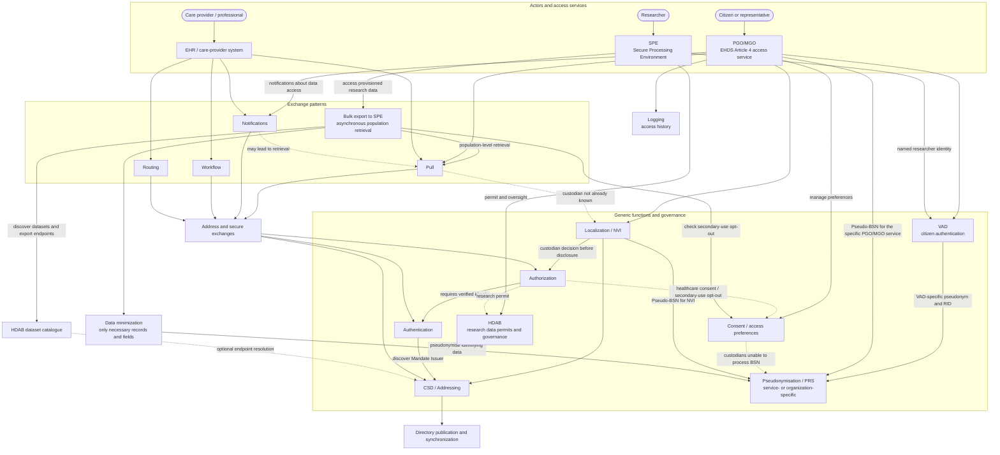
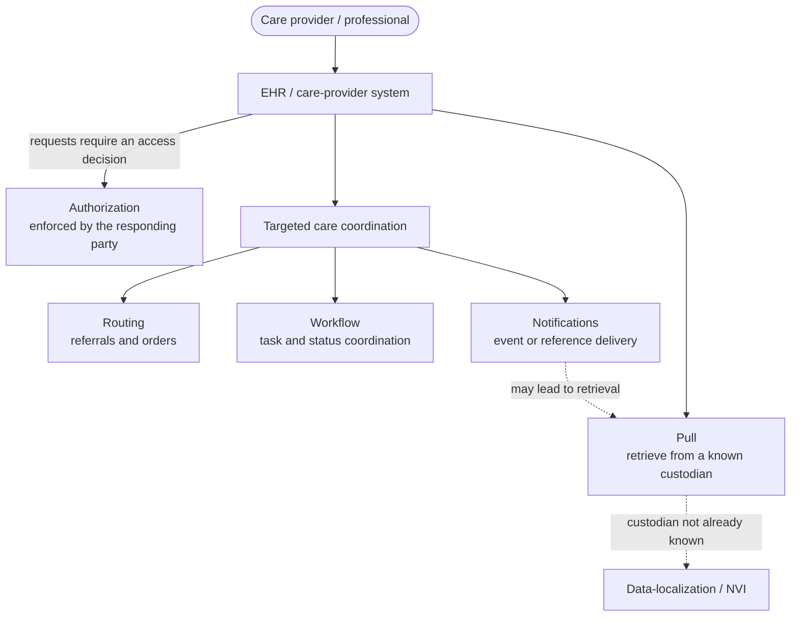
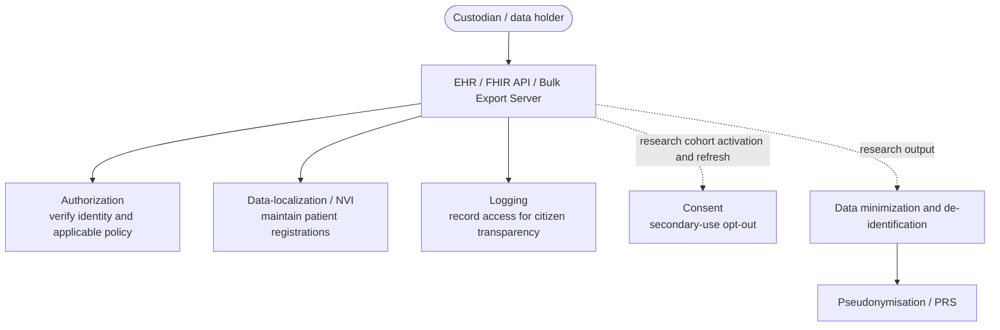
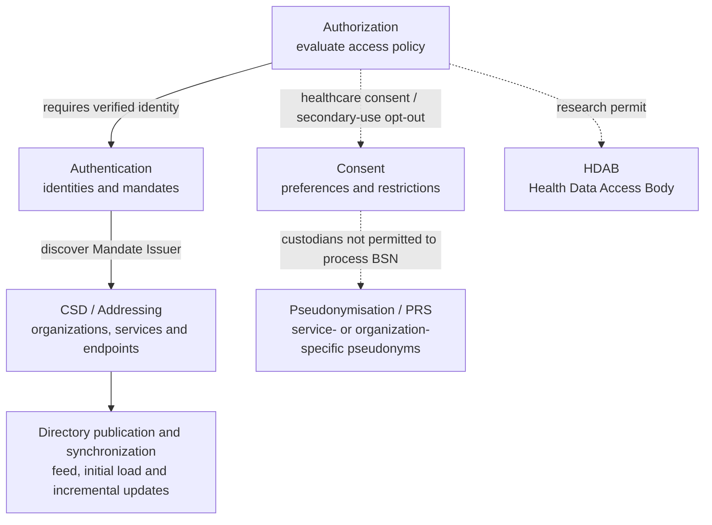
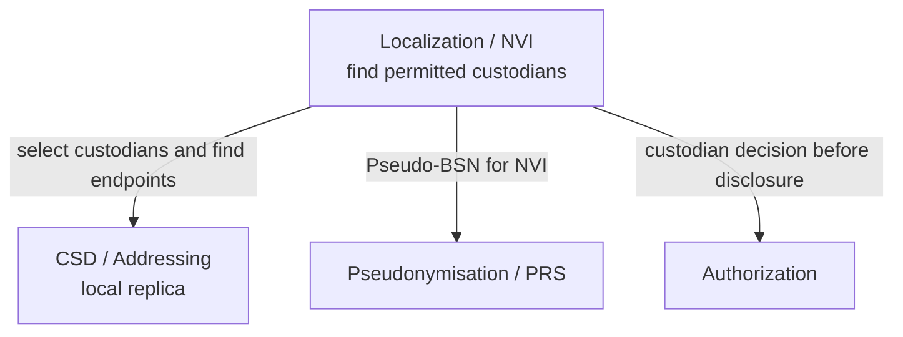
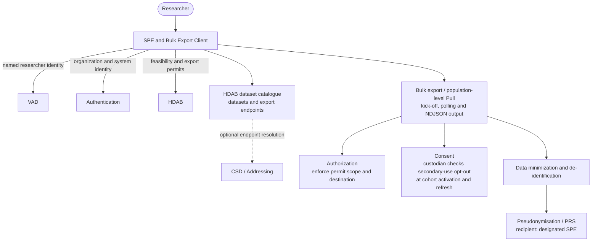
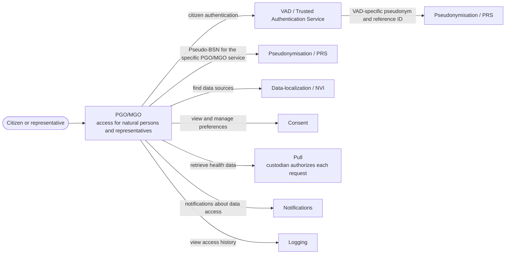

This FHIR Implementation Guide specifies the technical components of the generic functions (in Dutch: "generieke functies") for data availability in the Dutch healthcare system. The generic functions are specified in a national programme led by the Dutch Ministry of Health, Welfare and Sport (VWS). This guide currently covers the generic functions Care Service Directory, Localization, Pseudonymisation and Authentication, with different levels of maturity.
{: .ig-lead}

### Generic functions and exchange patterns

**DRAFT — work in progress.** The goal of this overview is to illustrate the bigger picture of the Generic Functions in the Dutch *Gezondheidsinformatiestelsel* (GIS): the roles of actors, generic functions and exchange patterns, and how they depend on each other. Some elements and dependencies are still being developed, discussed or validated. The diagrams are illustrative, not a complete or agreed architecture, an implementation specification or evidence that the depicted capabilities are already available. Refer to the individual specifications and their maturity statements for implementable requirements.

The combined overview shows actors, access services, exchange patterns and their dependencies. Smaller diagrams below explain each actor's perspective and shared functions. **Arrows point from a consumer to the function, service or pattern it uses**, not in the direction in which health data travels. Dashed arrows indicate a conditional dependency or an optional follow-up, as labelled. A function can appear in more than one diagram or box; these are repeated views of the same function, not additional services. This is an architectural overview, not an additional set of conformance requirements.

The [dependency table](#dependencies-and-boundaries) describes each function. Pseudonyms are always scoped to one specific service or organization: Pseudo-BSN (NVI) and Pseudo-BSN (MGO), for example, are distinct identifiers for the same person and are not interchangeable.

#### Combined overview

Care providers act through their EHRs or other systems; citizens and representatives use PGO/MGO; researchers work with data made available in a Secure Processing Environment (SPE), under HDAB governance. Custodians provide data and enforce access decisions. Consent preferences and HDAB permits are different policy inputs, not interchangeable permissions: neither replaces authentication or the applicable access checks. Bulk export is population-level retrieval using an asynchronous FHIR Bulk Data operation, polling and NDJSON output, rather than a series of ordinary per-patient requests. Data holders apply secondary-use opt-outs when activating or refreshing the cohort and minimize and de-identify the output before it becomes readable in the designated SPE. Data minimization includes selecting only necessary records and fields; pseudonymisation alone is not sufficient. This is not unrestricted download by a researcher.

#### Care-provider and professional access

Care providers and professionals use their EHR or other care-provider system. Routing, Workflow, Notifications and Pull use CSD for addressing, Authentication for verified identities, and Authorization for access decisions. Pull is an independent retrieval pattern, not a child of targeted care coordination. A notification may lead to a Pull request. Data-localization is only needed when the custodian is not already known.

#### Custodian and data-holder responsibilities

A care provider can be both a data user and a custodian. Its EHR or export server enforces access decisions, maintains localization registrations and records access for transparency to citizens.

#### Access control and supporting functions

Authorization uses verified identity information and the applicable policy inputs: consent and access restrictions for healthcare, and HDAB-issued data permits together with secondary-use opt-out checks for research bulk exports. The Consent function provides those opt-out preferences; a permit is not patient consent. Bulk retrieval also applies data minimization, including pseudonymisation, before data is made available in the SPE. Addressing provides endpoints, not permission to access data. Directory synchronization is a supporting pattern, not a clinical data exchange.

#### Data-localization

Localization depends on addressing, pseudonymisation and a custodian's access decision. It also requires authenticated requests. An allow decision at discovery does not replace authorization of the subsequent data retrieval.

#### Researcher access and bulk export

The working Bulk Export design on the `bulk-export` branch uses an HDAB catalogue to discover datasets and Bulk Export Server endpoints; CSD can optionally resolve addressing information. A feasibility permit allows cohort counts, while an export permit additionally authorizes delivery into a designated SPE. The Bulk Export Client authenticates the named researcher through VAD and the organization/system through the applicable authentication protocol.

The data holder excludes opted-out subjects before returning counts or exporting the activated cohort; the opt-out is not a researcher-side filter. Permit constraints bound cohort criteria, resource types, filters, elements and destination. De-identification also addresses indirect identifiers, for example through date shifting and disclosure thresholds. SPE output checking governs which research results may leave the environment.

#### Citizen and representative access

PGO/MGO combines generic functions to support the EHDS Article 4 access service. The depicted role also includes access history and notifications about access to health data, as required by EHDS Article 9. These logging notifications are distinct from clinical workflow notifications; showing the Notifications dependency does not prescribe the same delivery protocol. Each pseudonym is scoped to one specific service or organization: a PGO-specific pseudonym, Pseudo-BSN (MGO), Pseudo-BSN (NVI) and the VAD-specific pseudonym are not interchangeable. The two PRS boxes below show uses of the same function for different recipients.

#### Dependencies and boundaries

| Function | Role and dependencies |
|---|---|
| [Care Service Directory](csd.html) | Finds organizations, services and endpoints. Operational queries use local LRZa replicas; the central LRZa directory is used for publication and synchronization, not runtime matching. It contains no patient consent records and does not grant access to health data. |
| [Localization](localization.html) | Uses PRS-derived patient pseudonyms and a CSD replica. Before disclosing a custodian, the NVI requests an Authorization Decision from that custodian, including consent or access restrictions. This decision does not authorize the subsequent data retrieval: the custodian evaluates each data request again. Localization also requires authenticated requests. |
| Consent | Supplies consent preferences or a consent decision to authorization, and secondary-use opt-out preferences for research cohort activation and refresh. The current working model distinguishes national Mitz preferences, locally recorded consent and implicit consent made explicit by the care provider. Some custodians, particularly outside healthcare in secondary use, are not permitted to process the BSN. They must be able to use a pseudonym; if the consent register uses the BSN internally, the register arranges conversion through the PRS without disclosing the BSN to those custodians. This is an architectural requirement for the future consent register, not a capability specified by the current Mitz model. |
| [Authentication](authentication.html) | Establishes identities and mandates; uses CSD to discover the trusted service provider's Mandate Issuer and the source endpoint. Authentication alone does not establish a right to access patient data. |
| Authorization | Evaluates the request against policy using authenticated identities, consent where applicable, and other relevant attributes such as roles, purpose and care context. The responding party remains responsible for the access decision. |
| HDAB (Health Data Access Body) | Governs access to health data for secondary use and issues data permits whose conditions authorize research data provisioning, including bulk exports into an SPE. Authorization enforces the applicable permit conditions and legal restrictions. HDAB is a governance body and permission source, not a replacement for Consent or a generic transport function. Its permit and bulk-export protocols are not specified by this IG. |
| Data minimization | Restricts research provisioning to the records and fields necessary for the permitted purpose. It uses pseudonymisation to replace identifying data where appropriate, with pseudonyms scoped to the intended service or organization. Pseudonymisation does not itself reduce an unnecessarily broad dataset to the necessary scope, and is not anonymisation. |
| Logging and Notifications | Custodians record access to health data. The PGO/MGO role includes making access history available and enabling notifications about access under EHDS Article 9. Logging supplies the access events; Notifications supports informing the citizen. This overview does not specify their delivery or subscription protocol. |
| [Pseudonymisation](pseudonymisation.html) | Supports Localization, Consent and citizen access through PGO/MGO and VAD, with a separate pseudonym scope for each service or organization. Each PGO or MGO service uses its own scope; its pseudonym is not reused as the NVI identifier. This guide currently specifies the NVI-scoped pseudonym protocol; it does not yet specify every conversion needed for these other uses. The PRS does not locate custodians or grant access to their data. |
| VAD (Vertrouwde Authenticatie Dienst) | A generic authentication function depicted as a dependency of PGO/MGO for citizen login and identity information. The [MGO VAD implementation](https://github.com/minvws/nl-mgo-max-vad/blob/main/README.md) is an OpenID Connect provider and authorization server, integrating DigiD login, BRP identity enrichment and the PRS. It obtains a VAD-specific pseudonym and a reference ID (RID) that a client can exchange once for a pseudonym. The documented implementation currently uses a mock PRS integration. VAD is distinct from the care-provider/service-provider mandate protocol on the Authentication page. |
| PGO/MGO | Citizen-facing access through a Persoonlijke Gezondheidsomgeving or Mijn Gezondheidsoverzicht, depicted in the context of the EHDS Article 4 access service for natural persons and their representatives. Dependencies shown are VAD for citizen authentication, service-specific pseudonymisation, Localization and CSD for discovery, Consent for preference management, and Logging and Notifications for access transparency. The precise integration and supported capabilities depend on the implementation and remain partly work in progress. Custodians still authorize data access. Representation requires verification of the representative's authority; login alone does not establish that authority. |
{: .grid}

Authentication and authorization apply across healthcare exchanges, but **the current Authentication specification only details targeted BgZ and eOverdracht exchanges following a referral, handover or registration**. Its protocol must not be assumed to cover untargeted Pull, citizen access or secondary use without further specification. Consent, Authorization, VAD and PGO/MGO are shown here at architectural level; this overview does not specify their complete protocols. In particular, PGO/MGO use of Localization needs citizen and representative access rules beyond the healthcare-professional flow currently specified on that page. Identification underpins identities and identifiers; logging provides accountability across exchanges.

#### Exchange pattern overview

| Pattern | How it uses the generic functions |
|---|---|
| Citizen and representative access through PGO/MGO | The depicted PGO/MGO role uses VAD for authentication and service-specific pseudonymisation, discovers sources through Localization/CSD, retrieves data subject to custodian authorization, enables consent preference management, and provides access history and notifications. Representative access additionally requires the appropriate authority. This is an access-service composition, not a separate transport protocol or a use of the targeted BgZ/eOverdracht authentication protocol. |
| Routing of referrals and orders | CSD finds the destination healthcare service and its endpoint. Authentication and authorization establish who is acting and whether the operation is allowed, taking applicable consent into account. See [TA Routering](https://nuts-foundation.github.io/nl-generic-functions-ig/routing.html). |
| Notifications | CSD locates the recipient's notification endpoint. Delivery of an event or reference is distinct from access to the referenced data, which requires its own access decision. See [TA Notifications](https://ontwikkelsupplement.twiin.nl/actueel/10-3-1-1-ta-notifications-v0-10). |
| Workflow | Coordinates the progress of referrals, orders and handovers. CSD identifies the participating services and endpoints; authentication and authorization protect the task and status operations. See [TA Workflow](https://ontwikkelsupplement.twiin.nl/actueel/10-3-1-2-ta-workflow-v0-3). |
| Pull from a known custodian | CSD resolves the data endpoint; the custodian authenticates and authorizes retrieval, using applicable consent and other policy inputs. No NVI search is needed when the custodian is already known. See [TA Pull](https://ontwikkelsupplement.twiin.nl/actueel/10-3-3-tta-fhir-pull) (concept). |
| Pull after data-localization | Localization first finds permitted custodians using PRS pseudonyms, CSD and custodian Authorization Decisions. Actual data retrieval then follows the known-custodian Pull pattern, with a new access decision. See [Localization](localization.html#solution-overview). |
| Research bulk export to an SPE | Uses asynchronous FHIR Bulk Data access for population-level retrieval: kick-off, status polling and NDJSON output into the permitted SPE. The working design depends on the HDAB catalogue and permits, organization/system authentication, named-researcher authentication through VAD, custodian-side secondary-use opt-out checks at cohort activation and refresh, and data minimization/de-identification using SPE-scoped pseudonyms. This does not imply unrestricted export from the SPE to the researcher. This design is on the `bulk-export` branch and is not yet a published specification in this guide. |
| Directory publication and synchronization | A supporting pattern rather than clinical data exchange: authorized sources publish directory records; update clients load and periodically pull changes into local replicas. Runtime discovery uses those replicas. See [CSD](csd.html#solution-overview). |
{: .grid}

The routing, notification, workflow and Pull agreements are referenced in the [CSD handbook](csd-handbook.html#digitaal-verwijzen-overdragen-notificeren-en-dossiers-opvragen); they are not fully specified by this IG. These patterns can be composed and are not mutually exclusive. In particular, targeted *sending* describes the care process, not necessarily a standalone Push transport: in the [nursing handover example](authentication.html#use-case-retrieving-a-nursing-handover), a notification leads to retrieval of the referenced task and data. Pull can also be initiated independently of a notification.

### Maturity

Not all pages, or generic functions, in this guide are equally mature. Each generic function is specified in Functional and Technical requirements and design documents, and the pages in this guide are based on a specific version of those documents. The maturity of a page depends on the version it is based on. The main page of each generic function states this version in a note at the top.

| Generic function | Pages | Status | Based on design documents version | Design documents |
|---|---|---|---|---|
| Care Service Directory (Adressering) | [Care Service Directory](csd.html), [Handboek Adressering voor zorgaanbieders](csd-handbook.html), [LRZa-managed elements](lrza-managed-elements.html), [Resource signing](signing.html) | Trial use | 1.0.0 | [www.generiekefuncties.nl/adressering](https://www.generiekefuncties.nl/adressering) |
| Localization (Lokalisatie) | [Localization](localization.html) | Draft | 0.9.0 | [www.generiekefuncties.nl/lokalisatie](https://www.generiekefuncties.nl/lokalisatie) |
| Pseudonymisation | [Pseudonymisation](pseudonymisation.html) | Draft | 0.9.0 (Localization) | [www.generiekefuncties.nl/lokalisatie](https://www.generiekefuncties.nl/lokalisatie) |
| Authentication | [Authentication](authentication.html) | Draft | Harmonisation memo 0.95; follow-up memo 0.5.0 | [Harmonisation of BgZ and eOverdracht (18 August 2026)](authenticatie-en-autorisatie-eOverdracht-BgZ-vMT-DICIO-20260818.html), [Client registration and mandates (draft, 16 November 2026)](authenticatie-en-autorisatie-vervolg-mandaat-clientregistratie.html) |
{: .grid}

Pages marked as draft are based on a version of the design documents that has not yet reached 1.0.0, and may change significantly as those documents evolve. When a new version of the design documents is published, the corresponding pages are updated; see the [Release Notes](release-notes.html) for the changes per version.

<!-- #### Consent
Establishes a standardized system for managing patient consent as a legal basis for processing medical data. Supports both explicit consent (stored nationally or locally) and implicit consent, with granular control allowing patients to grant permissions to individual organizations or categories of organizations based on type, ensuring consistent and secure consent management across the healthcare ecosystem. See [Consent](consent.html).

#### Identification
Defines a standardized approach for uniquely identifying healthcare organizations, IT vendors, healthcare professionals, patients, and data objects. Ensures each identifier originates from a single authentic source and conforms to national healthcare information models and FHIR profiles, enabling reliable tracking of provenance, authenticity, and data integrity across the healthcare system. See [Identification](identification.html).

#### Authentication
Verifies the identity of entities such as healthcare professionals and organizations within healthcare systems. See [Authentication](authentication.html).

#### Authorization
Defines access control mechanisms that determine which healthcare professionals and organizations can access specific patient data and resources. Builds upon authenticated identities to enforce fine-grained permissions based on care relationships, roles, and patient consent, ensuring secure and compliant data sharing across organizational boundaries. See [Authorization](authorization.html).

This guide outlines the technical requirements and architectural principles underlying these generic functions. One of the key design principles is to reuse existing specifications as much as possible (e.g. Dutch Health Care Information Models or ZIB's) AND to adhere to international standards (e.g. HL7 FHIR and IHE profiles) to lower the bar for international (European) data exchange and adoption by internationally operating software vendors. -->

### Artifacts
The [Artifacts](artifacts.html) page includes a complete index of the profiles, capability statements, value sets, code systems, examples, and other generated IG resources.

### History
See the [Release Notes](release-notes.html) for the changes per version, and [History](https://fhir.generiekefuncties.nl/history.html) for the publication history of this guide.

### Conformance Expectations

The NL Generic Functions IG uses the normative keywords **SHALL**, **SHALL NOT**, **SHOULD**, **SHOULD NOT** and **MAY** as defined in [RFC 2119](https://www.rfc-editor.org/rfc/rfc2119) and the [IHE conformance conventions](https://profiles.ihe.net/GeneralIntro/ch-E.html). In short: **SHALL** is an absolute requirement, **SHALL NOT** an absolute prohibition, **SHOULD**/**SHOULD NOT** a recommendation that may be deviated from with the implications understood and weighed, and **MAY** is truly optional. Consistent with IHE, this guide uses **SHALL** rather than "MUST". Keywords carry this meaning only when written in upper case; the same words in lower case are descriptive, not normative.

### Dependencies

This guide is based on the [HL7 FHIR R4](https://hl7.org/fhir/R4/index.html) specification.  In addition, this guide also relies on a number of parent implementation guides:

 

### Download 

You can also download:

* [this entire guide](../full-ig.zip)
* the definition resources in [json](../definitions.json.zip) or [xml](../definitions.xml.zip) format,
* the example resources in [json](../examples.json.zip) or [xml](../examples.xml.zip) format.

### Package File

The following package file includes an NPM package file used by many of the FHIR tools.  It contains all the value sets, profiles, extensions, list of pages and urls in the IG, etc defined as part of this version of the Implementation Guide. This file should be the first choice whenever generating any implementation artefacts since it contains all of the rules about what makes the profiles valid. Implementers will still need to be familiar with the content of the specification and profiles that apply in order to make a conformant implementation:

- [R4 Package](../package.tgz){::download="true"}
- [R4B Package](../package.r4b.tgz){::download="true"}

See the overview on [validating FHIR profiles and resources](http://hl7.org/fhir/R4/validation.html) for more information about validating profiles and how to use these artefacts.
